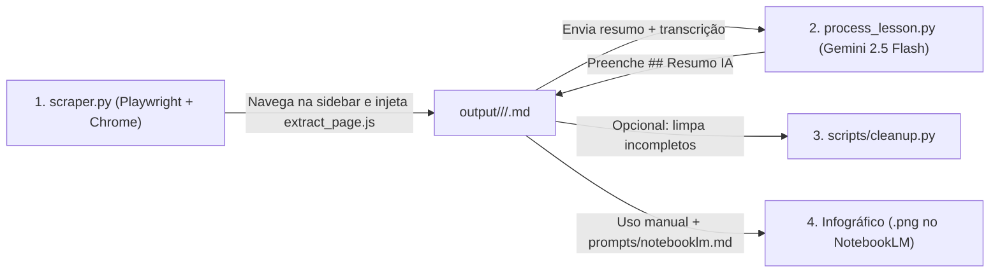

# Análise do Projeto `fullcycle-scraper` & Guia de Estudo Aula a Aula (MBA Engenharia de Software com IA)

---

## 1. Análise Passo a Passo do Projeto `fullcycle-scraper`

O repositório automatiza a extração e o resumo estruturado de aulas da plataforma FullCycle em um pipeline de 4 etapas:

### Como cada componente funciona
1. **Configuração (`.env`)**: Define `FULLCYCLE_EMAIL`, `FULLCYCLE_PASSWORD`, `FULLCYCLE_URL`, `GEMINI_API_KEY` e `GEMINI_MODEL` (`gemini-2.5-flash`).
2. **Extração (`scraper.py` + `scripts/extract_page.js`)**:
   - Abre o Google Chrome com perfil persistente (`~/.fullcycle-scraper-profile`) via Playwright e faz login automático quando necessário.
   - Expande todos os capítulos da sidebar (`[id^="chapter-"]`), coleta apenas aulas de vídeo (`li[id^="list-content-"]`, ignorando links externos `<a>`) e pula arquivos já salvos com transcrição completa.
   - Para cada aula, clica no item da sidebar, abre a transcrição, injeta `scripts/extract_page.js` e grava o `.md` com `Módulo`, `Aula` (com link), `## Resumo da aula`, `## Transcrição` e placeholder `[RESUMO_IA]`.
3. **Processamento com IA (`process_lesson.py`)**:
   - Lê um `.md`, uma pasta de capítulo ou um módulo inteiro, envia resumo + transcrição para o Gemini (`google-genai`) com controle de rate limit (4.5s + retry em `429`) e substitui `[RESUMO_IA]` por **Abreviações**, **Resumo** e **Pontos de atenção**.
4. **Limpeza (`scripts/cleanup.py`) e Infográficos (`prompts/notebooklm.md`)**:
   - `cleanup.py` remove arquivos defeituosos (resumo vazio ou `[TRANSCRIÇÃO]`); `prompts/notebooklm.md` serve para gerar infográficos `.png` manualmente no NotebookLM.

### Problemas encontrados durante a análise (e já corrigidos no código)
- **Bug 1 — Botão de transcrição não era clicado (`scraper.py`)**: O seletor exigia `button[role="tab"]:has-text("Mostrar Transcrição")`, mas na plataforma atual o botão não possui `role="tab"`. Isso fez todas as 94 aulas do módulo *Desenvolvimento de Software e Aplicações com IA* ficarem com `[TRANSCRIÇÃO]`.
- **Bug 2 — Classe CSS dos timestamps mudou (`scraper.py` e `extract_page.js`)**: O seletor dependia de `span.css-srttgs` (hash gerado pelo MUI/Emotion que mudou para `css-19wp34m`). Substituído por detecção estrutural independente de classe CSS (`span` com regex `MM:SS` / `HH:MM:SS`).
- **Bug 3 — Vazamento de transcrição entre aulas na SPA**: Quando o painel de transcrição permanecia aberto ao trocar de aula, havia risco de capturar o texto da aula anterior (observado em arquivos antigos dos caps. 04 e 05 de *Prompt Engineering*). Adicionada espera explícita pela troca do conteúdo da transcrição e uso de `li[aria-selected="true"]` para o título exato da aula.
- **Bug 4 — `process_lesson.py` pulava aulas sem resumo da plataforma**: Módulos como *IA Labs* possuem transcrição completa, mas não possuem bloco "Resumo da Aula". Corrigido para processar sempre que houver resumo **ou** transcrição.
- **Melhoria — Suporte a múltiplas URLs via CLI e preservação de `Resumo IA`**: `scraper.py` agora aceita múltiplas URLs de módulos por linha de comando em uma única sessão de navegador e preserva `## Resumo IA` caso um arquivo seja re-extraído.

---

## 2. Mapa Completo do Curso & Downloads Realizados

A página do curso (**MBA em Engenharia de Software com IA**) possui **14 módulos**:
- **5 disciplinas técnicas já estavam em `output/`:** Módulos 5, 6, 7, 8 e 10 (417 aulas).
- **5 disciplinas técnicas faltantes baixadas agora (0 erros):** Módulos **9** (162), **11** (18), **12** (65), **13** (53) e **14** (52) — **+350 aulas novas**, totalizando **767 aulas técnicas** em `output/`.
- **4 módulos complementares/administrativos (1–4) não baixados** (seguindo o padrão original de `output/`): *1 - Comece por aqui* (8), *2 - Bônus MBA* (69), *3 - Encontros Ao Vivo* (35) e *4 - Desafios Técnicos* (8). Caso queira baixá-los, basta rodar `python scraper.py` passando as URLs deles.

---

## 3. Painel Executivo — Onde Assistir vs. Onde Só o Resumo Basta

### Critérios de classificação
- **🔴 Assistir:** Live coding, hands-on, demos de ferramentas/IDE/CLI/dashboards, walkthrough de código/prompts/arquivos, construção de projetos ou diagramas complexos onde ver a tela faz diferença real.
- **🟡 Opcional (1.5x–2x):** Conceitos densos, trade-offs de arquitetura ou exemplos aplicados onde o resumo cobre ~80%; vale assistir acelerado apenas se o tema for novo ou prioritário para você.
- **🟢 Só o resumo basta:** Introduções, alinhamento de expectativas, encerramentos/revisões ou teoria bem fechada em texto sem dependência visual.

### Resumo consolidado por módulo (10 disciplinas técnicas — 767 aulas)

| # | Módulo | Status | Aulas | 🔴 Assistir | 🟡 Opcional | 🟢 Só Resumo | Duração medida* | Tempo só 🔴 |
| :---: | --- | --- | :---: | :---: | :---: | :---: | :---: | :---: |
| 5 | **Fundamentos de IA Generativa** | Já baixado anteriormente | 53 | 7 (13%) | 16 (30%) | 30 (57%) | 12h 06m | 1h 59m |
| 6 | **Prompt Engineering** | Já baixado anteriormente | 103 | 51 (50%) | 19 (18%) | 33 (32%) | 13h 01m | 8h 08m |
| 7 | **Design Docs com IA** | Já baixado anteriormente | 62 | 24 (39%) | 8 (13%) | 30 (48%) | 6h 50m | 3h 36m |
| 8 | **Desenvolvimento em modo agente** | Já baixado anteriormente | 105 | 62 (59%) | 18 (17%) | 25 (24%) | 10h 06m | 7h 09m |
| 9 | **Arquitetura na Era da IA** | Baixado agora (162 aulas) | 162 | 85 (52%) | 50 (31%) | 27 (17%) | 18h 39m | 11h 20m |
| 10 | **Desenvolvimento de Software e Aplicações com IA** | Já baixado anteriormente | 94 | 44 (47%) | 27 (29%) | 23 (24%) | N/A | N/A |
| 11 | **IA Labs** | Baixado agora (18 aulas) | 18 | 15 (83%) | 2 (11%) | 1 (6%) | 4h 44m | 4h 12m |
| 12 | **Desenvolvimento de Agentes com IA** | Baixado agora (65 aulas) | 65 | 42 (65%) | 14 (22%) | 9 (14%) | 11h 47m | 9h 21m |
| 13 | **Protocolos de Comunicação** | Baixado agora (53 aulas) | 53 | 25 (47%) | 17 (32%) | 11 (21%) | 11h 55m | 5h 21m |
| 14 | **DevOps e SRE com IA** | Baixado agora (52 aulas) | 52 | 41 (79%) | 5 (10%) | 6 (12%) | 9h 05m | 7h 34m |
| — | **TOTAL GERAL** | **10 módulos técnicos** | **767** | **396 (52%)** | **176 (23%)** | **195 (25%)** | **98h 17m** | **58h 43m** |

> [!TIP]
> **Economia estimada de tempo:** Das **767 aulas**, **195 (25%)** podem ser consumidas **somente pelo resumo** e outras **176 (23%)** são **opcionais em 1.5x–2x**. Focando o vídeo apenas nas **396 aulas 🔴 (52%)**, você elimina até **48%** do volume de vídeo sem perder a parte prática (nas aulas com duração medida pela transcrição, cai de **98h 17m** para **58h 43m**).
>
> *Nota sobre duração medida:* A duração é extraída do último timestamp da transcrição. No módulo **10 (Desenvolvimento de Software e Aplicações com IA)** os arquivos existentes ainda estavam sem transcrição (apenas resumo da plataforma), por isso a duração aparece como `N/A`.

---

## 4. Análise Detalhada Aula por Aula (Todos os 10 Módulos)

<!-- MODULE 5 -->
## Módulo: Fundamentos de IA Generativa

- **Total de aulas:** 53
- **🔴 Assistir:** 7 (13%) | **🟡 Opcional (1.5x–2x):** 16 (30%) | **🟢 Só o resumo basta:** 30 (57%)
- **Estratégia recomendada:** Concentre o vídeo nos hands-on de MCP/PRPs no Cursor e Claude Code (cap. 04, aulas 05–06) e nos laboratórios práticos de Tokenizer, Hugging Face Playground e Space com Gradio/embeddings (cap. 03 aula 22 e cap. 05). Leia apenas o resumo em toda a introdução, história da IA, teoria básica de prompting/RAG e na revisão final (além das aulas 10 e 11 do cap. 03, que estão com conteúdo duplicado da aula 09).

### 01 - Introdução

| Aula | Duração | Veredito | Motivo |
| --- | :---: | :---: | --- |
| [01 - Introdução](https://plataforma.fullcycle.com.br/courses/a091b0fe-a5c6-4287-a3d3-1ec61defcfd3/430/224/263/conteudos?capitulo=263&conteudo=16364) | 05:07 | 🟢 Só o resumo basta | Apresenta proposta do módulo e alinhamento de expectativas sem código ou demos. |
| [02 - Nosso momento](https://plataforma.fullcycle.com.br/courses/a091b0fe-a5c6-4287-a3d3-1ec61defcfd3/430/224/263/conteudos?capitulo=263&conteudo=16365) | 18:24 | 🟢 Só o resumo basta | Reflexão motivacional e estratégica sobre mercado de IA e papel do dev; 100% conceitual. |

### 02 - Gen IA

| Aula | Duração | Veredito | Motivo |
| --- | :---: | :---: | --- |
| [01 - O que é Gen AI](https://plataforma.fullcycle.com.br/courses/a091b0fe-a5c6-4287-a3d3-1ec61defcfd3/430/224/263/conteudos?capitulo=263&conteudo=16366) | 18:45 | 🟢 Só o resumo basta | Panorama conceitual de IA, ML, Deep Learning e GenAI bem fechado em texto. |
| [02 - Introdução as diferenças de IA](https://plataforma.fullcycle.com.br/courses/a091b0fe-a5c6-4287-a3d3-1ec61defcfd3/430/224/263/conteudos?capitulo=263&conteudo=16367) | 13:23 | 🟢 Só o resumo basta | Compara IA tradicional supervisionada vs. IA generativa sem dependência visual. |
| [03 - Como a Gen AI aprende](https://plataforma.fullcycle.com.br/courses/a091b0fe-a5c6-4287-a3d3-1ec61defcfd3/430/224/263/conteudos?capitulo=263&conteudo=16368) | 12:27 | 🟡 Opcional (1.5x–2x) | Intuição de distribuições probabilísticas, self-attention e geração token a token para quem não domina. |
| [04 - História da IA, o início](https://plataforma.fullcycle.com.br/courses/a091b0fe-a5c6-4287-a3d3-1ec61defcfd3/430/224/263/conteudos?capitulo=263&conteudo=16369) | 10:13 | 🟢 Só o resumo basta | Contexto histórico da IA desde a Antiguidade até regras condicionais; puramente textual. |
| [05 - O inverno da IA](https://plataforma.fullcycle.com.br/courses/a091b0fe-a5c6-4287-a3d3-1ec61defcfd3/430/224/263/conteudos?capitulo=263&conteudo=16370) | 14:11 | 🟢 Só o resumo basta | Linha do tempo do inverno da IA até GPUs, Big Data, GANs e Transformers. |
| [06 - Evolução dos modelos 2 gramas](https://plataforma.fullcycle.com.br/courses/a091b0fe-a5c6-4287-a3d3-1ec61defcfd3/430/224/263/conteudos?capitulo=263&conteudo=16371) | 15:37 | 🟡 Opcional (1.5x–2x) | Progressão didática de bigramas/n-gramas até LLMs ajuda se você nunca estudou NLP clássico. |

### 03 - Aprofundando na IA e LLM

| Aula | Duração | Veredito | Motivo |
| --- | :---: | :---: | --- |
| [01 - Cadeias de Markov](https://plataforma.fullcycle.com.br/courses/a091b0fe-a5c6-4287-a3d3-1ec61defcfd3/430/224/263/conteudos?capitulo=263&conteudo=16372) | 17:48 | 🟡 Opcional (1.5x–2x) | Explica HMMs, estados ocultos e POS tagging; útil em 1.5x se o conceito for novo. |
| [02 - Redes neurais profundas](https://plataforma.fullcycle.com.br/courses/a091b0fe-a5c6-4287-a3d3-1ec61defcfd3/430/224/263/conteudos?capitulo=263&conteudo=16373) | 15:12 | 🟢 Só o resumo basta | Visão conceitual sobre redes neurais profundas e papel das GPUs, completa no resumo. |
| [03 - RNNs](https://plataforma.fullcycle.com.br/courses/a091b0fe-a5c6-4287-a3d3-1ec61defcfd3/430/224/263/conteudos?capitulo=263&conteudo=16374) | 16:08 | 🟡 Opcional (1.5x–2x) | Explica RNNs, LSTM, GRU e gargalos sequenciais que motivaram os Transformers. |
| [04 - Transformers](https://plataforma.fullcycle.com.br/courses/a091b0fe-a5c6-4287-a3d3-1ec61defcfd3/430/224/263/conteudos?capitulo=263&conteudo=16375) | 15:58 | 🟡 Opcional (1.5x–2x) | Arquitetura Transformer e comparação com RNNs, BERT, GPT e Llama; boa revisão conceitual. |
| [05 - Tokens](https://plataforma.fullcycle.com.br/courses/a091b0fe-a5c6-4287-a3d3-1ec61defcfd3/430/224/263/conteudos?capitulo=263&conteudo=16376) | 11:03 | 🟢 Só o resumo basta | Conceito de tokens e BPE como unidade de processamento/custo, totalmente coberto em texto. |
| [06 - LLMs](https://plataforma.fullcycle.com.br/courses/a091b0fe-a5c6-4287-a3d3-1ec61defcfd3/430/224/263/conteudos?capitulo=263&conteudo=16377) | 15:36 | 🟢 Só o resumo basta | Visão geral de LLMs (GPT, BERT, LLaMA, RLHF) em alto nível, sem dependência visual. |
| [07 - GANs](https://plataforma.fullcycle.com.br/courses/a091b0fe-a5c6-4287-a3d3-1ec61defcfd3/430/224/263/conteudos?capitulo=263&conteudo=16378) | 06:15 | 🟢 Só o resumo basta | Introdução curta e puramente teórica a GANs e VAEs para geração de imagens. |
| [08 - Aprofundando em LLM](https://plataforma.fullcycle.com.br/courses/a091b0fe-a5c6-4287-a3d3-1ec61defcfd3/430/224/263/conteudos?capitulo=263&conteudo=16379) | 06:58 | 🟡 Opcional (1.5x–2x) | Mostra fórmula de single-head attention (Q, K, V) na tela e explica multi-head attention. |
| [09 - Position Wise Layers](https://plataforma.fullcycle.com.br/courses/a091b0fe-a5c6-4287-a3d3-1ec61defcfd3/430/224/263/conteudos?capitulo=263&conteudo=16380) | 10:31 | 🟡 Opcional (1.5x–2x) | Explica fórmulas de Position-wise Feedforward (`W1/W2`, ReLU) exibidas na tela com analogias. |
| [10 - Positional encoding](https://plataforma.fullcycle.com.br/courses/a091b0fe-a5c6-4287-a3d3-1ec61defcfd3/430/224/263/conteudos?capitulo=263&conteudo=16380) | 10:31 | 🟢 Só o resumo basta | Conteúdo e link duplicados da aula 09 (Position-wise Feedforward); nada novo no vídeo. |
| [11 - LayerNorm](https://plataforma.fullcycle.com.br/courses/a091b0fe-a5c6-4287-a3d3-1ec61defcfd3/430/224/263/conteudos?capitulo=263&conteudo=16380) | 10:31 | 🟢 Só o resumo basta | Conteúdo e link duplicados da aula 09 (Position-wise Feedforward); nada novo no vídeo. |
| [12 - Pré treinamento](https://plataforma.fullcycle.com.br/courses/a091b0fe-a5c6-4287-a3d3-1ec61defcfd3/430/224/263/conteudos?capitulo=263&conteudo=16383) | 14:19 | 🟡 Opcional (1.5x–2x) | Detalha Causal Language Modeling (CLM), cross-entropy loss e custos de pré-treinamento. |
| [13 - MLM](https://plataforma.fullcycle.com.br/courses/a091b0fe-a5c6-4287-a3d3-1ec61defcfd3/430/224/263/conteudos?capitulo=263&conteudo=16384) | 05:09 | 🟢 Só o resumo basta | Definição curta e autocontida de Masked Language Modeling (BERT) vs. CLM. |
| [14 - Fine Tuning supervisionado](https://plataforma.fullcycle.com.br/courses/a091b0fe-a5c6-4287-a3d3-1ec61defcfd3/430/224/263/conteudos?capitulo=263&conteudo=16385) | 14:56 | 🟡 Opcional (1.5x–2x) | Trade-offs de SFT, datasets rotulados, PEFT e LoRA bem explicados para quem não domina. |
| [15 - RLHF](https://plataforma.fullcycle.com.br/courses/a091b0fe-a5c6-4287-a3d3-1ec61defcfd3/430/224/263/conteudos?capitulo=263&conteudo=16386) | 15:45 | 🟡 Opcional (1.5x–2x) | Fluxo de alinhamento com SFT, modelo de recompensa e PPO; resumo cobre ~80%. |
| [16 - Otimização para grandes modelos](https://plataforma.fullcycle.com.br/courses/a091b0fe-a5c6-4287-a3d3-1ec61defcfd3/430/224/263/conteudos?capitulo=263&conteudo=16387) | 12:29 | 🟡 Opcional (1.5x–2x) | Compara LoRA, MoE, P-Tuning e quantização (FP32/FP16/INT8/INT4) com trade-offs de escala. |
| [17 - Alucinação](https://plataforma.fullcycle.com.br/courses/a091b0fe-a5c6-4287-a3d3-1ec61defcfd3/430/224/263/conteudos?capitulo=263&conteudo=16388) | 17:43 | 🟢 Só o resumo basta | Causas conceituais de alucinação e factualidade em LLMs, totalmente assimilável pelo resumo. |
| [18 - Estratégias alucinação](https://plataforma.fullcycle.com.br/courses/a091b0fe-a5c6-4287-a3d3-1ec61defcfd3/430/224/263/conteudos?capitulo=263&conteudo=16389) | 14:17 | 🟢 Só o resumo basta | Lista técnicas conceituais de mitigação de alucinação; texto estruturado já entrega tudo. |
| [19 - Context window](https://plataforma.fullcycle.com.br/courses/a091b0fe-a5c6-4287-a3d3-1ec61defcfd3/430/224/263/conteudos?capitulo=263&conteudo=16390) | 08:51 | 🟢 Só o resumo basta | Conceito de janela de contexto autoregressiva e seus limites, claro e completo em texto. |
| [20 - Raciocínio simbólico](https://plataforma.fullcycle.com.br/courses/a091b0fe-a5c6-4287-a3d3-1ec61defcfd3/430/224/263/conteudos?capitulo=263&conteudo=16391) | 15:33 | 🟡 Opcional (1.5x–2x) | Limitações de raciocínio lógico/simbólico em LLMs e papel de CoT; útil se não domina. |
| [21 - Conhecimento em tempo real](https://plataforma.fullcycle.com.br/courses/a091b0fe-a5c6-4287-a3d3-1ec61defcfd3/430/224/263/conteudos?capitulo=263&conteudo=16392) | 09:37 | 🟢 Só o resumo basta | Explica corte temporal de conhecimento em LLMs e introdução conceitual a RAG/KB. |
| [22 - Objetivos geração de respostas](https://plataforma.fullcycle.com.br/courses/a091b0fe-a5c6-4287-a3d3-1ec61defcfd3/430/224/263/conteudos?capitulo=263&conteudo=16393) | 08:50 | 🔴 Assistir | Demo prática no OpenAI Tokenizer comparando quebra de tokens entre variantes de GPT. |

### 04 - Quick Wins com IA

| Aula | Duração | Veredito | Motivo |
| --- | :---: | :---: | --- |
| [01 - Aula 01](https://plataforma.fullcycle.com.br/courses/a091b0fe-a5c6-4287-a3d3-1ec61defcfd3/430/224/263/conteudos?capitulo=263&conteudo=16767) | 17:56 | 🟢 Só o resumo basta | Boas-vindas do MBA, regras de encontros ao vivo, Zoom, avaliações e breakout rooms. |
| [02 - Aula 02](https://plataforma.fullcycle.com.br/courses/a091b0fe-a5c6-4287-a3d3-1ec61defcfd3/430/224/263/conteudos?capitulo=263&conteudo=16768) | 05:48 | 🟢 Só o resumo basta | Avisos operacionais sobre presença, gravações, prazos e acompanhamento acadêmico. |
| [03 - Aula 03](https://plataforma.fullcycle.com.br/courses/a091b0fe-a5c6-4287-a3d3-1ec61defcfd3/430/224/263/conteudos?capitulo=263&conteudo=16769) | 29:27 | 🟡 Opcional (1.5x–2x) | Excalidraw ao vivo comparando Cursor, Windsurf, Copilot, Claude Code, Gemini CLI, rules e contexto. |
| [04 - Aula 04](https://plataforma.fullcycle.com.br/courses/a091b0fe-a5c6-4287-a3d3-1ec61defcfd3/430/224/263/conteudos?capitulo=263&conteudo=16770) | 25:57 | 🟡 Opcional (1.5x–2x) | Quadro ao vivo sobre context engineering, docs de projeto, guidelines, testes e `state.local.md`. |
| [05 - Aula 05](https://plataforma.fullcycle.com.br/courses/a091b0fe-a5c6-4287-a3d3-1ec61defcfd3/430/224/263/conteudos?capitulo=263&conteudo=16771) | 18:53 | 🔴 Assistir | Hands-on no Cursor e Claude Code configurando MCP Context7, docs de libs, Firecrawl e Playwright. |
| [06 - Aula 06](https://plataforma.fullcycle.com.br/courses/a091b0fe-a5c6-4287-a3d3-1ec61defcfd3/430/224/263/conteudos?capitulo=263&conteudo=16772) | 22:44 | 🔴 Assistir | Walkthrough prático de PRPs (`prp-base`, `generate-prp`, `execute-prp`) e comandos customizados no Claude Code. |
| [07 - Aula 07](https://plataforma.fullcycle.com.br/courses/a091b0fe-a5c6-4287-a3d3-1ec61defcfd3/430/224/263/conteudos?capitulo=263&conteudo=16773) | 27:55 | 🟡 Opcional (1.5x–2x) | Q&A ao vivo com trade-offs de governança enterprise, CI/CD de prompts, MCP+Jira e commits. |

### 05 - Hands on

| Aula | Duração | Veredito | Motivo |
| --- | :---: | :---: | --- |
| [01 - Introdução a temperatura](https://plataforma.fullcycle.com.br/courses/a091b0fe-a5c6-4287-a3d3-1ec61defcfd3/430/224/263/conteudos?capitulo=263&conteudo=16394) | 12:25 | 🟡 Opcional (1.5x–2x) | Conceito de temperatura + passo a passo na tela criando conta e token no Hugging Face Playground. |
| [02 - Hands on - Temperatura](https://plataforma.fullcycle.com.br/courses/a091b0fe-a5c6-4287-a3d3-1ec61defcfd3/430/224/263/conteudos?capitulo=263&conteudo=16395) | 24:41 | 🔴 Assistir | Demo ao vivo no Playground comparando saídas do modelo em diferentes temperaturas e thinking. |
| [03 - Hands on - Janela tokens](https://plataforma.fullcycle.com.br/courses/a091b0fe-a5c6-4287-a3d3-1ec61defcfd3/430/224/263/conteudos?capitulo=263&conteudo=16396) | 18:22 | 🔴 Assistir | Tour prático no Hugging Face e experimentos ao vivo ajustando max tokens e janela de contexto. |
| [04 - Top_K & Top_P](https://plataforma.fullcycle.com.br/courses/a091b0fe-a5c6-4287-a3d3-1ec61defcfd3/430/224/263/conteudos?capitulo=263&conteudo=16397) | 09:55 | 🟢 Só o resumo basta | Explicação conceitual das estratégias de amostragem Top-K e Top-P; resumo cobre tudo. |
| [05 - Hands on - Top_P](https://plataforma.fullcycle.com.br/courses/a091b0fe-a5c6-4287-a3d3-1ec61defcfd3/430/224/263/conteudos?capitulo=263&conteudo=16398) | 05:31 | 🔴 Assistir | Demo curta no Playground testando Top-P 0.1 vs. 0.9, erro de max tokens e comparação lado a lado. |
| [06 - Encoder-only](https://plataforma.fullcycle.com.br/courses/a091b0fe-a5c6-4287-a3d3-1ec61defcfd3/430/224/263/conteudos?capitulo=263&conteudo=16399) | 14:49 | 🟢 Só o resumo basta | Teoria de arquiteturas encoder-only (BERT, MLM, NER) sem código ou demo visual. |
| [07 - Decoder-only](https://plataforma.fullcycle.com.br/courses/a091b0fe-a5c6-4287-a3d3-1ec61defcfd3/430/224/263/conteudos?capitulo=263&conteudo=16400) | 13:40 | 🟢 Só o resumo basta | Teoria de arquiteturas decoder-only autoregressivas bem sintetizada no resumo. |
| [08 - Hands on - Similaridade](https://plataforma.fullcycle.com.br/courses/a091b0fe-a5c6-4287-a3d3-1ec61defcfd3/430/224/263/conteudos?capitulo=263&conteudo=16401) | 20:00 | 🔴 Assistir | Live coding criando Space no Hugging Face com Gradio, Python, embeddings e similaridade por cosseno. |
| [09 - Explorando soluções](https://plataforma.fullcycle.com.br/courses/a091b0fe-a5c6-4287-a3d3-1ec61defcfd3/430/224/263/conteudos?capitulo=263&conteudo=16402) | 11:45 | 🟢 Só o resumo basta | Trade-offs conceituais de custo e controle entre prompt engineering, RAG e fine-tuning. |
| [10 - Engenharia de prompt](https://plataforma.fullcycle.com.br/courses/a091b0fe-a5c6-4287-a3d3-1ec61defcfd3/430/224/263/conteudos?capitulo=263&conteudo=16403) | 18:09 | 🟢 Só o resumo basta | Catálogo conceitual de zero-shot, few-shot, CoT, role-based e instruction prompting. |
| [11 - Arquitetura RAG](https://plataforma.fullcycle.com.br/courses/a091b0fe-a5c6-4287-a3d3-1ec61defcfd3/430/224/263/conteudos?capitulo=263&conteudo=16404) | 12:05 | 🟢 Só o resumo basta | Visão conceitual de arquitetura RAG com bases corporativas (S3, FAQ, APIs) sem código. |

### 06 - Revisando

| Aula | Duração | Veredito | Motivo |
| --- | :---: | :---: | --- |
| [01 - Revisão pt.1](https://plataforma.fullcycle.com.br/courses/a091b0fe-a5c6-4287-a3d3-1ec61defcfd3/430/224/263/conteudos?capitulo=263&conteudo=16405) | 08:36 | 🟢 Só o resumo basta | Revisão de fundamentos de GenAI, RNNs, LLMs, GANs e VAEs já cobertos anteriormente. |
| [02 - Revisão pt.2](https://plataforma.fullcycle.com.br/courses/a091b0fe-a5c6-4287-a3d3-1ec61defcfd3/430/224/263/conteudos?capitulo=263&conteudo=16406) | 11:20 | 🟢 Só o resumo basta | Recapitulação teórica de CLM, MLM e RLHF sem novos exemplos práticos. |
| [03 - Revisão pt.3](https://plataforma.fullcycle.com.br/courses/a091b0fe-a5c6-4287-a3d3-1ec61defcfd3/430/224/263/conteudos?capitulo=263&conteudo=16407) | 04:26 | 🟢 Só o resumo basta | Revisão rápida de MoE e LoRA para eficiência de grandes modelos. |
| [04 - Revisão pt.4](https://plataforma.fullcycle.com.br/courses/a091b0fe-a5c6-4287-a3d3-1ec61defcfd3/430/224/263/conteudos?capitulo=263&conteudo=16408) | 06:01 | 🟢 Só o resumo basta | Revisão final de RAG, Top-K/Top-P e arquiteturas Transformer. |
| [05 - Encerramento](https://plataforma.fullcycle.com.br/courses/a091b0fe-a5c6-4287-a3d3-1ec61defcfd3/430/224/263/conteudos?capitulo=263&conteudo=16409) | 03:53 | 🟢 Só o resumo basta | Mensagem de encerramento do módulo e consolidação motivacional. |

---

<!-- MODULE 6 -->
## Módulo: Prompt Engineering

- **Total de aulas:** 103
- **🔴 Assistir:** 51 (50%) | **🟡 Opcional (1.5x–2x):** 19 (18%) | **🟢 Só o resumo basta:** 33 (32%)
- **Estratégia recomendada:** Vá direto ao resumo nas aulas teóricas dos capítulos 1, 2, 3 e nas introduções/definições dos capítulos 6, 7 e 8; concentre seu tempo de vídeo nos hands-on em Python, LangChain, LangSmith (Hub + Evaluations + Pairwise) e ITER-RETGEN. Atenção especial aos capítulos 4 e 5: diversos arquivos locais foram salvos com transcrições/resumos duplicados ou deslocados de outras aulas, então assista na plataforma quando precisar do conteúdo real desses dois capítulos.

### 01 - Iniciando com Prompt Engineering

| Aula | Duração | Veredito | Motivo |
| --- | :---: | :---: | --- |
| [01 - Introdução e overview da disciplina](https://plataforma.fullcycle.com.br/courses/a091b0fe-a5c6-4287-a3d3-1ec61defcfd3/430/224/267/conteudos?capitulo=267&conteudo=16567) | 07:20 | 🟢 Só o resumo basta | Visão geral e alinhamento da disciplina tratando prompts como artefatos de engenharia, sem dependência de tela. |
| [02 - O que realmente e prompt engineering](https://plataforma.fullcycle.com.br/courses/a091b0fe-a5c6-4287-a3d3-1ec61defcfd3/430/224/267/conteudos?capitulo=267&conteudo=16568) | 04:37 | 🟢 Só o resumo basta | Definição conceitual do papel de Prompt Engineering no ciclo de desenvolvimento, completamente coberta no texto. |
| [03 - Outras aplicabilidades](https://plataforma.fullcycle.com.br/courses/a091b0fe-a5c6-4287-a3d3-1ec61defcfd3/430/224/267/conteudos?capitulo=267&conteudo=16569) | 08:28 | 🟢 Só o resumo basta | Panorama conceitual de aplicações fora de código (CRM, agentes, MCP); resumo entrega os cenários principais. |
| [04 - Tipos e tecnicas e Prompts](https://plataforma.fullcycle.com.br/courses/a091b0fe-a5c6-4287-a3d3-1ec61defcfd3/430/224/267/conteudos?capitulo=267&conteudo=16570) | 02:41 | 🟢 Só o resumo basta | Introdução curta ao princípio de concisão versus ruído no contexto; ideia direta e fechada no resumo. |
| [05 - Role Prompting](https://plataforma.fullcycle.com.br/courses/a091b0fe-a5c6-4287-a3d3-1ec61defcfd3/430/224/267/conteudos?capitulo=267&conteudo=16571) | 06:31 | 🟢 Só o resumo basta | Conceito de atribuição de papéis e enquadramento comportamental; a parte prática fica na aula seguinte. |
| [06 - Role Prompting na prática](https://plataforma.fullcycle.com.br/courses/a091b0fe-a5c6-4287-a3d3-1ec61defcfd3/430/224/267/conteudos?capitulo=267&conteudo=16572) | 08:02 | 🔴 Assistir | Demo em Python/IDE montando mensagens de system e user role diretamente na estrutura da API de chat. |
| [07 - Trabalhando com zero-shot em diversos modelos](https://plataforma.fullcycle.com.br/courses/a091b0fe-a5c6-4287-a3d3-1ec61defcfd3/430/224/267/conteudos?capitulo=267&conteudo=16573) | 10:43 | 🔴 Assistir | Roda scripts Python comparando aderência e tokens de reasoning em zero-shot entre GPT-3.5, GPT-4 e GPT-5 nano. |
| [08 - One e Few-shot e situações críticas](https://plataforma.fullcycle.com.br/courses/a091b0fe-a5c6-4287-a3d3-1ec61defcfd3/430/224/267/conteudos?capitulo=267&conteudo=16574) | 10:07 | 🔴 Assistir | Hands-on em Python e terminal testando one-shot e few-shot em arquivos e casos críticos de formatação. |
| [09 - Conceitos básicos de Chain of Thought](https://plataforma.fullcycle.com.br/courses/a091b0fe-a5c6-4287-a3d3-1ec61defcfd3/430/224/267/conteudos?capitulo=267&conteudo=16575) | 05:17 | 🟢 Só o resumo basta | Explicação teórica de CoT e quando o processo de raciocínio importa mais que só o resultado final. |
| [10 - CoT na prática e seus conflitos](https://plataforma.fullcycle.com.br/courses/a091b0fe-a5c6-4287-a3d3-1ec61defcfd3/430/224/267/conteudos?capitulo=267&conteudo=16576) | 09:22 | 🔴 Assistir | Execução em Python aplicando CoT na classificação de logs e expondo conflitos práticos e custo de tokens. |
| [11 - CoT com Self-consistency](https://plataforma.fullcycle.com.br/courses/a091b0fe-a5c6-4287-a3d3-1ec61defcfd3/430/224/267/conteudos?capitulo=267&conteudo=16577) | 08:41 | 🔴 Assistir | Demo em Python executando múltiplas cadeias CoT para diagnosticar N+1 e consolidar respostas consistentes. |
| [12 - Explorando diversos caminhos com Tree of Thought](https://plataforma.fullcycle.com.br/courses/a091b0fe-a5c6-4287-a3d3-1ec61defcfd3/430/224/267/conteudos?capitulo=267&conteudo=16578) | 10:40 | 🔴 Assistir | Walkthrough de código Python usando Tree of Thought para comparar alternativas de API, CDN e serverless. |
| [13 - Skeleton of Thought e resultados incríveis](https://plataforma.fullcycle.com.br/courses/a091b0fe-a5c6-4287-a3d3-1ec61defcfd3/430/224/267/conteudos?capitulo=267&conteudo=16579) | 13:10 | 🔴 Assistir | Demonstração prática gerando ADR e API CRUD em Go (Chi) via esqueleto estruturado antes da expansão. |
| [14 - Conceitos básicos do ReAct](https://plataforma.fullcycle.com.br/courses/a091b0fe-a5c6-4287-a3d3-1ec61defcfd3/430/224/267/conteudos?capitulo=267&conteudo=16580) | 03:22 | 🟢 Só o resumo basta | Introdução rápida ao ciclo Thought-Action-Observation do padrão ReAct; execução prática vem logo depois. |
| [15 - Identificando bugs na prática com ReAct](https://plataforma.fullcycle.com.br/courses/a091b0fe-a5c6-4287-a3d3-1ec61defcfd3/430/224/267/conteudos?capitulo=267&conteudo=16581) | 06:36 | 🔴 Assistir | Live walkthrough aplicando ciclo ReAct passo a passo para depurar bug em API REST/SQL escrita em Go. |
| [16 - Usando ReAct para análise de trade-offs](https://plataforma.fullcycle.com.br/courses/a091b0fe-a5c6-4287-a3d3-1ec61defcfd3/430/224/267/conteudos?capitulo=267&conteudo=16582) | 07:29 | 🔴 Assistir | Executa prompt ReAct no código avaliando trade-offs e múltiplas restrições de decisão passo a passo. |
| [17 - Prompt Channing na prática com LangChain](https://plataforma.fullcycle.com.br/courses/a091b0fe-a5c6-4287-a3d3-1ec61defcfd3/430/224/267/conteudos?capitulo=267&conteudo=16583) | 11:34 | 🔴 Assistir | Live coding em Python/LangChain encadeando prompts em pipeline para gerar especificação e API CRUD em Go. |
| [18 - Conclusões](https://plataforma.fullcycle.com.br/courses/a091b0fe-a5c6-4287-a3d3-1ec61defcfd3/430/224/267/conteudos?capitulo=267&conteudo=16584) | 07:01 | 🟢 Só o resumo basta | Revisão final das técnicas do capítulo (zero/few-shot, CoT, ToT, ReAct) sem demonstrações novas. |

### 02 - Conceitos importantes

| Aula | Duração | Veredito | Motivo |
| --- | :---: | :---: | --- |
| [01 - Revisitando conceitos](https://plataforma.fullcycle.com.br/courses/a091b0fe-a5c6-4287-a3d3-1ec61defcfd3/430/224/267/conteudos?capitulo=267&conteudo=16596) | 01:07 | 🟢 Só o resumo basta | Abertura de 1 minuto contextualizando por que fundamentos de LLMs importam na engenharia de prompts. |
| [02 - Context Window para Prompt Engineering](https://plataforma.fullcycle.com.br/courses/a091b0fe-a5c6-4287-a3d3-1ec61defcfd3/430/224/267/conteudos?capitulo=267&conteudo=16597) | 04:09 | 🟢 Só o resumo basta | Conceito de janela de contexto e limites de tokens em chamadas, completamente resolvido em texto. |
| [03 - Context Window vs memória, custo e latência](https://plataforma.fullcycle.com.br/courses/a091b0fe-a5c6-4287-a3d3-1ec61defcfd3/430/224/267/conteudos?capitulo=267&conteudo=16598) | 05:57 | 🟡 Opcional (1.5x–2x) | Trade-offs densos de complexidade O(n²), cache miss, custo e latência; ouvir agrega se não domina o tema. |
| [04 - Janela de contexto vs parâmetros](https://plataforma.fullcycle.com.br/courses/a091b0fe-a5c6-4287-a3d3-1ec61defcfd3/430/224/267/conteudos?capitulo=267&conteudo=16599) | 04:43 | 🟢 Só o resumo basta | Distinção conceitual objetiva entre capacidade de leitura (tokens) e pesos treinados do modelo. |
| [05 - Truncamento](https://plataforma.fullcycle.com.br/courses/a091b0fe-a5c6-4287-a3d3-1ec61defcfd3/430/224/267/conteudos?capitulo=267&conteudo=16600) | 03:42 | 🟢 Só o resumo basta | Técnica básica de corte do histórico para caber na janela, sem código ou visualizações necessárias. |
| [06 - Sumarização](https://plataforma.fullcycle.com.br/courses/a091b0fe-a5c6-4287-a3d3-1ec61defcfd3/430/224/267/conteudos?capitulo=267&conteudo=16601) | 05:20 | 🟢 Só o resumo basta | Explicação conceitual de compressão semântica de histórico em contraste direto com truncamento. |
| [07 - Sliding window](https://plataforma.fullcycle.com.br/courses/a091b0fe-a5c6-4287-a3d3-1ec61defcfd3/430/224/267/conteudos?capitulo=267&conteudo=16602) | 03:20 | 🟢 Só o resumo basta | Padrão de janela deslizante sobre mensagens recentes explicado de forma curta e autossuficiente no resumo. |
| [08 - Prompt Caching](https://plataforma.fullcycle.com.br/courses/a091b0fe-a5c6-4287-a3d3-1ec61defcfd3/430/224/267/conteudos?capitulo=267&conteudo=16603) | 07:33 | 🟡 Opcional (1.5x–2x) | Trade-offs importantes de reaproveitamento de prefixo, TTL e diferença para caches tradicionais como Redis. |
| [09 - Batch Prompting](https://plataforma.fullcycle.com.br/courses/a091b0fe-a5c6-4287-a3d3-1ec61defcfd3/430/224/267/conteudos?capitulo=267&conteudo=16604) | 05:08 | 🟢 Só o resumo basta | Conceito de agrupamento de requisições semelhantes em lote; a implementação prática está na próxima aula. |
| [10 - Demonstração prática para batch prompting](https://plataforma.fullcycle.com.br/courses/a091b0fe-a5c6-4287-a3d3-1ec61defcfd3/430/224/267/conteudos?capitulo=267&conteudo=16605) | 19:20 | 🔴 Assistir | Hands-on extenso no Cursor montando arquivos JSONL e integrando batch prompting via API/GitHub. |

### 03 - Estrutura básica de prompts

| Aula | Duração | Veredito | Motivo |
| --- | :---: | :---: | --- |
| [01 - Estruturação de Prompts](https://plataforma.fullcycle.com.br/courses/a091b0fe-a5c6-4287-a3d3-1ec61defcfd3/430/224/267/conteudos?capitulo=267&conteudo=16610) | 01:47 | 🟢 Só o resumo basta | Abertura rápida reforçando intenção, contexto e formato esperado como base de prompts estruturados. |
| [02 - Uma simples correção de Bug](https://plataforma.fullcycle.com.br/courses/a091b0fe-a5c6-4287-a3d3-1ec61defcfd3/430/224/267/conteudos?capitulo=267&conteudo=16611) | 10:34 | 🟡 Opcional (1.5x–2x) | Caso aplicado sobre desvio de escopo em PRs e barreiras de comportamento, sem live coding na IDE. |
| [03 - Minha IA produziu um lixo](https://plataforma.fullcycle.com.br/courses/a091b0fe-a5c6-4287-a3d3-1ec61defcfd3/430/224/267/conteudos?capitulo=267&conteudo=16612) | 15:28 | 🟡 Opcional (1.5x–2x) | Raciocínio aplicado de diagnosticar saídas ruins e convertê-las em guidelines e exemplos; resumo cobre ~80%. |
| [04 - Prompts no processo de desenvolvimento](https://plataforma.fullcycle.com.br/courses/a091b0fe-a5c6-4287-a3d3-1ec61defcfd3/430/224/267/conteudos?capitulo=267&conteudo=16613) | 08:02 | 🟢 Só o resumo basta | Discussão conceitual sobre priorizar qualidade versus economia de tokens em tarefas pontuais de engenharia. |
| [05 - Utilização e larga escala](https://plataforma.fullcycle.com.br/courses/a091b0fe-a5c6-4287-a3d3-1ec61defcfd3/430/224/267/conteudos?capitulo=267&conteudo=16614) | 03:51 | 🟢 Só o resumo basta | Contraste teórico entre prompts ricos para exploração e prompts enxutos para alto volume em produção. |
| [06 - Guidelines e trade-offs](https://plataforma.fullcycle.com.br/courses/a091b0fe-a5c6-4287-a3d3-1ec61defcfd3/430/224/267/conteudos?capitulo=267&conteudo=16615) | 06:40 | 🟡 Opcional (1.5x–2x) | Critérios e trade-offs de decisão entre zero-shot e few-shot conforme domínio e previsibilidade exigida. |
| [07 - System vs User Prompt](https://plataforma.fullcycle.com.br/courses/a091b0fe-a5c6-4287-a3d3-1ec61defcfd3/430/224/267/conteudos?capitulo=267&conteudo=16616) | 03:42 | 🟢 Só o resumo basta | Separação conceitual entre papéis de System/User prompt e noções introdutórias de jailbreak/injection. |
| [08 - Exemplo estruturado de prompts](https://plataforma.fullcycle.com.br/courses/a091b0fe-a5c6-4287-a3d3-1ec61defcfd3/430/224/267/conteudos?capitulo=267&conteudo=16617) | 11:26 | 🔴 Assistir | Walkthrough na tela de um prompt completo e estruturado para Node.js/Jest com contrato de saída JSON. |
| [09 - Finalizando com regras de ouro](https://plataforma.fullcycle.com.br/courses/a091b0fe-a5c6-4287-a3d3-1ec61defcfd3/430/224/267/conteudos?capitulo=267&conteudo=16618) | 01:16 | 🟢 Só o resumo basta | Encerramento breve apresentando checklist mental de revisão antes de executar qualquer prompt. |

### 04 - Prompt para execução de agentes workflows

| Aula | Duração | Veredito | Motivo |
| --- | :---: | :---: | --- |
| [01 - Analisando estruturas de prompts](https://plataforma.fullcycle.com.br/courses/a091b0fe-a5c6-4287-a3d3-1ec61defcfd3/430/224/267/conteudos?capitulo=267&conteudo=16619) | 01:39 | 🟢 Só o resumo basta | Abertura rápida introduzindo o cenário do agente auditor de dependências; prompt detalhado na próxima aula. |
| [02 - Dependency Auditor Agent Prompt](https://plataforma.fullcycle.com.br/courses/a091b0fe-a5c6-4287-a3d3-1ec61defcfd3/430/224/267/conteudos?capitulo=267&conteudo=16620) | 23:36 | 🔴 Assistir | Walkthrough extenso linha a linha de um prompt operacional completo para agente auditor de dependências/CVEs. |
| [03 - Resultado gerado pelo prompt](https://plataforma.fullcycle.com.br/courses/a091b0fe-a5c6-4287-a3d3-1ec61defcfd3/430/224/267/conteudos?capitulo=267&conteudo=16621) | 07:40 | 🔴 Assistir | Demonstra na tela o relatório gerado sobre codebase real e possibilidades de integração com CI/GitHub. |
| [04 - Arquivo declarativo do Agent e Prompt como Metadados](https://plataforma.fullcycle.com.br/courses/a091b0fe-a5c6-4287-a3d3-1ec61defcfd3/430/224/267/conteudos?capitulo=267&conteudo=16599) | 04:43 | 🔴 Assistir | Walkthrough de arquivo declarativo de agente; resumo local foi duplicado do Cap. 2 — assistir na plataforma. |
| [05 - Executando Agente na prática](https://plataforma.fullcycle.com.br/courses/a091b0fe-a5c6-4287-a3d3-1ec61defcfd3/430/224/267/conteudos?capitulo=267&conteudo=16576) | 09:22 | 🔴 Assistir | Execução prática do agente; resumo local foi duplicado do Cap. 1 — ver demonstração diretamente na plataforma. |
| [06 - Estruturas especificas de prompts](https://plataforma.fullcycle.com.br/courses/a091b0fe-a5c6-4287-a3d3-1ec61defcfd3/430/224/267/conteudos?capitulo=267&conteudo=16601) | 05:20 | 🟡 Opcional (1.5x–2x) | Estruturas específicas para workflows; arquivo local foi duplicado do Cap. 2 — conferir direto na plataforma. |
| [07 - Visão geral do workflow de um projeto](https://plataforma.fullcycle.com.br/courses/a091b0fe-a5c6-4287-a3d3-1ec61defcfd3/430/224/267/conteudos?capitulo=267&conteudo=16577) | 08:41 | 🟡 Opcional (1.5x–2x) | Visão geral do fluxo multiagente do projeto; arquivo local está duplicado do Cap. 1 — ver na plataforma. |
| [08 - Analisando prompt especialista em analisar arquiteturas](https://plataforma.fullcycle.com.br/courses/a091b0fe-a5c6-4287-a3d3-1ec61defcfd3/430/224/267/conteudos?capitulo=267&conteudo=16578) | 10:40 | 🔴 Assistir | Walkthrough de prompt especialista em arquitetura; arquivo local duplicou Cap. 1 — assistir na plataforma. |
| [09 - Analisando prompt de analise de componentes](https://plataforma.fullcycle.com.br/courses/a091b0fe-a5c6-4287-a3d3-1ec61defcfd3/430/224/267/conteudos?capitulo=267&conteudo=16601) | 05:20 | 🔴 Assistir | Walkthrough de prompt de análise de componentes; arquivo local duplicou Cap. 2 — assistir na plataforma. |
| [10 - Workflow Specification Prompt](https://plataforma.fullcycle.com.br/courses/a091b0fe-a5c6-4287-a3d3-1ec61defcfd3/430/224/267/conteudos?capitulo=267&conteudo=16620) | 23:36 | 🔴 Assistir | Walkthrough do prompt de especificação de workflow; arquivo local repetiu a aula 02 — assistir na plataforma. |
| [11 - Role Specification como Orquestrador](https://plataforma.fullcycle.com.br/courses/a091b0fe-a5c6-4287-a3d3-1ec61defcfd3/430/224/267/conteudos?capitulo=267&conteudo=16622) | 09:33 | 🔴 Assistir | Mostra na tela como encapsular prompt como agente operacional no Claude Code (conteúdo local deslocado). |

### 05 - Gestão e versionamento de prompt

| Aula | Duração | Veredito | Motivo |
| --- | :---: | :---: | --- |
| [01 - Versionamento de prompts](https://plataforma.fullcycle.com.br/courses/a091b0fe-a5c6-4287-a3d3-1ec61defcfd3/430/224/267/conteudos?capitulo=267&conteudo=16599) | 04:43 | 🟡 Opcional (1.5x–2x) | Fundamentos de versionamento de prompts; arquivo local foi duplicado do Cap. 2 — conferir na plataforma. |
| [02 - Prompts para produtividade em equipe](https://plataforma.fullcycle.com.br/courses/a091b0fe-a5c6-4287-a3d3-1ec61defcfd3/430/224/267/conteudos?capitulo=267&conteudo=16699) | 16:19 | 🔴 Assistir | Walkthrough de arquivos `.md` e orquestrador multiagente no Claude Code (conteúdo local deslocado do Cap. 4). |
| [03 - Gestão e controle de versão](https://plataforma.fullcycle.com.br/courses/a091b0fe-a5c6-4287-a3d3-1ec61defcfd3/430/224/267/conteudos?capitulo=267&conteudo=16581) | 06:36 | 🟡 Opcional (1.5x–2x) | Práticas de controle de versão; arquivo local foi duplicado do Cap. 1 — conferir na plataforma em 1.5x. |
| [04 - Documentação e categorização](https://plataforma.fullcycle.com.br/courses/a091b0fe-a5c6-4287-a3d3-1ec61defcfd3/430/224/267/conteudos?capitulo=267&conteudo=16697) | 08:16 | 🟡 Opcional (1.5x–2x) | Organização e taxonomia de prompts; arquivo local traz aula deslocada de componentes — ver na plataforma. |
| [05 - Prompts utilizados por projetos de IA](https://plataforma.fullcycle.com.br/courses/a091b0fe-a5c6-4287-a3d3-1ec61defcfd3/430/224/267/conteudos?capitulo=267&conteudo=16697) | 08:16 | 🟡 Opcional (1.5x–2x) | Gestão de prompts em projetos reais; arquivo local repete conteúdo deslocado — conferir na plataforma. |
| [06 - Registry e estrutura de pastas](https://plataforma.fullcycle.com.br/courses/a091b0fe-a5c6-4287-a3d3-1ec61defcfd3/430/224/267/conteudos?capitulo=267&conteudo=16620) | 23:36 | 🔴 Assistir | Walkthrough de registry e organização de diretórios; arquivo local duplicou Cap. 4 — assistir na plataforma. |
| [07 - Visão geral com prompt.yaml](https://plataforma.fullcycle.com.br/courses/a091b0fe-a5c6-4287-a3d3-1ec61defcfd3/430/224/267/conteudos?capitulo=267&conteudo=16620) | 23:36 | 🔴 Assistir | Walkthrough da especificação `prompt.yaml`; arquivo local duplicou Cap. 4 — assistir na plataforma. |
| [08 - Executando testes automatizados](https://plataforma.fullcycle.com.br/courses/a091b0fe-a5c6-4287-a3d3-1ec61defcfd3/430/224/267/conteudos?capitulo=267&conteudo=16596) | 01:07 | 🔴 Assistir | Execução prática de testes em prompts; arquivo local foi duplicado do Cap. 2 — assistir na plataforma. |
| [09 - Exemplo prático com Agent Code Reviewer](https://plataforma.fullcycle.com.br/courses/a091b0fe-a5c6-4287-a3d3-1ec61defcfd3/430/224/267/conteudos?capitulo=267&conteudo=16723) | 04:34 | 🔴 Assistir | Walkthrough na IDE de arquivos YAML, pastas e consumo do prompt de Code Reviewer em Python/LangChain. |
| [10 - Exemplo com PR e outras considerações](https://plataforma.fullcycle.com.br/courses/a091b0fe-a5c6-4287-a3d3-1ec61defcfd3/430/224/267/conteudos?capitulo=267&conteudo=16612) | 15:28 | 🔴 Assistir | Demo de fluxo de PR com prompts versionados; arquivo local duplicou Cap. 3 — assistir na plataforma. |
| [11 - Soluções de terceiros para gestão](https://plataforma.fullcycle.com.br/courses/a091b0fe-a5c6-4287-a3d3-1ec61defcfd3/430/224/267/conteudos?capitulo=267&conteudo=16725) | 10:28 | 🔴 Assistir | Mostra na tela estrutura de arquivos YAML, README e ChangeLog tratando prompts como artefatos críticos. |
| [12 - Langsmith Prompt Hub](https://plataforma.fullcycle.com.br/courses/a091b0fe-a5c6-4287-a3d3-1ec61defcfd3/430/224/267/conteudos?capitulo=267&conteudo=16726) | 04:08 | 🔴 Assistir | Demonstração na tela de integração via SDK, API Key, README e Git para consumo remoto de prompts. |
| [13 - Entendendo Langsmith](https://plataforma.fullcycle.com.br/courses/a091b0fe-a5c6-4287-a3d3-1ec61defcfd3/430/224/267/conteudos?capitulo=267&conteudo=16727) | 02:36 | 🟢 Só o resumo basta | Visão geral curta posicionando o LangSmith dentro do ecossistema LangChain/LangGraph. |
| [14 - Criando prompt via interface](https://plataforma.fullcycle.com.br/courses/a091b0fe-a5c6-4287-a3d3-1ec61defcfd3/430/224/267/conteudos?capitulo=267&conteudo=16728) | 06:50 | 🔴 Assistir | Demo hands-on criando, editando e rodando prompts diretamente na interface web do LangSmith Hub. |
| [15 - Fazendo push de um prompt](https://plataforma.fullcycle.com.br/courses/a091b0fe-a5c6-4287-a3d3-1ec61defcfd3/430/224/267/conteudos?capitulo=267&conteudo=16729) | 07:28 | 🔴 Assistir | Live coding em Python publicando prompt YAML no LangSmith Hub via SDK com IDs e controle de versão. |
| [16 - Fazendo pull e controle de versão](https://plataforma.fullcycle.com.br/courses/a091b0fe-a5c6-4287-a3d3-1ec61defcfd3/430/224/267/conteudos?capitulo=267&conteudo=16730) | 07:22 | 🔴 Assistir | Demo em Python baixando prompts remotos via `langsmith_client` e gerenciando versões sem depender de arquivo local. |
| [17 - Concluindo](https://plataforma.fullcycle.com.br/courses/a091b0fe-a5c6-4287-a3d3-1ec61defcfd3/430/224/267/conteudos?capitulo=267&conteudo=16731) | 03:06 | 🟢 Só o resumo basta | Encerramento recapitulando gestão em Git, YAML e LangSmith Hub sem novas telas ou código. |

### 06 - Query reformulation e prompt enrichment

| Aula | Duração | Veredito | Motivo |
| --- | :---: | :---: | --- |
| [01 - Introdução a Prompt Enrichement](https://plataforma.fullcycle.com.br/courses/a091b0fe-a5c6-4287-a3d3-1ec61defcfd3/430/224/267/conteudos?capitulo=267&conteudo=16745) | 02:09 | 🟢 Só o resumo basta | Introdução breve ao problema de perguntas vagas de usuários e ao escopo de Query Reformulation/Enrichment. |
| [02 - Necessidades para reformulação e enriquecimento de prompts](https://plataforma.fullcycle.com.br/courses/a091b0fe-a5c6-4287-a3d3-1ec61defcfd3/430/224/267/conteudos?capitulo=267&conteudo=16746) | 09:45 | 🟢 Só o resumo basta | Lista conceitual de 6 cenários de reformulação (ambiguidade, formato, premissa errada, busca, perfil); texto basta. |
| [03 - Fluxo basico e considerações importantes](https://plataforma.fullcycle.com.br/courses/a091b0fe-a5c6-4287-a3d3-1ec61defcfd3/430/224/267/conteudos?capitulo=267&conteudo=16747) | 05:26 | 🟢 Só o resumo basta | Fluxo conceitual de pré-processar a query com LLM menor e mais barata antes do modelo principal. |
| [04 - Query2Doc](https://plataforma.fullcycle.com.br/courses/a091b0fe-a5c6-4287-a3d3-1ec61defcfd3/430/224/267/conteudos?capitulo=267&conteudo=16748) | 06:19 | 🟡 Opcional (1.5x–2x) | Técnica Query2Doc para expansão léxica (BM25/Elastic); resumo cobre a lógica, vídeo ajuda a fixar detalhes. |
| [05 - Hyde vs Query2Doc](https://plataforma.fullcycle.com.br/courses/a091b0fe-a5c6-4287-a3d3-1ec61defcfd3/430/224/267/conteudos?capitulo=267&conteudo=16749) | 11:14 | 🟡 Opcional (1.5x–2x) | Comparação aprofundada entre busca léxica (Query2Doc) e vetorial com documento hipotético (HyDE) com exemplos de prompt. |
| [06 - ITER-RETGEN](https://plataforma.fullcycle.com.br/courses/a091b0fe-a5c6-4287-a3d3-1ec61defcfd3/430/224/267/conteudos?capitulo=267&conteudo=16750) | 05:24 | 🟡 Opcional (1.5x–2x) | Padrão iterativo Draft-Query-Fill-Expansion com `[MISSING]` markers; prepara diretamente o código seguinte. |
| [07 - Resposta simples sem expansao na prtica](https://plataforma.fullcycle.com.br/courses/a091b0fe-a5c6-4287-a3d3-1ec61defcfd3/430/224/267/conteudos?capitulo=267&conteudo=16751) | 03:39 | 🔴 Assistir | Executa o baseline em Python sem expansão de query para contraste prático com o fluxo ITER-RETGEN. |
| [08 - ITER-RETGEN na prática - parte 1](https://plataforma.fullcycle.com.br/courses/a091b0fe-a5c6-4287-a3d3-1ec61defcfd3/430/224/267/conteudos?capitulo=267&conteudo=16752) | 06:42 | 🔴 Assistir | Walkthrough de diagrama e primeira etapa do pipeline encadeado de refinamento iterativo em LangChain/LangGraph. |
| [09 - ITER-RETGEN na prática - parte 2](https://plataforma.fullcycle.com.br/courses/a091b0fe-a5c6-4287-a3d3-1ec61defcfd3/430/224/267/conteudos?capitulo=267&conteudo=16753) | 11:07 | 🔴 Assistir | Live walkthrough em Python rodando o loop iterativo completo até preencher todas as lacunas de contexto. |
| [10 - Enriquecimento de queries na prática](https://plataforma.fullcycle.com.br/courses/a091b0fe-a5c6-4287-a3d3-1ec61defcfd3/430/224/267/conteudos?capitulo=267&conteudo=16754) | 18:38 | 🔴 Assistir | Live coding extenso em Python com Pydantic e JSON implementando enriquecimento de queries para análise de PRs. |

### 07 - Prompt Evaluation

| Aula | Duração | Veredito | Motivo |
| --- | :---: | :---: | --- |
| [01 - Introdução a Prompt Evaluation](https://plataforma.fullcycle.com.br/courses/a091b0fe-a5c6-4287-a3d3-1ec61defcfd3/430/224/267/conteudos?capitulo=267&conteudo=16856) | 02:01 | 🟢 Só o resumo basta | Abertura rápida defendendo critérios explícitos de avaliação no lugar de tentativa e erro subjetiva. |
| [02 - O que devemos avaliar](https://plataforma.fullcycle.com.br/courses/a091b0fe-a5c6-4287-a3d3-1ec61defcfd3/430/224/267/conteudos?capitulo=267&conteudo=16857) | 04:18 | 🟢 Só o resumo basta | Recorte conceitual focado em isolar e avaliar variações de prompt mantendo o modelo fixo. |
| [03 - Entendendo Objetivos](https://plataforma.fullcycle.com.br/courses/a091b0fe-a5c6-4287-a3d3-1ec61defcfd3/430/224/267/conteudos?capitulo=267&conteudo=16858) | 09:34 | 🟡 Opcional (1.5x–2x) | Taxonomia detalhada de objetivos mensuráveis (JSON, regex, RAG, aderência) e critérios de desenho. |
| [04 - Métricas e tipos de avaliação](https://plataforma.fullcycle.com.br/courses/a091b0fe-a5c6-4287-a3d3-1ec61defcfd3/430/224/267/conteudos?capitulo=267&conteudo=16859) | 09:26 | 🟡 Opcional (1.5x–2x) | Visão densa de métricas e estratégias (F1, Precision, Recall, A/B, heurísticas) antes dos labs no LangSmith. |
| [05 - Evaluators](https://plataforma.fullcycle.com.br/courses/a091b0fe-a5c6-4287-a3d3-1ec61defcfd3/430/224/267/conteudos?capitulo=267&conteudo=16860) | 09:59 | 🟡 Opcional (1.5x–2x) | Papel do runner e comparação entre evaluators determinísticos, LLM-as-Judge e revisão humana. |
| [06 - Datasets](https://plataforma.fullcycle.com.br/courses/a091b0fe-a5c6-4287-a3d3-1ec61defcfd3/430/224/267/conteudos?capitulo=267&conteudo=16861) | 05:09 | 🟡 Opcional (1.5x–2x) | Estratégias de coleta real/sintética e breve visualização da estrutura JSON de casos de teste no LangSmith. |
| [07 - Entendendo estrutura dos exemplos](https://plataforma.fullcycle.com.br/courses/a091b0fe-a5c6-4287-a3d3-1ec61defcfd3/430/224/267/conteudos?capitulo=267&conteudo=16862) | 02:32 | 🔴 Assistir | Walkthrough direto na pasta e arquivos JSONL mostrando a anatomia real dos exemplos de avaliação. |
| [08 - Executando primeira avaliação](https://plataforma.fullcycle.com.br/courses/a091b0fe-a5c6-4287-a3d3-1ec61defcfd3/430/224/267/conteudos?capitulo=267&conteudo=16863) | 13:55 | 🔴 Assistir | Hands-on completo em Python rodando a primeira suite no LangSmith e inspecionando traces e resultados na UI. |
| [09 - Evaluators binarios](https://plataforma.fullcycle.com.br/courses/a091b0fe-a5c6-4287-a3d3-1ec61defcfd3/430/224/267/conteudos?capitulo=267&conteudo=16864) | 08:29 | 🔴 Assistir | Live coding em Python implementando avaliadores binários (pass/fail) comparados contra ground truth no LangSmith. |
| [10 - Score com range](https://plataforma.fullcycle.com.br/courses/a091b0fe-a5c6-4287-a3d3-1ec61defcfd3/430/224/267/conteudos?capitulo=267&conteudo=16865) | 04:51 | 🔴 Assistir | Mostra no código e no dashboard do LangSmith o uso de `ScoreString` com notas contínuas e percentis P50/P99. |
| [11 - Additional criteria](https://plataforma.fullcycle.com.br/courses/a091b0fe-a5c6-4287-a3d3-1ec61defcfd3/430/224/267/conteudos?capitulo=267&conteudo=16866) | 08:28 | 🔴 Assistir | Demo prática em Python e dashboard adicionando critérios customizados ao evaluator com múltiplos scores. |
| [12 - Embedding distance](https://plataforma.fullcycle.com.br/courses/a091b0fe-a5c6-4287-a3d3-1ec61defcfd3/430/224/267/conteudos?capitulo=267&conteudo=16867) | 04:26 | 🔴 Assistir | Configura e executa evaluator de distância vetorial (L2/embeddings OpenAI) no código e analisa no dashboard. |
| [13 - Revisor otimista](https://plataforma.fullcycle.com.br/courses/a091b0fe-a5c6-4287-a3d3-1ec61defcfd3/430/224/267/conteudos?capitulo=267&conteudo=16868) | 04:14 | 🔴 Assistir | Roda experimento no código com prompt degradado otimista e evidencia o efeito direto nas métricas. |
| [14 - Revisor verboso](https://plataforma.fullcycle.com.br/courses/a091b0fe-a5c6-4287-a3d3-1ec61defcfd3/430/224/267/conteudos?capitulo=267&conteudo=16869) | 03:03 | 🔴 Assistir | Demo no código e dashboard mostrando como prompts verbosos degradam a qualidade do code review. |
| [15 - Alucinação e sem utilidade](https://plataforma.fullcycle.com.br/courses/a091b0fe-a5c6-4287-a3d3-1ec61defcfd3/430/224/267/conteudos?capitulo=267&conteudo=16870) | 05:08 | 🔴 Assistir | Inspeciona no dashboard do LangSmith falhas de alucinação (bugs inventados) e respostas vazias de prompts ruins. |
| [16 - Cenas para os próximos capítulos](https://plataforma.fullcycle.com.br/courses/a091b0fe-a5c6-4287-a3d3-1ec61defcfd3/430/224/267/conteudos?capitulo=267&conteudo=16871) | 04:09 | 🟢 Só o resumo basta | Fechamento de capítulo resumindo métricas e introduzindo a avaliação comparativa do capítulo 8. |

### 08 - Evaluation Comparativa

| Aula | Duração | Veredito | Motivo |
| --- | :---: | :---: | --- |
| [01 - Precision](https://plataforma.fullcycle.com.br/courses/a091b0fe-a5c6-4287-a3d3-1ec61defcfd3/430/224/267/conteudos?capitulo=267&conteudo=16929) | 04:54 | 🟢 Só o resumo basta | Definição clássica de Precision (TP/FP) aplicada a prompts; leitura rápida do resumo resolve. |
| [02 - Recall](https://plataforma.fullcycle.com.br/courses/a091b0fe-a5c6-4287-a3d3-1ec61defcfd3/430/224/267/conteudos?capitulo=267&conteudo=16930) | 06:17 | 🟢 Só o resumo basta | Explicação conceitual de Recall (TP/FN) sem dependência de tela ou código. |
| [03 - F1](https://plataforma.fullcycle.com.br/courses/a091b0fe-a5c6-4287-a3d3-1ec61defcfd3/430/224/267/conteudos?capitulo=267&conteudo=16931) | 03:22 | 🟢 Só o resumo basta | Conceito de média harmônica entre Precision e Recall bem fechado no texto. |
| [04 - Quando usar no mundo real](https://plataforma.fullcycle.com.br/courses/a091b0fe-a5c6-4287-a3d3-1ec61defcfd3/430/224/267/conteudos?capitulo=267&conteudo=16932) | 04:41 | 🟡 Opcional (1.5x–2x) | Trade-offs práticos sobre quando métricas objetivas (Precision/Recall/F1) fazem sentido versus tarefas abertas. |
| [05 - Entendendo 3 tipos de prompt](https://plataforma.fullcycle.com.br/courses/a091b0fe-a5c6-4287-a3d3-1ec61defcfd3/430/224/267/conteudos?capitulo=267&conteudo=16933) | 05:10 | 🔴 Assistir | Walkthrough no código comparando três variantes de prompt (agressivo, conservador, balanceado) sobre dataset Go. |
| [06 - Calculando as métricas](https://plataforma.fullcycle.com.br/courses/a091b0fe-a5c6-4287-a3d3-1ec61defcfd3/430/224/267/conteudos?capitulo=267&conteudo=16934) | 06:57 | 🔴 Assistir | Walkthrough do código Python (`extractPredict`, `zip`, conjuntos TP/FP/FN) para calcular e retornar métricas ao LangSmith. |
| [07 - Comparação na prática](https://plataforma.fullcycle.com.br/courses/a091b0fe-a5c6-4287-a3d3-1ec61defcfd3/430/224/267/conteudos?capitulo=267&conteudo=16935) | 08:18 | 🔴 Assistir | Executa os três prompts no LangSmith e compara Precision, Recall e F1 lado a lado no painel. |
| [08 - Entendendo Pairwise Evaluator vs Evaluation](https://plataforma.fullcycle.com.br/courses/a091b0fe-a5c6-4287-a3d3-1ec61defcfd3/430/224/267/conteudos?capitulo=267&conteudo=16936) | 02:48 | 🟢 Só o resumo basta | Distinção conceitual rápida entre teste A/B em produção e Pairwise Evaluation offline. |
| [09 - Contexto do nosso experimento](https://plataforma.fullcycle.com.br/courses/a091b0fe-a5c6-4287-a3d3-1ec61defcfd3/430/224/267/conteudos?capitulo=267&conteudo=16937) | 04:59 | 🔴 Assistir | Mostra na tela os arquivos dos prompts concorrentes A/B e a configuração do experimento com LLM-as-Judge. |
| [10 - Executando Pairwise](https://plataforma.fullcycle.com.br/courses/a091b0fe-a5c6-4287-a3d3-1ec61defcfd3/430/224/267/conteudos?capitulo=267&conteudo=16938) | 08:29 | 🔴 Assistir | Live coding em Python puxando prompts versionados via `pull_prompt` e rodando comparação pairwise em DataFrame. |
| [11 - Refazendo evaluation com prompt otimizado](https://plataforma.fullcycle.com.br/courses/a091b0fe-a5c6-4287-a3d3-1ec61defcfd3/430/224/267/conteudos?capitulo=267&conteudo=16939) | 04:37 | 🔴 Assistir | Executa nova rodada pairwise comparando V1 versus V2 otimizada no LangSmith para comprovar ganho com evidência. |
| [12 - Pairwise com justificativa do LLM-as-Judge](https://plataforma.fullcycle.com.br/courses/a091b0fe-a5c6-4287-a3d3-1ec61defcfd3/430/224/267/conteudos?capitulo=267&conteudo=16940) | 11:57 | 🔴 Assistir | Hands-on em Python/LangSmith coletando justificativas do juiz e comparando resultados entre GPT-4o mini e GPT-5. |

---

<!-- MODULE 7 -->
## Módulo: Design Docs com IA

- **Total de aulas:** 62
- **🔴 Assistir:** 24 (39%) | **🟡 Opcional (1.5x–2x):** 8 (13%) | **🟢 Só o resumo basta:** 30 (48%)
- **Estratégia recomendada:** Assista aos walkthroughs práticos de documentos, prompts de entrevista, fluxo de Deep Research → FDD, geração de diagramas C4/Mermaid no Cursor e os agentes de ADR e Guidelines no Claude Code (cap. 03–06). Leia apenas o resumo nas introduções históricas (RUP/Agile), taxonomias conceituais de PRD/HLD/FDD/ADR e considerações finais.

### 01 - Introdução

| Aula | Duração | Veredito | Motivo |
| --- | :---: | :---: | --- |
| [01 - Alinhando expectativas](https://plataforma.fullcycle.com.br/courses/a091b0fe-a5c6-4287-a3d3-1ec61defcfd3/430/224/276/conteudos?capitulo=276&conteudo=16959) | 03:22 | 🟢 Só o resumo basta | Boas-vindas e alinhamento sobre o valor da documentação como ativo de engenharia. |
| [02 - Contextualizando o mundo da documentação](https://plataforma.fullcycle.com.br/courses/a091b0fe-a5c6-4287-a3d3-1ec61defcfd3/430/224/276/conteudos?capitulo=276&conteudo=16960) | 07:25 | 🟢 Só o resumo basta | Panorama conceitual do papel da documentação e modelagem (UML/RUP) no desenvolvimento. |
| [03 - RUP](https://plataforma.fullcycle.com.br/courses/a091b0fe-a5c6-4287-a3d3-1ec61defcfd3/430/224/276/conteudos?capitulo=276&conteudo=16961) | 07:22 | 🟢 Só o resumo basta | Contexto histórico do RUP e excesso documental; teoria puramente textual. |
| [04 - Agile](https://plataforma.fullcycle.com.br/courses/a091b0fe-a5c6-4287-a3d3-1ec61defcfd3/430/224/276/conteudos?capitulo=276&conteudo=16962) | 03:04 | 🟢 Só o resumo basta | Manifesto Ágil e mudança de propósito da documentação; curto e autocontido. |
| [05 - Problemas conhecidos](https://plataforma.fullcycle.com.br/courses/a091b0fe-a5c6-4287-a3d3-1ec61defcfd3/430/224/276/conteudos?capitulo=276&conteudo=16963) | 05:02 | 🟢 Só o resumo basta | Riscos de ausência e desatualização documental bem resumidos em texto. |

### 02 - Documentação na era da IA

| Aula | Duração | Veredito | Motivo |
| --- | :---: | :---: | --- |
| [01 - Documentação na era da IA](https://plataforma.fullcycle.com.br/courses/a091b0fe-a5c6-4287-a3d3-1ec61defcfd3/430/224/276/conteudos?capitulo=276&conteudo=16964) | 04:12 | 🟢 Só o resumo basta | Documentação como contexto operacional para agentes de IA; conceitual e direto. |
| [02 - Tipos de documentação e Design Docs](https://plataforma.fullcycle.com.br/courses/a091b0fe-a5c6-4287-a3d3-1ec61defcfd3/430/224/276/conteudos?capitulo=276&conteudo=16965) | 05:17 | 🟢 Só o resumo basta | Taxonomia dos tipos de documentação (produto vs. técnica) bem fechada no resumo. |
| [03 - PRDs - Product Requirement Document](https://plataforma.fullcycle.com.br/courses/a091b0fe-a5c6-4287-a3d3-1ec61defcfd3/430/224/276/conteudos?capitulo=276&conteudo=16966) | 06:57 | 🟢 Só o resumo basta | Definição e propósito do PRD antes do design técnico; puramente conceitual. |
| [04 - Seções de um PRD](https://plataforma.fullcycle.com.br/courses/a091b0fe-a5c6-4287-a3d3-1ec61defcfd3/430/224/276/conteudos?capitulo=276&conteudo=16967) | 04:20 | 🟢 Só o resumo basta | Lista flexível de seções de um PRD conforme maturidade do produto. |
| [05 - PRDs de Alto Nivel](https://plataforma.fullcycle.com.br/courses/a091b0fe-a5c6-4287-a3d3-1ec61defcfd3/430/224/276/conteudos?capitulo=276&conteudo=16968) | 02:28 | 🟢 Só o resumo basta | Recorte macro de PRDs de alto nível e épicos; aula muito curta e textual. |
| [06 - PRDs de Feature e casos de uso](https://plataforma.fullcycle.com.br/courses/a091b0fe-a5c6-4287-a3d3-1ec61defcfd3/430/224/276/conteudos?capitulo=276&conteudo=16969) | 06:40 | 🟢 Só o resumo basta | Diferenciação entre PRD macro e PRD de feature com exemplos conceituais (SSO, 2FA). |
| [07 - Principais Seções em um PRD de Feature](https://plataforma.fullcycle.com.br/courses/a091b0fe-a5c6-4287-a3d3-1ec61defcfd3/430/224/276/conteudos?capitulo=276&conteudo=16970) | 03:03 | 🟢 Só o resumo basta | Estrutura enxuta e acionável de um PRD de feature; resumo cobre 100%. |
| [08 - Exemplo 1 de PRD](https://plataforma.fullcycle.com.br/courses/a091b0fe-a5c6-4287-a3d3-1ec61defcfd3/430/224/276/conteudos?capitulo=276&conteudo=16971) | 06:51 | 🟡 Opcional (1.5x–2x) | Walkthrough de PRD real de catálogo de e-commerce mostrando RF numerados, métricas e escopo. |
| [09 - Exemplo 2 de PRD e JSON Opcional](https://plataforma.fullcycle.com.br/courses/a091b0fe-a5c6-4287-a3d3-1ec61defcfd3/430/224/276/conteudos?capitulo=276&conteudo=16972) | 04:41 | 🔴 Assistir | Mostra PRD técnico de Rate Limiter na tela e estrutura equivalente em JSON para agentes. |
| [10 - Prompt para geração de PRD](https://plataforma.fullcycle.com.br/courses/a091b0fe-a5c6-4287-a3d3-1ec61defcfd3/430/224/276/conteudos?capitulo=276&conteudo=16973) | 06:41 | 🔴 Assistir | Walkthrough do prompt de entrevista step-by-step na tela com JSON interno, defaults e template. |

### 03 - Design e Arquitetura

| Aula | Duração | Veredito | Motivo |
| --- | :---: | :---: | --- |
| [01 - Documentos de Design e Arquitetura](https://plataforma.fullcycle.com.br/courses/a091b0fe-a5c6-4287-a3d3-1ec61defcfd3/430/224/276/conteudos?capitulo=276&conteudo=17052) | 02:20 | 🟢 Só o resumo basta | Introdução breve ao papel dos design docs como ponte entre produto e código. |
| [02 - Documentos comuns](https://plataforma.fullcycle.com.br/courses/a091b0fe-a5c6-4287-a3d3-1ec61defcfd3/430/224/276/conteudos?capitulo=276&conteudo=17053) | 06:39 | 🟢 Só o resumo basta | Mapa conceitual da cadeia PRD → HLD → FDD/FRD → LLD → ADR/RFC. |
| [03 - High Level Design](https://plataforma.fullcycle.com.br/courses/a091b0fe-a5c6-4287-a3d3-1ec61defcfd3/430/224/276/conteudos?capitulo=276&conteudo=17054) | 05:03 | 🟢 Só o resumo basta | Conceito, escopo e nível de abstração do HLD; bem fechado no resumo. |
| [04 - Exemplo de um High Level Design Document](https://plataforma.fullcycle.com.br/courses/a091b0fe-a5c6-4287-a3d3-1ec61defcfd3/430/224/276/conteudos?capitulo=276&conteudo=17055) | 11:45 | 🔴 Assistir | Walkthrough na tela de HLD completo de Rate Limiter (SDK Go, Redis, P95, hot keys, fallback). |
| [05 - Prompt para High Level Design](https://plataforma.fullcycle.com.br/courses/a091b0fe-a5c6-4287-a3d3-1ec61defcfd3/430/224/276/conteudos?capitulo=276&conteudo=17056) | 05:16 | 🔴 Assistir | Mostra estrutura do prompt de entrevista de HLD na tela gerando artefato em Markdown/JSON. |
| [06 - Feature Design Doc](https://plataforma.fullcycle.com.br/courses/a091b0fe-a5c6-4287-a3d3-1ec61defcfd3/430/224/276/conteudos?capitulo=276&conteudo=17057) | 04:15 | 🟢 Só o resumo basta | Conceito do FDD como camada intermediária entre HLD e implementação. |
| [07 - Exemplo de um FDD](https://plataforma.fullcycle.com.br/courses/a091b0fe-a5c6-4287-a3d3-1ec61defcfd3/430/224/276/conteudos?capitulo=276&conteudo=17058) | 10:24 | 🔴 Assistir | Walkthrough detalhado na tela de FDD do Rate Limiter com contratos, headers, erros e Docker. |
| [08 - Prompt para FDD](https://plataforma.fullcycle.com.br/courses/a091b0fe-a5c6-4287-a3d3-1ec61defcfd3/430/224/276/conteudos?capitulo=276&conteudo=17059) | 04:53 | 🟡 Opcional (1.5x–2x) | Explica como o template de FDD guia a IA para completude; útil se for customizar o prompt. |
| [09 - Realizando Deep Research](https://plataforma.fullcycle.com.br/courses/a091b0fe-a5c6-4287-a3d3-1ec61defcfd3/430/224/276/conteudos?capitulo=276&conteudo=17060) | 10:54 | 🔴 Assistir | Demo prática mostrando entrevista preparatória e Deep Research (PDF 27 págs) no ChatGPT/Gemini. |
| [10 - Adaptando Deep Research a um novo formato](https://plataforma.fullcycle.com.br/courses/a091b0fe-a5c6-4287-a3d3-1ec61defcfd3/430/224/276/conteudos?capitulo=276&conteudo=17061) | 08:41 | 🔴 Assistir | Mostra na prática como converter PDF/Markdown bruto de Deep Research em template reutilizável. |
| [11 - Gerando um FDD a partir da Deep Research](https://plataforma.fullcycle.com.br/courses/a091b0fe-a5c6-4287-a3d3-1ec61defcfd3/430/224/276/conteudos?capitulo=276&conteudo=17062) | 10:48 | 🔴 Assistir | Demo ao vivo no ChatGPT combinando HLD + PDF de Deep Research + esqueleto para gerar FDD. |

### 04 - Diagramas - Design e Arquitetura

| Aula | Duração | Veredito | Motivo |
| --- | :---: | :---: | --- |
| [01 - Introdução a diagramas](https://plataforma.fullcycle.com.br/courses/a091b0fe-a5c6-4287-a3d3-1ec61defcfd3/430/224/276/conteudos?capitulo=276&conteudo=17070) | 04:06 | 🟢 Só o resumo basta | Por que diagramas como código reduzem custo cognitivo e acompanham o repositório. |
| [02 - Introdução aos diagramas C4](https://plataforma.fullcycle.com.br/courses/a091b0fe-a5c6-4287-a3d3-1ec61defcfd3/430/224/276/conteudos?capitulo=276&conteudo=17071) | 03:58 | 🟢 Só o resumo basta | Visão geral dos quatro níveis do modelo C4 (Context, Container, Component, Code). |
| [03 - C1-System Context](https://plataforma.fullcycle.com.br/courses/a091b0fe-a5c6-4287-a3d3-1ec61defcfd3/430/224/276/conteudos?capitulo=276&conteudo=17072) | 07:01 | 🔴 Assistir | Walkthrough visual do diagrama C1 do Rate Limiter mostrando fronteiras, atores e dependências. |
| [04 - C2-Containers](https://plataforma.fullcycle.com.br/courses/a091b0fe-a5c6-4287-a3d3-1ec61defcfd3/430/224/276/conteudos?capitulo=276&conteudo=17073) | 07:14 | 🔴 Assistir | Análise visual do diagrama C2 detalhando containers executáveis, SDK, Redis e observabilidade. |
| [05 - C3-Component](https://plataforma.fullcycle.com.br/courses/a091b0fe-a5c6-4287-a3d3-1ec61defcfd3/430/224/276/conteudos?capitulo=276&conteudo=17074) | 07:17 | 🔴 Assistir | Walkthrough visual do diagrama C3 abrindo componentes internos e interfaces do Rate Limiter. |
| [06 - C4-Code](https://plataforma.fullcycle.com.br/courses/a091b0fe-a5c6-4287-a3d3-1ec61defcfd3/430/224/276/conteudos?capitulo=276&conteudo=17075) | 08:02 | 🔴 Assistir | Mostra diagrama C4-Code na tela com structs, interfaces, métodos e trade-off de granularidade. |
| [07 - Prompts e agentes](https://plataforma.fullcycle.com.br/courses/a091b0fe-a5c6-4287-a3d3-1ec61defcfd3/430/224/276/conteudos?capitulo=276&conteudo=17076) | 08:25 | 🔴 Assistir | Walkthrough no Cursor dos prompts/agentes e setup PlantUML para gerar diagramas C4 do FDD. |
| [08 - Gerando diagrama C4](https://plataforma.fullcycle.com.br/courses/a091b0fe-a5c6-4287-a3d3-1ec61defcfd3/430/224/276/conteudos?capitulo=276&conteudo=17077) | 12:02 | 🔴 Assistir | Hands-on no Cursor gerando arquivos `.puml` e PNGs C1–C4 a partir do FDD do Rate Limiter. |
| [09 - Diagramas Mermaid](https://plataforma.fullcycle.com.br/courses/a091b0fe-a5c6-4287-a3d3-1ec61defcfd3/430/224/276/conteudos?capitulo=276&conteudo=17078) | 03:59 | 🟢 Só o resumo basta | Apresentação rápida do Mermaid como diagram-as-code versionável em Markdown/GitHub. |
| [10 - Flowchart e Sequence Diagram](https://plataforma.fullcycle.com.br/courses/a091b0fe-a5c6-4287-a3d3-1ec61defcfd3/430/224/276/conteudos?capitulo=276&conteudo=17079) | 04:08 | 🔴 Assistir | Mostra diagramas Flowchart e Sequence em Mermaid do fluxo HTTP/Redis/Lua na tela. |
| [11 - Prática, Class e ER Diagram](https://plataforma.fullcycle.com.br/courses/a091b0fe-a5c6-4287-a3d3-1ec61defcfd3/430/224/276/conteudos?capitulo=276&conteudo=17080) | 07:50 | 🔴 Assistir | Demo no Mermaid Live Editor construindo Flowchart e analisando Class e ER Diagrams do projeto. |
| [12 - State Diagram](https://plataforma.fullcycle.com.br/courses/a091b0fe-a5c6-4287-a3d3-1ec61defcfd3/430/224/276/conteudos?capitulo=276&conteudo=17081) | 03:00 | 🔴 Assistir | Mostra diagrama de estados em Mermaid na tela modelando transições do Rate Limiter. |
| [13 - Gerando diagramas Mermaid com IA](https://plataforma.fullcycle.com.br/courses/a091b0fe-a5c6-4287-a3d3-1ec61defcfd3/430/224/276/conteudos?capitulo=276&conteudo=17082) | 13:10 | 🔴 Assistir | Hands-on no Cursor gerando suite de diagramas Mermaid (fluxo, sequência, classes, ER) via IA. |
| [14 - Acesso aos prompts](https://plataforma.fullcycle.com.br/courses/a091b0fe-a5c6-4287-a3d3-1ec61defcfd3/430/224/276/conteudos?capitulo=276&conteudo=17083) | 03:26 | 🟢 Só o resumo basta | Tour rápido de organização dos prompts e artefatos no Notion; sem implementação técnica. |

### 05 - Architecture Decision Record

| Aula | Duração | Veredito | Motivo |
| --- | :---: | :---: | --- |
| [01 - Introdução a ADRs](https://plataforma.fullcycle.com.br/courses/a091b0fe-a5c6-4287-a3d3-1ec61defcfd3/430/224/276/conteudos?capitulo=276&conteudo=17118) | 01:32 | 🟢 Só o resumo basta | Introdução curtíssima ao papel das ADRs para preservar o "porquê" das decisões. |
| [02 - Estrutura clássica](https://plataforma.fullcycle.com.br/courses/a091b0fe-a5c6-4287-a3d3-1ec61defcfd3/430/224/276/conteudos?capitulo=276&conteudo=17119) | 07:26 | 🟢 Só o resumo basta | Seções clássicas de uma ADR (contexto, decisão, consequências) com exemplos textuais. |
| [03 - MADRs](https://plataforma.fullcycle.com.br/courses/a091b0fe-a5c6-4287-a3d3-1ec61defcfd3/430/224/276/conteudos?capitulo=276&conteudo=17120) | 08:18 | 🟡 Opcional (1.5x–2x) | Mostra template MADR na tela, metadados (`supersedes`, `amends`), ADR Tools e lint em CI/CD. |
| [04 - Status, Metadados e Fluxos](https://plataforma.fullcycle.com.br/courses/a091b0fe-a5c6-4287-a3d3-1ec61defcfd3/430/224/276/conteudos?capitulo=276&conteudo=17121) | 05:14 | 🟢 Só o resumo basta | Ciclo de vida dos status de ADR/MADR (Draft, Accepted, Superseded) bem fechado em texto. |
| [05 - Boas práticas e dicas importantes](https://plataforma.fullcycle.com.br/courses/a091b0fe-a5c6-4287-a3d3-1ec61defcfd3/430/224/276/conteudos?capitulo=276&conteudo=17122) | 05:45 | 🟢 Só o resumo basta | Checklist prático de boas práticas para versionar e revisar ADRs em PRs. |
| [06 - Quando e recomendável utilizar ADRs](https://plataforma.fullcycle.com.br/courses/a091b0fe-a5c6-4287-a3d3-1ec61defcfd3/430/224/276/conteudos?capitulo=276&conteudo=17123) | 07:54 | 🟡 Opcional (1.5x–2x) | Critérios e exemplos concretos de decisões estruturais que exigem ADR (REST/gRPC, auth, MCP/A2A). |
| [07 - Quando ADRs são opcionais](https://plataforma.fullcycle.com.br/courses/a091b0fe-a5c6-4287-a3d3-1ec61defcfd3/430/224/276/conteudos?capitulo=276&conteudo=17124) | 07:37 | 🟡 Opcional (1.5x–2x) | Zona cinzenta entre ADR, README e CONTRIBUTING.md; útil para calibrar critério do time. |
| [08 - Quando não devemos usar ADRs](https://plataforma.fullcycle.com.br/courses/a091b0fe-a5c6-4287-a3d3-1ec61defcfd3/430/224/276/conteudos?capitulo=276&conteudo=17125) | 05:39 | 🟢 Só o resumo basta | Anti-padrões e situações onde ADR gera ruído em vez de valor; completo no resumo. |
| [09 - Agente de mapeamento na prática](https://plataforma.fullcycle.com.br/courses/a091b0fe-a5c6-4287-a3d3-1ec61defcfd3/430/224/276/conteudos?capitulo=276&conteudo=17126) | 21:02 | 🔴 Assistir | Hands-on no Claude Code com agente `ADR Analyzer` mapeando codebase, `mapping.md`, red flags e git log. |
| [10 - Criando potenciais ADRs](https://plataforma.fullcycle.com.br/courses/a091b0fe-a5c6-4287-a3d3-1ec61defcfd3/430/224/276/conteudos?capitulo=276&conteudo=17127) | 10:00 | 🔴 Assistir | Execução ao vivo de `/adr-identify` com subagentes paralelos gerando `potential-adrs` com evidências Git. |
| [11 - Gerando ADRs com IA](https://plataforma.fullcycle.com.br/courses/a091b0fe-a5c6-4287-a3d3-1ec61defcfd3/430/224/276/conteudos?capitulo=276&conteudo=17128) | 15:31 | 🔴 Assistir | Demo prática de `/adr-generate` em repositório legado gerando MADRs e marcadores `Needs Input`. |
| [12 - Linkando e relacionando ADRs](https://plataforma.fullcycle.com.br/courses/a091b0fe-a5c6-4287-a3d3-1ec61defcfd3/430/224/276/conteudos?capitulo=276&conteudo=17129) | 07:06 | 🔴 Assistir | Execução ao vivo de `/adr-link` construindo grafo temporal (`dependsOn`, `supersedes`) entre ADRs. |
| [13 - Considerações finais](https://plataforma.fullcycle.com.br/courses/a091b0fe-a5c6-4287-a3d3-1ec61defcfd3/430/224/276/conteudos?capitulo=276&conteudo=17130) | 02:16 | 🟢 Só o resumo basta | Encerramento breve do capítulo de ADRs recapitulando valor da linha do tempo arquitetural. |

### 06 - Engineering Guidelines

| Aula | Duração | Veredito | Motivo |
| --- | :---: | :---: | --- |
| [01 - Software Development Guidelines](https://plataforma.fullcycle.com.br/courses/a091b0fe-a5c6-4287-a3d3-1ec61defcfd3/430/224/276/conteudos?capitulo=276&conteudo=17225) | 00:42 | 🟢 Só o resumo basta | Vinheta introdutória de 42 segundos apresentando o capítulo de guidelines. |
| [02 - Guidelines na era da IA](https://plataforma.fullcycle.com.br/courses/a091b0fe-a5c6-4287-a3d3-1ec61defcfd3/430/224/276/conteudos?capitulo=276&conteudo=17226) | 10:38 | 🟡 Opcional (1.5x–2x) | Papel operacional de guidelines para guiar agentes, PRs, pre-commit e CI/CD sem deriva. |
| [03 - Seções sugeridas de um guideline](https://plataforma.fullcycle.com.br/courses/a091b0fe-a5c6-4287-a3d3-1ec61defcfd3/430/224/276/conteudos?capitulo=276&conteudo=17227) | 05:57 | 🟢 Só o resumo basta | Lista das seções recomendadas (stack, Docker, Git, testes, benchmarks) totalmente coberta no resumo. |
| [04 - Project Stack](https://plataforma.fullcycle.com.br/courses/a091b0fe-a5c6-4287-a3d3-1ec61defcfd3/430/224/276/conteudos?capitulo=276&conteudo=17228) | 02:09 | 🟢 Só o resumo basta | Explica brevemente a seção Project Stack dentro do documento de guidelines. |
| [05 - Documento como um todo e pre-commit](https://plataforma.fullcycle.com.br/courses/a091b0fe-a5c6-4287-a3d3-1ec61defcfd3/430/224/276/conteudos?capitulo=276&conteudo=17229) | 07:01 | 🟡 Opcional (1.5x–2x) | Walkthrough de guidelines reais (Go, Java, Python/LangGraph), Docker e checklist de pre-commit. |
| [06 - Comando para geracao de guidelines - Parte 1](https://plataforma.fullcycle.com.br/courses/a091b0fe-a5c6-4287-a3d3-1ec61defcfd3/430/224/276/conteudos?capitulo=276&conteudo=17230) | 07:08 | 🔴 Assistir | Walkthrough na tela do prompt `/generate-development-guideline`, parâmetros, JSON interno e escrita incremental. |
| [07 - Comando para geracao de guidelines - Parte 2](https://plataforma.fullcycle.com.br/courses/a091b0fe-a5c6-4287-a3d3-1ec61defcfd3/430/224/276/conteudos?capitulo=276&conteudo=17231) | 04:55 | 🟡 Opcional (1.5x–2x) | Continua lógica de pesquisa, seleção de seções opcionais e controle de tamanho do comando. |
| [08 - Gerando guidelines na prática](https://plataforma.fullcycle.com.br/courses/a091b0fe-a5c6-4287-a3d3-1ec61defcfd3/430/224/276/conteudos?capitulo=276&conteudo=17232) | 08:01 | 🔴 Assistir | Live demo no Claude Code rodando `/guidelines-generate` (PHP/Laravel) com fases, autovalidação e poda. |
| [09 - Classificação de Documentos e Considerações finais](https://plataforma.fullcycle.com.br/courses/a091b0fe-a5c6-4287-a3d3-1ec61defcfd3/430/224/276/conteudos?capitulo=276&conteudo=17233) | 06:19 | 🟢 Só o resumo basta | Revisão final classificando todos os documentos (PRD, HLD, FDD, ADR, Guidelines) e encerramento. |

---

<!-- MODULE 8 -->
## Módulo: Desenvolvimento em modo agente

- **Total de aulas:** 105
- **🔴 Assistir:** 62 (59%) | **🟡 Opcional (1.5x–2x):** 18 (17%) | **🟢 Só o resumo basta:** 25 (24%)
- **Estratégia recomendada:** Priorize os vídeos nos projetos práticos (caps. 02, 03, 06 a 10) e nos walkthroughs de skills (PRD Writer, Spec Writer, `implement-and-evaluate`, gates, worktrees e tmux), onde ver arquivos, diffs e terminal faz toda a diferença. Leia apenas os resumos nos fundamentos teóricos de Harness Engineering (caps. 04 e 05) e ignore as 10 entradas duplicadas no repositório (9 arquivos vazios no cap. 06 e a aula 14 do cap. 03).

### 01 - SDD - Fundamentos

| Aula | Duração | Veredito | Motivo |
| --- | :---: | :---: | --- |
| [01 - Introdução a SDD](https://plataforma.fullcycle.com.br/courses/a091b0fe-a5c6-4287-a3d3-1ec61defcfd3/430/224/288/conteudos?capitulo=288&conteudo=17765) | 03:32 | 🟢 Só o resumo basta | Introdução conceitual curta sobre Spec-Driven Development e foco em especificações. |
| [02 - 3 níveis do SDD](https://plataforma.fullcycle.com.br/courses/a091b0fe-a5c6-4287-a3d3-1ec61defcfd3/430/224/288/conteudos?capitulo=288&conteudo=17766) | 08:16 | 🟡 Opcional (1.5x–2x) | Taxonomia dos três níveis de maturidade em SDD; exemplos falados ajudam a fixar. |
| [03 - Pontos importantes sobre SDD](https://plataforma.fullcycle.com.br/courses/a091b0fe-a5c6-4287-a3d3-1ec61defcfd3/430/224/288/conteudos?capitulo=288&conteudo=17767) | 07:31 | 🟡 Opcional (1.5x–2x) | Nuances da ThoughtWorks separando SDD de prompt detalhado e seus limites práticos. |
| [04 - Limites de SDD com Harness](https://plataforma.fullcycle.com.br/courses/a091b0fe-a5c6-4287-a3d3-1ec61defcfd3/430/224/288/conteudos?capitulo=288&conteudo=17768) | 05:13 | 🟡 Opcional (1.5x–2x) | Zona cinzenta entre especificar o produto ("o que") e o processo do agente ("como"). |
| [05 - Fases de desenvolvimento do projeto pratico](https://plataforma.fullcycle.com.br/courses/a091b0fe-a5c6-4287-a3d3-1ec61defcfd3/430/224/288/conteudos?capitulo=288&conteudo=17769) | 07:12 | 🟢 Só o resumo basta | Visão geral das fases incrementais com zero guidance; completamente coberta no texto. |
| [06 - Entendimento da estrutura da Skill de PRD](https://plataforma.fullcycle.com.br/courses/a091b0fe-a5c6-4287-a3d3-1ec61defcfd3/430/224/288/conteudos?capitulo=288&conteudo=17770) | 06:13 | 🔴 Assistir | Walkthrough do diagrama na tela explicando fases, entrevista e checklist do PRD Writer. |
| [07 - Entendendo Skill mais de perto](https://plataforma.fullcycle.com.br/courses/a091b0fe-a5c6-4287-a3d3-1ec61defcfd3/430/224/288/conteudos?capitulo=288&conteudo=17771) | 06:00 | 🔴 Assistir | Inspeção dos arquivos e estrutura interna da skill PRD Writer e rastreabilidade. |
| [08 - Desafio de Integração entre Features](https://plataforma.fullcycle.com.br/courses/a091b0fe-a5c6-4287-a3d3-1ec61defcfd3/430/224/288/conteudos?capitulo=288&conteudo=17772) | 02:47 | 🟢 Só o resumo basta | Alerta conceitual curto sobre features bem especificadas que falham ao se conectar. |
| [09 - Detalhes finais da Skill](https://plataforma.fullcycle.com.br/courses/a091b0fe-a5c6-4287-a3d3-1ec61defcfd3/430/224/288/conteudos?capitulo=288&conteudo=17773) | 03:20 | 🟡 Opcional (1.5x–2x) | Organização de core scope, dependências e paralelismo na especificação com apoio visual. |
| [10 - Interagindo com a Skill](https://plataforma.fullcycle.com.br/courses/a091b0fe-a5c6-4287-a3d3-1ec61defcfd3/430/224/288/conteudos?capitulo=288&conteudo=17774) | 05:25 | 🔴 Assistir | Demo prática invocando o PRD Writer no Claude Code por comando e linguagem natural. |
| [11 - Entendendo o PRD gerado](https://plataforma.fullcycle.com.br/courses/a091b0fe-a5c6-4287-a3d3-1ec61defcfd3/430/224/288/conteudos?capitulo=288&conteudo=17775) | 09:11 | 🔴 Assistir | Walkthrough na tela do PRD gerado do Videomax (personas, fluxos, dependências e ACs). |
| [12 - Spec-writer](https://plataforma.fullcycle.com.br/courses/a091b0fe-a5c6-4287-a3d3-1ec61defcfd3/430/224/288/conteudos?capitulo=288&conteudo=17776) | 13:18 | 🔴 Assistir | Walkthrough da skill Spec Writer, diagramas e geração de `spec.md` e `plan.md`. |
| [13 - Criando especificação e plano](https://plataforma.fullcycle.com.br/courses/a091b0fe-a5c6-4287-a3d3-1ec61defcfd3/430/224/288/conteudos?capitulo=288&conteudo=17777) | 04:03 | 🔴 Assistir | Execução prática transformando o PRD em especificação técnica e plano implementável. |
| [14 - Analisando especificação e planos gerados](https://plataforma.fullcycle.com.br/courses/a091b0fe-a5c6-4287-a3d3-1ec61defcfd3/430/224/288/conteudos?capitulo=288&conteudo=17778) | 07:27 | 🔴 Assistir | Revisão na tela dos arquivos `spec.md` e `plan.md` gerados antes da codificação. |

### 02 - SDD em um projeto prático

| Aula | Duração | Veredito | Motivo |
| --- | :---: | :---: | --- |
| [01 - Iniciando desenvolvimento](https://plataforma.fullcycle.com.br/courses/a091b0fe-a5c6-4287-a3d3-1ec61defcfd3/430/224/288/conteudos?capitulo=288&conteudo=17779) | 08:58 | 🔴 Assistir | Setup hands-on do projeto Next.js greenfield no terminal com arquivos mínimos de guidance. |
| [02 - Instalando Skill para Next.js](https://plataforma.fullcycle.com.br/courses/a091b0fe-a5c6-4287-a3d3-1ec61defcfd3/430/224/288/conteudos?capitulo=288&conteudo=17780) | 04:25 | 🔴 Assistir | Instalação via `npx` no terminal e acionamento da skill de Next.js para a feature 01. |
| [03 - Desenvolvendo primeira feature e PR](https://plataforma.fullcycle.com.br/courses/a091b0fe-a5c6-4287-a3d3-1ec61defcfd3/430/224/288/conteudos?capitulo=288&conteudo=17781) | 11:36 | 🔴 Assistir | Live coding da landing page no Cursor, validação no navegador e abertura de PR no GitHub. |
| [04 - Feature de autenticação e guidance](https://plataforma.fullcycle.com.br/courses/a091b0fe-a5c6-4287-a3d3-1ec61defcfd3/430/224/288/conteudos?capitulo=288&conteudo=17782) | 11:59 | 🔴 Assistir | Implementação prática da feature de autenticação com Docker/SQL e ajustes de guidance. |
| [05 - Playwright-cli e potenciais problemas](https://plataforma.fullcycle.com.br/courses/a091b0fe-a5c6-4287-a3d3-1ec61defcfd3/430/224/288/conteudos?capitulo=288&conteudo=17783) | 05:18 | 🔴 Assistir | Demo do Playwright CLI via terminal/skill versus MCP para validação automatizada de browser. |
| [06 - Acessando feature e entendendo problemas](https://plataforma.fullcycle.com.br/courses/a091b0fe-a5c6-4287-a3d3-1ec61defcfd3/430/224/288/conteudos?capitulo=288&conteudo=17784) | 05:51 | 🔴 Assistir | Debugging ao vivo dos problemas reais causados por guidance mínimo e ausência de harness. |
| [07 - Claude Desktop e Testes E2E com preview](https://plataforma.fullcycle.com.br/courses/a091b0fe-a5c6-4287-a3d3-1ec61defcfd3/430/224/288/conteudos?capitulo=288&conteudo=17785) | 09:41 | 🔴 Assistir | Demo na tela usando Claude Desktop com preview integrado e testes E2E em múltiplas sessões. |
| [08 - Codex App - Avaliando critérios](https://plataforma.fullcycle.com.br/courses/a091b0fe-a5c6-4287-a3d3-1ec61defcfd3/430/224/288/conteudos?capitulo=288&conteudo=17786) | 07:22 | 🔴 Assistir | Demonstração prática do Codex App avaliando critérios do PRD/SDD sobre o repositório. |
| [09 - Agentes com Cursor](https://plataforma.fullcycle.com.br/courses/a091b0fe-a5c6-4287-a3d3-1ec61defcfd3/430/224/288/conteudos?capitulo=288&conteudo=17787) | 05:01 | 🔴 Assistir | Demo da Agents Window do Cursor executando agentes autônomos e comparando a interface. |
| [10 - PR e proximos passos](https://plataforma.fullcycle.com.br/courses/a091b0fe-a5c6-4287-a3d3-1ec61defcfd3/430/224/288/conteudos?capitulo=288&conteudo=17788) | 04:13 | 🔴 Assistir | Fechamento prático do fluxo: commit, push, PR, merge e limpeza de branch no Cursor/Git. |
| [11 - Finalizando feature bloqueante](https://plataforma.fullcycle.com.br/courses/a091b0fe-a5c6-4287-a3d3-1ec61defcfd3/430/224/288/conteudos?capitulo=288&conteudo=17789) | 04:27 | 🔴 Assistir | Walkthrough final da feature bloqueante de upload de vídeo (browser, branch e PR). |

### 03 - Desenvolvimento paralelo com SDD

| Aula | Duração | Veredito | Motivo |
| --- | :---: | :---: | --- |
| [01 - Integração entre features](https://plataforma.fullcycle.com.br/courses/a091b0fe-a5c6-4287-a3d3-1ec61defcfd3/430/224/288/conteudos?capitulo=288&conteudo=17790) | 09:50 | 🟡 Opcional (1.5x–2x) | Organização de paralelismo por waves e dependências entre features com diagramas na tela. |
| [02 - Regra de ouro em integrações entre features](https://plataforma.fullcycle.com.br/courses/a091b0fe-a5c6-4287-a3d3-1ec61defcfd3/430/224/288/conteudos?capitulo=288&conteudo=17791) | 03:36 | 🟢 Só o resumo basta | Princípio direto: formalizar contratos explícitos entre provedor e consumidor de dados. |
| [03 - Gerando features em batch com subagentes](https://plataforma.fullcycle.com.br/courses/a091b0fe-a5c6-4287-a3d3-1ec61defcfd3/430/224/288/conteudos?capitulo=288&conteudo=17792) | 09:31 | 🔴 Assistir | Demo prática do Batch Mode disparando subagentes em paralelo para gerar specs em waves. |
| [04 - Arquitetura do orquestrador para economia de tokens](https://plataforma.fullcycle.com.br/courses/a091b0fe-a5c6-4287-a3d3-1ec61defcfd3/430/224/288/conteudos?capitulo=288&conteudo=17793) | 07:40 | 🟡 Opcional (1.5x–2x) | Padrão de centralizar exploração em `research.md` para evitar tokens duplicados entre subagentes. |
| [05 - Desafios do desenvolvimento paralelo](https://plataforma.fullcycle.com.br/courses/a091b0fe-a5c6-4287-a3d3-1ec61defcfd3/430/224/288/conteudos?capitulo=288&conteudo=17794) | 15:56 | 🔴 Assistir | Análise prática de gargalos reais (portas, Docker, Git, banco) ao rodar agentes em paralelo. |
| [06 - Guidance mínima no CLAUDE.md](https://plataforma.fullcycle.com.br/courses/a091b0fe-a5c6-4287-a3d3-1ec61defcfd3/430/224/288/conteudos?capitulo=288&conteudo=17795) | 10:19 | 🔴 Assistir | Walkthrough de `CLAUDE.md`, `.env.local` e Docker Compose para isolar sessões paralelas. |
| [07 - Skill de implementação](https://plataforma.fullcycle.com.br/courses/a091b0fe-a5c6-4287-a3d3-1ec61defcfd3/430/224/288/conteudos?capitulo=288&conteudo=17796) | 08:06 | 🔴 Assistir | Apresentação na tela da skill `implement`, seus parâmetros, overrides e diagrama de execução. |
| [08 - Entendendo o prompt da Skill](https://plataforma.fullcycle.com.br/courses/a091b0fe-a5c6-4287-a3d3-1ec61defcfd3/430/224/288/conteudos?capitulo=288&conteudo=17797) | 12:31 | 🔴 Assistir | Leitura comentada do prompt real da skill de implementação e como ela consome artefatos. |
| [09 - Executando agentes em paralelo](https://plataforma.fullcycle.com.br/courses/a091b0fe-a5c6-4287-a3d3-1ec61defcfd3/430/224/288/conteudos?capitulo=288&conteudo=17798) | 15:30 | 🔴 Assistir | Hands-on usando Git Worktree para executar múltiplos agentes implementando features simultâneas. |
| [10 - Background processing finalizado](https://plataforma.fullcycle.com.br/courses/a091b0fe-a5c6-4287-a3d3-1ec61defcfd3/430/224/288/conteudos?capitulo=288&conteudo=17799) | 10:53 | 🔴 Assistir | Validação prática do pipeline de background contra serviços reais em vez de mocks. |
| [11 - Video library implementada](https://plataforma.fullcycle.com.br/courses/a091b0fe-a5c6-4287-a3d3-1ec61defcfd3/430/224/288/conteudos?capitulo=288&conteudo=17800) | 08:37 | 🔴 Assistir | Revisão na tela e no navegador da Video Library implementada em worktree com testes E2E. |
| [12 - Resolução de conflitos](https://plataforma.fullcycle.com.br/courses/a091b0fe-a5c6-4287-a3d3-1ec61defcfd3/430/224/288/conteudos?capitulo=288&conteudo=17801) | 06:59 | 🔴 Assistir | Resolução prática de conflitos em worktrees e revalidação completa antes de abrir PR. |
| [13 - Finalizando wave 3](https://plataforma.fullcycle.com.br/courses/a091b0fe-a5c6-4287-a3d3-1ec61defcfd3/430/224/288/conteudos?capitulo=288&conteudo=17802) | 06:58 | 🔴 Assistir | Integração prática do painel admin com rebase, conflitos de Prisma/Playwright e PR final. |
| [14 - Considerações finais](https://plataforma.fullcycle.com.br/courses/a091b0fe-a5c6-4287-a3d3-1ec61defcfd3/430/224/288/conteudos?capitulo=288&conteudo=17802) | 06:58 | 🟢 Só o resumo basta | Entrada duplicada no repositório (mesma URL/conteúdo da aula 13); não precisa reassistir. |

### 04 - Introdução a Harness Engineering

| Aula | Duração | Veredito | Motivo |
| --- | :---: | :---: | --- |
| [01 - Introdução e o que esperar](https://plataforma.fullcycle.com.br/courses/a091b0fe-a5c6-4287-a3d3-1ec61defcfd3/430/224/288/conteudos?capitulo=288&conteudo=17877) | 02:05 | 🟢 Só o resumo basta | Abertura breve alinhando expectativas e definição inicial de Harness Engineering. |
| [02 - O que é Agent Harness](https://plataforma.fullcycle.com.br/courses/a091b0fe-a5c6-4287-a3d3-1ec61defcfd3/430/224/288/conteudos?capitulo=288&conteudo=17878) | 05:17 | 🟢 Só o resumo basta | Conceito bem fechado em texto sobre a fórmula `agente = modelo + harness`. |
| [03 - General-purpose harness](https://plataforma.fullcycle.com.br/courses/a091b0fe-a5c6-4287-a3d3-1ec61defcfd3/430/224/288/conteudos?capitulo=288&conteudo=17879) | 05:55 | 🟡 Opcional (1.5x–2x) | Panorama de harnesses de propósito geral (CLI, IDE, SDK); útil se não conhece o ecossistema. |
| [04 - User Harness](https://plataforma.fullcycle.com.br/courses/a091b0fe-a5c6-4287-a3d3-1ec61defcfd3/430/224/288/conteudos?capitulo=288&conteudo=17880) | 05:00 | 🟢 Só o resumo basta | Definição conceitual clara da camada Outer/User Harness moldada pelo próprio time. |
| [05 - Harness vs Context vs Prompt Engineering](https://plataforma.fullcycle.com.br/courses/a091b0fe-a5c6-4287-a3d3-1ec61defcfd3/430/224/288/conteudos?capitulo=288&conteudo=17881) | 07:02 | 🟡 Opcional (1.5x–2x) | Distinção densa e complementaridade entre Prompt, Context e Harness Engineering. |
| [06 - Parenteses para artigos importantes](https://plataforma.fullcycle.com.br/courses/a091b0fe-a5c6-4287-a3d3-1ec61defcfd3/430/224/288/conteudos?capitulo=288&conteudo=17882) | 02:20 | 🟢 Só o resumo basta | Recomendação rápida de leitura de artigos originais da indústria sobre Harness Engineering. |
| [07 - Desafios para domar o Agente](https://plataforma.fullcycle.com.br/courses/a091b0fe-a5c6-4287-a3d3-1ec61defcfd3/430/224/288/conteudos?capitulo=288&conteudo=17883) | 08:23 | 🟡 Opcional (1.5x–2x) | Análise dos limites de documentação estática em codebases maduros (ADRs, DTOs, drift). |
| [08 - Context anexiety e Self-evaluation](https://plataforma.fullcycle.com.br/courses/a091b0fe-a5c6-4287-a3d3-1ec61defcfd3/430/224/288/conteudos?capitulo=288&conteudo=17884) | 04:49 | 🟢 Só o resumo basta | Explicação concisa sobre Context Anxiety e Self-Evaluation Bias; totalmente resolvida no texto. |

### 05 - Princípios de Harness Engeering

| Aula | Duração | Veredito | Motivo |
| --- | :---: | :---: | --- |
| [01 - Principios e Ambiente](https://plataforma.fullcycle.com.br/courses/a091b0fe-a5c6-4287-a3d3-1ec61defcfd3/430/224/288/conteudos?capitulo=288&conteudo=17885) | 02:21 | 🟢 Só o resumo basta | Introdução curta destacando que o ambiente bem desenhado pesa mais que trocar de modelo. |
| [02 - Orquestração de subagentes](https://plataforma.fullcycle.com.br/courses/a091b0fe-a5c6-4287-a3d3-1ec61defcfd3/430/224/288/conteudos?capitulo=288&conteudo=17886) | 07:57 | 🟡 Opcional (1.5x–2x) | Trade-offs contra over-engineering em cadeias de subagentes; raciocínio arquitetural valioso. |
| [03 - Artefatos e estado](https://plataforma.fullcycle.com.br/courses/a091b0fe-a5c6-4287-a3d3-1ec61defcfd3/430/224/288/conteudos?capitulo=288&conteudo=17887) | 05:21 | 🟢 Só o resumo basta | Conceito de persistir estado em artefatos fora de sessões temporárias; fechado no resumo. |
| [04 - Unidades pequenas e verificaveis](https://plataforma.fullcycle.com.br/courses/a091b0fe-a5c6-4287-a3d3-1ec61defcfd3/430/224/288/conteudos?capitulo=288&conteudo=17888) | 03:28 | 🟢 Só o resumo basta | Princípio objetivo de quebrar trabalho em unidades com verificação binária; resumo basta. |
| [05 - Guardrails e enforcements mecânicos](https://plataforma.fullcycle.com.br/courses/a091b0fe-a5c6-4287-a3d3-1ec61defcfd3/430/224/288/conteudos?capitulo=288&conteudo=17889) | 04:28 | 🟢 Só o resumo basta | Conceito de constraints automáticos para impedir desvio arquitetural; bem coberto no texto. |
| [06 - Evaluation](https://plataforma.fullcycle.com.br/courses/a091b0fe-a5c6-4287-a3d3-1ec61defcfd3/430/224/288/conteudos?capitulo=288&conteudo=17890) | 04:41 | 🟡 Opcional (1.5x–2x) | Estratégia de avaliação independente para neutralizar viés do próprio agente implementador. |
| [07 - Criterios de qualidade e rubrics](https://plataforma.fullcycle.com.br/courses/a091b0fe-a5c6-4287-a3d3-1ec61defcfd3/430/224/288/conteudos?capitulo=288&conteudo=17891) | 04:42 | 🟡 Opcional (1.5x–2x) | Uso de rubrics para avaliar aspectos subjetivos (UX, design, legibilidade) além do binário. |
| [08 - Verificação funcional](https://plataforma.fullcycle.com.br/courses/a091b0fe-a5c6-4287-a3d3-1ec61defcfd3/430/224/288/conteudos?capitulo=288&conteudo=17892) | 04:01 | 🟢 Só o resumo basta | Papel conceitual da verificação no browser complementando testes unitários; direto no resumo. |
| [09 - Observabilidade](https://plataforma.fullcycle.com.br/courses/a091b0fe-a5c6-4287-a3d3-1ec61defcfd3/430/224/288/conteudos?capitulo=288&conteudo=17893) | 02:51 | 🟢 Só o resumo basta | Visão geral breve sobre validar requisitos não funcionais e telemetria no harness. |
| [10 - Gestão de degradação](https://plataforma.fullcycle.com.br/courses/a091b0fe-a5c6-4287-a3d3-1ec61defcfd3/430/224/288/conteudos?capitulo=288&conteudo=17894) | 04:53 | 🟡 Opcional (1.5x–2x) | Práticas de combate a código morto e entropia estrutural acelerada por IA; exemplos agregam. |

### 06 - Projeto prático

| Aula | Duração | Veredito | Motivo |
| --- | :---: | :---: | --- |
| [01 - Criação da Skill e Entrevista](https://plataforma.fullcycle.com.br/courses/a091b0fe-a5c6-4287-a3d3-1ec61defcfd3/430/224/288/conteudos?capitulo=288&conteudo=17966) | N/A | 🟢 Só o resumo basta | Arquivo duplicado sem resumo (mesma URL da aula 03 abaixo); acompanhe pela entrada completa. |
| [01 - Importância das Skills no Harness Engineering](https://plataforma.fullcycle.com.br/courses/a091b0fe-a5c6-4287-a3d3-1ec61defcfd3/430/224/288/conteudos?capitulo=288&conteudo=17964) | 09:24 | 🟡 Opcional (1.5x–2x) | Ponte entre teoria de Harness Engineering e skills arquiteturais; contextualiza o projeto prático. |
| [02 - Checklist para criar nossa Skill](https://plataforma.fullcycle.com.br/courses/a091b0fe-a5c6-4287-a3d3-1ec61defcfd3/430/224/288/conteudos?capitulo=288&conteudo=17965) | 09:56 | 🔴 Assistir | Walkthrough na tela do checklist para codificar decisões arquiteturais (DDD/MVC) em skills. |
| [02 - SKILL.md e Referencias](https://plataforma.fullcycle.com.br/courses/a091b0fe-a5c6-4287-a3d3-1ec61defcfd3/430/224/288/conteudos?capitulo=288&conteudo=17967) | N/A | 🟢 Só o resumo basta | Arquivo duplicado sem resumo (mesma URL da aula 04 abaixo); acompanhe pela entrada completa. |
| [03 - Criação da Skill e Entrevista](https://plataforma.fullcycle.com.br/courses/a091b0fe-a5c6-4287-a3d3-1ec61defcfd3/430/224/288/conteudos?capitulo=288&conteudo=17966) | 04:41 | 🔴 Assistir | Demo prática da entrevista conduzida pelo agente para extrair regras arquiteturais implícitas. |
| [03 - Scaffolding e scripts na skill](https://plataforma.fullcycle.com.br/courses/a091b0fe-a5c6-4287-a3d3-1ec61defcfd3/430/224/288/conteudos?capitulo=288&conteudo=17968) | N/A | 🟢 Só o resumo basta | Arquivo duplicado sem resumo (mesma URL da aula 05 abaixo); acompanhe pela entrada completa. |
| [04 - AGENTS.md](https://plataforma.fullcycle.com.br/courses/a091b0fe-a5c6-4287-a3d3-1ec61defcfd3/430/224/288/conteudos?capitulo=288&conteudo=17969) | N/A | 🟢 Só o resumo basta | Arquivo duplicado sem resumo (mesma URL da aula 06 abaixo); acompanhe pela entrada completa. |
| [04 - SKILL.md e Referencias](https://plataforma.fullcycle.com.br/courses/a091b0fe-a5c6-4287-a3d3-1ec61defcfd3/430/224/288/conteudos?capitulo=288&conteudo=17967) | 05:00 | 🔴 Assistir | Walkthrough do `SKILL.md` e referências traduzindo Clean Architecture e DDD tático em regras. |
| [05 - Gates do Projeto](https://plataforma.fullcycle.com.br/courses/a091b0fe-a5c6-4287-a3d3-1ec61defcfd3/430/224/288/conteudos?capitulo=288&conteudo=17970) | N/A | 🟢 Só o resumo basta | Arquivo duplicado sem resumo (mesma URL da aula 07 abaixo); acompanhe pela entrada completa. |
| [05 - Scaffolding e scripts na skill](https://plataforma.fullcycle.com.br/courses/a091b0fe-a5c6-4287-a3d3-1ec61defcfd3/430/224/288/conteudos?capitulo=288&conteudo=17968) | 05:09 | 🔴 Assistir | Hands-on embutindo scripts executáveis e templates base de scaffolding dentro da própria skill. |
| [06 - AGENTS.md](https://plataforma.fullcycle.com.br/courses/a091b0fe-a5c6-4287-a3d3-1ec61defcfd3/430/224/288/conteudos?capitulo=288&conteudo=17969) | 05:49 | 🔴 Assistir | Inspeção prática de `AGENTS.md`, `CLAUDE.md` e scripts `init.sh`/`stop.sh` no repositório. |
| [06 - Gates do projeto e scripts de inicialização](https://plataforma.fullcycle.com.br/courses/a091b0fe-a5c6-4287-a3d3-1ec61defcfd3/430/224/288/conteudos?capitulo=288&conteudo=17971) | N/A | 🟢 Só o resumo basta | Arquivo duplicado sem resumo (mesma URL da aula 08 abaixo); acompanhe pela entrada completa. |
| [07 - Gates do Projeto](https://plataforma.fullcycle.com.br/courses/a091b0fe-a5c6-4287-a3d3-1ec61defcfd3/430/224/288/conteudos?capitulo=288&conteudo=17970) | 09:21 | 🔴 Assistir | Implementação prática de gates determinísticos (TSC, lint, testes) como barreira objetiva. |
| [07 - Guidelines de UI](https://plataforma.fullcycle.com.br/courses/a091b0fe-a5c6-4287-a3d3-1ec61defcfd3/430/224/288/conteudos?capitulo=288&conteudo=17972) | N/A | 🟢 Só o resumo basta | Arquivo duplicado sem resumo (mesma URL da aula 09 abaixo); acompanhe pela entrada completa. |
| [08 - Gates do projeto e scripts de inicialização](https://plataforma.fullcycle.com.br/courses/a091b0fe-a5c6-4287-a3d3-1ec61defcfd3/430/224/288/conteudos?capitulo=288&conteudo=17971) | 06:59 | 🔴 Assistir | Hands-on configurando DepCruise, ESLint, Knip e scripts de ambiente com Postgres/worktree. |
| [08 - Tokens e Design System](https://plataforma.fullcycle.com.br/courses/a091b0fe-a5c6-4287-a3d3-1ec61defcfd3/430/224/288/conteudos?capitulo=288&conteudo=17973) | N/A | 🟢 Só o resumo basta | Arquivo duplicado sem resumo (mesma URL da aula 10 abaixo); acompanhe pela entrada completa. |
| [09 - Design System e AGENTS.md](https://plataforma.fullcycle.com.br/courses/a091b0fe-a5c6-4287-a3d3-1ec61defcfd3/430/224/288/conteudos?capitulo=288&conteudo=17974) | N/A | 🟢 Só o resumo basta | Arquivo duplicado sem resumo (mesma URL da aula 11 abaixo); acompanhe pela entrada completa. |
| [09 - Guidelines de UI](https://plataforma.fullcycle.com.br/courses/a091b0fe-a5c6-4287-a3d3-1ec61defcfd3/430/224/288/conteudos?capitulo=288&conteudo=17972) | 04:13 | 🔴 Assistir | Walkthrough visual de diretrizes de UI e referências para preservar consistência estética. |
| [10 - Tokens e Design System](https://plataforma.fullcycle.com.br/courses/a091b0fe-a5c6-4287-a3d3-1ec61defcfd3/430/224/288/conteudos?capitulo=288&conteudo=17973) | 03:45 | 🔴 Assistir | Demonstração dos artefatos de Design System e tokens visuais que reduzem ambiguidade de UI. |
| [11 - Design System e AGENTS.md](https://plataforma.fullcycle.com.br/courses/a091b0fe-a5c6-4287-a3d3-1ec61defcfd3/430/224/288/conteudos?capitulo=288&conteudo=17974) | 02:27 | 🔴 Assistir | Integração prática de exports visuais (HTML/CSS) no `AGENTS.md` como contexto consultável. |

### 07 - Desenvolvendo projeto prático

| Aula | Duração | Veredito | Motivo |
| --- | :---: | :---: | --- |
| [01 - PDR Writer e Tracking](https://plataforma.fullcycle.com.br/courses/a091b0fe-a5c6-4287-a3d3-1ec61defcfd3/430/224/288/conteudos?capitulo=288&conteudo=17975) | 03:58 | 🔴 Assistir | Walkthrough da evolução do PRD Writer adicionando arquivo JSON de tracking ao projeto. |
| [02 - Gerando arquivo de tracking](https://plataforma.fullcycle.com.br/courses/a091b0fe-a5c6-4287-a3d3-1ec61defcfd3/430/224/288/conteudos?capitulo=288&conteudo=17976) | 03:02 | 🔴 Assistir | Demonstração na tela gerando e inspecionando `PRDProgress.json` a partir do PRD. |
| [03 - SpecWriter na prática](https://plataforma.fullcycle.com.br/courses/a091b0fe-a5c6-4287-a3d3-1ec61defcfd3/430/224/288/conteudos?capitulo=288&conteudo=17978) | 03:15 | 🔴 Assistir | Execução prática do SpecWriter gerando `spec.md`, `plan.md` e `contracts.md` em GWT. |
| [04 - Avaliando arquivos gerados e contract.md](https://plataforma.fullcycle.com.br/courses/a091b0fe-a5c6-4287-a3d3-1ec61defcfd3/430/224/288/conteudos?capitulo=288&conteudo=17979) | 04:52 | 🔴 Assistir | Inspeção na tela dos artefatos gerados com foco nos contratos verificáveis de `contract.md`. |
| [05 - Desenvolvendo Landing Page](https://plataforma.fullcycle.com.br/courses/a091b0fe-a5c6-4287-a3d3-1ec61defcfd3/430/224/288/conteudos?capitulo=288&conteudo=17980) | 08:28 | 🔴 Assistir | Live coding do agente implementador executando a Landing Page via spec, plan e contract. |
| [06 - Evaluator](https://plataforma.fullcycle.com.br/courses/a091b0fe-a5c6-4287-a3d3-1ec61defcfd3/430/224/288/conteudos?capitulo=288&conteudo=17981) | 03:28 | 🟡 Opcional (1.5x–2x) | Introdução ao agente Evaluator separado validando contra `contract.md`; curto e claro. |
| [07 - Avaliação e report gerado](https://plataforma.fullcycle.com.br/courses/a091b0fe-a5c6-4287-a3d3-1ec61defcfd3/430/224/288/conteudos?capitulo=288&conteudo=17982) | 04:23 | 🔴 Assistir | Walkthrough na tela do `eval report` gerado pelo Evaluator analisando evidências e falhas. |

### 08 - Pós implementação

| Aula | Duração | Veredito | Motivo |
| --- | :---: | :---: | --- |
| [01 - Especificando login para implementação](https://plataforma.fullcycle.com.br/courses/a091b0fe-a5c6-4287-a3d3-1ec61defcfd3/430/224/288/conteudos?capitulo=288&conteudo=17983) | 04:55 | 🔴 Assistir | Preparação prática da feature de login (F02) para o fluxo automatizado de spec e avaliação. |
| [02 - Realizando ciclo completo de imlpementação](https://plataforma.fullcycle.com.br/courses/a091b0fe-a5c6-4287-a3d3-1ec61defcfd3/430/224/288/conteudos?capitulo=288&conteudo=17984) | 17:14 | 🔴 Assistir | Demo ponta a ponta do orquestrador `implement-and-evaluate` com Docker, E2E e correções. |
| [03 - Entendendo Workflow](https://plataforma.fullcycle.com.br/courses/a091b0fe-a5c6-4287-a3d3-1ec61defcfd3/430/224/288/conteudos?capitulo=288&conteudo=17985) | 09:32 | 🔴 Assistir | Walkthrough dos arquivos da skill multiagente `implement-and-evaluate` e fluxo JSON/MD. |
| [04 - Avaliando aspectos importantes pós-implementação](https://plataforma.fullcycle.com.br/courses/a091b0fe-a5c6-4287-a3d3-1ec61defcfd3/430/224/288/conteudos?capitulo=288&conteudo=17986) | 07:53 | 🟡 Opcional (1.5x–2x) | Checklist pós-entrega sobre seeds, scripts NPM e CI/CD; bom ouvir o raciocínio do instrutor. |
| [05 - Seeds e atualizando init.sh](https://plataforma.fullcycle.com.br/courses/a091b0fe-a5c6-4287-a3d3-1ec61defcfd3/430/224/288/conteudos?capitulo=288&conteudo=17987) | 10:15 | 🔴 Assistir | Edição prática de seeds de banco e atualização do `init.sh` revisando o `git diff`. |
| [06 - Revisando AGENTS.md e criando PR](https://plataforma.fullcycle.com.br/courses/a091b0fe-a5c6-4287-a3d3-1ec61defcfd3/430/224/288/conteudos?capitulo=288&conteudo=17988) | 12:24 | 🔴 Assistir | Revisão ao vivo do `AGENTS.md`, validação com Docker/worktree e abertura de PR no GitHub. |

### 09 - Nova feature - desafio inicial

| Aula | Duração | Veredito | Motivo |
| --- | :---: | :---: | --- |
| [01 - Organizando documentações](https://plataforma.fullcycle.com.br/courses/a091b0fe-a5c6-4287-a3d3-1ec61defcfd3/430/224/288/conteudos?capitulo=288&conteudo=17989) | 05:10 | 🔴 Assistir | Uso prático do Spec Writer para gerar e organizar os documentos da F3 (Video Upload). |
| [02 - Assets estáticos e problemas relacionados no contrato](https://plataforma.fullcycle.com.br/courses/a091b0fe-a5c6-4287-a3d3-1ec61defcfd3/430/224/288/conteudos?capitulo=288&conteudo=17990) | 04:44 | 🟡 Opcional (1.5x–2x) | Gargalos com arquivos binários (MP4/FFmpeg) no `contract.md` e `.gitignore`; resumo cobre bem. |
| [03 - Geração de script de assets](https://plataforma.fullcycle.com.br/courses/a091b0fe-a5c6-4287-a3d3-1ec61defcfd3/430/224/288/conteudos?capitulo=288&conteudo=17991) | 17:57 | 🔴 Assistir | Hands-on extenso criando script de geração de fixtures de vídeo (`dd`/FFmpeg/TS) no terminal. |
| [04 - Implementando feature de upload](https://plataforma.fullcycle.com.br/courses/a091b0fe-a5c6-4287-a3d3-1ec61defcfd3/430/224/288/conteudos?capitulo=288&conteudo=17992) | 10:23 | 🔴 Assistir | Execução prática do fluxo `implement-and-evaluate` para construir a feature de upload. |
| [05 - Validando imlpementação](https://plataforma.fullcycle.com.br/courses/a091b0fe-a5c6-4287-a3d3-1ec61defcfd3/430/224/288/conteudos?capitulo=288&conteudo=17993) | 04:30 | 🔴 Assistir | Validação prática da implementação da F3 e preparação da Pull Request no GitHub. |
| [06 - Executando simplify](https://plataforma.fullcycle.com.br/courses/a091b0fe-a5c6-4287-a3d3-1ec61defcfd3/430/224/288/conteudos?capitulo=288&conteudo=17994) | 05:28 | 🔴 Assistir | Demo prática executando `simplify` para limpar e padronizar o código antes do PR final. |
| [07 - AGENTS.md improver](https://plataforma.fullcycle.com.br/courses/a091b0fe-a5c6-4287-a3d3-1ec61defcfd3/430/224/288/conteudos?capitulo=288&conteudo=17995) | 10:14 | 🔴 Assistir | Hands-on rodando o `AGENTS.md improver` para retroalimentar regras de ESLint/TSC via diff. |

### 10 - Paralelização e tmux

| Aula | Duração | Veredito | Motivo |
| --- | :---: | :---: | --- |
| [01 - Skill para paralelização independente](https://plataforma.fullcycle.com.br/courses/a091b0fe-a5c6-4287-a3d3-1ec61defcfd3/430/224/288/conteudos?capitulo=288&conteudo=18046) | N/A | 🔴 Assistir | Sem resumo disponível; demonstração da skill criada para paralelizar execuções independentes. |
| [02 - Wrapper em cima do implement-and-evaluate](https://plataforma.fullcycle.com.br/courses/a091b0fe-a5c6-4287-a3d3-1ec61defcfd3/430/224/288/conteudos?capitulo=288&conteudo=18047) | N/A | 🔴 Assistir | Sem resumo disponível; walkthrough técnico do wrapper orquestrando `implement-and-evaluate`. |
| [03 - Waves e concolidação de resultados](https://plataforma.fullcycle.com.br/courses/a091b0fe-a5c6-4287-a3d3-1ec61defcfd3/430/224/288/conteudos?capitulo=288&conteudo=18048) | N/A | 🔴 Assistir | Sem resumo disponível; coordenação prática de waves paralelas e consolidação das entregas. |
| [04 - Entendendo tmux](https://plataforma.fullcycle.com.br/courses/a091b0fe-a5c6-4287-a3d3-1ec61defcfd3/430/224/288/conteudos?capitulo=288&conteudo=18049) | N/A | 🔴 Assistir | Sem resumo disponível; demonstração prática de comandos e sessões no terminal com tmux. |
| [05 - Tmux combinado com a skill](https://plataforma.fullcycle.com.br/courses/a091b0fe-a5c6-4287-a3d3-1ec61defcfd3/430/224/288/conteudos?capitulo=288&conteudo=18050) | N/A | 🔴 Assistir | Sem resumo disponível; integração hands-on do tmux com a skill de paralelização. |
| [06 - Trabalhano com multi-sessão na prática](https://plataforma.fullcycle.com.br/courses/a091b0fe-a5c6-4287-a3d3-1ec61defcfd3/430/224/288/conteudos?capitulo=288&conteudo=18051) | N/A | 🔴 Assistir | Sem resumo disponível; execução ao vivo de múltiplos agentes em sessões paralelas no terminal. |
| [07 - Resultado da execução](https://plataforma.fullcycle.com.br/courses/a091b0fe-a5c6-4287-a3d3-1ec61defcfd3/430/224/288/conteudos?capitulo=288&conteudo=18052) | N/A | 🔴 Assistir | Sem resumo disponível; inspeção prática dos resultados gerados pelas sessões paralelas. |
| [08 - Considerações finais](https://plataforma.fullcycle.com.br/courses/a091b0fe-a5c6-4287-a3d3-1ec61defcfd3/430/224/288/conteudos?capitulo=288&conteudo=18053) | N/A | 🟡 Opcional (1.5x–2x) | Sem resumo disponível; fechamento e síntese das lições finais sobre desenvolvimento agêntico. |

---

<!-- MODULE 9 -->
## Módulo: Arquitetura na Era da IA

- **Total de aulas:** 162
- **🔴 Assistir:** 85 (52%) | **🟡 Opcional (1.5x–2x):** 50 (31%) | **🟢 Só o resumo basta:** 27 (17%)
- **Estratégia recomendada:** Módulo denso e prático de produção (AI Gateways, Cache semântico, RAG híbrido, Observabilidade com Langfuse, Evaluation e Segurança/OWASP). Assista prioritariamente às implementações em código, pipelines de RAG/eval e demonstrações de ataques; use os resumos para as introduções conceituais e checklists de fechamento.

### 01 - Introdução

| Aula | Duração | Veredito | Motivo |
| --- | :---: | :---: | --- |
| [01 - Arquitetura na Era da IA](https://plataforma.fullcycle.com.br/courses/a091b0fe-a5c6-4287-a3d3-1ec61defcfd3/430/224/291/conteudos?capitulo=291&conteudo=18106) | 08:31 | 🟢 Só o resumo basta | Visão introdutória alinhando que arquitetura começa por problema, contexto e decisões, não por ferramentas. |
| [02 - Arquitetura Corporativa e Tecnológica](https://plataforma.fullcycle.com.br/courses/a091b0fe-a5c6-4287-a3d3-1ec61defcfd3/430/224/291/conteudos?capitulo=291&conteudo=18107) | 05:33 | 🟢 Só o resumo basta | Distinção conceitual entre arquitetura corporativa e tecnológica sem dependência visual ou código. |
| [03 - Arquitetura de Solução](https://plataforma.fullcycle.com.br/courses/a091b0fe-a5c6-4287-a3d3-1ec61defcfd3/430/224/291/conteudos?capitulo=291&conteudo=18108) | 05:26 | 🟢 Só o resumo basta | Definição teórica do papel da arquitetura de solução como ponte entre negócio e tecnologia. |
| [04 - Arquitetura de Software e Consolidação](https://plataforma.fullcycle.com.br/courses/a091b0fe-a5c6-4287-a3d3-1ec61defcfd3/430/224/291/conteudos?capitulo=291&conteudo=18109) | 05:25 | 🟢 Só o resumo basta | Conceituação de arquitetura de software (componentes e responsabilidades) consolidando os quatro tipos vistos. |
| [05 - A Entrada da IA no Mundo da Arquitetura](https://plataforma.fullcycle.com.br/courses/a091b0fe-a5c6-4287-a3d3-1ec61defcfd3/430/224/291/conteudos?capitulo=291&conteudo=18110) | 08:18 | 🟡 Opcional (1.5x–2x) | Análise de como IA generativa adiciona interpretação e altera decisões de arquitetura de solução e software. |

### 02 - Acoplamento e saúde da aplicação ao longo do tempo

| Aula | Duração | Veredito | Motivo |
| --- | :---: | :---: | --- |
| [01 - Introdução a Acoplamento](https://plataforma.fullcycle.com.br/courses/a091b0fe-a5c6-4287-a3d3-1ec61defcfd3/430/224/291/conteudos?capitulo=291&conteudo=18111) | 06:56 | 🟢 Só o resumo basta | Motivação conceitual de como IA viabiliza monitorar métricas de acoplamento continuamente no dia a dia. |
| [02 - Tipos de Acoplamento](https://plataforma.fullcycle.com.br/courses/a091b0fe-a5c6-4287-a3d3-1ec61defcfd3/430/224/291/conteudos?capitulo=291&conteudo=18112) | 08:03 | 🟡 Opcional (1.5x–2x) | Definição de acoplamento aferente (Ca), eferente (Ce) e instabilidade; útil ouvir se não domina as métricas. |
| [03 - Quando Acoplamento Vira Dor Arquitetural](https://plataforma.fullcycle.com.br/courses/a091b0fe-a5c6-4287-a3d3-1ec61defcfd3/430/224/291/conteudos?capitulo=291&conteudo=18113) | 06:19 | 🟡 Opcional (1.5x–2x) | Relação entre estabilidade, abstração e zona de dor usando exemplos conceituais como database global e logger. |
| [04 - Main Sequence e As Zonas de Acoplamento](https://plataforma.fullcycle.com.br/courses/a091b0fe-a5c6-4287-a3d3-1ec61defcfd3/430/224/291/conteudos?capitulo=291&conteudo=18114) | 06:19 | 🟡 Opcional (1.5x–2x) | Explicação conceitual da Main Sequence de Uncle Bob e zonas de dor/inutilidade antes da demonstração prática. |
| [05 - Entendendo Objetivos e Projeto Exemplo](https://plataforma.fullcycle.com.br/courses/a091b0fe-a5c6-4287-a3d3-1ec61defcfd3/430/224/291/conteudos?capitulo=291&conteudo=18115) | 05:19 | 🔴 Assistir | Walkthrough inicial do projeto TypeScript gerado com problemas de acoplamento que guiará as refatorações. |
| [06 - Script de Geração para Calcular Acoplamento](https://plataforma.fullcycle.com.br/courses/a091b0fe-a5c6-4287-a3d3-1ec61defcfd3/430/224/291/conteudos?capitulo=291&conteudo=18116) | 04:56 | 🔴 Assistir | Demonstração em código Node/TypeScript do script que extrai dependências e calcula métricas Ca/Ce. |
| [07 - Gerando Gráfico de Acompanhamento](https://plataforma.fullcycle.com.br/courses/a091b0fe-a5c6-4287-a3d3-1ec61defcfd3/430/224/291/conteudos?capitulo=291&conteudo=18117) | 04:33 | 🔴 Assistir | Geração e visualização no navegador do gráfico interativo da Main Sequence para inspecionar módulos. |
| [08 - Aprofundando nos Detalhes](https://plataforma.fullcycle.com.br/courses/a091b0fe-a5c6-4287-a3d3-1ec61defcfd3/430/224/291/conteudos?capitulo=291&conteudo=18118) | 07:43 | 🔴 Assistir | Análise prática na tela cruzando pontos críticos do gráfico da Main Sequence com os arquivos do projeto. |
| [09 - Planejando Refatoração](https://plataforma.fullcycle.com.br/courses/a091b0fe-a5c6-4287-a3d3-1ec61defcfd3/430/224/291/conteudos?capitulo=291&conteudo=18119) | 15:31 | 🔴 Assistir | Live planning com agente de IA para montar rede de segurança de testes e plano de refatoração. |
| [10 - Reescrevendo Planejamento](https://plataforma.fullcycle.com.br/courses/a091b0fe-a5c6-4287-a3d3-1ec61defcfd3/430/224/291/conteudos?capitulo=291&conteudo=18120) | 09:30 | 🔴 Assistir | Iteração ao vivo no modo planejamento do Claude ajustando cobertura determinística antes de refatorar. |
| [11 - Iniciando Execução do Plano](https://plataforma.fullcycle.com.br/courses/a091b0fe-a5c6-4287-a3d3-1ec61defcfd3/430/224/291/conteudos?capitulo=291&conteudo=18121) | 08:29 | 🔴 Assistir | Inspeção prática do resultado de 3 subagentes paralelos mapeando edge cases e lacunas de testes. |
| [12 - Handoff para Agentes e Inicio da Refatoração](https://plataforma.fullcycle.com.br/courses/a091b0fe-a5c6-4287-a3d3-1ec61defcfd3/430/224/291/conteudos?capitulo=291&conteudo=18122) | 08:27 | 🔴 Assistir | Execução no terminal, comparação de cobertura antes/depois e uso de handoff estruturado entre agentes. |
| [13 - Refatorando e Verificando Mudança no Gráfico](https://plataforma.fullcycle.com.br/courses/a091b0fe-a5c6-4287-a3d3-1ec61defcfd3/430/224/291/conteudos?capitulo=291&conteudo=18123) | 06:28 | 🔴 Assistir | Aplicação de DIP no `PaymentGateway`/`OrderService` e validação visual do deslocamento no gráfico. |
| [14 - Testando Refatoração Até Desaparecimento no Gráfico](https://plataforma.fullcycle.com.br/courses/a091b0fe-a5c6-4287-a3d3-1ec61defcfd3/430/224/291/conteudos?capitulo=291&conteudo=18124) | 05:44 | 🔴 Assistir | Walkthrough da refatoração do `StripeGateway` com injeção de dependência e comparação de impacto no gráfico. |
| [15 - Finalizando Refatoração Piloto](https://plataforma.fullcycle.com.br/courses/a091b0fe-a5c6-4287-a3d3-1ec61defcfd3/430/224/291/conteudos?capitulo=291&conteudo=18125) | 08:17 | 🔴 Assistir | Revisão do arquivo de handoff, armadilhas em `db.ts`, skills sugeridas e ciclo TDD na tela. |
| [16 - Conferindo Saída da Zona de Dor](https://plataforma.fullcycle.com.br/courses/a091b0fe-a5c6-4287-a3d3-1ec61defcfd3/430/224/291/conteudos?capitulo=291&conteudo=18126) | 12:34 | 🔴 Assistir | Comparação visual antes/depois no gráfico e código mostrando a remoção do `database` da zona de dor. |
| [17 - Refatoração Após Saída da Zona de Perigo](https://plataforma.fullcycle.com.br/courses/a091b0fe-a5c6-4287-a3d3-1ec61defcfd3/430/224/291/conteudos?capitulo=291&conteudo=18127) | 16:56 | 🔴 Assistir | Prompting avançado referenciando `@database.ts` e `@main_sequence.html` para quebrar acoplamento residual. |
| [18 - Abstrações e Composition](https://plataforma.fullcycle.com.br/courses/a091b0fe-a5c6-4287-a3d3-1ec61defcfd3/430/224/291/conteudos?capitulo=291&conteudo=18128) | 04:38 | 🔴 Assistir | Walkthrough de `index.ts` e `composition.ts` centralizando instanciação concreta via Composition Root. |
| [19 - Removendo Todos Os Itens da Zona de Perigo](https://plataforma.fullcycle.com.br/courses/a091b0fe-a5c6-4287-a3d3-1ec61defcfd3/430/224/291/conteudos?capitulo=291&conteudo=18129) | 08:18 | 🔴 Assistir | Fluxo prático com commit, handoff e prompt único para limpar todos os módulos restantes da zona de perigo. |
| [20 - Resultado Final](https://plataforma.fullcycle.com.br/courses/a091b0fe-a5c6-4287-a3d3-1ec61defcfd3/430/224/291/conteudos?capitulo=291&conteudo=18130) | 03:40 | 🔴 Assistir | Inspeção visual do gráfico final da Main Sequence comparando módulos refatorados, `types` e `composition.ts`. |
| [21 - Considerações Finais](https://plataforma.fullcycle.com.br/courses/a091b0fe-a5c6-4287-a3d3-1ec61defcfd3/430/224/291/conteudos?capitulo=291&conteudo=18131) | 04:05 | 🟢 Só o resumo basta | Encerramento com orientações gerais para adaptar os scripts a projetos legados e empacotá-los como skills. |

### 03 - AI Gateways

| Aula | Duração | Veredito | Motivo |
| --- | :---: | :---: | --- |
| [01 - Introdução - Integrações com IA](https://plataforma.fullcycle.com.br/courses/a091b0fe-a5c6-4287-a3d3-1ec61defcfd3/430/224/291/conteudos?capitulo=291&conteudo=18285) | 02:58 | 🟢 Só o resumo basta | Introdução curta ao problema de chamar SDKs de provedores diretamente quando a aplicação cresce. |
| [02 - Chando OpenIA com SDK](https://plataforma.fullcycle.com.br/courses/a091b0fe-a5c6-4287-a3d3-1ec61defcfd3/430/224/291/conteudos?capitulo=291&conteudo=18286) | 04:18 | 🔴 Assistir | Demo prática em Python criando projeto mínimo (`main.py`, `.env`) usando SDK nativo da OpenAI. |
| [03 - Adicionando Anthropic como opção](https://plataforma.fullcycle.com.br/courses/a091b0fe-a5c6-4287-a3d3-1ec61defcfd3/430/224/291/conteudos?capitulo=291&conteudo=18287) | 04:24 | 🔴 Assistir | Implementação prática adicionando Anthropic ao mesmo código e evidenciando o acoplamento com condicionais. |
| [04 - Entendendo AI Gateway](https://plataforma.fullcycle.com.br/courses/a091b0fe-a5c6-4287-a3d3-1ec61defcfd3/430/224/291/conteudos?capitulo=291&conteudo=18288) | 03:23 | 🟢 Só o resumo basta | Definição conceitual de AI Gateway como fronteira arquitetural intermediária entre aplicação e provedores. |
| [05 - Compatibilidade - a primeira capacidade de uma AI Gateway](https://plataforma.fullcycle.com.br/courses/a091b0fe-a5c6-4287-a3d3-1ec61defcfd3/430/224/291/conteudos?capitulo=291&conteudo=18289) | 03:35 | 🟢 Só o resumo basta | Explicação conceitual da camada de compatibilidade padronizando contratos antes de introduzir ferramentas. |
| [06 - LiteLLM como primeira implementação da compatibilidade](https://plataforma.fullcycle.com.br/courses/a091b0fe-a5c6-4287-a3d3-1ec61defcfd3/430/224/291/conteudos?capitulo=291&conteudo=18290) | 03:08 | 🟢 Só o resumo basta | Apresentação teórica do papel do LiteLLM como camada de compatibilidade na evolução arquitetural. |
| [07 - LiteLLM na prática](https://plataforma.fullcycle.com.br/courses/a091b0fe-a5c6-4287-a3d3-1ec61defcfd3/430/224/291/conteudos?capitulo=291&conteudo=18291) | 04:53 | 🔴 Assistir | Hands-on substituindo SDKs acoplados de OpenAI/Anthropic pelo SDK do LiteLLM no código Python. |
| [08 - LiteLLM como Proxy](https://plataforma.fullcycle.com.br/courses/a091b0fe-a5c6-4287-a3d3-1ec61defcfd3/430/224/291/conteudos?capitulo=291&conteudo=18292) | 03:02 | 🟡 Opcional (1.5x–2x) | Comparação arquitetural entre LiteLLM embutido (SDK) vs serviço separado (Proxy) e impactos de desacoplamento. |
| [09 - LiteLLM Proxy - Fluxo da requisição](https://plataforma.fullcycle.com.br/courses/a091b0fe-a5c6-4287-a3d3-1ec61defcfd3/430/224/291/conteudos?capitulo=291&conteudo=18293) | 03:22 | 🟢 Só o resumo basta | Descrição conceitual passo a passo do caminho interno de uma requisição atravessando o LiteLLM Proxy. |
| [10 - LiteLLM Proxy e Router](https://plataforma.fullcycle.com.br/courses/a091b0fe-a5c6-4287-a3d3-1ec61defcfd3/430/224/291/conteudos?capitulo=291&conteudo=18294) | 03:36 | 🟡 Opcional (1.5x–2x) | Explicação do papel do Router no Proxy junto a virtual keys, budgets e políticas de roteamento. |
| [11 - Expondo capacidades, não modelos físicos](https://plataforma.fullcycle.com.br/courses/a091b0fe-a5c6-4287-a3d3-1ec61defcfd3/430/224/291/conteudos?capitulo=291&conteudo=18295) | 03:20 | 🟡 Opcional (1.5x–2x) | Padrão arquitetural importante de abstrair modelos físicos em aliases de capacidade interna no gateway. |
| [12 - Governança mínima - acesso, custo e limites](https://plataforma.fullcycle.com.br/courses/a091b0fe-a5c6-4287-a3d3-1ec61defcfd3/430/224/291/conteudos?capitulo=291&conteudo=18296) | 03:35 | 🟢 Só o resumo basta | Conceitos de governança centralizada (acesso por capacidade, controle de custos e limites) no gateway. |
| [13 - Resiliência - timeout, retry e fallback](https://plataforma.fullcycle.com.br/courses/a091b0fe-a5c6-4287-a3d3-1ec61defcfd3/430/224/291/conteudos?capitulo=291&conteudo=18297) | 04:22 | 🟡 Opcional (1.5x–2x) | Trade-offs conceituais de disponibilidade, latência, timeout, retry e fallback em dependências de LLMs. |
| [14 - LiteLLM Proxy na prática](https://plataforma.fullcycle.com.br/courses/a091b0fe-a5c6-4287-a3d3-1ec61defcfd3/430/224/291/conteudos?capitulo=291&conteudo=18325) | 07:09 | 🔴 Assistir | Configuração prática do LiteLLM Proxy com Docker, YAML e integração em Python na tela. |
| [15 - LiteLLM Proxy na prática - parte 2](https://plataforma.fullcycle.com.br/courses/a091b0fe-a5c6-4287-a3d3-1ec61defcfd3/430/224/291/conteudos?capitulo=291&conteudo=18326) | 03:06 | 🔴 Assistir | Walkthrough do código e `.env` apontando `base_url` do SDK OpenAI para o alias `Developer Assistant` no proxy. |
| [16 - Adicionando e alternando modelos no Proxy](https://plataforma.fullcycle.com.br/courses/a091b0fe-a5c6-4287-a3d3-1ec61defcfd3/430/224/291/conteudos?capitulo=291&conteudo=18327) | 06:07 | 🔴 Assistir | Demo prática alterando o YAML do proxy no Docker para trocar modelos sem mudar o `main.py`. |
| [17 - Fallback técnico](https://plataforma.fullcycle.com.br/courses/a091b0fe-a5c6-4287-a3d3-1ec61defcfd3/430/224/291/conteudos?capitulo=291&conteudo=18328) | 06:28 | 🔴 Assistir | Configuração prática de fallback técnico no `config.yaml` do LiteLLM e teste de falha/backup no Docker. |
| [18 - Fallback com modelo fraco](https://plataforma.fullcycle.com.br/courses/a091b0fe-a5c6-4287-a3d3-1ec61defcfd3/430/224/291/conteudos?capitulo=291&conteudo=18329) | 05:35 | 🔴 Assistir | Demo em código mostrando o risco de fallback para modelo incapaz de manter qualidade e JSON esperado. |

### 04 - Fluxos de Chamada

| Aula | Duração | Veredito | Motivo |
| --- | :---: | :---: | --- |
| [01 - O problema de execução em aplicações com IA](https://plataforma.fullcycle.com.br/courses/a091b0fe-a5c6-4287-a3d3-1ec61defcfd3/430/224/291/conteudos?capitulo=291&conteudo=18311) | 04:40 | 🟢 Só o resumo basta | Enquadramento conceitual dos três modelos de execução (síncrono, streaming e assíncrono) em sistemas com IA. |
| [02 - Quando uma chamada síncrona ainda faz sentido](https://plataforma.fullcycle.com.br/courses/a091b0fe-a5c6-4287-a3d3-1ec61defcfd3/430/224/291/conteudos?capitulo=291&conteudo=18312) | 04:10 | 🟡 Opcional (1.5x–2x) | Critérios arquiteturais e trade-offs para manter chamadas bloqueantes em tarefas curtas e objetivas. |
| [03 - Streaming e latência percebida](https://plataforma.fullcycle.com.br/courses/a091b0fe-a5c6-4287-a3d3-1ec61defcfd3/430/224/291/conteudos?capitulo=291&conteudo=18313) | 05:24 | 🟡 Opcional (1.5x–2x) | Análise de UX e arquitetura sobre como streaming reduz latência percebida além de interfaces de chat. |
| [04 - Quando transformar IA em processamento assíncrono](https://plataforma.fullcycle.com.br/courses/a091b0fe-a5c6-4287-a3d3-1ec61defcfd3/430/224/291/conteudos?capitulo=291&conteudo=18314) | 03:45 | 🟡 Opcional (1.5x–2x) | Diretrizes para mover tarefas pesadas ou longas para filas/workers em background fora do ciclo HTTP. |
| [05 - Trabalhando de forma síncrona na prática](https://plataforma.fullcycle.com.br/courses/a091b0fe-a5c6-4287-a3d3-1ec61defcfd3/430/224/291/conteudos?capitulo=291&conteudo=18315) | 04:49 | 🔴 Assistir | Walkthrough em código Python no editor demonstrando endpoint síncrono bloqueante de análise de tickets. |
| [06 - Exemplificando com streaming](https://plataforma.fullcycle.com.br/courses/a091b0fe-a5c6-4287-a3d3-1ec61defcfd3/430/224/291/conteudos?capitulo=291&conteudo=18317) | 05:24 | 🔴 Assistir | Implementação prática do endpoint `explain ticket` com streaming no back-end e teste ao vivo via `curl`. |
| [07 - Trabalhando de forma assíncrona](https://plataforma.fullcycle.com.br/courses/a091b0fe-a5c6-4287-a3d3-1ec61defcfd3/430/224/291/conteudos?capitulo=291&conteudo=18316) | 06:12 | 🔴 Assistir | Demo prática do endpoint `Full Analysis` assíncrono desacoplando processamento de IA da requisição HTTP. |

### 05 - Cache

| Aula | Duração | Veredito | Motivo |
| --- | :---: | :---: | --- |
| [01 - Cache em aplicações com IA não é só performance](https://plataforma.fullcycle.com.br/courses/a091b0fe-a5c6-4287-a3d3-1ec61defcfd3/430/224/291/conteudos?capitulo=291&conteudo=18336) | 07:09 | 🟡 Opcional (1.5x–2x) | Visão arquitetural mostrando que cache em IA reduz custo, variabilidade e dependência de provedores além de latência. |
| [02 - Hit, miss e cache-aside](https://plataforma.fullcycle.com.br/courses/a091b0fe-a5c6-4287-a3d3-1ec61defcfd3/430/224/291/conteudos?capitulo=291&conteudo=18337) | 03:57 | 🟢 Só o resumo basta | Revisão conceitual direta dos fundamentos de hit, miss e padrão cache-aside aplicados a chamadas LLM. |
| [03 - TTL, resposta stale e invalidação](https://plataforma.fullcycle.com.br/courses/a091b0fe-a5c6-4287-a3d3-1ec61defcfd3/430/224/291/conteudos?capitulo=291&conteudo=18338) | 03:38 | 🟡 Opcional (1.5x–2x) | Trade-offs sobre validade de respostas de IA, TTL, dados stale e estratégias de invalidação. |
| [04 - Analisador sem cache](https://plataforma.fullcycle.com.br/courses/a091b0fe-a5c6-4287-a3d3-1ec61defcfd3/430/224/291/conteudos?capitulo=291&conteudo=18339) | 07:07 | 🔴 Assistir | Construção prática do analisador de tickets em Python/LangChain servindo de baseline sem cache. |
| [05 - Cache de resposta em chamadas de IA](https://plataforma.fullcycle.com.br/courses/a091b0fe-a5c6-4287-a3d3-1ec61defcfd3/430/224/291/conteudos?capitulo=291&conteudo=18340) | 03:49 | 🟢 Só o resumo basta | Ponte conceitual curta explicando a lógica do cache de resposta antes da implementação no projeto. |
| [06 - Cache exato com cache-aside](https://plataforma.fullcycle.com.br/courses/a091b0fe-a5c6-4287-a3d3-1ec61defcfd3/430/224/291/conteudos?capitulo=291&conteudo=18342) | 04:52 | 🔴 Assistir | Implementação prática de normalização (`normalizeText`) e cache-aside exato executando testes na tela. |
| [07 - Fingerprint de prompt e contexto](https://plataforma.fullcycle.com.br/courses/a091b0fe-a5c6-4287-a3d3-1ec61defcfd3/430/224/291/conteudos?capitulo=291&conteudo=18343) | 04:41 | 🟡 Opcional (1.5x–2x) | Conceito crítico de incluir versão de prompt, regras e modelo na chave de cache para evitar colisões. |
| [08 - Cache com fingerprint](https://plataforma.fullcycle.com.br/courses/a091b0fe-a5c6-4287-a3d3-1ec61defcfd3/430/224/291/conteudos?capitulo=291&conteudo=18344) | 07:27 | 🔴 Assistir | Walkthrough em código implementando `runtime config` e geração de fingerprint contextual como chave de cache. |
| [09 - O que é um modelo de embedding](https://plataforma.fullcycle.com.br/courses/a091b0fe-a5c6-4287-a3d3-1ec61defcfd3/430/224/291/conteudos?capitulo=291&conteudo=18345) | 05:20 | 🟢 Só o resumo basta | Explicação introdutória conceitual sobre modelos de embeddings e vetores sem dependência de código. |
| [10 - Gerando embeddings de textos](https://plataforma.fullcycle.com.br/courses/a091b0fe-a5c6-4287-a3d3-1ec61defcfd3/430/224/291/conteudos?capitulo=291&conteudo=18346) | 06:17 | 🔴 Assistir | Walkthrough da estrutura de pastas/models e execução prática em Python gerando vetores de embedding. |
| [11 - Similaridade, distância e threshold](https://plataforma.fullcycle.com.br/courses/a091b0fe-a5c6-4287-a3d3-1ec61defcfd3/430/224/291/conteudos?capitulo=291&conteudo=18347) | 05:20 | 🟡 Opcional (1.5x–2x) | Conceitos de comparação vetorial, distância, similaridade e escolha de threshold; útil se ainda não domina vetores. |
| [12 - Cache semântico não é RAG](https://plataforma.fullcycle.com.br/courses/a091b0fe-a5c6-4287-a3d3-1ec61defcfd3/430/224/291/conteudos?capitulo=291&conteudo=18348) | 04:16 | 🟡 Opcional (1.5x–2x) | Diferenciação arquitetural clara entre reutilizar resposta (cache semântico) e recuperar contexto (RAG). |
| [13 - Preparando pgvector e salvando embeddings](https://plataforma.fullcycle.com.br/courses/a091b0fe-a5c6-4287-a3d3-1ec61defcfd3/430/224/291/conteudos?capitulo=291&conteudo=18349) | 08:08 | 🔴 Assistir | Setup prático do PostgreSQL com `pgvector` via Docker e persistência manual de embeddings em Python. |
| [14 - Buscando respostas parecidas com pgvector](https://plataforma.fullcycle.com.br/courses/a091b0fe-a5c6-4287-a3d3-1ec61defcfd3/430/224/291/conteudos?capitulo=291&conteudo=18350) | 07:57 | 🔴 Assistir | Implementação prática de consultas vetoriais no `pgvector` calculando similaridade e distância no banco. |
| [15 - Threshold e falso positivo no cache semântico](https://plataforma.fullcycle.com.br/courses/a091b0fe-a5c6-4287-a3d3-1ec61defcfd3/430/224/291/conteudos?capitulo=291&conteudo=18351) | 06:57 | 🔴 Assistir | Testes práticos no endpoint ajustando threshold ao vivo e observando falsos positivos semânticos. |
| [16 - Entendendo a integração do cache semântico no fluxo principal](https://plataforma.fullcycle.com.br/courses/a091b0fe-a5c6-4287-a3d3-1ec61defcfd3/430/224/291/conteudos?capitulo=291&conteudo=18352) | 03:57 | 🟢 Só o resumo basta | Desenho conceitual curto do fluxo em cascata (exato → semântico → LLM) antes da codificação. |
| [17 - Integrando cache semântico no endpoint de tickets](https://plataforma.fullcycle.com.br/courses/a091b0fe-a5c6-4287-a3d3-1ec61defcfd3/430/224/291/conteudos?capitulo=291&conteudo=18353) | 10:08 | 🔴 Assistir | Implementação prática completa da cascata de 3 camadas no endpoint `/tickets/analyze` com testes. |
| [18 - Miss semântico e gravação automática no pgvector](https://plataforma.fullcycle.com.br/courses/a091b0fe-a5c6-4287-a3d3-1ec61defcfd3/430/224/291/conteudos?capitulo=291&conteudo=18354) | 04:22 | 🔴 Assistir | Evolução prática do código gravando automaticamente misses tanto em memória quanto no `pgvector` via Docker. |
| [19 - Refazendo exemplo utilizando LangChain](https://plataforma.fullcycle.com.br/courses/a091b0fe-a5c6-4287-a3d3-1ec61defcfd3/430/224/291/conteudos?capitulo=291&conteudo=18355) | 12:12 | 🔴 Assistir | Consolidação hands-on reescrevendo toda a pipeline de cache em um único arquivo FastAPI + LangChain. |
| [20 - Camadas de cache em aplicações com IA](https://plataforma.fullcycle.com.br/courses/a091b0fe-a5c6-4287-a3d3-1ec61defcfd3/430/224/291/conteudos?capitulo=291&conteudo=18356) | 05:50 | 🟡 Opcional (1.5x–2x) | Mapa arquitetural comparando onde posicionar cache: aplicação, gateway/proxy ou provedor de LLM. |
| [21 - Cache da aplicação não é cache do provider](https://plataforma.fullcycle.com.br/courses/a091b0fe-a5c6-4287-a3d3-1ec61defcfd3/430/224/291/conteudos?capitulo=291&conteudo=18357) | 06:07 | 🟡 Opcional (1.5x–2x) | Distinção arquitetural entre reaproveitar resposta final (app) vs prefixo de prompt/KV cache (provider). |
| [22 - Como OpenAI, Anthropic e Gemini tratam prompt caching](https://plataforma.fullcycle.com.br/courses/a091b0fe-a5c6-4287-a3d3-1ec61defcfd3/430/224/291/conteudos?capitulo=291&conteudo=18358) | 07:26 | 🟡 Opcional (1.5x–2x) | Comparativo prático das diferenças de mecânica e ativação de prompt caching entre OpenAI, Anthropic e Gemini. |
| [23 - Prompt Caching na prática](https://plataforma.fullcycle.com.br/courses/a091b0fe-a5c6-4287-a3d3-1ec61defcfd3/430/224/291/conteudos?capitulo=291&conteudo=18359) | 07:02 | 🔴 Assistir | Demo prática com system prompt >1024 tokens inspecionando `cached_tokens` e cache hit via `.http`. |

### 06 - RAG

| Aula | Duração | Veredito | Motivo |
| --- | :---: | :---: | --- |
| [01 - O que é RAG](https://plataforma.fullcycle.com.br/courses/a091b0fe-a5c6-4287-a3d3-1ec61defcfd3/430/224/291/conteudos?capitulo=291&conteudo=18404) | 05:46 | 🟢 Só o resumo basta | Introdução conceitual construindo o problema que o RAG resolve do zero, sem tela ou código. |
| [02 - O que RAG não resolve](https://plataforma.fullcycle.com.br/courses/a091b0fe-a5c6-4287-a3d3-1ec61defcfd3/430/224/291/conteudos?capitulo=291&conteudo=18405) | 06:16 | 🟡 Opcional (1.5x–2x) | Limites arquiteturais do RAG (não substitui BD/API nem executa ações), bom raciocínio de trade-offs. |
| [03 - RAG vs outras estratégias arquiteturais](https://plataforma.fullcycle.com.br/courses/a091b0fe-a5c6-4287-a3d3-1ec61defcfd3/430/224/291/conteudos?capitulo=291&conteudo=19128) | 06:02 | 🟡 Opcional (1.5x–2x) | Comparativo de trade-offs entre RAG, Long Context, Cache, SQL/API, Tool Calling e Fine-Tuning. |
| [04 - Entendendo o Projeto Prático](https://plataforma.fullcycle.com.br/courses/a091b0fe-a5c6-4287-a3d3-1ec61defcfd3/430/224/291/conteudos?capitulo=291&conteudo=18406) | 05:18 | 🟢 Só o resumo basta | Visão geral descritiva do Knowledge Chat (stack Python/LangChain/pgvector e dois fluxos), sem código na tela. |
| [05 - Estrutura dos arquivos iniciais](https://plataforma.fullcycle.com.br/courses/a091b0fe-a5c6-4287-a3d3-1ec61defcfd3/430/224/291/conteudos?capitulo=291&conteudo=18407) | N/A | 🔴 Assistir | Sem transcrição/resumo; walkthrough inicial da estrutura de arquivos e setup do projeto prático. |
| [06 - Criando a base de documentos em Markdown](https://plataforma.fullcycle.com.br/courses/a091b0fe-a5c6-4287-a3d3-1ec61defcfd3/430/224/291/conteudos?capitulo=291&conteudo=18408) | 02:09 | 🔴 Assistir | Mostra na tela a pasta `knowledge_base`, estrutura dos documentos Markdown e front matter. |
| [07 - Perguntando ao modelo sem RAG](https://plataforma.fullcycle.com.br/courses/a091b0fe-a5c6-4287-a3d3-1ec61defcfd3/430/224/291/conteudos?capitulo=291&conteudo=18409) | 02:14 | 🔴 Assistir | Walkthrough do `chat.py` com LangChain (`init_chat_model`) demonstrando o baseline sem contexto. |
| [08 - Colocando documento inteiro no prompt e entendendo o limite](https://plataforma.fullcycle.com.br/courses/a091b0fe-a5c6-4287-a3d3-1ec61defcfd3/430/224/291/conteudos?capitulo=291&conteudo=18410) | 05:08 | 🔴 Assistir | Walkthrough do `context_chat.py` injetando o documento inteiro no prompt e testando limites práticos. |
| [09 - Arquitetura do RAG - ingestão, índice, retrieval e geração](https://plataforma.fullcycle.com.br/courses/a091b0fe-a5c6-4287-a3d3-1ec61defcfd3/430/224/291/conteudos?capitulo=291&conteudo=18411) | 05:35 | 🟡 Opcional (1.5x–2x) | Visão arquitetural das quatro etapas do pipeline RAG (ingestão, índice, retrieval e geração). |
| [10 - Pipeline de ingestão inicial](https://plataforma.fullcycle.com.br/courses/a091b0fe-a5c6-4287-a3d3-1ec61defcfd3/430/224/291/conteudos?capitulo=291&conteudo=18412) | 06:12 | 🔴 Assistir | Walkthrough do código inicial de ingestão lendo Markdown e validando front matter YAML. |
| [11 - Chunking, metadados e versionamento](https://plataforma.fullcycle.com.br/courses/a091b0fe-a5c6-4287-a3d3-1ec61defcfd3/430/224/291/conteudos?capitulo=291&conteudo=18413) | 06:45 | 🟡 Opcional (1.5x–2x) | Critérios arquiteturais para quebra em chunks, escolha de metadados de filtro e versionamento da base. |
| [12 - Gerando chunks com metadados](https://plataforma.fullcycle.com.br/courses/a091b0fe-a5c6-4287-a3d3-1ec61defcfd3/430/224/291/conteudos?capitulo=291&conteudo=18414) | 11:44 | 🔴 Assistir | Código prático com `MarkdownHeaderTextSplitter` do LangChain gerando `chunks.jsonl` e executando ao vivo. |
| [13 - Indexando chunks no Postgres com pgvector](https://plataforma.fullcycle.com.br/courses/a091b0fe-a5c6-4287-a3d3-1ec61defcfd3/430/224/291/conteudos?capitulo=291&conteudo=18415) | 11:58 | 🔴 Assistir | Hands-on do `index.py` carregando `chunks.jsonl`, gerando embeddings e persistindo no Postgres/pgvector. |
| [14 - Retrieval onde o RAG ganha ou perde](https://plataforma.fullcycle.com.br/courses/a091b0fe-a5c6-4287-a3d3-1ec61defcfd3/430/224/291/conteudos?capitulo=291&conteudo=18416) | 05:29 | 🟡 Opcional (1.5x–2x) | Análise conceitual dos gargalos do retrieval semântico e por que indexar não garante bom RAG. |
| [15 - Testando retrieval isolado](https://plataforma.fullcycle.com.br/courses/a091b0fe-a5c6-4287-a3d3-1ec61defcfd3/430/224/291/conteudos?capitulo=291&conteudo=18436) | 12:14 | 🔴 Assistir | Walkthrough e execução no terminal do `retrieve.py` realizando busca vetorial isolada no pgvector. |
| [16 - Montagem do contexto e prompt final](https://plataforma.fullcycle.com.br/courses/a091b0fe-a5c6-4287-a3d3-1ec61defcfd3/430/224/291/conteudos?capitulo=291&conteudo=18437) | 06:22 | 🟡 Opcional (1.5x–2x) | Padrões conceituais de montagem de contexto e prompt para reduzir alucinações antes da geração. |
| [17 - Primeira resposta com RAG](https://plataforma.fullcycle.com.br/courses/a091b0fe-a5c6-4287-a3d3-1ec61defcfd3/430/224/291/conteudos?capitulo=291&conteudo=18438) | 06:40 | 🔴 Assistir | Walkthrough do código do primeiro chat RAG conectando retrieval, montagem de prompt e chamada ao LLM. |
| [18 - Resposta com fontes, recusa e debug](https://plataforma.fullcycle.com.br/courses/a091b0fe-a5c6-4287-a3d3-1ec61defcfd3/430/224/291/conteudos?capitulo=291&conteudo=18439) | 08:53 | 🔴 Assistir | Walkthrough do prompt estruturado (`hasAnswer`, `noAnswerMessage`, `chunk_ids`) e modo debug na tela. |
| [19 - Por que RAG simples falha](https://plataforma.fullcycle.com.br/courses/a091b0fe-a5c6-4287-a3d3-1ec61defcfd3/430/224/291/conteudos?capitulo=291&conteudo=18440) | 05:41 | 🟡 Opcional (1.5x–2x) | Diagnóstico arquitetural das falhas clássicas de RAG ingênuo (ruído, ambiguidade e contexto fragmentado). |
| [20 - Melhorando uma busca ruim](https://plataforma.fullcycle.com.br/courses/a091b0fe-a5c6-4287-a3d3-1ec61defcfd3/430/224/291/conteudos?capitulo=291&conteudo=18441) | 07:58 | 🔴 Assistir | Ajuste prático em código enriquecendo chunks com headers/metadados para melhorar qualidade dos embeddings. |
| [21 - Intenção da pergunta antes do retrieval](https://plataforma.fullcycle.com.br/courses/a091b0fe-a5c6-4287-a3d3-1ec61defcfd3/430/224/291/conteudos?capitulo=291&conteudo=18442) | 04:59 | 🟡 Opcional (1.5x–2x) | Conceito de planejamento/normalização de intenção e extração de filtros antes da busca vetorial. |
| [22 - Demostrando Query Planner](https://plataforma.fullcycle.com.br/courses/a091b0fe-a5c6-4287-a3d3-1ec61defcfd3/430/224/291/conteudos?capitulo=291&conteudo=18443) | 10:10 | 🔴 Assistir | Demo prática comparando buscas com e sem Query Planner e o impacto real dos filtros na tela. |
| [23 - Entendendo o Código do Query Planner](https://plataforma.fullcycle.com.br/courses/a091b0fe-a5c6-4287-a3d3-1ec61defcfd3/430/224/291/conteudos?capitulo=291&conteudo=18444) | 12:03 | 🔴 Assistir | Walkthrough detalhado na tela do código do Query Planner de trás para frente. |
| [24 - Reranking e seleção final do contexto](https://plataforma.fullcycle.com.br/courses/a091b0fe-a5c6-4287-a3d3-1ec61defcfd3/430/224/291/conteudos?capitulo=291&conteudo=18445) | 05:52 | 🟡 Opcional (1.5x–2x) | Conceito e papel arquitetural do reranking para refinar candidatos após a busca vetorial inicial. |
| [25 - Aplicando reranking simples nos chunks recuperados](https://plataforma.fullcycle.com.br/courses/a091b0fe-a5c6-4287-a3d3-1ec61defcfd3/430/224/291/conteudos?capitulo=291&conteudo=18446) | 09:23 | 🔴 Assistir | Demo prática executando `rerank.py` e comparando na tela a seleção final dos chunks. |
| [26 - Entendendo o código do Rerank](https://plataforma.fullcycle.com.br/courses/a091b0fe-a5c6-4287-a3d3-1ec61defcfd3/430/224/291/conteudos?capitulo=291&conteudo=18447) | 03:57 | 🔴 Assistir | Walkthrough direto do `rerank.py` e do prompt de seleção dos top 4 candidatos. |
| [27 - Reranking sem chamar o modelo novamente](https://plataforma.fullcycle.com.br/courses/a091b0fe-a5c6-4287-a3d3-1ec61defcfd3/430/224/291/conteudos?capitulo=291&conteudo=18448) | 05:08 | 🟡 Opcional (1.5x–2x) | Trade-offs de alternativas de reranking sem LLM: score vetorial, MMR e busca lexical/full-text. |
| [28 - Documentos mudam - consistência e reindexação](https://plataforma.fullcycle.com.br/courses/a091b0fe-a5c6-4287-a3d3-1ec61defcfd3/430/224/291/conteudos?capitulo=291&conteudo=18449) | 05:37 | 🟡 Opcional (1.5x–2x) | Análise arquitetural sobre fonte da verdade, drift entre documentos e índice e reindexação incremental. |
| [29 - Manifest, hash e reindexação idempotente](https://plataforma.fullcycle.com.br/courses/a091b0fe-a5c6-4287-a3d3-1ec61defcfd3/430/224/291/conteudos?capitulo=291&conteudo=18450) | 09:22 | 🔴 Assistir | Demo ao vivo de reindexação idempotente com manifest JSON e hash detectando arquivos alterados. |
| [30 - Entendendo código de indexação](https://plataforma.fullcycle.com.br/courses/a091b0fe-a5c6-4287-a3d3-1ec61defcfd3/430/224/291/conteudos?capitulo=291&conteudo=18451) | 06:18 | 🔴 Assistir | Walkthrough do `manifest.py` e da lógica passo a passo de controle de pipelines e reindexação. |
| [31 - Expondo o Knowledge Chat como API](https://plataforma.fullcycle.com.br/courses/a091b0fe-a5c6-4287-a3d3-1ec61defcfd3/430/224/291/conteudos?capitulo=291&conteudo=18452) | 06:03 | 🔴 Assistir | Demo dos endpoints da API funcionando e walkthrough do código Python no VS Code. |
| [32 - Logs, tempos e resposta auditável](https://plataforma.fullcycle.com.br/courses/a091b0fe-a5c6-4287-a3d3-1ec61defcfd3/430/224/291/conteudos?capitulo=291&conteudo=18453) | 07:48 | 🔴 Assistir | Execução no terminal inspecionando JSON de telemetria (tempos por etapa, tokens e debug do pipeline). |
| [33 - Soluções prontas de providers e decisão build vs buy](https://plataforma.fullcycle.com.br/courses/a091b0fe-a5c6-4287-a3d3-1ec61defcfd3/430/224/291/conteudos?capitulo=291&conteudo=18454) | 08:46 | 🟡 Opcional (1.5x–2x) | Trade-offs arquiteturais entre construir pipeline RAG próprio vs adotar soluções gerenciadas de providers. |
| [34 - Checklist arquitetural de RAG](https://plataforma.fullcycle.com.br/courses/a091b0fe-a5c6-4287-a3d3-1ec61defcfd3/430/224/291/conteudos?capitulo=291&conteudo=18455) | 06:22 | 🟢 Só o resumo basta | Revisão e encerramento em formato de checklist mental para validar RAG antes de produção. |

### 07 - Observabilidade

| Aula | Duração | Veredito | Motivo |
| --- | :---: | :---: | --- |
| [01 - O problema de operar sistemas com IA](https://plataforma.fullcycle.com.br/courses/a091b0fe-a5c6-4287-a3d3-1ec61defcfd3/430/224/291/conteudos?capitulo=291&conteudo=18748) | 05:58 | 🟢 Só o resumo basta | Introdução conceitual sobre por que operar IA exige visibilidade de custo, modelo, latência e decisões. |
| [02 - Logs, métricas, traces e spans em aplicações com IA](https://plataforma.fullcycle.com.br/courses/a091b0fe-a5c6-4287-a3d3-1ec61defcfd3/430/224/291/conteudos?capitulo=291&conteudo=18749) | 07:03 | 🟡 Opcional (1.5x–2x) | Alinhamento conceitual dos pilares de observabilidade adaptados a tokens, custo, contexto e ferramentas. |
| [03 - OpenTelemetry como padrão e não como destino](https://plataforma.fullcycle.com.br/courses/a091b0fe-a5c6-4287-a3d3-1ec61defcfd3/430/224/291/conteudos?capitulo=291&conteudo=18750) | 05:41 | 🟡 Opcional (1.5x–2x) | Decisão arquitetural de desacoplar instrumentação via OTel/OTLP dos backends (Jaeger, Langfuse). |
| [04 - Instrumentando o pipeline com OpenTelemetry](https://plataforma.fullcycle.com.br/courses/a091b0fe-a5c6-4287-a3d3-1ec61defcfd3/430/224/291/conteudos?capitulo=291&conteudo=18751) | 07:31 | 🔴 Assistir | Mão na massa executando o RAGChat instrumentado no terminal e inspecionando traces JSON. |
| [05 - Instrumentando o pipeline com OpenTelemetry - PT2](https://plataforma.fullcycle.com.br/courses/a091b0fe-a5c6-4287-a3d3-1ec61defcfd3/430/224/291/conteudos?capitulo=291&conteudo=18752) | 04:08 | 🔴 Assistir | Demo no console manipulando env vars (`exporter=console`, `no-rerank`) e analisando spans gerados. |
| [06 - OTEL - Show me the code](https://plataforma.fullcycle.com.br/courses/a091b0fe-a5c6-4287-a3d3-1ec61defcfd3/430/224/291/conteudos?capitulo=291&conteudo=18753) | 09:33 | 🔴 Assistir | Walkthrough de código de trás para frente da instrumentação OTel na classe `RagPipeline`. |
| [07 - Enviando traces para o Jaeger via OTLP](https://plataforma.fullcycle.com.br/courses/a091b0fe-a5c6-4287-a3d3-1ec61defcfd3/430/224/291/conteudos?capitulo=291&conteudo=18754) | 08:14 | 🔴 Assistir | Demo prática subindo ambiente Docker e explorando traces e spans do pipeline no dashboard do Jaeger. |
| [08 - Enviando traces para o Langfuse via OTLP](https://plataforma.fullcycle.com.br/courses/a091b0fe-a5c6-4287-a3d3-1ec61defcfd3/430/224/291/conteudos?capitulo=291&conteudo=18755) | 06:54 | 🔴 Assistir | Demo prática redirecionando OTLP para o Langfuse e inspecionando traces no dashboard dedicado a LLMs. |
| [09 - Código e Docker Compose](https://plataforma.fullcycle.com.br/courses/a091b0fe-a5c6-4287-a3d3-1ec61defcfd3/430/224/291/conteudos?capitulo=291&conteudo=18756) | 05:06 | 🔴 Assistir | Walkthrough do `docker-compose` e arquivos Python de configuração OTel, Jaeger e Langfuse. |
| [10 - Privacidade, cardinalidade, sampling e retenção](https://plataforma.fullcycle.com.br/courses/a091b0fe-a5c6-4287-a3d3-1ec61defcfd3/430/224/291/conteudos?capitulo=291&conteudo=18757) | 06:21 | 🟡 Opcional (1.5x–2x) | Trade-offs críticos de produção: PII em traces, explosão de cardinalidade, sampling e custos de retenção. |
| [11 - Controlando captura de conteúdo por ambiente](https://plataforma.fullcycle.com.br/courses/a091b0fe-a5c6-4287-a3d3-1ec61defcfd3/430/224/291/conteudos?capitulo=291&conteudo=18758) | 12:32 | 🔴 Assistir | Experiência prática em código e env vars controlando cardinalidade e captura de payloads no Langfuse. |
| [12 - Ferramentas de mercado e categorias de observabilidade](https://plataforma.fullcycle.com.br/courses/a091b0fe-a5c6-4287-a3d3-1ec61defcfd3/430/224/291/conteudos?capitulo=291&conteudo=18759) | 07:06 | 🟢 Só o resumo basta | Panorama conceitual organizando categorias de ferramentas de observabilidade do mercado, bem fechado em texto. |
| [13 - Custos, budgets e governança operacional](https://plataforma.fullcycle.com.br/courses/a091b0fe-a5c6-4287-a3d3-1ec61defcfd3/430/224/291/conteudos?capitulo=291&conteudo=18760) | 06:17 | 🟡 Opcional (1.5x–2x) | Conceitos de sair da observabilidade passiva para políticas ativas de budget, limites e controle de modelos. |
| [14 - Aplicando limites simples por tenant, feature e modelo](https://plataforma.fullcycle.com.br/courses/a091b0fe-a5c6-4287-a3d3-1ec61defcfd3/430/224/291/conteudos?capitulo=291&conteudo=18761) | 03:01 | 🔴 Assistir | Walkthrough prático de código/config de allowlist de modelos, max output tokens, budget e ledger JSON. |
| [15 - Operação de agentes e tool calling](https://plataforma.fullcycle.com.br/courses/a091b0fe-a5c6-4287-a3d3-1ec61defcfd3/430/224/291/conteudos?capitulo=291&conteudo=18762) | 06:04 | 🟡 Opcional (1.5x–2x) | Análise arquitetural dos desafios de observar e governar fluxos autônomos e chamadas de ferramentas. |
| [16 - Checklist de produção para observabilidade com IA](https://plataforma.fullcycle.com.br/courses/a091b0fe-a5c6-4287-a3d3-1ec61defcfd3/430/224/291/conteudos?capitulo=291&conteudo=18763) | 07:19 | 🟢 Só o resumo basta | Encerramento do capítulo sintetizando os cuidados de observabilidade em um checklist mental. |

### 08 - Testes e Evaluation em Arquiteturas com IA

| Aula | Duração | Veredito | Motivo |
| --- | :---: | :---: | --- |
| [01 - Por que teste tradicional não basta](https://plataforma.fullcycle.com.br/courses/a091b0fe-a5c6-4287-a3d3-1ec61defcfd3/430/224/291/conteudos?capitulo=291&conteudo=18780) | 06:14 | 🟢 Só o resumo basta | Introdução conceitual sobre papel complementar de testes determinísticos e evaluations em sistemas com LLMs. |
| [02 - A arquitetura de uma evaluation](https://plataforma.fullcycle.com.br/courses/a091b0fe-a5c6-4287-a3d3-1ec61defcfd3/430/224/291/conteudos?capitulo=291&conteudo=18781) | 06:45 | 🟡 Opcional (1.5x–2x) | Vocabulário e anatomia arquitetural de evaluations (datasets, evaluators, experimentos e métricas). |
| [03 - Validando dataset para sincronização com o Langfuse](https://plataforma.fullcycle.com.br/courses/a091b0fe-a5c6-4287-a3d3-1ec61defcfd3/430/224/291/conteudos?capitulo=291&conteudo=18782) | 07:10 | 🔴 Assistir | Walkthrough na tela do JSON de dataset (`shouldAnswer`, `shouldClarify`) e script Python de validação. |
| [04 - Sincronizando e visualizando dataset no Langfuse](https://plataforma.fullcycle.com.br/courses/a091b0fe-a5c6-4287-a3d3-1ec61defcfd3/430/224/291/conteudos?capitulo=291&conteudo=18783) | 06:32 | 🔴 Assistir | Demo prática sincronizando o dataset local e inspecionando os casos na interface do Langfuse. |
| [05 - Testes determinísticos em aplicações com IA](https://plataforma.fullcycle.com.br/courses/a091b0fe-a5c6-4287-a3d3-1ec61defcfd3/430/224/291/conteudos?capitulo=291&conteudo=18784) | 06:33 | 🟡 Opcional (1.5x–2x) | Raciocínio sobre o que validar deterministicamente antes de investir em LLM-as-a-judge ou Ragas. |
| [06 - Testes de contrato](https://plataforma.fullcycle.com.br/courses/a091b0fe-a5c6-4287-a3d3-1ec61defcfd3/430/224/291/conteudos?capitulo=291&conteudo=18785) | 04:43 | 🔴 Assistir | Walkthrough prático dos arquivos Python com 13 testes de contrato validando formato e regras do chat. |
| [07 - Evaluation por componente](https://plataforma.fullcycle.com.br/courses/a091b0fe-a5c6-4287-a3d3-1ec61defcfd3/430/224/291/conteudos?capitulo=291&conteudo=18786) | 03:02 | 🟢 Só o resumo basta | Conceito curto e direto explicando por que avaliar planner, retrieval e rerank separadamente. |
| [08 - Evaluation com componente na prática](https://plataforma.fullcycle.com.br/courses/a091b0fe-a5c6-4287-a3d3-1ec61defcfd3/430/224/291/conteudos?capitulo=291&conteudo=18787) | 07:37 | 🔴 Assistir | Execução e walkthrough do script de evaluation por componente no terminal e integração com Langfuse. |
| [09 - Entendendo falhas de onde e quem](https://plataforma.fullcycle.com.br/courses/a091b0fe-a5c6-4287-a3d3-1ec61defcfd3/430/224/291/conteudos?capitulo=291&conteudo=18788) | 11:59 | 🔴 Assistir | Debugging ao vivo de falha sutil no pipeline isolando no código e no Langfuse a causa raiz. |
| [10 - Realizando experimento no Langfuse](https://plataforma.fullcycle.com.br/courses/a091b0fe-a5c6-4287-a3d3-1ec61defcfd3/430/224/291/conteudos?capitulo=291&conteudo=18789) | 09:09 | 🔴 Assistir | Hands-on rodando experimento completo de componentes no terminal e analisando scores no Langfuse. |
| [11 - Avaliando resposta final](https://plataforma.fullcycle.com.br/courses/a091b0fe-a5c6-4287-a3d3-1ec61defcfd3/430/224/291/conteudos?capitulo=291&conteudo=18790) | 06:17 | 🟡 Opcional (1.5x–2x) | Critérios conceituais de qualidade da resposta final (relevância, fidelidade ao contexto, completude e fontes). |
| [12 - O que é Ragas e onde ele entra](https://plataforma.fullcycle.com.br/courses/a091b0fe-a5c6-4287-a3d3-1ec61defcfd3/430/224/291/conteudos?capitulo=291&conteudo=18791) | 05:17 | 🟡 Opcional (1.5x–2x) | Visão conceitual do papel do framework Ragas e de suas métricas dentro da arquitetura de evaluation. |
| [13 - Métricas de RAG com Ragas](https://plataforma.fullcycle.com.br/courses/a091b0fe-a5c6-4287-a3d3-1ec61defcfd3/430/224/291/conteudos?capitulo=291&conteudo=18792) | 14:13 | 🔴 Assistir | Hands-on rodando Ragas no projeto, analisando scores JSON e entendendo na prática cada métrica. |
| [14 - Navegando pelo código em alto nível](https://plataforma.fullcycle.com.br/courses/a091b0fe-a5c6-4287-a3d3-1ec61defcfd3/430/224/291/conteudos?capitulo=291&conteudo=18793) | 10:55 | 🔴 Assistir | Walkthrough na tela do código de integração com Ragas (`load_cases`, configuração e fluxo de execução). |
| [15 - LLM-as-a-judge rubricas e calibração](https://plataforma.fullcycle.com.br/courses/a091b0fe-a5c6-4287-a3d3-1ec61defcfd3/430/224/291/conteudos?capitulo=291&conteudo=18794) | 06:22 | 🟡 Opcional (1.5x–2x) | Padrões e cuidados conceituais ao desenhar rubricas, evitar vieses e calibrar juízes baseados em LLM. |
| [16 - Criando um judge com structured output](https://plataforma.fullcycle.com.br/courses/a091b0fe-a5c6-4287-a3d3-1ec61defcfd3/430/224/291/conteudos?capitulo=291&conteudo=18795) | 21:14 | 🔴 Assistir | Aula prática extensa implementando LLM-as-a-judge customizado com structured output JSON e rubricas de produto. |
| [17 - Experiments baseline e regression testing](https://plataforma.fullcycle.com.br/courses/a091b0fe-a5c6-4287-a3d3-1ec61defcfd3/430/224/291/conteudos?capitulo=291&conteudo=18796) | 05:37 | 🟡 Opcional (1.5x–2x) | Conceito de evoluir de testes isolados para baselines versionadas e testes de regressão entre mudanças. |
| [18 - Comparando versões no Langfuse](https://plataforma.fullcycle.com.br/courses/a091b0fe-a5c6-4287-a3d3-1ec61defcfd3/430/224/291/conteudos?capitulo=291&conteudo=18797) | 13:34 | 🔴 Assistir | Hands-on comparando experimentos e baselines lado a lado na interface do Langfuse e arquivos do repo. |
| [19 - Evaluation de tool calling e agentes simples](https://plataforma.fullcycle.com.br/courses/a091b0fe-a5c6-4287-a3d3-1ec61defcfd3/430/224/291/conteudos?capitulo=291&conteudo=18798) | 06:20 | 🟡 Opcional (1.5x–2x) | Conceitos do que muda na avaliação quando a IA escolhe ferramentas, argumentos e trajetórias. |
| [20 - O mini-projeto Support Triage Agent](https://plataforma.fullcycle.com.br/courses/a091b0fe-a5c6-4287-a3d3-1ec61defcfd3/430/224/291/conteudos?capitulo=291&conteudo=18799) | 04:04 | 🟢 Só o resumo basta | Apresentação descritiva do mini-projeto e das 3 ferramentas do agente de triagem, sem código na tela. |
| [21 - Criando as ferramentas do agente](https://plataforma.fullcycle.com.br/courses/a091b0fe-a5c6-4287-a3d3-1ec61defcfd3/430/224/291/conteudos?capitulo=291&conteudo=18800) | 07:04 | 🔴 Assistir | Walkthrough prático em Python das 3 tools (`get_current_usage`, `create_support_ticket`, `search_knowledge_base`). |
| [22 - Criando o agente simples de triagem](https://plataforma.fullcycle.com.br/courses/a091b0fe-a5c6-4287-a3d3-1ec61defcfd3/430/224/291/conteudos?capitulo=291&conteudo=18801) | 04:33 | 🔴 Assistir | Walkthrough do código LangChain e do System Prompt que orienta o agente na escolha das ferramentas. |
| [23 - Agente funcionamento na prática](https://plataforma.fullcycle.com.br/courses/a091b0fe-a5c6-4287-a3d3-1ec61defcfd3/430/224/291/conteudos?capitulo=291&conteudo=18802) | N/A | 🔴 Assistir | Sem transcrição/resumo; demonstração prática do agente de triagem executando ferramentas ao vivo. |
| [24 - Criando o dataset de evaluation do agente](https://plataforma.fullcycle.com.br/courses/a091b0fe-a5c6-4287-a3d3-1ec61defcfd3/430/224/291/conteudos?capitulo=291&conteudo=18803) | 04:12 | 🔴 Assistir | Walkthrough do arquivo de dataset específico para agentes e sincronização com Langfuse. |
| [25 - Avaliando tool selection argumentos e trajetória](https://plataforma.fullcycle.com.br/courses/a091b0fe-a5c6-4287-a3d3-1ec61defcfd3/430/224/291/conteudos?capitulo=291&conteudo=18804) | 06:01 | 🔴 Assistir | Walkthrough do `eval_agent_dataset` e dos score labels determinísticos (seleção, argumentos e trajetória). |
| [26 - Criando gates de qualidade no CI](https://plataforma.fullcycle.com.br/courses/a091b0fe-a5c6-4287-a3d3-1ec61defcfd3/430/224/291/conteudos?capitulo=291&conteudo=18806) | 09:23 | 🔴 Assistir | Demo prática rodando Quality Gate via JSON combinando eval de componentes, Ragas e Judge no CI. |

### 09 - Segurança

| Aula | Duração | Veredito | Motivo |
| --- | :---: | :---: | --- |
| [01 - O problema de segurança em sistemas com IA](https://plataforma.fullcycle.com.br/courses/a091b0fe-a5c6-4287-a3d3-1ec61defcfd3/430/224/291/conteudos?capitulo=291&conteudo=18839) | 06:46 | 🟢 Só o resumo basta | Introdução conceitual sobre a mudança de paradigma de segurança ao embutir decisões probabilísticas na aplicação. |
| [02 - Superfícies de ataque e trust boundaries em aplicações com IA](https://plataforma.fullcycle.com.br/courses/a091b0fe-a5c6-4287-a3d3-1ec61defcfd3/430/224/291/conteudos?capitulo=291&conteudo=18840) | 06:37 | 🟡 Opcional (1.5x–2x) | Conceitos arquiteturais de superfícies de ataque e fronteiras de confiança (input, data/context, tool, output). |
| [03 - Mapeando o threat model do projeto atual](https://plataforma.fullcycle.com.br/courses/a091b0fe-a5c6-4287-a3d3-1ec61defcfd3/430/224/291/conteudos?capitulo=291&conteudo=18841) | 16:41 | 🔴 Assistir | Walkthrough visual com diagrama arquitetural e código mapeando 4 trust boundaries e riscos SEC-001+. |
| [04 - Usando OWASP como mapa de cobertura de riscos](https://plataforma.fullcycle.com.br/courses/a091b0fe-a5c6-4287-a3d3-1ec61defcfd3/430/224/291/conteudos?capitulo=291&conteudo=18842) | 09:37 | 🟡 Opcional (1.5x–2x) | Análise cruzando o threat model do projeto com o OWASP Top 10 for LLM para achar pontos cegos. |
| [05 - Prompt injection não é só um prompt malicioso](https://plataforma.fullcycle.com.br/courses/a091b0fe-a5c6-4287-a3d3-1ec61defcfd3/430/224/291/conteudos?capitulo=291&conteudo=18843) | 07:10 | 🟡 Opcional (1.5x–2x) | Explicação conceitual das formas de prompt injection (direto, indireto, desvio de tarefa) na arquitetura. |
| [06 - Criando uma baseline reproduzível de ataques](https://plataforma.fullcycle.com.br/courses/a091b0fe-a5c6-4287-a3d3-1ec61defcfd3/430/224/291/conteudos?capitulo=291&conteudo=18844) | 15:46 | 🔴 Assistir | Hands-on rodando suite de security eval (33 ataques no Knowledge Chat) e inspecionando resultados no Langfuse. |
| [07 - Expandindo a Input Boundary](https://plataforma.fullcycle.com.br/courses/a091b0fe-a5c6-4287-a3d3-1ec61defcfd3/430/224/291/conteudos?capitulo=291&conteudo=18845) | 07:23 | 🟡 Opcional (1.5x–2x) | Análise dos resultados da baseline (off-task generation) e discussão arquitetural sobre expandir a input boundary. |
| [08 - Criando uma baseline de ataques diretos no Support Agent](https://plataforma.fullcycle.com.br/courses/a091b0fe-a5c6-4287-a3d3-1ec61defcfd3/430/224/291/conteudos?capitulo=291&conteudo=18846) | 24:13 | 🔴 Assistir | Hands-on extenso executando 16 ataques no agente, depurando código/Langfuse e falhas de tenant/trajetória. |
| [09 - Quando o ataque vem do contexto](https://plataforma.fullcycle.com.br/courses/a091b0fe-a5c6-4287-a3d3-1ec61defcfd3/430/224/291/conteudos?capitulo=291&conteudo=18847) | 07:17 | 🟡 Opcional (1.5x–2x) | Análise conceitual de prompt injection indireto via documentos ingeridos na base de conhecimento do RAG. |
| [10 - Como saber se um ataque ao RAG funcionou](https://plataforma.fullcycle.com.br/courses/a091b0fe-a5c6-4287-a3d3-1ec61defcfd3/430/224/291/conteudos?capitulo=291&conteudo=18848) | 08:12 | 🟡 Opcional (1.5x–2x) | Critérios e propriedades para detectar contaminação em cada etapa (ingestão, retrieval, reranking e geração). |
| [11 - Envenenando a base de conhecimento](https://plataforma.fullcycle.com.br/courses/a091b0fe-a5c6-4287-a3d3-1ec61defcfd3/430/224/291/conteudos?capitulo=291&conteudo=18849) | 16:08 | 🔴 Assistir | Experimento prático ao vivo injetando documentos envenenados no RAG e observando o impacto ponta a ponta. |
| [12 - Provenance e confiança antes do retrieval](https://plataforma.fullcycle.com.br/courses/a091b0fe-a5c6-4287-a3d3-1ec61defcfd3/430/224/291/conteudos?capitulo=291&conteudo=18850) | 08:50 | 🟡 Opcional (1.5x–2x) | Conceito arquitetural de proveniência (origem autorizada vs metadado autodeclarado) para blindar a ingestão. |

---

<!-- MODULE 10 -->
## Módulo: Desenvolvimento de Software e Aplicações com IA

- **Total de aulas:** 94
- **🔴 Assistir:** 44 (47%) | **🟡 Opcional (1.5x–2x):** 27 (29%) | **🟢 Só o resumo basta:** 23 (24%)
- **Estratégia recomendada:** Nos capítulos 01 a 04 (até aula 06), use os resumos para toda a parte conceitual e assista apenas às demos práticas (bootstrap, `/init`, criação/uso de skills, MCP Builder e tmux). A partir da aula 07 do cap. 04 até o final (caps. 05 a 07) não há resumos no repositório, portanto foque os vídeos nos hands-on de testes/playwright-cli, TDD, setup do StreamTube (Nest.js, Docker, `CLAUDE.md`, rules, skills e MCPs) e acelere para 1.5x–2x as aulas conceituais sem resumo.

### 01 - Introdução

| Aula | Duração | Veredito | Motivo |
| --- | :---: | :---: | --- |
| [01 - Introdução e conceitos iniciais](https://plataforma.fullcycle.com.br/courses/a091b0fe-a5c6-4287-a3d3-1ec61defcfd3/430/224/283/conteudos?capitulo=283&conteudo=17377) | N/A | 🟢 Só o resumo basta | Visão introdutória sobre mudança de papel do dev para orientar e revisar código com IA. |
| [02 - Ferramentas e Workflows](https://plataforma.fullcycle.com.br/courses/a091b0fe-a5c6-4287-a3d3-1ec61defcfd3/430/224/283/conteudos?capitulo=283&conteudo=17378) | N/A | 🟢 Só o resumo basta | Reflexão conceitual sobre convergência de ferramentas e foco em workflows transferíveis. |
| [03 - Paralelização](https://plataforma.fullcycle.com.br/courses/a091b0fe-a5c6-4287-a3d3-1ec61defcfd3/430/224/283/conteudos?capitulo=283&conteudo=17379) | N/A | 🟢 Só o resumo basta | Diferença entre multitarefa humana e frentes paralelas delegadas a agentes; claro no resumo. |
| [04 - Documentação e artefatos](https://plataforma.fullcycle.com.br/courses/a091b0fe-a5c6-4287-a3d3-1ec61defcfd3/430/224/283/conteudos?capitulo=283&conteudo=17380) | N/A | 🟢 Só o resumo basta | Papel de Markdowns e especificações como fonte de verdade; ideia totalmente fechada em texto. |
| [05 - Arquitetura de Software e solução](https://plataforma.fullcycle.com.br/courses/a091b0fe-a5c6-4287-a3d3-1ec61defcfd3/430/224/283/conteudos?capitulo=283&conteudo=17381) | N/A | 🟢 Só o resumo basta | Análise conceitual de como IA comoditiza protótipos e valoriza arquitetura bem desenhada. |
| [06 - Spec Driven Development](https://plataforma.fullcycle.com.br/courses/a091b0fe-a5c6-4287-a3d3-1ec61defcfd3/430/224/283/conteudos?capitulo=283&conteudo=17382) | N/A | 🟢 Só o resumo basta | Introdução conceitual ao SDD substituindo prompts improvisados por especificações claras. |
| [07 - Pilares do desenvolvimento com IA](https://plataforma.fullcycle.com.br/courses/a091b0fe-a5c6-4287-a3d3-1ec61defcfd3/430/224/283/conteudos?capitulo=283&conteudo=17383) | N/A | 🟢 Só o resumo basta | Mapa geral dos componentes do curso (agentes, skills, MCP, ambiente); resumo cobre tudo. |
| [08 - Ferramentas e IDEs](https://plataforma.fullcycle.com.br/courses/a091b0fe-a5c6-4287-a3d3-1ec61defcfd3/430/224/283/conteudos?capitulo=283&conteudo=17384) | N/A | 🟡 Opcional (1.5x–2x) | Panorama de IDEs nativas de IA (Cursor, Windsurf) e CLIs; útil se não conhece o ecossistema. |
| [09 - Ferramentas que vamos utilizar durante o curso](https://plataforma.fullcycle.com.br/courses/a091b0fe-a5c6-4287-a3d3-1ec61defcfd3/430/224/283/conteudos?capitulo=283&conteudo=17385) | N/A | 🟢 Só o resumo basta | Alinhamento da stack escolhida para o curso (Cursor + Claude Code CLI). |
| [10 - Dinâmica da disciplina](https://plataforma.fullcycle.com.br/courses/a091b0fe-a5c6-4287-a3d3-1ec61defcfd3/430/224/283/conteudos?capitulo=283&conteudo=17386) | N/A | 🟢 Só o resumo basta | Alinhamento de expectativas sobre a dinâmica de projetos greenfield e legados. |

### 02 - Quick start

| Aula | Duração | Veredito | Motivo |
| --- | :---: | :---: | --- |
| [01 - O basico não é fácil](https://plataforma.fullcycle.com.br/courses/a091b0fe-a5c6-4287-a3d3-1ec61defcfd3/430/224/283/conteudos?capitulo=283&conteudo=17389) | N/A | 🟢 Só o resumo basta | Reflexão conceitual sobre disciplina de ambiente em projetos assistidos por IA. |
| [02 - Pontos essenciais para desenvolvimento](https://plataforma.fullcycle.com.br/courses/a091b0fe-a5c6-4287-a3d3-1ec61defcfd3/430/224/283/conteudos?capitulo=283&conteudo=17390) | N/A | 🟢 Só o resumo basta | Conceito de inteligência operacional do agente (instalar, verificar e resetar ambiente). |
| [03 - Tentantiva de subir ambiente](https://plataforma.fullcycle.com.br/courses/a091b0fe-a5c6-4287-a3d3-1ec61defcfd3/430/224/283/conteudos?capitulo=283&conteudo=17391) | N/A | 🔴 Assistir | Demo prática mostrando exploração excessiva do agente ao subir repo Docker/Next sem guia. |
| [04 - A diferença do README.md](https://plataforma.fullcycle.com.br/courses/a091b0fe-a5c6-4287-a3d3-1ec61defcfd3/430/224/283/conteudos?capitulo=283&conteudo=17392) | N/A | 🟡 Opcional (1.5x–2x) | Contraste do README operacional reduzindo inferência; resumo é ótimo, mas ver o impacto ajuda. |
| [05 - Scripts de inicialização](https://plataforma.fullcycle.com.br/courses/a091b0fe-a5c6-4287-a3d3-1ec61defcfd3/430/224/283/conteudos?capitulo=283&conteudo=17393) | N/A | 🔴 Assistir | Hands-on criando scripts executáveis (`init-all`, `down-all`) como interface para o agente. |
| [06 - Arquivo de inicialização do agente](https://plataforma.fullcycle.com.br/courses/a091b0fe-a5c6-4287-a3d3-1ec61defcfd3/430/224/283/conteudos?capitulo=283&conteudo=17394) | N/A | 🟡 Opcional (1.5x–2x) | Diferença operacional entre README e arquivo pré-carregado (`CLAUDE.md`/`AGENTS.md`). |
| [07 - O que devemos ter nos arquivos de inicialização](https://plataforma.fullcycle.com.br/courses/a091b0fe-a5c6-4287-a3d3-1ec61defcfd3/430/224/283/conteudos?capitulo=283&conteudo=17395) | N/A | 🟡 Opcional (1.5x–2x) | Estrutura prática recomendada para arquivos de contexto inicial; 1.5x reforça os exemplos. |
| [08 - O que NÃO deve entrar](https://plataforma.fullcycle.com.br/courses/a091b0fe-a5c6-4287-a3d3-1ec61defcfd3/430/224/283/conteudos?capitulo=283&conteudo=17396) | N/A | 🟢 Só o resumo basta | Critérios claros de poda para evitar ruído e gasto desnecessário de tokens no contexto. |
| [09 - Entendendo nos detalhes](https://plataforma.fullcycle.com.br/courses/a091b0fe-a5c6-4287-a3d3-1ec61defcfd3/430/224/283/conteudos?capitulo=283&conteudo=17397) | N/A | 🔴 Assistir | Walkthrough detalhado de um arquivo de inicialização real (projeto Videomax com FFmpeg/Docker). |
| [10 - Testabilidade](https://plataforma.fullcycle.com.br/courses/a091b0fe-a5c6-4287-a3d3-1ec61defcfd3/430/224/283/conteudos?capitulo=283&conteudo=17398) | N/A | 🟢 Só o resumo basta | Uso de marcadores determinísticos de teste (unit, integration, slow) e pré-requisitos no texto. |
| [11 - Gotchas e policies](https://plataforma.fullcycle.com.br/courses/a091b0fe-a5c6-4287-a3d3-1ec61defcfd3/430/224/283/conteudos?capitulo=283&conteudo=17399) | N/A | 🟢 Só o resumo basta | Definição de Git policies e gotchas para bloquear ações destrutivas da IA; direto no resumo. |
| [12 - Evolução](https://plataforma.fullcycle.com.br/courses/a091b0fe-a5c6-4287-a3d3-1ec61defcfd3/430/224/283/conteudos?capitulo=283&conteudo=17400) | N/A | 🔴 Assistir | Demo prática do comando `/init` gerando contexto inicial e refinamento iterativo na tela. |
| [13 - Otimizando arquivos existentes](https://plataforma.fullcycle.com.br/courses/a091b0fe-a5c6-4287-a3d3-1ec61defcfd3/430/224/283/conteudos?capitulo=283&conteudo=17403) | N/A | 🔴 Assistir | Demo de prompt de auditoria detectando conflitos e contradições em arquivos de contexto legados. |
| [14 - Dica final](https://plataforma.fullcycle.com.br/courses/a091b0fe-a5c6-4287-a3d3-1ec61defcfd3/430/224/283/conteudos?capitulo=283&conteudo=17401) | N/A | 🟢 Só o resumo basta | Técnica direta de pedir à IA pós-tarefa os pontos de fricção para retroalimentar o contexto. |

### 03 - Skills

| Aula | Duração | Veredito | Motivo |
| --- | :---: | :---: | --- |
| [01 - Introdução ao Project Skills](https://plataforma.fullcycle.com.br/courses/a091b0fe-a5c6-4287-a3d3-1ec61defcfd3/430/224/283/conteudos?capitulo=283&conteudo=17520) | N/A | 🟢 Só o resumo basta | Introdução conceitual ao padrão de Skills para especializar agentes por domínio. |
| [02 - Os problemas que as Skills resolvem](https://plataforma.fullcycle.com.br/courses/a091b0fe-a5c6-4287-a3d3-1ec61defcfd3/430/224/283/conteudos?capitulo=283&conteudo=17521) | N/A | 🟢 Só o resumo basta | Explicação fechada em texto dos problemas de padronização resolvidos por Project Skills. |
| [03 - Mapeamento de Skills em um projeto](https://plataforma.fullcycle.com.br/courses/a091b0fe-a5c6-4287-a3d3-1ec61defcfd3/430/224/283/conteudos?capitulo=283&conteudo=17522) | N/A | 🟢 Só o resumo basta | Separação conceitual entre `CLAUDE.md` fixo e conhecimento especializado carregado sob demanda. |
| [04 - Racionais para mapeamento](https://plataforma.fullcycle.com.br/courses/a091b0fe-a5c6-4287-a3d3-1ec61defcfd3/430/224/283/conteudos?capitulo=283&conteudo=17523) | N/A | 🟡 Opcional (1.5x–2x) | Critérios para classificar a stack e separar repertório conceitual de instruções prescritivas. |
| [05 - Racionais para Linguagens, Frameworks e Ferramentas](https://plataforma.fullcycle.com.br/courses/a091b0fe-a5c6-4287-a3d3-1ec61defcfd3/430/224/283/conteudos?capitulo=283&conteudo=17524) | N/A | 🟡 Opcional (1.5x–2x) | Heurísticas para decidir quais skills criar internamente por linguagem, framework e ferramenta. |
| [06 - Skills oficiais da Anthropic](https://plataforma.fullcycle.com.br/courses/a091b0fe-a5c6-4287-a3d3-1ec61defcfd3/430/224/283/conteudos?capitulo=283&conteudo=17525) | N/A | 🔴 Assistir | Tour pelo repositório oficial de skills da Anthropic inspecionando estrutura e exemplos reais. |
| [07 - Skills.sh](https://plataforma.fullcycle.com.br/courses/a091b0fe-a5c6-4287-a3d3-1ec61defcfd3/430/224/283/conteudos?capitulo=283&conteudo=17526) | N/A | 🔴 Assistir | Demo do diretório `skills.sh` para buscar, instalar e reutilizar skills entre Cursor e Codex. |
| [08 - Skills em workflows](https://plataforma.fullcycle.com.br/courses/a091b0fe-a5c6-4287-a3d3-1ec61defcfd3/430/224/283/conteudos?capitulo=283&conteudo=17527) | N/A | 🔴 Assistir | Walkthrough do repositório Superpowers encadeando múltiplas skills em um workflow ponta a ponta. |
| [09 - Frontmatter](https://plataforma.fullcycle.com.br/courses/a091b0fe-a5c6-4287-a3d3-1ec61defcfd3/430/224/283/conteudos?capitulo=283&conteudo=17528) | N/A | 🟡 Opcional (1.5x–2x) | Anatomia do cabeçalho YAML que controla descoberta e trigger on-demand das skills. |
| [10 - Skills e arquivos de referencia](https://plataforma.fullcycle.com.br/courses/a091b0fe-a5c6-4287-a3d3-1ec61defcfd3/430/224/283/conteudos?capitulo=283&conteudo=17529) | N/A | 🔴 Assistir | Walkthrough na tela estruturando `skill.md` enxuto (<500 linhas) com arquivos de referência. |
| [11 - Criando servidor MCP com Skill](https://plataforma.fullcycle.com.br/courses/a091b0fe-a5c6-4287-a3d3-1ec61defcfd3/430/224/283/conteudos?capitulo=283&conteudo=17530) | N/A | 🔴 Assistir | Demo prática usando a skill MCP Builder no Claude Code para gerar e validar servidor MCP em TS. |
| [12 - Skill Personalizada da Full Cycle](https://plataforma.fullcycle.com.br/courses/a091b0fe-a5c6-4287-a3d3-1ec61defcfd3/430/224/283/conteudos?capitulo=283&conteudo=17531) | N/A | 🔴 Assistir | Walkthrough na tela da skill real de design system da Full Cycle (tokens, layouts e branding). |
| [13 - Página gerada com a Skill da Full Cycle](https://plataforma.fullcycle.com.br/courses/a091b0fe-a5c6-4287-a3d3-1ec61defcfd3/430/224/283/conteudos?capitulo=283&conteudo=17532) | N/A | 🔴 Assistir | Demonstração visual da página gerada com prompt curto graças à skill de design system. |
| [14 - Progressive disclosure](https://plataforma.fullcycle.com.br/courses/a091b0fe-a5c6-4287-a3d3-1ec61defcfd3/430/224/283/conteudos?capitulo=283&conteudo=17542) | N/A | 🟡 Opcional (1.5x–2x) | Padrão de High-Level Guide com carregamento progressivo de referências para economizar tokens. |
| [15 - Conditional details](https://plataforma.fullcycle.com.br/courses/a091b0fe-a5c6-4287-a3d3-1ec61defcfd3/430/224/283/conteudos?capitulo=283&conteudo=17543) | N/A | 🟡 Opcional (1.5x–2x) | Pattern de árvore de decisão condicional dentro da skill para leitura seletiva de docs. |
| [16 - Agents.md vs Skills e Progressive disclosure](https://plataforma.fullcycle.com.br/courses/a091b0fe-a5c6-4287-a3d3-1ec61defcfd3/430/224/283/conteudos?capitulo=283&conteudo=17544) | N/A | 🟡 Opcional (1.5x–2x) | Trade-off de controle e observabilidade de contexto entre `AGENTS.md` e Skills. |
| [17 - Criando nossa primeira skill](https://plataforma.fullcycle.com.br/courses/a091b0fe-a5c6-4287-a3d3-1ec61defcfd3/430/224/283/conteudos?capitulo=283&conteudo=17545) | N/A | 🔴 Assistir | Hands-on criando do zero uma skill de validação para checar desalinhamentos entre código e docs. |
| [18 - Utilizando nossa Skill](https://plataforma.fullcycle.com.br/courses/a091b0fe-a5c6-4287-a3d3-1ec61defcfd3/430/224/283/conteudos?capitulo=283&conteudo=17546) | N/A | 🔴 Assistir | Demo prática empacotando (`.skill`), instalando em `.claude/skills` e executando a skill. |
| [19 - Skill como comando e formatos de invocação](https://plataforma.fullcycle.com.br/courses/a091b0fe-a5c6-4287-a3d3-1ec61defcfd3/430/224/283/conteudos?capitulo=283&conteudo=17547) | N/A | 🟢 Só o resumo basta | Diferença objetiva entre trigger semântico e slash command explícito; completo no resumo. |
| [20 - Entendendo contexto da Skill de Next.js](https://plataforma.fullcycle.com.br/courses/a091b0fe-a5c6-4287-a3d3-1ec61defcfd3/430/224/283/conteudos?capitulo=283&conteudo=17548) | N/A | 🟡 Opcional (1.5x–2x) | Requisitos operacionais (portas, env, banco) de um projeto Next.js operado por agentes paralelos. |
| [21 - Colocando Skill em Pratica usando tmux](https://plataforma.fullcycle.com.br/courses/a091b0fe-a5c6-4287-a3d3-1ec61defcfd3/430/224/283/conteudos?capitulo=283&conteudo=17549) | N/A | 🔴 Assistir | Demo prática rodando a skill de setup Next.js com scripts de porta dinâmica e painéis tmux. |
| [22 - Deep diving na Skill](https://plataforma.fullcycle.com.br/courses/a091b0fe-a5c6-4287-a3d3-1ec61defcfd3/430/224/283/conteudos?capitulo=283&conteudo=17550) | N/A | 🔴 Assistir | Leitura aprofundada na tela do `skill.md`, scripts e referências da skill de setup Next.js. |
| [23 - AgentSkills.io e Finalização](https://plataforma.fullcycle.com.br/courses/a091b0fe-a5c6-4287-a3d3-1ec61defcfd3/430/224/283/conteudos?capitulo=283&conteudo=17551) | N/A | 🟢 Só o resumo basta | Encerramento do capítulo citando AgentSkills.io e critérios de adoção; resumo basta. |

### 04 - Projetos green field

| Aula | Duração | Veredito | Motivo |
| --- | :---: | :---: | --- |
| [01 - Projetos Green Field](https://plataforma.fullcycle.com.br/courses/a091b0fe-a5c6-4287-a3d3-1ec61defcfd3/430/224/283/conteudos?capitulo=283&conteudo=17567) | N/A | 🟢 Só o resumo basta | Diferença conceitual entre iniciar greenfield versus atuar em legados com IA. |
| [02 - Abordagem padrão dos nossos frameworks](https://plataforma.fullcycle.com.br/courses/a091b0fe-a5c6-4287-a3d3-1ec61defcfd3/430/224/283/conteudos?capitulo=283&conteudo=17568) | N/A | 🟢 Só o resumo basta | Heurística objetiva de usar scaffolding oficial do framework em vez de gerar do zero via IA. |
| [03 - O problema do Hello World](https://plataforma.fullcycle.com.br/courses/a091b0fe-a5c6-4287-a3d3-1ec61defcfd3/430/224/283/conteudos?capitulo=283&conteudo=17569) | N/A | 🟡 Opcional (1.5x–2x) | Por que o scaffold nativo não cria a fundação operacional que o agente precisa. |
| [04 - Skill personalizada](https://plataforma.fullcycle.com.br/courses/a091b0fe-a5c6-4287-a3d3-1ec61defcfd3/430/224/283/conteudos?capitulo=283&conteudo=17570) | N/A | 🟢 Só o resumo basta | Conceito de encapsular scaffold oficial ou boilerplate corporativo em uma skill única. |
| [05 - Fazendo o bootstrap de um projeto](https://plataforma.fullcycle.com.br/courses/a091b0fe-a5c6-4287-a3d3-1ec61defcfd3/430/224/283/conteudos?capitulo=283&conteudo=17571) | N/A | 🔴 Assistir | Demo prática invocando a skill de bootstrap (Next.js, Prisma, NextAuth, Inngest + `CLAUDE.md`). |
| [06 - Executando projeto e analisando regras](https://plataforma.fullcycle.com.br/courses/a091b0fe-a5c6-4287-a3d3-1ec61defcfd3/430/224/283/conteudos?capitulo=283&conteudo=17572) | N/A | 🔴 Assistir | Inspeção prática do projeto gerado, symlink `ln -s` (`CLAUDE.md`/`AGENTS.md`) e regras. |
| [07 - Navegando pela Skill](https://plataforma.fullcycle.com.br/courses/a091b0fe-a5c6-4287-a3d3-1ec61defcfd3/430/224/283/conteudos?capitulo=283&conteudo=17573) | N/A | 🔴 Assistir | Sem resumo disponível; walkthrough na tela explorando os arquivos da skill de bootstrap. |

### 05 - Testes automatizados vs IA

| Aula | Duração | Veredito | Motivo |
| --- | :---: | :---: | --- |
| [01 - Testes no dia ZERO](https://plataforma.fullcycle.com.br/courses/a091b0fe-a5c6-4287-a3d3-1ec61defcfd3/430/224/283/conteudos?capitulo=283&conteudo=17574) | N/A | 🟡 Opcional (1.5x–2x) | Sem resumo disponível; fundamentos sobre estruturar testes desde o início com IA. |
| [02 - Falsa sensação de segurança](https://plataforma.fullcycle.com.br/courses/a091b0fe-a5c6-4287-a3d3-1ec61defcfd3/430/224/283/conteudos?capitulo=283&conteudo=17575) | N/A | 🟡 Opcional (1.5x–2x) | Sem resumo disponível; riscos de testes gerados por IA que passam sem validar comportamento real. |
| [03 - Definição e categorização de testes](https://plataforma.fullcycle.com.br/courses/a091b0fe-a5c6-4287-a3d3-1ec61defcfd3/430/224/283/conteudos?capitulo=283&conteudo=17589) | N/A | 🟡 Opcional (1.5x–2x) | Sem resumo disponível; categorização e papel de cada tipo de teste no fluxo com agentes. |
| [04 - Cobertura de código pode ser um vilão](https://plataforma.fullcycle.com.br/courses/a091b0fe-a5c6-4287-a3d3-1ec61defcfd3/430/224/283/conteudos?capitulo=283&conteudo=17590) | N/A | 🟡 Opcional (1.5x–2x) | Sem resumo disponível; armadilhas de perseguir alta cobertura de código gerada por IA. |
| [05 - Testes desnecessários](https://plataforma.fullcycle.com.br/courses/a091b0fe-a5c6-4287-a3d3-1ec61defcfd3/430/224/283/conteudos?capitulo=283&conteudo=17591) | N/A | 🟡 Opcional (1.5x–2x) | Sem resumo disponível; critérios para detectar testes redundantes ou frágeis na suíte. |
| [06 - Criando na prática planejamento para remoção de testes sem valor](https://plataforma.fullcycle.com.br/courses/a091b0fe-a5c6-4287-a3d3-1ec61defcfd3/430/224/283/conteudos?capitulo=283&conteudo=17592) | N/A | 🔴 Assistir | Sem resumo disponível; prática na tela montando plano com IA para remover testes sem valor. |
| [07 - Report dos testes que poderiam ser removidos](https://plataforma.fullcycle.com.br/courses/a091b0fe-a5c6-4287-a3d3-1ec61defcfd3/430/224/283/conteudos?capitulo=283&conteudo=17593) | N/A | 🔴 Assistir | Sem resumo disponível; leitura na tela do relatório gerado apontando testes descartáveis. |
| [08 - Caminho feliz vs caminho teste e Edge Cases](https://plataforma.fullcycle.com.br/courses/a091b0fe-a5c6-4287-a3d3-1ec61defcfd3/430/224/283/conteudos?capitulo=283&conteudo=17594) | N/A | 🟡 Opcional (1.5x–2x) | Sem resumo disponível; priorização de caminhos tristes e edge cases sobre happy paths triviais. |
| [09 - Gerando report the Edge Cases](https://plataforma.fullcycle.com.br/courses/a091b0fe-a5c6-4287-a3d3-1ec61defcfd3/430/224/283/conteudos?capitulo=283&conteudo=17595) | N/A | 🔴 Assistir | Sem resumo disponível; execução prática usando o agente para gerar relatório de edge cases. |
| [10 - Skill para Test Guidelines](https://plataforma.fullcycle.com.br/courses/a091b0fe-a5c6-4287-a3d3-1ec61defcfd3/430/224/283/conteudos?capitulo=283&conteudo=17596) | N/A | 🔴 Assistir | Sem resumo disponível; walkthrough da skill estruturando guidelines de qualidade de testes. |
| [11 - Worth vs NOT worth testing](https://plataforma.fullcycle.com.br/courses/a091b0fe-a5c6-4287-a3d3-1ec61defcfd3/430/224/283/conteudos?capitulo=283&conteudo=17597) | N/A | 🟡 Opcional (1.5x–2x) | Sem resumo disponível; critérios objetivos para orientar agentes sobre o que vale testar. |
| [12 - Explorando Modos de Criação e de Auditoria](https://plataforma.fullcycle.com.br/courses/a091b0fe-a5c6-4287-a3d3-1ec61defcfd3/430/224/283/conteudos?capitulo=283&conteudo=17598) | N/A | 🔴 Assistir | Sem resumo disponível; walkthrough prático dos modos de criação e auditoria da skill de testes. |
| [13 - Executando Skill e recebendo report](https://plataforma.fullcycle.com.br/courses/a091b0fe-a5c6-4287-a3d3-1ec61defcfd3/430/224/283/conteudos?capitulo=283&conteudo=17599) | N/A | 🔴 Assistir | Sem resumo disponível; execução hands-on da skill de auditoria e análise do report gerado. |
| [14 - Testes E2E de navegação e playwright-cli](https://plataforma.fullcycle.com.br/courses/a091b0fe-a5c6-4287-a3d3-1ec61defcfd3/430/224/283/conteudos?capitulo=283&conteudo=17600) | N/A | 🔴 Assistir | Sem resumo disponível; introdução prática a testes E2E de navegação com `playwright-cli`. |
| [15 - Realizando primeiros testes de navegação com playwright-cli](https://plataforma.fullcycle.com.br/courses/a091b0fe-a5c6-4287-a3d3-1ec61defcfd3/430/224/283/conteudos?capitulo=283&conteudo=17601) | N/A | 🔴 Assistir | Sem resumo disponível; hands-on no terminal rodando os primeiros fluxos com `playwright-cli`. |
| [16 - E2E-Nav-Test Skill](https://plataforma.fullcycle.com.br/courses/a091b0fe-a5c6-4287-a3d3-1ec61defcfd3/430/224/283/conteudos?capitulo=283&conteudo=17602) | N/A | 🔴 Assistir | Sem resumo disponível; walkthrough dos arquivos da skill `E2E-Nav-Test` para agentes. |
| [17 - Testando navegação na prática com test case gerado](https://plataforma.fullcycle.com.br/courses/a091b0fe-a5c6-4287-a3d3-1ec61defcfd3/430/224/283/conteudos?capitulo=283&conteudo=17603) | N/A | 🔴 Assistir | Sem resumo disponível; demo prática executando no navegador um test case gerado pela skill. |
| [18 - TDD - Test Driven Developement com IA](https://plataforma.fullcycle.com.br/courses/a091b0fe-a5c6-4287-a3d3-1ec61defcfd3/430/224/283/conteudos?capitulo=283&conteudo=17604) | N/A | 🟡 Opcional (1.5x–2x) | Sem resumo disponível; conceitos de como o ciclo TDD aumenta assertividade em agentes. |
| [19 - TDD na prática e analise de edge cases](https://plataforma.fullcycle.com.br/courses/a091b0fe-a5c6-4287-a3d3-1ec61defcfd3/430/224/283/conteudos?capitulo=283&conteudo=17605) | N/A | 🔴 Assistir | Sem resumo disponível; live coding aplicando TDD com IA e cobrindo edge cases reais. |
| [20 - Case - Reescrita do Next.js através de testes](https://plataforma.fullcycle.com.br/courses/a091b0fe-a5c6-4287-a3d3-1ec61defcfd3/430/224/283/conteudos?capitulo=283&conteudo=17606) | N/A | 🟡 Opcional (1.5x–2x) | Sem resumo disponível; estudo de caso sobre reescrita guiada por suíte robusta de testes. |

### 06 - Projeto prático - Workflow base - Fundamentos

| Aula | Duração | Veredito | Motivo |
| --- | :---: | :---: | --- |
| [01 - Arquitetura do projeto - StreamTube](https://plataforma.fullcycle.com.br/courses/a091b0fe-a5c6-4287-a3d3-1ec61defcfd3/430/224/283/conteudos?capitulo=283&conteudo=17642) | N/A | 🔴 Assistir | Sem resumo disponível; apresentação visual e diagramas da arquitetura do projeto StreamTube. |
| [02 - Dinâmica de desenvolvimento do projeto Greenfield](https://plataforma.fullcycle.com.br/courses/a091b0fe-a5c6-4287-a3d3-1ec61defcfd3/430/224/283/conteudos?capitulo=283&conteudo=17643) | N/A | 🟡 Opcional (1.5x–2x) | Sem resumo disponível; visão geral da dinâmica e etapas previstas do projeto prático. |
| [03 - Nossos workflows de desenvolvimento com IA](https://plataforma.fullcycle.com.br/courses/a091b0fe-a5c6-4287-a3d3-1ec61defcfd3/430/224/283/conteudos?capitulo=283&conteudo=17644) | N/A | 🟡 Opcional (1.5x–2x) | Sem resumo disponível; panorama dos workflows de desenvolvimento adotados no projeto. |
| [04 - Artefatos do Claude Code que vamos usar](https://plataforma.fullcycle.com.br/courses/a091b0fe-a5c6-4287-a3d3-1ec61defcfd3/430/224/283/conteudos?capitulo=283&conteudo=17645) | N/A | 🔴 Assistir | Sem resumo disponível; tour prático pelos artefatos do Claude Code usados no StreamTube. |
| [05 - Criando projeto backend com Nest.js](https://plataforma.fullcycle.com.br/courses/a091b0fe-a5c6-4287-a3d3-1ec61defcfd3/430/224/283/conteudos?capitulo=283&conteudo=17646) | N/A | 🔴 Assistir | Sem resumo disponível; hands-on criando a estrutura inicial do backend em Nest.js. |
| [06 - Configurando Docker no projeto](https://plataforma.fullcycle.com.br/courses/a091b0fe-a5c6-4287-a3d3-1ec61defcfd3/430/224/283/conteudos?capitulo=283&conteudo=17647) | N/A | 🔴 Assistir | Sem resumo disponível; configuração prática de Docker e Docker Compose para o ambiente. |
| [07 - Prova dos noves - Usando a IA crua](https://plataforma.fullcycle.com.br/courses/a091b0fe-a5c6-4287-a3d3-1ec61defcfd3/430/224/283/conteudos?capitulo=283&conteudo=17648) | N/A | 🔴 Assistir | Sem resumo disponível; experimento prático exibindo desvios ao usar IA sem fundação. |
| [08 - A fundação de IA que vamos implementar](https://plataforma.fullcycle.com.br/courses/a091b0fe-a5c6-4287-a3d3-1ec61defcfd3/430/224/283/conteudos?capitulo=283&conteudo=17650) | N/A | 🟡 Opcional (1.5x–2x) | Sem resumo disponível; plano da fundação de contexto, rules, skills e MCPs do projeto. |
| [09 - Criando arquivo CLAUDE.md global](https://plataforma.fullcycle.com.br/courses/a091b0fe-a5c6-4287-a3d3-1ec61defcfd3/430/224/283/conteudos?capitulo=283&conteudo=17651) | N/A | 🔴 Assistir | Sem resumo disponível; criação hands-on do `CLAUDE.md` raiz com instruções globais. |
| [10 - Criando o sub CLAUDE.md do Nest.js](https://plataforma.fullcycle.com.br/courses/a091b0fe-a5c6-4287-a3d3-1ec61defcfd3/430/224/283/conteudos?capitulo=283&conteudo=17652) | N/A | 🔴 Assistir | Sem resumo disponível; criação prática de `CLAUDE.md` escopado no diretório do Nest.js. |
| [11 - Criando as rules](https://plataforma.fullcycle.com.br/courses/a091b0fe-a5c6-4287-a3d3-1ec61defcfd3/430/224/283/conteudos?capitulo=283&conteudo=17653) | N/A | 🔴 Assistir | Sem resumo disponível; criação prática de arquivos de rules para impor convenções no repo. |
| [12 - Dicas de curadoria de skills no projeto](https://plataforma.fullcycle.com.br/courses/a091b0fe-a5c6-4287-a3d3-1ec61defcfd3/430/224/283/conteudos?capitulo=283&conteudo=17656) | N/A | 🟡 Opcional (1.5x–2x) | Sem resumo disponível; critérios práticos para selecionar e adaptar skills de terceiros. |
| [13 - Curadoria da skill de boas práticas do Nest.js](https://plataforma.fullcycle.com.br/courses/a091b0fe-a5c6-4287-a3d3-1ec61defcfd3/430/224/283/conteudos?capitulo=283&conteudo=17657) | N/A | 🔴 Assistir | Sem resumo disponível; curadoria e adaptação prática na tela da skill de Nest.js. |
| [14 - Curadoria da skill de boas práticas do TypeORM](https://plataforma.fullcycle.com.br/courses/a091b0fe-a5c6-4287-a3d3-1ec61defcfd3/430/224/283/conteudos?capitulo=283&conteudo=17658) | N/A | 🔴 Assistir | Sem resumo disponível; curadoria e revisão prática na tela da skill de TypeORM. |
| [15 - Confrontando rules e skills](https://plataforma.fullcycle.com.br/courses/a091b0fe-a5c6-4287-a3d3-1ec61defcfd3/430/224/283/conteudos?capitulo=283&conteudo=17659) | N/A | 🔴 Assistir | Sem resumo disponível; auditoria prática removendo conflitos entre rules e skills do projeto. |
| [16 - Introdução ao MCP](https://plataforma.fullcycle.com.br/courses/a091b0fe-a5c6-4287-a3d3-1ec61defcfd3/430/224/283/conteudos?capitulo=283&conteudo=17693) | N/A | 🟡 Opcional (1.5x–2x) | Sem resumo disponível; introdução conceitual ao Model Context Protocol e seus casos de uso. |
| [17 - Workflow dos servidores MCP do projeto](https://plataforma.fullcycle.com.br/courses/a091b0fe-a5c6-4287-a3d3-1ec61defcfd3/430/224/283/conteudos?capitulo=283&conteudo=17694) | N/A | 🔴 Assistir | Sem resumo disponível; diagrama e fluxo de como os servidores MCP atuam no StreamTube. |
| [18 - Configurando MCP do Context7](https://plataforma.fullcycle.com.br/courses/a091b0fe-a5c6-4287-a3d3-1ec61defcfd3/430/224/283/conteudos?capitulo=283&conteudo=17695) | N/A | 🔴 Assistir | Sem resumo disponível; configuração prática do servidor MCP Context7 no Claude Code. |
| [19 - Configurando MCP do PostgreSQL](https://plataforma.fullcycle.com.br/courses/a091b0fe-a5c6-4287-a3d3-1ec61defcfd3/430/224/283/conteudos?capitulo=283&conteudo=17696) | N/A | 🔴 Assistir | Sem resumo disponível; setup hands-on do MCP do PostgreSQL para inspeção pelo agente. |

### 07 - Projeto prático - Workflow base - Implementação

| Aula | Duração | Veredito | Motivo |
| --- | :---: | :---: | --- |
| [01 - Introdução ao workflow de desenvolvimento](https://plataforma.fullcycle.com.br/courses/a091b0fe-a5c6-4287-a3d3-1ec61defcfd3/430/224/283/conteudos?capitulo=283&conteudo=17697) | N/A | 🟡 Opcional (1.5x–2x) | Sem resumo disponível; introdução ao fluxo prático de implementação sobre a fundação criada. |

---

<!-- MODULE 11 -->
## Módulo: IA Labs

- **Total de aulas:** 18
- **🔴 Assistir:** 15 (83%) | **🟡 Opcional (1.5x–2x):** 2 (11%) | **🟢 Só o resumo basta:** 1 (6%)
- **Estratégia recomendada:** Este módulo é praticamente um workshop hands-on completo de Agent Skills no Claude Code (e os arquivos locais ainda não possuem resumo IA, apenas transcrição bruta), então vale assistir quase tudo na sequência — especialmente frontmatter, skills N3, subskills, subagents, MCP e evals com Promptfoo. Só dá para acelerar em 1.5x–2x nas duas aulas conceituais de fundamentos/decisão (aulas 01 e 06) e pular o encerramento de 2 minutos (aula 18).

### 01 - Skills

| Aula | Duração | Veredito | Motivo |
| --- | :---: | :---: | --- |
| [01 - O que é uma skill](https://plataforma.fullcycle.com.br/courses/a091b0fe-a5c6-4287-a3d3-1ec61defcfd3/430/224/294/conteudos?capitulo=294&conteudo=18267) | 14:20 | 🟡 Opcional (1.5x–2x) | Fundamentos conceituais de Agent Skills, segurança e diferença para CLAUDE.md/MCP (sem resumo IA local). |
| [02 - Frontmatter e progressive discloure](https://plataforma.fullcycle.com.br/courses/a091b0fe-a5c6-4287-a3d3-1ec61defcfd3/430/224/294/conteudos?capitulo=294&conteudo=18268) | 14:51 | 🔴 Assistir | Walkthrough prático na pasta `.claude/skills` mostrando skill de Code Review, frontmatter e carregamento progressivo. |
| [03 - Arquitetura por trás da Skill](https://plataforma.fullcycle.com.br/courses/a091b0fe-a5c6-4287-a3d3-1ec61defcfd3/430/224/294/conteudos?capitulo=294&conteudo=18269) | 14:18 | 🔴 Assistir | Inspeciona na tela a skill pronta `Team Code Review` (`SKILL.md`, YAML e pastas auxiliares/referências). |
| [04 - Primeira skill](https://plataforma.fullcycle.com.br/courses/a091b0fe-a5c6-4287-a3d3-1ec61defcfd3/430/224/294/conteudos?capitulo=294&conteudo=18270) | 06:06 | 🔴 Assistir | Live hands-on criando, estruturando e executando do zero a primeira skill funcional. |
| [05 - Frontmatter](https://plataforma.fullcycle.com.br/courses/a091b0fe-a5c6-4287-a3d3-1ec61defcfd3/430/224/294/conteudos?capitulo=294&conteudo=18271) | 17:55 | 🔴 Assistir | Demonstra na prática os parâmetros avançados do frontmatter no Claude Code (invocação, permissões e git). |
| [06 - Framework de decisão - vira ou não skill](https://plataforma.fullcycle.com.br/courses/a091b0fe-a5c6-4287-a3d3-1ec61defcfd3/430/224/294/conteudos?capitulo=294&conteudo=18272) | 16:03 | 🟡 Opcional (1.5x–2x) | Modelo mental de triagem N2/N3 para decidir quando criar skill, encerrando com demo rápida de prompt avaliador. |
| [07 - Melhorando description](https://plataforma.fullcycle.com.br/courses/a091b0fe-a5c6-4287-a3d3-1ec61defcfd3/430/224/294/conteudos?capitulo=294&conteudo=18273) | 07:45 | 🔴 Assistir | Walkthrough prático aplicando dois prompts geradores/revisores de `description` diretamente na skill de commit. |
| [08 - Skill N3](https://plataforma.fullcycle.com.br/courses/a091b0fe-a5c6-4287-a3d3-1ec61defcfd3/430/224/294/conteudos?capitulo=294&conteudo=18274) | 11:19 | 🔴 Assistir | Live coding criando uma skill nível 3 combinando instruções com scripts executáveis e saída JSON. |
| [09 - Conectando skill ao mundo externo](https://plataforma.fullcycle.com.br/courses/a091b0fe-a5c6-4287-a3d3-1ec61defcfd3/430/224/294/conteudos?capitulo=294&conteudo=18275) | 12:54 | 🔴 Assistir | Hands-on evoluindo skill N3 com arquivos de referência, políticas externas, Docker e integração com repositório. |
| [10 - Best practice - skills](https://plataforma.fullcycle.com.br/courses/a091b0fe-a5c6-4287-a3d3-1ec61defcfd3/430/224/294/conteudos?capitulo=294&conteudo=18276) | 16:43 | 🔴 Assistir | Revisa 6 boas práticas na tela e testa ao vivo no Claude Code falsos positivos da skill `Dev Helper`. |
| [11 - Orquestração de Skills e subskills](https://plataforma.fullcycle.com.br/courses/a091b0fe-a5c6-4287-a3d3-1ec61defcfd3/430/224/294/conteudos?capitulo=294&conteudo=18277) | 35:08 | 🔴 Assistir | Projeto prático extenso desenhando granularidade e orquestrando skills e subskills em um fluxo real. |
| [12 - Orquestração com script deterministico](https://plataforma.fullcycle.com.br/courses/a091b0fe-a5c6-4287-a3d3-1ec61defcfd3/430/224/294/conteudos?capitulo=294&conteudo=18278) | 20:56 | 🔴 Assistir | Live coding inserindo script determinístico na skill para validação automatizada e loop de autocorreção. |
| [13 - Skills e subagents](https://plataforma.fullcycle.com.br/courses/a091b0fe-a5c6-4287-a3d3-1ec61defcfd3/430/224/294/conteudos?capitulo=294&conteudo=18279) | 16:50 | 🔴 Assistir | Demo prática em projeto JavaScript mostrando como uma skill invoca e coordena subagents no Claude Code. |
| [14 - Evalution skills](https://plataforma.fullcycle.com.br/courses/a091b0fe-a5c6-4287-a3d3-1ec61defcfd3/430/224/294/conteudos?capitulo=294&conteudo=18280) | 29:29 | 🔴 Assistir | Hands-on completo montando e rodando avaliações de skills (Skill Creator, JSON, browser e diagnóstico de falhas). |
| [15 - Evaluation trigger](https://plataforma.fullcycle.com.br/courses/a091b0fe-a5c6-4287-a3d3-1ec61defcfd3/430/224/294/conteudos?capitulo=294&conteudo=18281) | 11:05 | 🔴 Assistir | Demo no VS Code e browser avaliando acurácia de disparo (triggering) e reescrevendo `description` iterativamente. |
| [16 - Skill com MCP](https://plataforma.fullcycle.com.br/courses/a091b0fe-a5c6-4287-a3d3-1ec61defcfd3/430/224/294/conteudos?capitulo=294&conteudo=18282) | 17:36 | 🔴 Assistir | Hands-on integrando uma skill ao servidor MCP (instalação, configuração JSON, Docker e execução integrada). |
| [17 - Evalution com promptfoo](https://plataforma.fullcycle.com.br/courses/a091b0fe-a5c6-4287-a3d3-1ec61defcfd3/430/224/294/conteudos?capitulo=294&conteudo=18283) | 19:41 | 🔴 Assistir | Live setup e execução de suite automatizada de evals para skills usando Promptfoo (config, CLI e interface web). |
| [18 - Finalizando](https://plataforma.fullcycle.com.br/courses/a091b0fe-a5c6-4287-a3d3-1ec61defcfd3/430/224/294/conteudos?capitulo=294&conteudo=18284) | 01:53 | 🟢 Só o resumo basta | Encerramento rápido de 2 minutos apenas recapitulando os temas vistos no laboratório de Skills. |

---

<!-- MODULE 12 -->
## Módulo: Desenvolvimento de Agentes com IA

- **Total de aulas:** 65
- **🔴 Assistir:** 42 (64.6%) | **🟡 Opcional (1.5x–2x):** 14 (21.5%) | **🟢 Só o resumo basta:** 9 (13.8%)
- **Estratégia recomendada:** Este módulo é majoritariamente live coding com Python e Google ADK, então assista na íntegra aos blocos práticos de tools, subagentes, sessões/states, projeto de chamados e workflows em grafo. Pule para o resumo nas introduções, encerramentos e revisões conceituais de `async`/generators se já domina Python assíncrono.

### 01 - Introdução ao Desenvolvimento de Agentes de IA

| Aula | Duração | Veredito | Motivo |
| --- | :---: | :---: | --- |
| [01 - Introdução ao Desenvolvimento de Agentes com IA](https://plataforma.fullcycle.com.br/courses/a091b0fe-a5c6-4287-a3d3-1ec61defcfd3/430/224/290/conteudos?capitulo=290&conteudo=18089) | 04:36 | 🟢 Só o resumo basta | Boas-vindas, apresentação do instrutor e panorama geral do escopo e tecnologias da disciplina. |
| [02 - Como Aprender na Era da IA](https://plataforma.fullcycle.com.br/courses/a091b0fe-a5c6-4287-a3d3-1ec61defcfd3/430/224/290/conteudos?capitulo=290&conteudo=18090) | 06:53 | 🟢 Só o resumo basta | Reflexão conceitual sobre postura de estudo e riscos de terceirizar aprendizado para IA. |
| [03 - Preparação do Ambiente de Desenvolvimento](https://plataforma.fullcycle.com.br/courses/a091b0fe-a5c6-4287-a3d3-1ec61defcfd3/430/224/290/conteudos?capitulo=290&conteudo=18091) | 04:04 | 🟢 Só o resumo basta | Checklist simples de pré-requisitos (Python 3.12, Docker, Node, VS Code/Cursor) conferível em texto. |

### 02 - Criando primeiro agente de IA

| Aula | Duração | Veredito | Motivo |
| --- | :---: | :---: | --- |
| [01 - O Que É Um Agente de IA](https://plataforma.fullcycle.com.br/courses/a091b0fe-a5c6-4287-a3d3-1ec61defcfd3/430/224/290/conteudos?capitulo=290&conteudo=18092) | 09:40 | 🟡 Opcional (1.5x–2x) | Definição conceitual de agentes e diferenças para software tradicional; útil em 1.5x para nivelamento. |
| [02 - Criando Ambiente do Projeto](https://plataforma.fullcycle.com.br/courses/a091b0fe-a5c6-4287-a3d3-1ec61defcfd3/430/224/290/conteudos?capitulo=290&conteudo=18093) | 09:03 | 🔴 Assistir | Setup prático do zero no VS Code com extensões Python, ambiente virtual e estrutura inicial. |
| [03 - Configuração da Conta no Google API Studio](https://plataforma.fullcycle.com.br/courses/a091b0fe-a5c6-4287-a3d3-1ec61defcfd3/430/224/290/conteudos?capitulo=290&conteudo=18094) | 06:35 | 🟡 Opcional (1.5x–2x) | Tour pelo dashboard do Google AI Studio (API keys, limites free tier vs nível 1); pule se já usa Gemini. |
| [04 - Introdução e Instalação do Google Adk](https://plataforma.fullcycle.com.br/courses/a091b0fe-a5c6-4287-a3d3-1ec61defcfd3/430/224/290/conteudos?capitulo=290&conteudo=18095) | 05:34 | 🟡 Opcional (1.5x–2x) | Contexto histórico do Google ADK e instalação básica do pacote no projeto Python. |
| [05 - Criando Primeiro Agente](https://plataforma.fullcycle.com.br/courses/a091b0fe-a5c6-4287-a3d3-1ec61defcfd3/430/224/290/conteudos?capitulo=290&conteudo=18096) | 11:29 | 🔴 Assistir | Live coding do primeiro agente em `main.py` com Google ADK e execução inicial no terminal. |
| [06 - Definição de Instruções e Modelos](https://plataforma.fullcycle.com.br/courses/a091b0fe-a5c6-4287-a3d3-1ec61defcfd3/430/224/290/conteudos?capitulo=290&conteudo=18097) | 11:08 | 🔴 Assistir | Walkthrough no VS Code configurando system prompt (`instruction`) e seleção de modelos no ADK. |

### 03 - Tools

| Aula | Duração | Veredito | Motivo |
| --- | :---: | :---: | --- |
| [01 - O Que É Uma Tool](https://plataforma.fullcycle.com.br/courses/a091b0fe-a5c6-4287-a3d3-1ec61defcfd3/430/224/290/conteudos?capitulo=290&conteudo=18098) | 07:23 | 🔴 Assistir | Implementação e execução no terminal da primeira tool Python no agente operador de conta. |
| [02 - Como Criar Uma Boa Tool](https://plataforma.fullcycle.com.br/courses/a091b0fe-a5c6-4287-a3d3-1ec61defcfd3/430/224/290/conteudos?capitulo=290&conteudo=18099) | 10:03 | 🔴 Assistir | Walkthrough de código refinando nome, docstring, tipagem de parâmetros e retorno JSON das tools. |
| [03 - Fluxo de Invocação da Tool](https://plataforma.fullcycle.com.br/courses/a091b0fe-a5c6-4287-a3d3-1ec61defcfd3/430/224/290/conteudos?capitulo=290&conteudo=18100) | 04:50 | 🟡 Opcional (1.5x–2x) | Diagrama de sequência explicando a troca de mensagens usuário → agente → LLM na chamada de tool. |
| [04 - Rodando Agentes com Adk Web](https://plataforma.fullcycle.com.br/courses/a091b0fe-a5c6-4287-a3d3-1ec61defcfd3/430/224/290/conteudos?capitulo=290&conteudo=18101) | 09:44 | 🔴 Assistir | Demo da Developer UI ADK Web inspecionando eventos, chamadas à LLM e execução de tools no browser. |
| [05 - Aprovando Execução de Tools](https://plataforma.fullcycle.com.br/courses/a091b0fe-a5c6-4287-a3d3-1ec61defcfd3/430/224/290/conteudos?capitulo=290&conteudo=18102) | 20:37 | 🔴 Assistir | Live coding de Tool Confirmation (aprovação humana) na tool de cancelar assinatura com testes ao vivo. |

### 04 - Subagents

| Aula | Duração | Veredito | Motivo |
| --- | :---: | :---: | --- |
| [01 - Introdução aos Subagents](https://plataforma.fullcycle.com.br/courses/a091b0fe-a5c6-4287-a3d3-1ec61defcfd3/430/224/290/conteudos?capitulo=290&conteudo=18256) | 10:53 | 🟡 Opcional (1.5x–2x) | Conceito de delegação para subagentes e critérios arquiteturais para dividir responsabilidades. |
| [02 - Primeiro Exemplo de Subagents](https://plataforma.fullcycle.com.br/courses/a091b0fe-a5c6-4287-a3d3-1ec61defcfd3/430/224/290/conteudos?capitulo=290&conteudo=18257) | 07:14 | 🔴 Assistir | Estrutura de pastas e live coding inicial do agente coordenador com subagentes no ADK. |
| [03 - Tool Transfer To Agent e Autoflow](https://plataforma.fullcycle.com.br/courses/a091b0fe-a5c6-4287-a3d3-1ec61defcfd3/430/224/290/conteudos?capitulo=290&conteudo=18258) | 18:08 | 🔴 Assistir | Análise detalhada com diagrama, código e execução prática da tool `transfer_to_agent` e autoflow. |
| [04 - Autoflow e Agent Description](https://plataforma.fullcycle.com.br/courses/a091b0fe-a5c6-4287-a3d3-1ec61defcfd3/430/224/290/conteudos?capitulo=290&conteudo=18259) | 11:01 | 🔴 Assistir | Ajustes em código na propriedade `description` dos subagentes observando o impacto no roteamento automático. |
| [05 - Bloqueio Transfer To Agent para Coordenador e Subagents](https://plataforma.fullcycle.com.br/courses/a091b0fe-a5c6-4287-a3d3-1ec61defcfd3/430/224/290/conteudos?capitulo=290&conteudo=18260) | 10:10 | 🔴 Assistir | Demo prática controlando bloqueios de transferência de volta ao coordenador e entre subagentes pares. |
| [06 - Agente Mode Chat](https://plataforma.fullcycle.com.br/courses/a091b0fe-a5c6-4287-a3d3-1ec61defcfd3/430/224/290/conteudos?capitulo=290&conteudo=18261) | 03:20 | 🟡 Opcional (1.5x–2x) | Explicação rápida do modo padrão `chat` (transferência de controle conversacional) com teste curto. |
| [07 - Agente Mode Single Turn](https://plataforma.fullcycle.com.br/courses/a091b0fe-a5c6-4287-a3d3-1ec61defcfd3/430/224/290/conteudos?capitulo=290&conteudo=18262) | 19:17 | 🔴 Assistir | Experimentação ao vivo com `mode=single_turn`, inspecionando retenção de controle e sessão na tela. |
| [08 - Agenttool](https://plataforma.fullcycle.com.br/courses/a091b0fe-a5c6-4287-a3d3-1ec61defcfd3/430/224/290/conteudos?capitulo=290&conteudo=18263) | 07:08 | 🔴 Assistir | Código e testes de `AgentTool` encapsulando subagente com sessão isolada em comparação ao `single_turn`. |
| [09 - Agente Mode Task](https://plataforma.fullcycle.com.br/courses/a091b0fe-a5c6-4287-a3d3-1ec61defcfd3/430/224/290/conteudos?capitulo=290&conteudo=18264) | 13:44 | 🔴 Assistir | Implementação prática do modo `task` para subagentes multi-turno que devolvem controle ao finalizar. |
| [10 - Material Didático Sobre o Capítulo](https://plataforma.fullcycle.com.br/courses/a091b0fe-a5c6-4287-a3d3-1ec61defcfd3/430/224/290/conteudos?capitulo=290&conteudo=18265) | 00:41 | 🟢 Só o resumo basta | Aviso breve indicando o guia resumido sobre modos de agente na pasta `docs` do repositório. |

### 05 - Session app and runners

| Aula | Duração | Veredito | Motivo |
| --- | :---: | :---: | --- |
| [01 - Introdução a session, app and runners](https://plataforma.fullcycle.com.br/courses/a091b0fe-a5c6-4287-a3d3-1ec61defcfd3/430/224/290/conteudos?capitulo=290&conteudo=18476) | 02:50 | 🟢 Só o resumo basta | Introdução curta situando o papel de Session, App e Runners antes da implementação em código. |
| [02 - Primeiro execução personalizada de um agente](https://plataforma.fullcycle.com.br/courses/a091b0fe-a5c6-4287-a3d3-1ec61defcfd3/430/224/290/conteudos?capitulo=290&conteudo=18477) | 14:12 | 🔴 Assistir | Live coding executando agente programaticamente via `SessionService` e `Runner` fora do `adk web`. |
| [03 - O artefato App](https://plataforma.fullcycle.com.br/courses/a091b0fe-a5c6-4287-a3d3-1ec61defcfd3/430/224/290/conteudos?capitulo=290&conteudo=18478) | 07:21 | 🔴 Assistir | Walkthrough de código instanciando o artefato `App` integrado ao `Runner` e ao `SessionService`. |
| [04 - Primeiro contato com o padrão async](https://plataforma.fullcycle.com.br/courses/a091b0fe-a5c6-4287-a3d3-1ec61defcfd3/430/224/290/conteudos?capitulo=290&conteudo=18479) | 11:18 | 🟡 Opcional (1.5x–2x) | Fundamentos de `async/await` em Python comparados com Node/TS; dispensável se já domina `asyncio`. |
| [05 - Primeiro contato com aplicação web agêntica](https://plataforma.fullcycle.com.br/courses/a091b0fe-a5c6-4287-a3d3-1ec61defcfd3/430/224/290/conteudos?capitulo=290&conteudo=18480) | 05:18 | 🔴 Assistir | Walkthrough do `web.py` servindo o agente ADK via FastAPI assíncrono em poucas linhas. |
| [06 - O que seria uma aplicação agêntica](https://plataforma.fullcycle.com.br/courses/a091b0fe-a5c6-4287-a3d3-1ec61defcfd3/430/224/290/conteudos?capitulo=290&conteudo=18481) | 02:53 | 🟢 Só o resumo basta | Distinção conceitual breve entre app tradicional com agente embutido e aplicação agêntica. |
| [07 - Primeiro exemplo de conversação usando a WEB](https://plataforma.fullcycle.com.br/courses/a091b0fe-a5c6-4287-a3d3-1ec61defcfd3/430/224/290/conteudos?capitulo=290&conteudo=18482) | 12:19 | 🔴 Assistir | Live coding de API de chat web multi-turno mantendo sessão e retornando respostas da LLM. |
| [08 - Padrão generators](https://plataforma.fullcycle.com.br/courses/a091b0fe-a5c6-4287-a3d3-1ec61defcfd3/430/224/290/conteudos?capitulo=290&conteudo=18483) | 09:49 | 🟡 Opcional (1.5x–2x) | Explicação com código de generators e streaming de eventos no `runner.run_async`; pule se domina Python. |
| [09 - Padrão async e event loop](https://plataforma.fullcycle.com.br/courses/a091b0fe-a5c6-4287-a3d3-1ec61defcfd3/430/224/290/conteudos?capitulo=290&conteudo=18484) | 11:39 | 🟡 Opcional (1.5x–2x) | Funcionamento interno de concorrência não bloqueante e event loop no SDK; opcional para devs experientes. |
| [10 - Persistência da sessão no banco de dados](https://plataforma.fullcycle.com.br/courses/a091b0fe-a5c6-4287-a3d3-1ec61defcfd3/430/224/290/conteudos?capitulo=290&conteudo=18485) | 22:30 | 🔴 Assistir | Hands-on migrando de `InMemorySessionService` para banco relacional (SQLite/Postgres com Docker). |
| [11 - Arqutietura do runtime do ADK](https://plataforma.fullcycle.com.br/courses/a091b0fe-a5c6-4287-a3d3-1ec61defcfd3/430/224/290/conteudos?capitulo=290&conteudo=18486) | 13:26 | 🟡 Opcional (1.5x–2x) | Ciclo completo do runtime (`Runner`, `InvocationContext`, `Session`, `App` e plugins) ilustrado no ADK Web. |
| [12 - States](https://plataforma.fullcycle.com.br/courses/a091b0fe-a5c6-4287-a3d3-1ec61defcfd3/430/224/290/conteudos?capitulo=290&conteudo=18487) | 19:49 | 🔴 Assistir | Live coding manipulando `state` da sessão, eventos e inspeção de estado no terminal e ADK Web. |
| [13 - Hands-on com state delta e outros detalhes](https://plataforma.fullcycle.com.br/courses/a091b0fe-a5c6-4287-a3d3-1ec61defcfd3/430/224/290/conteudos?capitulo=290&conteudo=18488) | 19:34 | 🔴 Assistir | Hands-on em código diferenciando `state_delta` por evento do estado consolidado da sessão. |
| [14 - Output schema](https://plataforma.fullcycle.com.br/courses/a091b0fe-a5c6-4287-a3d3-1ec61defcfd3/430/224/290/conteudos?capitulo=290&conteudo=18489) | 16:36 | 🔴 Assistir | Implementação prática de Structured Output (`output_schema`) padronizando respostas JSON de agentes. |

### 06 - Iniciando projeto de sistema de chamados

| Aula | Duração | Veredito | Motivo |
| --- | :---: | :---: | --- |
| [01 - Introdução ao sistema de chamados com agentes de IA](https://plataforma.fullcycle.com.br/courses/a091b0fe-a5c6-4287-a3d3-1ec61defcfd3/430/224/290/conteudos?capitulo=290&conteudo=18556) | 06:11 | 🟢 Só o resumo basta | Visão geral do projeto prático de sistema de chamados e fundamentos do ADK que serão explorados. |
| [02 - Criando base do agente de recepção dos tickets](https://plataforma.fullcycle.com.br/courses/a091b0fe-a5c6-4287-a3d3-1ec61defcfd3/430/224/290/conteudos?capitulo=290&conteudo=18557) | 14:50 | 🔴 Assistir | Walkthrough da estrutura de pastas e código do `Ticket Receptionist` com subagente classificador. |
| [03 - Estruturando banco de dados de tickets](https://plataforma.fullcycle.com.br/courses/a091b0fe-a5c6-4287-a3d3-1ec61defcfd3/430/224/290/conteudos?capitulo=290&conteudo=18558) | 06:30 | 🔴 Assistir | Criação em código da persistência dos tickets em SQLite (pronta para alternar para Postgres). |
| [04 - Criando tool de registrar o ticket](https://plataforma.fullcycle.com.br/courses/a091b0fe-a5c6-4287-a3d3-1ec61defcfd3/430/224/290/conteudos?capitulo=290&conteudo=18559) | 13:59 | 🔴 Assistir | Live coding da tool `registrar_ticket` consumindo dados do state e persistindo no banco. |
| [05 - Trabalhando com state temporários](https://plataforma.fullcycle.com.br/courses/a091b0fe-a5c6-4287-a3d3-1ec61defcfd3/430/224/290/conteudos?capitulo=290&conteudo=18560) | 06:17 | 🔴 Assistir | Teste ao vivo e código usando namespace temporário de state para evitar colisão entre turnos. |
| [06 - Idempotência](https://plataforma.fullcycle.com.br/courses/a091b0fe-a5c6-4287-a3d3-1ec61defcfd3/430/224/290/conteudos?capitulo=290&conteudo=18561) | 15:57 | 🔴 Assistir | Implementação de idempotência na tool `registrar_ticket` evitando registros duplicados no mesmo turno. |
| [07 - Tratamento de erros e logging](https://plataforma.fullcycle.com.br/courses/a091b0fe-a5c6-4287-a3d3-1ec61defcfd3/430/224/290/conteudos?capitulo=290&conteudo=18562) | 18:52 | 🔴 Assistir | Live coding tratando falhas em chamadas externas/SQL nas tools com logging estruturado no projeto. |
| [08 - ADK Hooks](https://plataforma.fullcycle.com.br/courses/a091b0fe-a5c6-4287-a3d3-1ec61defcfd3/430/224/290/conteudos?capitulo=290&conteudo=18563) | 14:01 | 🔴 Assistir | Diagrama do ciclo de callbacks (`on_user_message`, `before/after_*`) e implementação de hooks no ADK. |
| [09 - ADK Plugins](https://plataforma.fullcycle.com.br/courses/a091b0fe-a5c6-4287-a3d3-1ec61defcfd3/430/224/290/conteudos?capitulo=290&conteudo=18564) | 06:58 | 🔴 Assistir | Código agrupando múltiplos hooks em classes de Plugin reutilizáveis entre vários agentes. |

### 07 - Workflows

| Aula | Duração | Veredito | Motivo |
| --- | :---: | :---: | --- |
| [01 - Introdução aos workflows](https://plataforma.fullcycle.com.br/courses/a091b0fe-a5c6-4287-a3d3-1ec61defcfd3/430/224/290/conteudos?capitulo=290&conteudo=18565) | 11:15 | 🟡 Opcional (1.5x–2x) | Panorama dos Graph-Based Agent Workflows na documentação do ADK 2.0 e casos de uso. |
| [02 - O grafo do workflows](https://plataforma.fullcycle.com.br/courses/a091b0fe-a5c6-4287-a3d3-1ec61defcfd3/430/224/290/conteudos?capitulo=290&conteudo=18566) | 05:02 | 🟡 Opcional (1.5x–2x) | Conceito de nós do grafo (`start`, agente, tool, `function code`, `human input`) e roteamento. |
| [03 - Primeiro exemplo com workflow](https://plataforma.fullcycle.com.br/courses/a091b0fe-a5c6-4287-a3d3-1ec61defcfd3/430/224/290/conteudos?capitulo=290&conteudo=18567) | 11:49 | 🔴 Assistir | Live coding criando a estrutura `Ticket Resolution` e o primeiro workflow em grafo executável. |
| [04 - Criando nó function code para triage do ticket](https://plataforma.fullcycle.com.br/courses/a091b0fe-a5c6-4287-a3d3-1ec61defcfd3/430/224/290/conteudos?capitulo=290&conteudo=18568) | 15:42 | 🔴 Assistir | Implementação prática do nó determinístico `function code` para consulta e triagem de tickets. |
| [05 - Roteamento do grafo](https://plataforma.fullcycle.com.br/courses/a091b0fe-a5c6-4287-a3d3-1ec61defcfd3/430/224/290/conteudos?capitulo=290&conteudo=18569) | 11:40 | 🔴 Assistir | Live coding de rotas condicionais no grafo direcionando o fluxo conforme saída da triagem. |
| [06 - Criando agente de atendimento com MCP](https://plataforma.fullcycle.com.br/courses/a091b0fe-a5c6-4287-a3d3-1ec61defcfd3/430/224/290/conteudos?capitulo=290&conteudo=18570) | 22:23 | 🔴 Assistir | Hands-on criando agente de atendimento geral integrado a servidor MCP para consultas externas. |
| [07 - Agentool e integração ao atendimento ao grafo](https://plataforma.fullcycle.com.br/courses/a091b0fe-a5c6-4287-a3d3-1ec61defcfd3/430/224/290/conteudos?capitulo=290&conteudo=18571) | 20:26 | 🔴 Assistir | Integração em código do agente atendente e `AgentTool` de operador de conta ao workflow principal. |
| [08 - Reflexão sobre determinismo e não-determinismo](https://plataforma.fullcycle.com.br/courses/a091b0fe-a5c6-4287-a3d3-1ec61defcfd3/430/224/290/conteudos?capitulo=290&conteudo=18572) | 04:58 | 🟢 Só o resumo basta | Reflexão conceitual curta sobre dosar código determinístico e decisão agêntica no fluxo de estorno. |
| [09 - Agente investigador de estorno](https://plataforma.fullcycle.com.br/courses/a091b0fe-a5c6-4287-a3d3-1ec61defcfd3/430/224/290/conteudos?capitulo=290&conteudo=18573) | 09:48 | 🔴 Assistir | Walkthrough de código e testes do agente somente-leitura que emite parecer de estorno no workflow. |
| [10 - Estorno automatizado](https://plataforma.fullcycle.com.br/courses/a091b0fe-a5c6-4287-a3d3-1ec61defcfd3/430/224/290/conteudos?capitulo=290&conteudo=18574) | 13:56 | 🔴 Assistir | Live coding do nó determinístico de triagem e execução automática de estornos dentro do teto. |
| [11 - Linear, InputSchema e agente de escalonamento](https://plataforma.fullcycle.com.br/courses/a091b0fe-a5c6-4287-a3d3-1ec61defcfd3/430/224/290/conteudos?capitulo=290&conteudo=18575) | 20:18 | 🔴 Assistir | Implementação de `InputSchema` e agente de escalonamento criando tickets no Linear para humanos. |
| [12 - Adicionando escalonamento no workflow](https://plataforma.fullcycle.com.br/courses/a091b0fe-a5c6-4287-a3d3-1ec61defcfd3/430/224/290/conteudos?capitulo=290&conteudo=18576) | 12:06 | 🔴 Assistir | Conexão em código da ramificação `escalate` no grafo a partir do `output_schema` do investigador. |
| [13 - Finalizando o workflow com RequestInput](https://plataforma.fullcycle.com.br/courses/a091b0fe-a5c6-4287-a3d3-1ec61defcfd3/430/224/290/conteudos?capitulo=290&conteudo=18577) | 13:31 | 🔴 Assistir | Hands-on pausando o workflow com `RequestInput` para aprovação humana de estornos acima do limite. |
| [14 - Limitação do Workflow com Tool Confirmation](https://plataforma.fullcycle.com.br/courses/a091b0fe-a5c6-4287-a3d3-1ec61defcfd3/430/224/290/conteudos?capitulo=290&conteudo=18578) | 05:11 | 🟡 Opcional (1.5x–2x) | Explica limitação atual de `ToolConfirmation` em workflows do ADK e como contornar com `RequestInput`. |
| [15 - Exemplo de aplicação WEB com os agentes](https://plataforma.fullcycle.com.br/courses/a091b0fe-a5c6-4287-a3d3-1ec61defcfd3/430/224/290/conteudos?capitulo=290&conteudo=18579) | 17:28 | 🔴 Assistir | Walkthrough do `web.py` expondo abertura de chamados e o workflow `Ticket Resolution` via API web. |

### 08 - Final

| Aula | Duração | Veredito | Motivo |
| --- | :---: | :---: | --- |
| [01 - LangChain e LangGraph](https://plataforma.fullcycle.com.br/courses/a091b0fe-a5c6-4287-a3d3-1ec61defcfd3/430/224/290/conteudos?capitulo=290&conteudo=18555) | N/A | 🟡 Opcional (1.5x–2x) | Sem transcrição/resumo extraído (duração N/A); checar na plataforma apenas se usar LangChain/LangGraph. |
| [02 - Dicas de desenvolvimento de agentes usando IA](https://plataforma.fullcycle.com.br/courses/a091b0fe-a5c6-4287-a3d3-1ec61defcfd3/430/224/290/conteudos?capitulo=290&conteudo=18580) | 11:01 | 🔴 Assistir | Demo prática configurando skills (`skills.sh`, `agents CLI`, MCP de docs) no Claude Code/Cursor para ADK. |
| [03 - Conclusão](https://plataforma.fullcycle.com.br/courses/a091b0fe-a5c6-4287-a3d3-1ec61defcfd3/430/224/290/conteudos?capitulo=290&conteudo=18581) | 04:55 | 🟢 Só o resumo basta | Encerramento da disciplina com agradecimentos e considerações finais sobre o mercado de agentes. |

---

<!-- MODULE 13 -->
## Módulo: Protocolos de Comunicação

- **Total de aulas:** 53
- **🔴 Assistir:** 25 (47.2%) | **🟡 Opcional (1.5x–2x):** 17 (32.1%) | **🟢 Só o resumo basta:** 11 (20.8%)
- **Estratégia recomendada:** Foque os vídeos nos LABs hands-on e walkthroughs de código (FastMCP, TypeScript `McpServer`, Docker MCP Gateway, servidores/clientes A2A, LangGraph e Resolution Center final). Todas as aulas de boas-vindas e os `Recap & Domínios` são perfeitamente substituíveis pelo resumo, e as aulas conceituais de arquitetura/segurança/OTel têm resumos densos que cobrem ~80% do conteúdo.

### 01 - Boas-vindas

| Aula | Duração | Veredito | Motivo |
| --- | :---: | :---: | --- |
| [01 - Conhecendo o instrutor (Natan)](https://plataforma.fullcycle.com.br/courses/a091b0fe-a5c6-4287-a3d3-1ec61defcfd3/430/224/296/conteudos?capitulo=296&conteudo=18582) | 03:45 | 🟢 Só o resumo basta | Apresentação do instrutor Natan e de sua trajetória em arquitetura de sistemas e IA corporativa. |
| [02 - Motivadores do curso](https://plataforma.fullcycle.com.br/courses/a091b0fe-a5c6-4287-a3d3-1ec61defcfd3/430/224/296/conteudos?capitulo=296&conteudo=18583) | 05:52 | 🟢 Só o resumo basta | Motivação de alto nível sobre acoplamento entre provedores de LLM e necessidade de protocolos abertos. |
| [03 - O que você vai dominar](https://plataforma.fullcycle.com.br/courses/a091b0fe-a5c6-4287-a3d3-1ec61defcfd3/430/224/296/conteudos?capitulo=296&conteudo=18585) | 11:33 | 🟢 Só o resumo basta | Visão geral da ementa (JSON-RPC, MCP, OAuth 2.1, Docker, A2A, OTel); resumo textual já entrega tudo. |

### 02 - Evolução e Fundamentos

| Aula | Duração | Veredito | Motivo |
| --- | :---: | :---: | --- |
| [01 - O Caos das Integrações](https://plataforma.fullcycle.com.br/courses/a091b0fe-a5c6-4287-a3d3-1ec61defcfd3/430/224/296/conteudos?capitulo=296&conteudo=18586) | 23:35 | 🟡 Opcional (1.5x–2x) | Análise conceitual do problema N×M de integrações e acoplamento por provider; resumo cobre o essencial. |
| [02 - JSON-RPC 2.0 O Wire Format](https://plataforma.fullcycle.com.br/courses/a091b0fe-a5c6-4287-a3d3-1ec61defcfd3/430/224/296/conteudos?capitulo=296&conteudo=18587) | 23:20 | 🟡 Opcional (1.5x–2x) | Detalhamento do wire format JSON-RPC 2.0 com slides de payloads; útil a 1.5x se não domina RPC. |
| [03 - Tool Calling vs MCP vs A2A](https://plataforma.fullcycle.com.br/courses/a091b0fe-a5c6-4287-a3d3-1ec61defcfd3/430/224/296/conteudos?capitulo=296&conteudo=18588) | 21:22 | 🟡 Opcional (1.5x–2x) | Trade-offs e fronteiras arquiteturais entre function calling, MCP e A2A bem consolidados no resumo. |
| [04 - LAB Comparativo Prático 1](https://plataforma.fullcycle.com.br/courses/a091b0fe-a5c6-4287-a3d3-1ec61defcfd3/430/224/296/conteudos?capitulo=296&conteudo=18589) | 19:03 | 🔴 Assistir | Walkthrough prático comparando adapters Anthropic, OpenAI e FastMCP sobre a mesma API externa. |
| [05 - LAB Comparativo Prático 2](https://plataforma.fullcycle.com.br/courses/a091b0fe-a5c6-4287-a3d3-1ec61defcfd3/430/224/296/conteudos?capitulo=296&conteudo=18590) | 30:28 | 🔴 Assistir | Execução hands-on no Cursor/terminal aplicando patch V2 na API e observando impacto de refatoração. |
| [06 - Recap & Domínios (M1)](https://plataforma.fullcycle.com.br/courses/a091b0fe-a5c6-4287-a3d3-1ec61defcfd3/430/224/296/conteudos?capitulo=296&conteudo=18591) | 12:57 | 🟢 Só o resumo basta | Revisão de consolidação dos critérios de acoplamento, JSON-RPC e escolha de camada do bloco M1. |

### 03 - Arquitetura MCP

| Aula | Duração | Veredito | Motivo |
| --- | :---: | :---: | --- |
| [01 - Host, Client e Server](https://plataforma.fullcycle.com.br/courses/a091b0fe-a5c6-4287-a3d3-1ec61defcfd3/430/224/296/conteudos?capitulo=296&conteudo=18592) | 22:41 | 🟡 Opcional (1.5x–2x) | Arquitetura Host-Client-Server do MCP e papéis de governança, sessão e domínio; denso mas bem resumido. |
| [02 - Primitivos Tools e Resources](https://plataforma.fullcycle.com.br/courses/a091b0fe-a5c6-4287-a3d3-1ec61defcfd3/430/224/296/conteudos?capitulo=296&conteudo=18593) | 13:02 | 🟡 Opcional (1.5x–2x) | Distinção operacional entre `Resources` (leitura de contexto) e `Tools` (ações) com contratos tipados. |
| [03 - Prompts e Sampling Avançado](https://plataforma.fullcycle.com.br/courses/a091b0fe-a5c6-4287-a3d3-1ec61defcfd3/430/224/296/conteudos?capitulo=296&conteudo=18594) | 16:11 | 🟡 Opcional (1.5x–2x) | Padrões de `Prompts` parametrizados e `Sampling` bidirecional no MCP; vale 1.5x se inédito para você. |
| [04 - LAB Setup do Ecossistema 1](https://plataforma.fullcycle.com.br/courses/a091b0fe-a5c6-4287-a3d3-1ec61defcfd3/430/224/296/conteudos?capitulo=296&conteudo=18595) | 22:59 | 🔴 Assistir | Hands-on conectando servidores MCP de terceiros, Docker e validando capabilities no host real. |
| [05 - LAB Setup do Ecossistema 2](https://plataforma.fullcycle.com.br/courses/a091b0fe-a5c6-4287-a3d3-1ec61defcfd3/430/224/296/conteudos?capitulo=296&conteudo=18596) | 20:32 | 🔴 Assistir | Execução E2E com Docker Desktop, seed no Postgres e GitHub PAT validando correlação entre sistemas. |
| [06 - Recap & Domínios (M2)](https://plataforma.fullcycle.com.br/courses/a091b0fe-a5c6-4287-a3d3-1ec61defcfd3/430/224/296/conteudos?capitulo=296&conteudo=18597) | 13:14 | 🟢 Só o resumo basta | Recapitulação de fronteiras entre host, client e server e regras de governança do bloco M2. |

### 04 - Desenvolvimento MCP

| Aula | Duração | Veredito | Motivo |
| --- | :---: | :---: | --- |
| [01 - TypeScript SDK (McpServer) - part I](https://plataforma.fullcycle.com.br/courses/a091b0fe-a5c6-4287-a3d3-1ec61defcfd3/430/224/296/conteudos?capitulo=296&conteudo=18598) | 11:05 | 🔴 Assistir | Walkthrough de código da classe `McpServer`, transporte STDIO e validação de contratos com Zod. |
| [02 - TypeScript SDK (McpServer) - part II](https://plataforma.fullcycle.com.br/courses/a091b0fe-a5c6-4287-a3d3-1ec61defcfd3/430/224/296/conteudos?capitulo=296&conteudo=18599) | 18:22 | 🔴 Assistir | Live coding, checagem estrutural via `tsc` e execução prática do servidor MCP em TypeScript. |
| [03 - Python SDK (FastMCP) parte 1](https://plataforma.fullcycle.com.br/courses/a091b0fe-a5c6-4287-a3d3-1ec61defcfd3/430/224/296/conteudos?capitulo=296&conteudo=18600) | 18:57 | 🔴 Assistir | Walkthrough do FastMCP expondo tools/resources via decorators Python e comparando camada low-level. |
| [04 - Python SDK (FastMCP) parte II](https://plataforma.fullcycle.com.br/courses/a091b0fe-a5c6-4287-a3d3-1ec61defcfd3/430/224/296/conteudos?capitulo=296&conteudo=18601) | 25:03 | 🔴 Assistir | Implementação e execução da tool `makePriorityShift` com PostgreSQL e retorno estruturado em Python. |
| [05 - Python SDK (FastMCP) parte III](https://plataforma.fullcycle.com.br/courses/a091b0fe-a5c6-4287-a3d3-1ec61defcfd3/430/224/296/conteudos?capitulo=296&conteudo=18602) | 03:07 | 🔴 Assistir | Demo ao vivo encadeando leitura de pedido via resource, consulta de CEP e geração de e-mail por prompt. |
| [06 - Erros, Logs e Progress](https://plataforma.fullcycle.com.br/courses/a091b0fe-a5c6-4287-a3d3-1ec61defcfd3/430/224/296/conteudos?capitulo=296&conteudo=18603) | 17:51 | 🟡 Opcional (1.5x–2x) | Especificação MCP para erros tipados JSON-RPC, logs RFC 5424 e notificações de progresso em slides. |
| [07 - LAB Servidor do Zero parte 1](https://plataforma.fullcycle.com.br/courses/a091b0fe-a5c6-4287-a3d3-1ec61defcfd3/430/224/296/conteudos?capitulo=296&conteudo=18604) | 20:55 | 🔴 Assistir | Live coding do servidor MCP Finance Admin do zero incluindo segurança, semântica de erro, logs e testes. |
| [08 - LAB Servidor do Zero parte 2](https://plataforma.fullcycle.com.br/courses/a091b0fe-a5c6-4287-a3d3-1ec61defcfd3/430/224/296/conteudos?capitulo=296&conteudo=18605) | 09:13 | 🔴 Assistir | Continuação prática encapsulando query SQL de cancelamentos em resource JSON seguro e validando. |
| [09 - Recap & Domínios (M3)](https://plataforma.fullcycle.com.br/courses/a091b0fe-a5c6-4287-a3d3-1ec61defcfd3/430/224/296/conteudos?capitulo=296&conteudo=18606) | 16:35 | 🟢 Só o resumo basta | Fechamento sintetizando trade-offs de escolha entre TypeScript SDK e Python SDK por perfil de time. |

### 05 - Produção e Segurança

| Aula | Duração | Veredito | Motivo |
| --- | :---: | :---: | --- |
| [01 - Segurança em Camadas](https://plataforma.fullcycle.com.br/courses/a091b0fe-a5c6-4287-a3d3-1ec61defcfd3/430/224/296/conteudos?capitulo=296&conteudo=18607) | 23:29 | 🟡 Opcional (1.5x–2x) | Ameaças semânticas, prompt injection e defesa em camadas para MCP; resumo detalhado já supre a base. |
| [02 - Autenticação (OAuth 2.1)](https://plataforma.fullcycle.com.br/courses/a091b0fe-a5c6-4287-a3d3-1ec61defcfd3/430/224/296/conteudos?capitulo=296&conteudo=18626) | 08:52 | 🟡 Opcional (1.5x–2x) | Limitações de API keys estáticas e desenho de identidade/escopos com OAuth 2.1 em servidores MCP. |
| [03 - Docker MCP Toolkit](https://plataforma.fullcycle.com.br/courses/a091b0fe-a5c6-4287-a3d3-1ec61defcfd3/430/224/296/conteudos?capitulo=296&conteudo=18608) | 17:30 | 🟡 Opcional (1.5x–2x) | Arquitetura de containerização MCP (Catalog, SBOM, Gateway YAML, non-root, secrets); slides bem resumidos. |
| [04 - LAB Deploy e Gateway parte 1](https://plataforma.fullcycle.com.br/courses/a091b0fe-a5c6-4287-a3d3-1ec61defcfd3/430/224/296/conteudos?capitulo=296&conteudo=18609) | 11:30 | 🔴 Assistir | Hands-on da topologia de produção com Docker MCP Gateway, OTel Collector, Prometheus, Tempo e Grafana. |
| [05 - LAB Deploy e Gateway parte 2](https://plataforma.fullcycle.com.br/courses/a091b0fe-a5c6-4287-a3d3-1ec61defcfd3/430/224/296/conteudos?capitulo=296&conteudo=18610) | 18:17 | 🔴 Assistir | Walkthrough prático do Dockerfile multi-stage hardened, políticas de runtime e build do container MCP. |
| [06 - LAB Deploy e Gateway parte 3](https://plataforma.fullcycle.com.br/courses/a091b0fe-a5c6-4287-a3d3-1ec61defcfd3/430/224/296/conteudos?capitulo=296&conteudo=18611) | 05:11 | 🔴 Assistir | Debugging ao vivo de falha de deploy (pasta de gabarito vs `src`), rebuild e validação operacional. |
| [07 - Recap & Domínios (M4)](https://plataforma.fullcycle.com.br/courses/a091b0fe-a5c6-4287-a3d3-1ec61defcfd3/430/224/296/conteudos?capitulo=296&conteudo=18612) | 16:42 | 🟢 Só o resumo basta | Mapa de revisão das três camadas de segurança (transporte, runtime e conteúdo) e checklist de produção. |

### 06 - Google A2A

| Aula | Duração | Veredito | Motivo |
| --- | :---: | :---: | --- |
| [01 - Agent-to-Agent O Manifesto](https://plataforma.fullcycle.com.br/courses/a091b0fe-a5c6-4287-a3d3-1ec61defcfd3/430/224/296/conteudos?capitulo=296&conteudo=18613) | 14:58 | 🟡 Opcional (1.5x–2x) | Fundamentos do Google A2A contra acoplamento N×N entre agentes autônomos de diferentes frameworks. |
| [02 - Agent Cards e Descoberta](https://plataforma.fullcycle.com.br/courses/a091b0fe-a5c6-4287-a3d3-1ec61defcfd3/430/224/296/conteudos?capitulo=296&conteudo=18614) | 12:12 | 🟡 Opcional (1.5x–2x) | Estrutura do Agent Card via RFC 8615 (`/.well-known/agent.json`) e descoberta automática de skills. |
| [03 - Ciclo de Vida da Task part 1](https://plataforma.fullcycle.com.br/courses/a091b0fe-a5c6-4287-a3d3-1ec61defcfd3/430/224/296/conteudos?capitulo=296&conteudo=18615) | 06:47 | 🟡 Opcional (1.5x–2x) | Conceito de Task persistente no A2A e transições de estado; resumo cobre bem a máquina de estados. |
| [04 - Ciclo de Vida da Task part 2](https://plataforma.fullcycle.com.br/courses/a091b0fe-a5c6-4287-a3d3-1ec61defcfd3/430/224/296/conteudos?capitulo=296&conteudo=18616) | 08:16 | 🟡 Opcional (1.5x–2x) | Separação entre `message` (conversa) e `artifact` (produto formal) com diagramas explicativos na tela. |
| [05 - LAB Explorando Agent Cards](https://plataforma.fullcycle.com.br/courses/a091b0fe-a5c6-4287-a3d3-1ec61defcfd3/430/224/296/conteudos?capitulo=296&conteudo=18617) | 11:11 | 🔴 Assistir | Hands-on subindo dois agentes A2A reais com SDK 1.1, LangGraph, `uv` e Streamlit localmente. |
| [06 - LAB Explorando Agent Cards 2](https://plataforma.fullcycle.com.br/courses/a091b0fe-a5c6-4287-a3d3-1ec61defcfd3/430/224/296/conteudos?capitulo=296&conteudo=18618) | 00:56 | 🔴 Assistir | Demo visual rápida na interface validando descoberta automática da skill `rastrear-pedido`. |
| [07 - LAB Explorando Agent Cards 3](https://plataforma.fullcycle.com.br/courses/a091b0fe-a5c6-4287-a3d3-1ec61defcfd3/430/224/296/conteudos?capitulo=296&conteudo=18619) | 02:59 | 🔴 Assistir | Demo na UI mostrando o orquestrador decompondo uma tarefa usando o catálogo descoberto de logística e estoque. |
| [08 - Recap & Domínios (M5)](https://plataforma.fullcycle.com.br/courses/a091b0fe-a5c6-4287-a3d3-1ec61defcfd3/430/224/296/conteudos?capitulo=296&conteudo=18620) | 06:22 | 🟢 Só o resumo basta | Síntese curta reforçando MCP (integração vertical) versus A2A (colaboração horizontal entre agentes). |
| [09 - Implementando o Server A2A](https://plataforma.fullcycle.com.br/courses/a091b0fe-a5c6-4287-a3d3-1ec61defcfd3/430/224/296/conteudos?capitulo=296&conteudo=18621) | 13:34 | 🔴 Assistir | Walkthrough de código de servidor A2A minimalista e com `TaskUpdater` validado na interface cliente. |
| [10 - SSE e Webhooks no A2A](https://plataforma.fullcycle.com.br/courses/a091b0fe-a5c6-4287-a3d3-1ec61defcfd3/430/224/296/conteudos?capitulo=296&conteudo=18622) | 01:42 | 🔴 Assistir | Demo E2E no terminal observando streaming SSE e push notifications via Webhook em paralelo. |
| [11 - Multi-Turno e Input Required](https://plataforma.fullcycle.com.br/courses/a091b0fe-a5c6-4287-a3d3-1ec61defcfd3/430/224/296/conteudos?capitulo=296&conteudo=18623) | 16:00 | 🔴 Assistir | Diagrama de estados e walkthrough de código pausando Task em `input-required` e mantendo histórico multi-turno. |
| [12 - LAB Orquestração Direta part 1](https://plataforma.fullcycle.com.br/courses/a091b0fe-a5c6-4287-a3d3-1ec61defcfd3/430/224/296/conteudos?capitulo=296&conteudo=18926) | 04:01 | 🟡 Opcional (1.5x–2x) | Diagrama da topologia GenUI → Estoque → Logística (papel duplo server/client) preparando o lab em código. |
| [13 - LAB Orquestração Direta part 2](https://plataforma.fullcycle.com.br/courses/a091b0fe-a5c6-4287-a3d3-1ec61defcfd3/430/224/296/conteudos?capitulo=296&conteudo=18927) | 07:56 | 🔴 Assistir | Walkthrough do código dos agentes de logística (grounding) e estoque chamando outro agente A2A diretamente. |
| [14 - LAB Orquestração Direta part 3](https://plataforma.fullcycle.com.br/courses/a091b0fe-a5c6-4287-a3d3-1ec61defcfd3/430/224/296/conteudos?capitulo=296&conteudo=18928) | 02:07 | 🔴 Assistir | Demo na interface GenUI comprovando encapsulamento transparente da chamada em cascata estoque → logística. |
| [15 - Recap & Domínios (M6)](https://plataforma.fullcycle.com.br/courses/a091b0fe-a5c6-4287-a3d3-1ec61defcfd3/430/224/296/conteudos?capitulo=296&conteudo=18929) | 06:22 | 🟢 Só o resumo basta | Sessão de fechamento revisando servidor A2A, ciclo de vida de tasks e arquitetura de domínios. |

### 07 - Arquiteturas Multi-Agente

| Aula | Duração | Veredito | Motivo |
| --- | :---: | :---: | --- |
| [01 - MCP + A2A Design Patterns](https://plataforma.fullcycle.com.br/courses/a091b0fe-a5c6-4287-a3d3-1ec61defcfd3/430/224/296/conteudos?capitulo=296&conteudo=18624) | 26:17 | 🟡 Opcional (1.5x–2x) | Catálogo de patterns multiagente (delegado, hierárquico, pipeline) unindo MCP e A2A; denso mas bem resumido. |
| [02 - LangGraph part 1](https://plataforma.fullcycle.com.br/courses/a091b0fe-a5c6-4287-a3d3-1ec61defcfd3/430/224/296/conteudos?capitulo=296&conteudo=18930) | 02:55 | 🟢 Só o resumo basta | Nivelamento rápido diferenciando orquestrador local (LangGraph) de agente remoto (A2A) antes da IDE. |
| [03 - LangGraph part 2](https://plataforma.fullcycle.com.br/courses/a091b0fe-a5c6-4287-a3d3-1ec61defcfd3/430/224/296/conteudos?capitulo=296&conteudo=18932) | 16:22 | 🔴 Assistir | Live coding do MVP Resolution Center em LangGraph (`State`, `nodes`, `edges`, `compile`, `invoke`). |
| [04 - Observabilidade (OTel)](https://plataforma.fullcycle.com.br/courses/a091b0fe-a5c6-4287-a3d3-1ec61defcfd3/430/224/296/conteudos?capitulo=296&conteudo=18625) | 33:37 | 🟡 Opcional (1.5x–2x) | Conceitos de OpenTelemetry (traces, spans, `traceparent`, sampling, PII, cardinalidade); ótimo resumo textual. |
| [05 - Ecossistema Final part 1](https://plataforma.fullcycle.com.br/courses/a091b0fe-a5c6-4287-a3d3-1ec61defcfd3/430/224/296/conteudos?capitulo=296&conteudo=18933) | 05:38 | 🔴 Assistir | Raio-X visual e walkthrough da arquitetura integrada: Streamlit + LangGraph + MCP + A2A + Arize Phoenix. |
| [06 - Ecossistema Final part 2](https://plataforma.fullcycle.com.br/courses/a091b0fe-a5c6-4287-a3d3-1ec61defcfd3/430/224/296/conteudos?capitulo=296&conteudo=18934) | 08:26 | 🔴 Assistir | Walkthrough de código e demo E2E do Resolution Center com tool MCP financeira, fan-out paralelo e traces. |
| [07 - Recap & Domínios](https://plataforma.fullcycle.com.br/courses/a091b0fe-a5c6-4287-a3d3-1ec61defcfd3/430/224/296/conteudos?capitulo=296&conteudo=18935) | 04:01 | 🟢 Só o resumo basta | Fechamento final consolidando fronteiras entre orquestração com estado e execução especializada MCP/A2A. |

---

<!-- MODULE 14 -->
## Módulo: DevOps e SRE com IA

- **Total de aulas:** 52
- **🔴 Assistir:** 41 (78,8%) | **🟡 Opcional (1.5x–2x):** 5 (9,6%) | **🟢 Só o resumo basta:** 6 (11,5%)
- **Estratégia recomendada:** Este módulo é fortemente hands-on (~79% de prática real com OpenCode, K3D, GitHub Actions, OpenTelemetry, MCP, Open WebUI e Langfuse), então priorize assistir às sequências de implementação e demos ao vivo. Pule direto para o resumo nas aulas de abertura/encerramento de capítulos, Golden Signals e níveis de autonomia, e acelere em 1.5x–2x apenas os blocos conceituais de supply chain security e governança de incidentes.

### 01 - Introdução

| Aula | Duração | Veredito | Motivo |
| --- | :---: | :---: | --- |
| [01 - Introdução](https://plataforma.fullcycle.com.br/courses/a091b0fe-a5c6-4287-a3d3-1ec61defcfd3/430/224/295/conteudos?capitulo=295&conteudo=18519) | 07:30 | 🟢 Só o resumo basta | Boas-vindas, visão geral das ferramentas (OpenCode, LM Studio, K3D) e conceitos de DORA, GitOps e Platform Engineering. |
| [02 - Conceitos, Arquitetura & Hands-on](https://plataforma.fullcycle.com.br/courses/a091b0fe-a5c6-4287-a3d3-1ec61defcfd3/430/224/295/conteudos?capitulo=295&conteudo=18516) | 12:05 | 🔴 Assistir | Revisa DevOps vs SRE, mas abre o OpenCode no terminal e faz walkthrough do prompt de Dockerfile multistage. |
| [03 - Hands-on Ambiente local, Dockerfile e Docker Compose](https://plataforma.fullcycle.com.br/courses/a091b0fe-a5c6-4287-a3d3-1ec61defcfd3/430/224/295/conteudos?capitulo=295&conteudo=18517) | 12:58 | 🔴 Assistir | Sobe containers locais de Postgres/Redis e gera e valida o Dockerfile da aplicação FastAPI ao vivo. |
| [04 - Hands-on Docker Compose e Manifests Kubernetes](https://plataforma.fullcycle.com.br/courses/a091b0fe-a5c6-4287-a3d3-1ec61defcfd3/430/224/295/conteudos?capitulo=295&conteudo=18502) | 11:46 | 🔴 Assistir | Walkthrough do `docker-compose.yml` gerado e criação prática dos manifests YAML de Kubernetes no editor. |
| [05 - Hands-on Manifests Kubernetes](https://plataforma.fullcycle.com.br/courses/a091b0fe-a5c6-4287-a3d3-1ec61defcfd3/430/224/295/conteudos?capitulo=295&conteudo=18503) | 12:10 | 🔴 Assistir | Live walkthrough dos StatefulSets e Services de Postgres/Redis e demais manifests Kubernetes na tela. |
| [06 - Hands-on Runbook Operacional](https://plataforma.fullcycle.com.br/courses/a091b0fe-a5c6-4287-a3d3-1ec61defcfd3/430/224/295/conteudos?capitulo=295&conteudo=18518) | 11:11 | 🔴 Assistir | Executa `kubectl port-forward` no cluster K3D, testa a API e inicia a geração prática do runbook operacional. |
| [07 - Hands-on Do Design à Validação de Ambiente](https://plataforma.fullcycle.com.br/courses/a091b0fe-a5c6-4287-a3d3-1ec61defcfd3/430/224/295/conteudos?capitulo=295&conteudo=18504) | 17:32 | 🔴 Assistir | Revisa o runbook gerado, cria Design Doc e executa skill de validação de ambiente de produção no OpenCode. |
| [08 - Hands-on_ Definindo SLIs e SLOs com os Four Golden Signals](https://plataforma.fullcycle.com.br/courses/a091b0fe-a5c6-4287-a3d3-1ec61defcfd3/430/224/295/conteudos?capitulo=295&conteudo=18520) | 15:00 | 🔴 Assistir | Valida checklist de produção e constrói ao vivo a skill reutilizável de mapeamento SLI/SLO no OpenCode. |

### 02 - CICD & Segurança

| Aula | Duração | Veredito | Motivo |
| --- | :---: | :---: | --- |
| [01 - Introdução](https://plataforma.fullcycle.com.br/courses/a091b0fe-a5c6-4287-a3d3-1ec61defcfd3/430/224/295/conteudos?capitulo=295&conteudo=18523) | 05:36 | 🟢 Só o resumo basta | Visão geral do módulo listando as três demos e ferramentas (GitHub Actions, SonarQube, Trivy e Promptfoo). |
| [02 - Pipeline de Deploy pt1](https://plataforma.fullcycle.com.br/courses/a091b0fe-a5c6-4287-a3d3-1ec61defcfd3/430/224/295/conteudos?capitulo=295&conteudo=18521) | 10:19 | 🟡 Opcional (1.5x–2x) | Explica arquitetura da pipeline de deploy, triggers manuais/automáticos e validações com ActionLint antes da prática. |
| [03 - Pipeline de Deploy pt2](https://plataforma.fullcycle.com.br/courses/a091b0fe-a5c6-4287-a3d3-1ec61defcfd3/430/224/295/conteudos?capitulo=295&conteudo=18525) | 07:47 | 🔴 Assistir | Configura repositório e runner local do GitHub Actions e inicia a geração prática da pipeline de deploy. |
| [04 - Pipeline de Deploy pt3](https://plataforma.fullcycle.com.br/courses/a091b0fe-a5c6-4287-a3d3-1ec61defcfd3/430/224/295/conteudos?capitulo=295&conteudo=18526) | 08:40 | 🔴 Assistir | Walkthrough do workflow `deploy.yaml` gerado via OpenCode e validação dos três caminhos de execução no editor. |
| [05 - Pipeline de Deploy pt4](https://plataforma.fullcycle.com.br/courses/a091b0fe-a5c6-4287-a3d3-1ec61defcfd3/430/224/295/conteudos?capitulo=295&conteudo=18505) | 09:31 | 🔴 Assistir | Navega na interface do GitHub, abre PR, dispara Actions e acompanha ao vivo o deploy no cluster K3D. |
| [06 - Pipeline de Deploy pt5](https://plataforma.fullcycle.com.br/courses/a091b0fe-a5c6-4287-a3d3-1ec61defcfd3/430/224/295/conteudos?capitulo=295&conteudo=18524) | 07:45 | 🔴 Assistir | Demonstra na UI do GitHub Actions o re-deploy manual (`workflow_dispatch`) e o job de destruição do ambiente. |
| [07 - Pipeline de Segurança pt1](https://plataforma.fullcycle.com.br/courses/a091b0fe-a5c6-4287-a3d3-1ec61defcfd3/430/224/295/conteudos?capitulo=295&conteudo=18522) | 09:49 | 🟡 Opcional (1.5x–2x) | Conceitos densos de supply chain security (SLSA, Sigstore, SBOM, Kyverno) e gates de PR com SonarQube e Trivy. |
| [08 - Pipeline de Segurança pt2](https://plataforma.fullcycle.com.br/courses/a091b0fe-a5c6-4287-a3d3-1ec61defcfd3/430/224/295/conteudos?capitulo=295&conteudo=18506) | 11:31 | 🔴 Assistir | Após resumo de mitigações, gera ao vivo o `security_agent.py` via OpenCode e faz walkthrough completo do código. |
| [09 - Pipeline de Segurança pt3](https://plataforma.fullcycle.com.br/courses/a091b0fe-a5c6-4287-a3d3-1ec61defcfd3/430/224/295/conteudos?capitulo=295&conteudo=18528) | 12:14 | 🔴 Assistir | Mostra configuração do LM Studio local e integração prática do Security Agent com SonarQube e Trivy. |
| [10 - Pipeline de Segurança pt4](https://plataforma.fullcycle.com.br/courses/a091b0fe-a5c6-4287-a3d3-1ec61defcfd3/430/224/295/conteudos?capitulo=295&conteudo=18507) | 12:48 | 🔴 Assistir | Configura workflow de segurança no GitHub Actions com dois jobs e testa a análise automatizada de PR ao vivo. |
| [11 - Pipeline de Eval de Prompt pt1](https://plataforma.fullcycle.com.br/courses/a091b0fe-a5c6-4287-a3d3-1ec61defcfd3/430/224/295/conteudos?capitulo=295&conteudo=18527) | 13:23 | 🔴 Assistir | Constrói na prática a pipeline de avaliação de prompts do Security Agent com Promptfoo, casos de teste e código. |
| [12 - Pipeline de Eval de Prompt pt2](https://plataforma.fullcycle.com.br/courses/a091b0fe-a5c6-4287-a3d3-1ec61defcfd3/430/224/295/conteudos?capitulo=295&conteudo=18508) | 12:57 | 🔴 Assistir | Executa avaliação de prompts ao vivo no LM Studio, analisando outputs JSON e classificação dos resultados no Promptfoo. |

### 03 - Monitoramento & Observabilidade

| Aula | Duração | Veredito | Motivo |
| --- | :---: | :---: | --- |
| [01 - Introdução](https://plataforma.fullcycle.com.br/courses/a091b0fe-a5c6-4287-a3d3-1ec61defcfd3/430/224/295/conteudos?capitulo=295&conteudo=18536) | 10:00 | 🟢 Só o resumo basta | Visão geral do módulo de observabilidade com IA e definições teóricas básicas de SLI, SLO e SLA. |
| [02 - Four Golden Signals](https://plataforma.fullcycle.com.br/courses/a091b0fe-a5c6-4287-a3d3-1ec61defcfd3/430/224/295/conteudos?capitulo=295&conteudo=18534) | 09:18 | 🟢 Só o resumo basta | Aula puramente conceitual sobre os Four Golden Signals do Google SRE (Latência, Tráfego, Erros e Saturação). |
| [03 - Reutilização de Skill](https://plataforma.fullcycle.com.br/courses/a091b0fe-a5c6-4287-a3d3-1ec61defcfd3/430/224/295/conteudos?capitulo=295&conteudo=18532) | 07:22 | 🔴 Assistir | Executa `/skills` no OpenCode para gerar error budget e apresenta o diagrama da stack OTel + MCP + Langfuse. |
| [04 - Instrumentação e Consultas pt1](https://plataforma.fullcycle.com.br/courses/a091b0fe-a5c6-4287-a3d3-1ec61defcfd3/430/224/295/conteudos?capitulo=295&conteudo=18497) | 13:28 | 🔴 Assistir | Hands-on de instrumentação OpenTelemetry no app FastAPI, gerando e revisando código e arquivos de telemetria. |
| [05 - Instrumentação e Consultas pt3](https://plataforma.fullcycle.com.br/courses/a091b0fe-a5c6-4287-a3d3-1ec61defcfd3/430/224/295/conteudos?capitulo=295&conteudo=18533) | 07:50 | 🔴 Assistir | Faz deploy da aplicação instrumentada com Ingress e valida métricas, dashboards e chamadas via terminal. |
| [06 - Instrumentação e Consultas pt2](https://plataforma.fullcycle.com.br/courses/a091b0fe-a5c6-4287-a3d3-1ec61defcfd3/430/224/295/conteudos?capitulo=295&conteudo=18511) | 13:46 | 🔴 Assistir | Abre Pull Request no GitHub, acompanha pipeline de deploy da observabilidade e valida configurações no cluster. |
| [07 - MCP & Langfuse pt1](https://plataforma.fullcycle.com.br/courses/a091b0fe-a5c6-4287-a3d3-1ec61defcfd3/430/224/295/conteudos?capitulo=295&conteudo=18529) | 10:14 | 🔴 Assistir | Walkthrough dos manifests do MCPO/Open WebUI (RBAC, env vars) e teste ao vivo do chat conectado ao LM Studio. |
| [08 - MCP & Langfuse pt2](https://plataforma.fullcycle.com.br/courses/a091b0fe-a5c6-4287-a3d3-1ec61defcfd3/430/224/295/conteudos?capitulo=295&conteudo=18509) | 13:14 | 🔴 Assistir | Demonstra ao vivo no Open WebUI consultas ao cluster K8s comparando LLM isolado vs integrado via MCP. |
| [09 - MCP & Langfuse pt3](https://plataforma.fullcycle.com.br/courses/a091b0fe-a5c6-4287-a3d3-1ec61defcfd3/430/224/295/conteudos?capitulo=295&conteudo=18535) | 11:05 | 🔴 Assistir | Ativa function calling nativo no Open WebUI e testa chamadas reais de tools do Kubernetes MCP na tela. |
| [10 - MCP & Langfuse pt4](https://plataforma.fullcycle.com.br/courses/a091b0fe-a5c6-4287-a3d3-1ec61defcfd3/430/224/295/conteudos?capitulo=295&conteudo=18510) | 09:42 | 🔴 Assistir | Troubleshooting ao vivo de memória no LM Studio e testes finais das integrações MCP no Open WebUI. |
| [11 - Observabilidade de Agentes pt1](https://plataforma.fullcycle.com.br/courses/a091b0fe-a5c6-4287-a3d3-1ec61defcfd3/430/224/295/conteudos?capitulo=295&conteudo=18531) | 09:31 | 🔴 Assistir | Walkthrough da integração do Langfuse com o Open WebUI, arquivos Python de filtro e configuração de tracing. |
| [12 - Observabilidade de Agentes pt2](https://plataforma.fullcycle.com.br/courses/a091b0fe-a5c6-4287-a3d3-1ec61defcfd3/430/224/295/conteudos?capitulo=295&conteudo=18537) | 09:12 | 🔴 Assistir | Testa o agente Kubernetes Troubleshooter no Open WebUI acompanhando o envio de chamadas e traces ao Langfuse. |
| [13 - Observabilidade de Agentes pt3](https://plataforma.fullcycle.com.br/courses/a091b0fe-a5c6-4287-a3d3-1ec61defcfd3/430/224/295/conteudos?capitulo=295&conteudo=18530) | 07:50 | 🔴 Assistir | Debug ao vivo de queda de pods do Open WebUI/MCPO e teste final validando estabilidade na interface. |

### 04 - Resposta a Incidentes

| Aula | Duração | Veredito | Motivo |
| --- | :---: | :---: | --- |
| [01 - Introdução](https://plataforma.fullcycle.com.br/courses/a091b0fe-a5c6-4287-a3d3-1ec61defcfd3/430/224/295/conteudos?capitulo=295&conteudo=18538) | 09:35 | 🟡 Opcional (1.5x–2x) | Apresenta ciclo de resposta a incidentes, papel de RAG/MCPs e trade-offs de autonomia vs aprovação humana. |
| [02 - Agente de Troubleshooting Operacional](https://plataforma.fullcycle.com.br/courses/a091b0fe-a5c6-4287-a3d3-1ec61defcfd3/430/224/295/conteudos?capitulo=295&conteudo=18539) | 07:32 | 🟡 Opcional (1.5x–2x) | Detalha arquitetura do agente SRE (Open WebUI, 4 MCPs, ChromaDB, Langfuse, modos Copilot vs Semi-autônomo) em slides. |
| [03 - Deploy do Serviço](https://plataforma.fullcycle.com.br/courses/a091b0fe-a5c6-4287-a3d3-1ec61defcfd3/430/224/295/conteudos?capitulo=295&conteudo=18512) | 11:52 | 🔴 Assistir | Walkthrough dos manifests Kubernetes atualizados do App API, alert rules do Prometheus e deploy no repositório. |
| [04 - Ferramentas & Prática](https://plataforma.fullcycle.com.br/courses/a091b0fe-a5c6-4287-a3d3-1ec61defcfd3/430/224/295/conteudos?capitulo=295&conteudo=18540) | 11:23 | 🔴 Assistir | Introduz ChatOps/AIOps e realiza walkthrough e deploy prático do `incident-mcp` (Dockerfile, FastMCP, YAML) no K3D. |
| [05 - Ferramentas & Prática (Conectar MCP's)](https://plataforma.fullcycle.com.br/courses/a091b0fe-a5c6-4287-a3d3-1ec61defcfd3/430/224/295/conteudos?capitulo=295&conteudo=18515) | 12:11 | 🔴 Assistir | Configura passo a passo no painel admin do Open WebUI os 4 servidores MCP (K8s, Prometheus, Fault e Incident). |
| [06 - Ferramentas & Prática (Postmortem Generator)](https://plataforma.fullcycle.com.br/courses/a091b0fe-a5c6-4287-a3d3-1ec61defcfd3/430/224/295/conteudos?capitulo=295&conteudo=18513) | 08:53 | 🔴 Assistir | Cria e configura na UI do Open WebUI o agente `PostmortemGenerator`, prompts de sistema e tools vinculadas. |
| [07 - Visão Geral, End-to-End, Arquitetura](https://plataforma.fullcycle.com.br/courses/a091b0fe-a5c6-4287-a3d3-1ec61defcfd3/430/224/295/conteudos?capitulo=295&conteudo=18541) | 08:39 | 🔴 Assistir | Cria automação agendada `PostMortemReminder` na UI, lida com carga local do LLM e consulta audit logs ao vivo. |
| [08 - Deploy do Fault Injection MCP](https://plataforma.fullcycle.com.br/courses/a091b0fe-a5c6-4287-a3d3-1ec61defcfd3/430/224/295/conteudos?capitulo=295&conteudo=18514) | 16:45 | 🔴 Assistir | Hands-on completo do código Python/FastMCP e deploy do servidor `fault-injection-mcp` no cluster Kubernetes. |

### 05 - Encerramento

| Aula | Duração | Veredito | Motivo |
| --- | :---: | :---: | --- |
| [01 - Introdução](https://plataforma.fullcycle.com.br/courses/a091b0fe-a5c6-4287-a3d3-1ec61defcfd3/430/224/295/conteudos?capitulo=295&conteudo=18548) | 08:14 | 🟢 Só o resumo basta | Revisão geral dos 5 módulos, 6 takeaways principais de SRE com IA e despedida do instrutor. |
| [02 - Agente SRE Operacional pt1](https://plataforma.fullcycle.com.br/courses/a091b0fe-a5c6-4287-a3d3-1ec61defcfd3/430/224/295/conteudos?capitulo=295&conteudo=18550) | 05:18 | 🟢 Só o resumo basta | Recapitulação das ferramentas construídas no módulo 4 e explicação conceitual dos 4 níveis de autonomia de agentes. |
| [03 - Agente SRE Operacional pt2](https://plataforma.fullcycle.com.br/courses/a091b0fe-a5c6-4287-a3d3-1ec61defcfd3/430/224/295/conteudos?capitulo=295&conteudo=18551) | 06:53 | 🟡 Opcional (1.5x–2x) | Estratégia de adoção gradual (dev/staging/prod), blast radius, kill switch e governança em setores críticos. |
| [04 - Demo Prática pt1](https://plataforma.fullcycle.com.br/courses/a091b0fe-a5c6-4287-a3d3-1ec61defcfd3/430/224/295/conteudos?capitulo=295&conteudo=18549) | 12:05 | 🔴 Assistir | Inicia a demo end-to-end no Open WebUI executando e debugando ao vivo o fluxo operacional do agente SRE. |
| [05 - Demo Prática pt2](https://plataforma.fullcycle.com.br/courses/a091b0fe-a5c6-4287-a3d3-1ec61defcfd3/430/224/295/conteudos?capitulo=295&conteudo=18544) | 11:32 | 🔴 Assistir | Injeta falha OOMKill ao vivo na API via Fault Injection MCP e acompanha o diagnóstico automático do agente. |
| [06 - Demo Prática pt3](https://plataforma.fullcycle.com.br/courses/a091b0fe-a5c6-4287-a3d3-1ec61defcfd3/430/224/295/conteudos?capitulo=295&conteudo=18545) | 12:26 | 🔴 Assistir | Demonstra governança em ação: agente propõe rollout restart, registra pendência e executa após aprovação humana no chat. |
| [07 - Kill Switch + Governance Cycle pt1](https://plataforma.fullcycle.com.br/courses/a091b0fe-a5c6-4287-a3d3-1ec61defcfd3/430/224/295/conteudos?capitulo=295&conteudo=18546) | 07:20 | 🔴 Assistir | Live debugging do envio de traces do Open WebUI para o Langfuse antes de iniciar a demo 2 de governança. |
| [08 - Kill Switch + Governance Cycle pt2](https://plataforma.fullcycle.com.br/courses/a091b0fe-a5c6-4287-a3d3-1ec61defcfd3/430/224/295/conteudos?capitulo=295&conteudo=18542) | 13:40 | 🔴 Assistir | Executa cenário de CrashLoopBackOff ao vivo mostrando consulta do agente à Knowledge Base (RAG de runbooks). |
| [09 - Kill Switch + Governance Cycle pt3](https://plataforma.fullcycle.com.br/courses/a091b0fe-a5c6-4287-a3d3-1ec61defcfd3/430/224/295/conteudos?capitulo=295&conteudo=18543) | 12:01 | 🔴 Assistir | Testa no chat do Open WebUI o ciclo completo de governança e o bloqueio imediato de ações com o Kill Switch. |
| [10 - Postmortem Automático](https://plataforma.fullcycle.com.br/courses/a091b0fe-a5c6-4287-a3d3-1ec61defcfd3/430/224/295/conteudos?capitulo=295&conteudo=18552) | 08:25 | 🔴 Assistir | Gera ao vivo postmortem blameless no Open WebUI cruzando audit logs e Prometheus e inspeciona traces no Langfuse. |
| [11 - CleanUp (Removendo as faults)](https://plataforma.fullcycle.com.br/courses/a091b0fe-a5c6-4287-a3d3-1ec61defcfd3/430/224/295/conteudos?capitulo=295&conteudo=18547) | 05:14 | 🔴 Assistir | Demo prática final removendo as falhas injetadas no cluster K3D via chat e verificando a restauração do ambiente. |
