# Engenharia de Software na Era da IA
### Guia Prático do Fundamento à Produção

> **Baseado no conteúdo integral do MBA em Engenharia de Software com IA (FullCycle — 10 módulos técnicos, 767 aulas).**
> Escrito para engenheiros de software, tech leads e arquitetos que querem dominar o ciclo completo — sem enrolação, sem hype e com foco em decisões técnicas que sustentam produção.

---

## Prefácio — Como Ler Este Livro

A mudança real trazida pela Inteligência Artificial à engenharia de software não é "digitar código mais rápido". É o deslocamento do gargalo: **gerar código ficou barato; especificar, arquitetar, validar, observar e operar com segurança virou o diferencial.**

Quem trata IA como um chat para gerar trechos soltos acumula dívida técnica em velocidade recorde. Quem trata IA como **componente arquitetural e motor de um workflow determinístico** multiplica qualidade, confiabilidade e throughput.

Este livro destila toda a trilha técnica do MBA em 10 capítulos progressivos, desenhados para funcionar tanto como **leitura sequencial** quanto como **manual de consulta rápida no dia a dia**.

### Mapa da Obra — Como os 10 Capítulos se Conectam

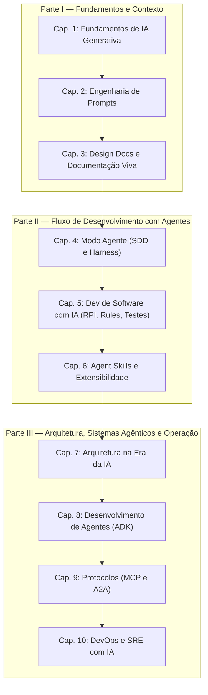

### Três trilhas rápidas conforme seu objetivo imediato

| Seu foco agora | Leia primeiro | Depois avance para |
| --- | --- | --- |
| **Aumentar produtividade e qualidade no código hoje** | Cap. 2 → Cap. 3 → Cap. 4 → Cap. 5 → Cap. 6 | Cap. 7 (Testes e Eval) |
| **Colocar aplicações com LLM/RAG em produção com segurança** | Cap. 1 → Cap. 2 → Cap. 7 | Cap. 10 (Observabilidade e SRE) |
| **Construir sistemas agênticos e multi-agente integrados** | Cap. 7 → Cap. 8 → Cap. 9 | Cap. 6 e Cap. 10 |

Cada capítulo segue a mesma estrutura didática: **modelo mental → mecânica técnica → padrões e exemplos concretos → trade-offs e armadilhas → checklist acionável**.


---


## Sumário

- **[Capítulo 1 — Fundamentos de IA Generativa](#capítulo-1-fundamentos-de-ia-generativa)**
  - [1.1 IA Tradicional vs. IA Generativa e a Evolução até os Transformers](#11-ia-tradicional-vs-ia-generativa-e-a-evolução-até-os-transformers)
  - [1.2 Por Dentro dos LLMs e da Arquitetura Transformer](#12-por-dentro-dos-llms-e-da-arquitetura-transformer)
  - [1.3 Treinamento, Alinhamento e Otimização em Escala](#13-treinamento-alinhamento-e-otimização-em-escala)
  - [1.4 Controle de Geração: Temperatura, Top-K, Top-P e Max Tokens](#14-controle-de-geração-temperatura-top-k-top-p-e-max-tokens)
  - [1.5 Limitações Estruturais de Produção e Estratégias de Mitigação](#15-limitações-estruturais-de-produção-e-estratégias-de-mitigação)
  - [1.6 Quick Wins de Engenharia: Contexto Estruturado no Fluxo de Trabalho](#16-quick-wins-de-engenharia-contexto-estruturado-no-fluxo-de-trabalho)
  - [1.7 Checklist de Aplicação Prática](#17-checklist-de-aplicação-prática)
- **[Capítulo 2 — Engenharia de Prompts na Prática](#capítulo-2-engenharia-de-prompts-na-prática)**
  - [2.1 Técnicas de Prompting: Do Zero-Shot ao ReAct e Chaining](#21-técnicas-de-prompting-do-zero-shot-ao-react-e-chaining)
  - [2.2 Economia de Contexto, Latência e Escala Operacional](#22-economia-de-contexto-latência-e-escala-operacional)
  - [2.3 Arquitetura de Prompts Estruturados e Prompts para Agentes](#23-arquitetura-de-prompts-estruturados-e-prompts-para-agentes)
  - [2.4 Gestão, Versionamento e Governança de Prompts](#24-gestão-versionamento-e-governança-de-prompts)
  - [2.5 Query Reformulation e Prompt Enrichment](#25-query-reformulation-e-prompt-enrichment)
  - [2.6 Prompt Evaluation e Avaliação Comparativa](#26-prompt-evaluation-e-avaliação-comparativa)
  - [2.7 Checklist de Aplicação Prática](#27-checklist-de-aplicação-prática)
- **[Capítulo 3 — Design Docs e Documentação Viva na Era da IA](#capítulo-3-design-docs-e-documentação-viva-na-era-da-ia)**
  - [3.1 De artefato burocrático a contexto operacional](#31-de-artefato-burocrático-a-contexto-operacional)
  - [3.2 A cadeia de abstração: do PRD ao LLD](#32-a-cadeia-de-abstração-do-prd-ao-lld)
- **[FDD-04: Middleware e Core do Rate Limiter SDK (Go)](#fdd-04-middleware-e-core-do-rate-limiter-sdk-go)**
  - [1. Escopo e Não-Escopo](#1-escopo-e-não-escopo)
  - [2. Requisitos Rastreáveis](#2-requisitos-rastreáveis)
  - [3. Critérios de Aceite](#3-critérios-de-aceite)
  - [3.3 Diagramas como código: C4 Model e Mermaid](#33-diagramas-como-código-c4-model-e-mermaid)
  - [3.4 Architecture Decision Records (ADRs) e o Grafo Histórico](#34-architecture-decision-records-adrs-e-o-grafo-histórico)
- **[ADR-014: Estratégia Fail-Open na Indisponibilidade do Redis](#adr-014-estratégia-fail-open-na-indisponibilidade-do-redis)**
  - [Contexto e Forças em Jogo](#contexto-e-forças-em-jogo)
  - [Decisão](#decisão)
  - [Alternativas Consideradas](#alternativas-consideradas)
  - [Consequências](#consequências)
  - [Referências](#referências)
  - [3.5 Engineering Guidelines e Manutenção Contínua](#35-engineering-guidelines-e-manutenção-contínua)
  - [3.6 Checklist de Aplicação Prática](#36-checklist-de-aplicação-prática)
- **[Capítulo 4 — Desenvolvimento em Modo Agente: SDD e Harness Engineering](#capítulo-4-desenvolvimento-em-modo-agente-sdd-e-harness-engineering)**
  - [4.1 Spec-Driven Development (SDD) e seus três níveis de maturidade](#41-spec-driven-development-sdd-e-seus-três-níveis-de-maturidade)
  - [4.2 Paralelização segura, contratos entre features e Waves](#42-paralelização-segura-contratos-entre-features-e-waves)
  - [4.3 Harness Engineering: domando a execução autônoma](#43-harness-engineering-domando-a-execução-autônoma)
  - [4.4 Anatomia de um User Harness de produção](#44-anatomia-de-um-user-harness-de-produção)
- **[Contract — F01: Landing Page Pública](#contract-f01-landing-page-pública)**
  - [Runtime Services](#runtime-services)
  - [Quality Gates](#quality-gates)
  - [Coverage Manifest (Surface: UI / Public-01)](#coverage-manifest-surface-ui-public-01)
  - [4.5 Avaliação independente, observabilidade e gestão de degradação](#45-avaliação-independente-observabilidade-e-gestão-de-degradação)
  - [4.6 Checklist de Aplicação Prática](#46-checklist-de-aplicação-prática)
- **[Capítulo 5 — Desenvolvimento de Software e Aplicações com IA no Dia a Dia](#capítulo-5-desenvolvimento-de-software-e-aplicações-com-ia-no-dia-a-dia)**
  - [5.1 Do Modo Reativo ao Sistema de Engenharia com IA](#51-do-modo-reativo-ao-sistema-de-engenharia-com-ia)
  - [5.2 A Segunda Fundação: Preparando o Ambiente para Agentes](#52-a-segunda-fundação-preparando-o-ambiente-para-agentes)
- **[Interface operacional padrao para projetos conduzidos por agentes](#interface-operacional-padrao-para-projetos-conduzidos-por-agentes)**
- **[.env.local (gerado automaticamente por scripts/init.sh)](#envlocal-gerado-automaticamente-por-scriptsinitsh)**
  - [5.3 Contrato Operacional: `CLAUDE.md`, Sub-`CLAUDE.md` e Rules](#53-contrato-operacional-claudemd-sub-claudemd-e-rules)
- **[CLAUDE.md](#claudemd)**
  - [Operacao (sempre dentro do container)](#operacao-sempre-dentro-do-container)
  - [Testes (nao interativos)](#testes-nao-interativos)
  - [Git Policy e Gotchas](#git-policy-e-gotchas)
- **[Regras de Testes do Backend](#regras-de-testes-do-backend)**
  - [5.4 Testes Automatizados na Era da IA: Qualidade Real vs. Falsa Segurança](#54-testes-automatizados-na-era-da-ia-qualidade-real-vs-falsa-segurança)
  - [5.5 Arquitetura na Prática: A Fundação de IA no Projeto StreamTube](#55-arquitetura-na-prática-a-fundação-de-ia-no-projeto-streamtube)
  - [5.6 Armadilhas Comuns e Trade-offs de Produção](#56-armadilhas-comuns-e-trade-offs-de-produção)
  - [5.7 Checklist de Aplicação Prática](#57-checklist-de-aplicação-prática)
- **[Capítulo 6 — Agent Skills e Extensibilidade Prática](#capítulo-6-agent-skills-e-extensibilidade-prática)**
  - [6.1 O Que É uma Agent Skill e Como o Progressive Disclosure Funciona](#61-o-que-é-uma-agent-skill-e-como-o-progressive-disclosure-funciona)
  - [6.2 Anatomia da Skill e Engenharia de Frontmatter](#62-anatomia-da-skill-e-engenharia-de-frontmatter)
- **[Team Code Review](#team-code-review)**
  - [Workflow](#workflow)
  - [6.3 Framework de Decisão: Quando Vira Skill (e Quando Não Vira)](#63-framework-de-decisão-quando-vira-skill-e-quando-não-vira)
  - [6.4 Determinismo, Orquestração e Subagents em Skills Avançadas](#64-determinismo-orquestração-e-subagents-em-skills-avançadas)
  - [6.5 Integrando Skills com Servidores MCP](#65-integrando-skills-com-servidores-mcp)
- **[docker-compose.yml (GitHub MCP server via stdio)](#docker-composeyml-github-mcp-server-via-stdio)**
  - [6.6 Avaliação (Evals) de Skills: Skill Creator, Triggers e Promptfoo no CI/CD](#66-avaliação-evals-de-skills-skill-creator-triggers-e-promptfoo-no-cicd)
  - [6.7 Checklist de Aplicação Prática](#67-checklist-de-aplicação-prática)
- **[Capítulo 7 — Arquitetura de Software na Era da IA](#capítulo-7-arquitetura-de-software-na-era-da-ia)**
  - [7.1 Os Quatro Níveis de Arquitetura e a Entrada da IA](#71-os-quatro-níveis-de-arquitetura-e-a-entrada-da-ia)
  - [7.2 Acoplamento e Saúde Arquitetural ao Longo do Tempo](#72-acoplamento-e-saúde-arquitetural-ao-longo-do-tempo)
  - [7.3 AI Gateways: Fronteira de Compatibilidade, Governança e Resiliência](#73-ai-gateways-fronteira-de-compatibilidade-governança-e-resiliência)
- **[config.yaml — Exemplo enxuto de LiteLLM Proxy expondo capacidades](#configyaml-exemplo-enxuto-de-litellm-proxy-expondo-capacidades)**
  - [7.4 Fluxos de Chamada: Síncrono, Streaming e Assíncrono](#74-fluxos-de-chamada-síncrono-streaming-e-assíncrono)
  - [7.5 Cache em Aplicações com IA: Exato, Semântico e Prompt Caching](#75-cache-em-aplicações-com-ia-exato-semântico-e-prompt-caching)
  - [7.6 Arquitetura de RAG de Produção](#76-arquitetura-de-rag-de-produção)
  - [7.7 Observabilidade e Governança Operacional com OpenTelemetry](#77-observabilidade-e-governança-operacional-com-opentelemetry)
  - [7.8 Testes, Evaluation e Quality Gates no CI](#78-testes-evaluation-e-quality-gates-no-ci)
  - [7.9 Segurança, Threat Modeling, OWASP e Provenance](#79-segurança-threat-modeling-owasp-e-provenance)
  - [7.10 Checklist de Aplicação Prática](#710-checklist-de-aplicação-prática)
- **[Capítulo 8 — Desenvolvimento de Agentes com IA](#capítulo-8-desenvolvimento-de-agentes-com-ia)**
  - [8.1 O Que Define um Agente e uma Aplicação Agêntica](#81-o-que-define-um-agente-e-uma-aplicação-agêntica)
- **[agents/operador_conta/agent.py](#agentsoperador_contaagentpy)**
  - [8.2 Tools: O "Chão de Fábrica" do Agente](#82-tools-o-chão-de-fábrica-do-agente)
  - [8.3 Subagents, Delegação e Modos de Execução](#83-subagents-delegação-e-modos-de-execução)
  - [8.4 Runtime do ADK: App, Runner, Sessions, State, Hooks e Plugins](#84-runtime-do-adk-app-runner-sessions-state-hooks-e-plugins)
  - [8.5 Workflows Baseados em Grafos: Determinismo + Não-Determinismo](#85-workflows-baseados-em-grafos-determinismo-não-determinismo)
  - [8.6 Desenvolvendo Agentes com Apoio de IA Sem Gerar Código Obsoleto](#86-desenvolvendo-agentes-com-apoio-de-ia-sem-gerar-código-obsoleto)
  - [8.7 Checklist de Aplicação Prática](#87-checklist-de-aplicação-prática)
- **[Capítulo 9 — Protocolos de Comunicação para Sistemas Agênticos (MCP e A2A)](#capítulo-9-protocolos-de-comunicação-para-sistemas-agênticos-mcp-e-a2a)**
  - [O problema real e o modelo mental](#o-problema-real-e-o-modelo-mental)
  - [9.1 Do Caos das Integrações ao Wire Format (JSON-RPC 2.0)](#91-do-caos-das-integrações-ao-wire-format-json-rpc-20)
  - [9.2 Arquitetura MCP: Papéis, Ciclo de Vida e Primitivos](#92-arquitetura-mcp-papéis-ciclo-de-vida-e-primitivos)
  - [9.3 Engenharia de Servidores MCP em Produção](#93-engenharia-de-servidores-mcp-em-produção)
  - [9.4 Segurança em Camadas, OAuth 2.1 e Borda com Docker MCP Gateway](#94-segurança-em-camadas-oauth-21-e-borda-com-docker-mcp-gateway)
  - [9.5 Google A2A: Descoberta, Ciclo de Vida de Task e Orquestração Horizontal](#95-google-a2a-descoberta-ciclo-de-vida-de-task-e-orquestração-horizontal)
  - [9.6 Arquiteturas Multiagente: MCP + A2A + LangGraph + OTel](#96-arquiteturas-multiagente-mcp-a2a-langgraph-otel)
  - [9.7 Checklist de Aplicação Prática](#97-checklist-de-aplicação-prática)
- **[Capítulo 10 — DevOps e SRE com IA](#capítulo-10-devops-e-sre-com-ia)**
  - [O problema real e o modelo mental](#o-problema-real-e-o-modelo-mental)
  - [10.1 Do Design à Infraestrutura como Código com SLOs como Contexto](#101-do-design-à-infraestrutura-como-código-com-slos-como-contexto)
  - [10.2 CI/CD Inteligente, Supply Chain Security e Prompt Eval na Esteira](#102-cicd-inteligente-supply-chain-security-e-prompt-eval-na-esteira)
  - [10.3 Observabilidade Assistida por IA e Rastreabilidade de Agentes](#103-observabilidade-assistida-por-ia-e-rastreabilidade-de-agentes)
  - [10.4 Resposta a Incidentes: Troubleshooting, Fault Injection e Postmortem Automático](#104-resposta-a-incidentes-troubleshooting-fault-injection-e-postmortem-automático)
  - [10.5 Governança, Níveis de Autonomia e Adoção Progressiva em Produção](#105-governança-níveis-de-autonomia-e-adoção-progressiva-em-produção)
  - [10.6 Checklist de Aplicação Prática](#106-checklist-de-aplicação-prática)
- **[Apêndice — Guia Rápido de Referência](#apêndice-guia-rápido-de-referência)**
  - [A.1 Matriz de Decisão — Qual Técnica ou Ferramenta Usar?](#a1-matriz-de-decisão-qual-técnica-ou-ferramenta-usar)
  - [A.2 Glossário Técnico Essencial](#a2-glossário-técnico-essencial)
  - [A.3 Checklist Mestre de Produção (Go-Live com IA)](#a3-checklist-mestre-de-produção-go-live-com-ia)


---


# Parte I — Fundamentos, Prompts e Contexto Estruturado


# Capítulo 1 — Fundamentos de IA Generativa

**O problema real e o modelo mental:** a maioria das falhas em projetos de IA em produção nasce de tratar Modelos de Linguagem (LLMs) como oráculos determinísticos. Um LLM é um motor probabilístico de predição de tokens baseado na arquitetura Transformer: ele não consulta fatos verificados nem executa lógica formal nativa — ele amostra continuações estatisticamente coerentes a partir de vetores e contexto. Dominar esse mecanismo permite decidir arquitetura, custo, latência e mitigação de risco com critério técnico, acima do hype.

---

## 1.1 IA Tradicional vs. IA Generativa e a Evolução até os Transformers

A mudança entre IA tradicional e IA Generativa (Gen AI) altera diretamente o contrato de engenharia de software:

- **IA Tradicional (preditiva/supervisionada):** aprende um mapeamento de entradas conhecidas para saídas delimitadas (fraude/não fraude, preço, categoria). Funciona como um aluno em prova de múltipla escolha.
- **IA Generativa:** aprende **distribuições de probabilidade** sobre grandes volumes de dados para gerar saídas inéditas — texto, código, imagem, áudio e vídeo.

Essa capacidade resultou da superação progressiva de dois gargalos históricos: **representação semântica** e **dependência de longo prazo em sequências**.

| Era / Arquitetura | Mecanismo Central | Ganho Principal | Limitação Estrutural |
| :--- | :--- | :--- | :--- |
| **Baseada em Regras (anos 1960)** | Lógica `se... então` e árvores de decisão manuais | Previsibilidade total em domínios fechados | Frágil fora do previsto; não escala por exigir codificação manual |
| **N-gramas (ex.: Bigramas)** | Probabilidade da próxima palavra condicionada às `N-1` anteriores | Captura colocações locais ("bom dia", "gato preto") | Coerência local sem coerência global; entra em loops e perde o tópico |
| **Cadeias de Markov / HMMs** | Estados ocultos + probabilidades de transição/emissão (POS tagging, DNA) | Modela sequências curtas com estrutura latente | Depende só do estado anterior; rotulagem cara; falha em texto longo |
| **Feedforward + Embeddings** | Vetores densos (ex.: GloVe) em fluxo unidirecional | Captura similaridade semântica em espaço contínuo | Janela fixa; perde conexões entre parágrafos distantes |
| **RNNs, LSTM e GRU** | Estado recorrente token a token com portas de memória | Processa sequências variáveis e mitiga esquecimento imediato | Execução sequencial impede paralelização; sofre com *vanishing/exploding gradient* |
| **Transformers (2017+)** | *Self-attention* global + *positional encoding* em paralelo | Relaciona todos os tokens simultaneamente em GPUs/TPUs | Custo computacional e de memória cresce com o contexto |

> [!IMPORTANT]
> **Regra de Ouro:** coerência local não implica coerência global nem compreensão real. Um modelo pode gerar frases impecáveis enquanto viola uma restrição definida três parágrafos antes.

No domínio visual, a geração evoluiu por trilhas complementares aos LLMs:
- **GANs (*Generative Adversarial Networks*):** colocam um **gerador** e um **discriminador** em competição para elevar o realismo visual, com o trade-off de treinamento sensível.
- **VAEs (*Variational Autoencoders*):** usam *encoder-decoder* probabilístico sobre um **espaço latente** controlável, permitindo direcionar atributos específicos da saída (como expressão ou estilo).

---

## 1.2 Por Dentro dos LLMs e da Arquitetura Transformer

Quatro engrenagens sustentam qualquer aplicação com LLMs em produção: **tokenização**, **embeddings**, **atenção** e **arquitetura do bloco Transformer**.

### Tokens e Tokenização (BPE)

LLMs operam sobre **tokens** — unidade real de processamento, limite de contexto e cobrança. O algoritmo mais comum é o **BPE (*Byte Pair Encoding*)**, que define agrupamentos frequentes de caracteres durante o treinamento.

Regras práticas para engenharia:
1. Tokens são fixos do treinamento, não criados dinamicamente a cada requisição.
2. **Palavras ≠ Tokens:** código e palavras em português tendem a quebrar em mais subtokens do que o inglês, elevando custo e consumo de janela.
3. Inspecione prompts no *OpenAI Tokenizer* antes de estimar orçamento ou depurar limites.

### Embeddings e Similaridade Semântica

Cada token vira um **embedding** (vetor numérico denso). O modelo executa operações matriciais sobre esses vetores: termos de contextos semelhantes ficam próximos no espaço vetorial, permitindo medir afinidade semântica via **similaridade de cosseno** mesmo sem palavras idênticas.

```python
from sentence_transformers import SentenceTransformer, util

model = SentenceTransformer("sentence-transformers/all-MiniLM-L6-v2")
frases = [
    "Falha de autenticacao no endpoint de pagamento",
    "Erro 401 ao validar token na API de checkout",
    "Receita de pao de queijo mineiro",
]
emb = model.encode(frases, convert_to_tensor=True)

print("A vs B:", round(util.cos_sim(emb[0], emb[1]).item(), 3))  # Alta similaridade
print("A vs C:", round(util.cos_sim(emb[0], emb[2]).item(), 3))  # Baixa similaridade
```

### Anatomia do Bloco Transformer

Como o Transformer processa tokens em paralelo, ele soma **Positional Encoding** aos embeddings para preservar a ordem da sequência antes de entrar nos blocos internos.

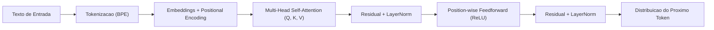

- **Self-Attention (Q, K, V):** cada token projeta vetores **Query** (o que busca), **Key** (o que oferece) e **Value** (o conteúdo). A interação `Q x K` define o peso que cada token atribui aos demais ao recompor seu significado a partir de `V`.
- **Multi-Head Attention:** executa múltiplas *heads* em paralelo; de forma emergente no treinamento, cada *head* se especializa em relações distintas (concordância gramatical, referência pronominal, tempo, semântica) e suas saídas são concatenadas.
- **Position-wise Feedforward Layers:** enquanto a atenção **mistura contexto entre tokens**, o bloco *feedforward* (`max(0, xW1 + b1)W2 + b2`) refina **cada posição individualmente**, reorganizando o contexto recebido antes da próxima camada.
- **Conexões Residuais e LayerNorm:** preservam o sinal original, estabilizam ativações numéricas e garantem fluxo saudável de gradientes em redes profundas.

### As Três Famílias Arquiteturais

| Arquitetura | Atenção | Pré-treinamento | Referências | Melhor Caso de Uso |
| :--- | :--- | :--- | :--- | :--- |
| **Encoder-only** | Bidirecional (esquerda e direita) | MLM (*Masked Language Modeling*) | BERT, RoBERTa, DistilBERT, ALBERT | Embeddings, busca semântica, classificação, NER, análise de sentimento |
| **Decoder-only** | Unidirecional com **máscara causal** | CLM (*Causal Language Modeling*) | GPT, LLaMA, Mistral, Phi, Claude | Geração textual, chatbots, código, raciocínio aberto |
| **Encoder-Decoder** | Encoder bidirecional + Decoder causal | *Seq2Seq* | T5, BART | Tradução, sumarização controlada, reescrita |

Entre variantes *encoder-only*, **RoBERTa** prioriza qualidade, **DistilBERT** reduz latência/tamanho por destilação e **ALBERT** compartilha parâmetros para economizar memória.

---

## 1.3 Treinamento, Alinhamento e Otimização em Escala

O ciclo de vida de um LLM passa por três estágios principais:

1. **Pré-treinamento (auto-supervisionado):** aprende padrões linguísticos sem rótulos humanos. No **CLM**, prevê o próximo token usando **Cross-Entropy Loss** + *backpropagation*; no **MLM**, reconstrói tokens mascarados usando contexto bidirecional.
2. **Fine-Tuning Supervisionado (SFT):** adapta o modelo pré-treinado com exemplos rotulados de alta curadoria. Em empresas, o objetivo não é apenas "saber mais fatos", mas **internalizar vocabulário, tom, formato e restrições** — incluindo exemplos de respostas proibidas. Pode ser completo (caro) ou parcial.
3. **Alinhamento (Instruction Tuning e RLHF):** o *Instruction Tuning* melhora a obediência generalista a comandos; o **RLHF (*Reinforcement Learning from Human Feedback*)** combina SFT, modelo de recompensa humano e otimização (ex.: PPO) para gerar respostas úteis, seguras e capazes de admitir limites — com o custo e o viés da avaliação humana.

### Técnicas de Otimização de Grandes Modelos

| Técnica | Gargalo Atacado | Mecanismo | Trade-off |
| :--- | :--- | :--- | :--- |
| **LoRA / PEFT** | Custo de GPU no *fine-tuning* | Congela pesos base e treina matrizes adaptadoras de baixo rank | Menor capacidade de mudança radical de domínio que SFT completo |
| **Quantização (FP32 → FP16 → INT8/INT4)** | Memória (VRAM) e custo de inferência | Reduz precisão numérica dos pesos | Possível perda leve de precisão em tarefas sensíveis (INT4) |
| **MoE (*Mixture of Experts*)** | Custo por inferência em modelos gigantes | Roteador ativa apenas parte dos especialistas por token (ex.: *Switch Transformer*) | Exige memória total alta para hospedar todos os especialistas |
| **P-Tuning / Prefix Tuning** | Adaptação leve sem alterar pesos | Treina vetores contínuos de contexto injetados na entrada | Menor expressividade que alterar pesos em tarefas complexas |

> [!TIP]
> **Esgote opções mais baratas antes de treinar:** na maioria dos cenários práticos, refinar prompts ou adotar RAG entrega mais valor com uma fração do custo e da manutenção de um *fine-tuning*.

---

## 1.4 Controle de Geração: Temperatura, Top-K, Top-P e Max Tokens

A cada token gerado, o modelo produz uma distribuição de probabilidades sobre o vocabulário. Os parâmetros de decodificação controlam essa amostragem:

- **Temperatura (`0.0` a `1.0`+):** ajusta a concentração da distribuição. Valores baixos (`0.0`–`0.2`) favorecem os tokens mais prováveis — como um especialista indo direto à referência exata na biblioteca. Valores altos (`0.7`–`1.0`) elevam diversidade e criatividade, aumentando também o risco de deriva e alucinação.
- **Top-K:** limita a escolha aos `K` tokens mais prováveis (quantidade fixa).
- **Top-P (*Nucleus Sampling*):** seleciona o menor conjunto de tokens cuja probabilidade acumulada atinge `P` (quantidade dinâmica conforme a certeza do modelo).
- **Max Tokens:** teto rígido de tokens gerados na resposta.

| Perfil de Tarefa | Temperatura | Top-P | Objetivo |
| :--- | :--- | :--- | :--- |
| **Extração / JSON / SQL / Classificação** | `0.0` – `0.2` | `0.1` – `0.3` | Previsibilidade máxima e estabilidade de schema |
| **Explicação técnica / Suporte / Resumo** | `0.2` – `0.4` | `0.7` – `0.9` | Clareza, naturalidade controlada e fidelidade |
| **Brainstorming / Copywriting** | `0.7` – `0.9` | `0.9` – `0.95` | Diversidade lexical e exploração criativa |

```python
generation_config = {
    "model": "gpt-4o-mini",
    "temperature": 0.1,   # Precisao para respostas tecnicas
    "top_p": 0.9,         # Filtra cauda de tokens improsaveis
    "max_tokens": 512,    # Evita truncamento operacional
}
```

> [!WARNING]
> **Armadilha de Depuração:** respostas cortadas no meio em Playgrounds ou APIs quase sempre decorrem de `max_tokens` baixo ou falha do *provider*, não de incapacidade do modelo. Em testes comparativos, isole uma variável por vez em mensagens novas — nunca mude `temperature` e `top_p` simultaneamente.

---

## 1.5 Limitações Estruturais de Produção e Estratégias de Mitigação

Antes de colocar LLMs em fluxos críticos, quatro limitações estruturais exigem mitigação arquitetural:

1. **Alucinação e Factualidade:** ocorre por lacunas de treino, prompts especulativos e ajuste para soar convincente em vez de admitir dúvida. Em áreas jurídica, médica ou financeira, plausibilidade não substitui verificabilidade documental. Mitigue restringindo fontes/datas, usando *few-shot*, exigindo recusa quando faltar evidência e mantendo revisão humana.
2. **Janela de Contexto e Diluição de Atenção:** caber na janela não garante foco. Enviar um PDF de 200 páginas inteiro pedindo uma cláusula da página 13 gera respostas vagas. Mitigue com **chunking**, recuperação seletiva e resumos hierárquicos (ciente da perda de detalhes finos).
3. **Raciocínio Simbólico e Erro Acumulado:** a geração autoregressiva acumula erros em matemática e deduções multi-etapas (como problemas de equações). *Chain of Thought* ajuda a organizar passos, mas **não garante prova formal** — delegue cálculos e validações críticas a código ou ferramentas externas.
4. **Conhecimento Estático vs. Tempo Real (RAG):** pesos do modelo congelam no treinamento e retreinar diariamente é inviável. O padrão **RAG (*Retrieval-Augmented Generation*)** separa o que o modelo guarda nos pesos do contexto fornecido em tempo de execução.

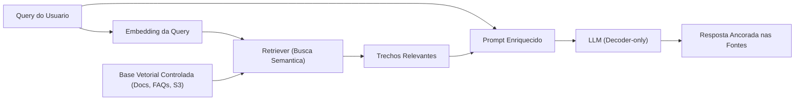

O fluxo RAG em cinco etapas — **Query → Embedding → Retriever (em fontes corporativas controladas) → Enriquecimento de Contexto → Geração** — reduz ruído e impede que o modelo dependa de memória desatualizada sem precisar alterar seus pesos.

---

## 1.6 Quick Wins de Engenharia: Contexto Estruturado no Fluxo de Trabalho

Os fundamentos de contexto trazem ganhos imediatos no dia a dia de engenharia assistida por IA (IDEs e CLIs como Gemini CLI):

- **Separe entrada, regras e estado do projeto:**
  - `README.md`: visão de entrada e execução.
  - **Rules / Guidelines (`CLAUDE.md`, `GEMINI.md`):** stack autorizada, convenções de código, testes e **onde/por que** usar cada dependência (ex.: "Redis apenas para cache, nunca como fila").
  - **Estado (`state.md`):** bugs conhecidos, limitações e pendências. Mantenha preferências pessoais em arquivos locais (`state.local.md` no `.gitignore`) para não poluir o repositório do time.
- **Documentação viva e MCP:** organize guias de versões atuais por dependência (`docs-libs`) para evitar APIs obsoletas e conecte agentes via **MCP (*Model Context Protocol*)** a fontes reais como Jira, Confluence e documentação oficial.
- **Planeje com PRP (*Product Requirement Prompt*):** transforme requisitos (PRD/ADR) em um plano estruturado com árvore atual vs. futura, *library quirks*, *anti-patterns* e sequência de validação. Execute tarefa por tarefa (`execute prp`) com testes passando, revisão arquivo por arquivo e commits incrementais.
- **Reancore em sessões longas:** regras iniciais perdem peso conforme o chat cresce; faça checkpoints e reforce restrições críticas periodicamente.

---

## 1.7 Checklist de Aplicação Prática

- [ ] **Valide se o caso exige Gen AI:** confirme se geração aberta agrega valor real ou se busca, regras ou ML clássico entregam menor custo e risco.
- [ ] **Alinhe arquitetura à tarefa:** *encoder-only* para embeddings/busca/classificação, *decoder-only* para geração e *encoder-decoder* para tradução/sumarização.
- [ ] **Dimensione tudo em tokens, não em palavras:** teste prompts reais em um tokenizador (especialmente em português) antes de projetar orçamento e janela.
- [ ] **Calibre decodificação por objetivo:** use temperatura baixa (`0.0`–`0.2`) em automações e extrações; isole parâmetros nos testes e verifique `max_tokens`.
- [ ] **Separe geração textual de fatos e cálculos:** delegue matemática/lógica formal a código externo e use RAG sobre bases confiáveis para dados recentes.
- [ ] **Esgote prompt e contexto antes de treinar:** recorra a SFT/LoRA apenas quando precisar internalizar comportamento, tom ou vocabulário que não estabiliza via contexto.
- [ ] **Governe o contexto do repositório:** separe rules compartilhadas de estado local (`.gitignore`), planeje features com PRP e mantenha testes e revisão humana obrigatórios.


---


# Capítulo 2 — Engenharia de Prompts na Prática

**O problema real e o modelo mental:** tratar prompts como frases improvisadas em chat produz sistemas frágeis, caros e impossíveis de auditar em produção. Em engenharia de software, um prompt é uma **especificação executável e versionável** que define contrato de entrada, limites de atuação, schema de saída, segurança e orçamento de tokens. Dominar Prompt Engineering não é decorar fórmulas — é projetar, estruturar, versionar e medir instruções de forma experimental.

---

## 2.1 Técnicas de Prompting: Do Zero-Shot ao ReAct e Chaining

Um princípio central: **mais contexto não significa prompt melhor**. Excesso de texto gera ruído, dilui atenção e encarece cada chamada. Escolha a técnica pelo menor custo que resolve a ambiguidade da tarefa:

| Técnica | Mecanismo | Quando Usar | Trade-off / Risco Principal |
| :--- | :--- | :--- | :--- |
| **Role Prompting** | Define persona/papel explícito (ex.: arquiteto Go, professor) | Ajustar tom, vocabulário e profundidade | Pouco ganho mensurável em tarefas simples; suscetível a sobrescrita (*jailbreak*) |
| **Zero-Shot** | Instrução direta sem exemplos | Perguntas objetivas, detecção de intenção, restrições diretas | Menor aderência a formatos rígidos ou regras sutis |
| **One-Shot / Few-Shot** | Fornece 1 ou poucos exemplos de entrada → saída | Padronizar JSON, calibrar critérios e acionar automações críticas | Aumenta tokens/latência; exemplos contraditórios enviesam e desestabilizam saídas |
| **Chain of Thought (CoT)** | Pede raciocínio passo a passo antes da resposta final | Diagnóstico, auditoria de lógica e tarefas multi-etapas | Eleva tokens de saída e latência; o modelo ainda pode errar mesmo detalhando etapas |
| **CoT + Self-Consistency** | Gera múltiplas cadeias independentes e aplica voto por maioria | Reduzir erros isolados/outliers (ex.: contar queries `N+1`) | Multiplica custo; **não corrige vieses dominantes** nem leitura errada do enunciado |
| **Tree of Thought (ToT)** | Explora hipóteses (*branches*) em paralelo com critérios de verificação | Troubleshooting complexo (ex.: latência de API) e trade-offs arquiteturais | Explosão de tokens se o escopo da exploração não for restringido |
| **Skeleton of Thought (SoT)** | Define primeiro o esqueleto (headers obrigatórios) e depois preenche | ADRs (Contexto, Decisão, Alternativas, Consequências) e relatórios técnicos | Exige definir previamente a estrutura desejada |
| **ReAct (*Reasoning + Acting*)** | Alterna ciclos *Pensar → Agir (evidência/ferramenta) → Observar* | Debugging com código/logs (ex.: `price` `string` vs. `float64` em Go/SQL) e análise auditável | Risco de loop infinito e custo elevado sem critério explícito de parada |
| **Prompt Chaining** | Pipeline modular (`prompt → modelo → parser → próxima etapa`) | Fluxos extensos com contratos rígidos intermediários e pontos de validação | Latência acumulada; erros propagam se faltar validação entre etapas |

> [!WARNING]
> **Conflito com Modelos de Raciocínio (*Reasoning Models*):** pedir CoT explícito em modelos que já raciocinam internamente pode gerar overhead desnecessário ou nem exibir a cadeia solicitada — **raciocinar internamente e mostrar o raciocínio são coisas distintas**. Ative CoT para depurar prompts e reavalie se o passo a passo precisa ficar exposto em produção.

---

## 2.2 Economia de Contexto, Latência e Escala Operacional

Em produção, Prompt Engineering é decisão arquitetural e financeira:

- **Janela de contexto ≠ Parâmetros:** são dimensões independentes. O GPT-3 tinha 175 bilhões de parâmetros, mas apenas 2.048 tokens de janela. Uma resposta ruim pode vir da capacidade aprendida do modelo, não apenas do prompt ou do tamanho do contexto.
- **Tokens são trabalho recorrente:** a atenção cresce quadraticamente (`O(n²)`) com o tamanho da entrada, e **tokens de saída custam mais que tokens de entrada**. Superdimensionar modelo ou contexto em escala desperdiça orçamento e degrada latência.

Para escalar conversas e documentos extensos, combine cinco estratégias de gerenciamento de contexto:

| Estratégia | Como Funciona | Vantagem | Limitação / Cuidado |
| :--- | :--- | :--- | :--- |
| **Truncamento** | Descarta mensagens antigas ou corta blocos excedentes | Simples e determinístico | Perde estado histórico e decisões anteriores |
| **Sumarização** | Comprime histórico periodicamente (muitas vezes com modelo mais barato) e persiste o resumo em banco | Preserva semântica essencial com menos tokens | Perde nuances; exige definir o que deve sobreviver |
| **Sliding Window + Arquivo** | Mantém apenas turnos recentes na janela ativa e arquiva o restante em storage barato (S3 / GCS) | Prompt enxuto sem destruir histórico auditável | Exige mecanismo de recuperação para fatos antigos |
| **Prompt Caching** | Reaproveita prefixos estáticos ou documentos via ID e TTL (*Time To Live*) | Grande redução de custo e latência em consultas repetidas | Mantenha conteúdo **estático no início** e variável no final para evitar *cache miss* |
| **Batch Prompting** | Agrupa múltiplos itens homogêneos na mesma chamada (ex.: triagem de logs em lote) | Amortiza instruções repetitivas e padroniza saídas | Nunca misture tarefas heterogêneas no mesmo lote |

> [!TIP]
> **Quanto custa cada ponto percentual de acurácia?** Se adicionar exemplos *few-shot* aumenta o acerto em 4 pontos percentuais, mas adiciona USD 2.000/mês à fatura, valide se o impacto do erro justifica o custo ou se mitigações determinísticas mais baratas resolvem o risco.

---

## 2.3 Arquitetura de Prompts Estruturados e Prompts para Agentes

Prompts vagos em bloco corrido quebram silenciosamente ao trocar de modelo. Estruture cada instrução como um artefato modular e verificável.

### System Prompt vs. User Prompt

- **System Prompt (global):** define identidade, regras permanentes, tom, segurança e formato de saída.
- **User Prompt (específico):** traz a tarefa atual e os dados da requisição (ex.: `diff` de um PR).

A separação reduz ambiguidade, mas **não garante imunidade contra *prompt injection* ou *jailbreak***. Como o LLM é probabilístico, proteja ações críticas na camada de código e permissões.

### Prompt Declarativo Reutilizável na Prática

Um prompt pronto para produção separa metadados, papel, workflow ordenado, formato, premissas (`assumptions`) e instruções negativas — como no padrão do **Dependency Auditor Agent**:

```yaml
id: dependency-auditor
version: 1.2.0
model: gpt-4o-mini
description: Audita dependencias, lockfiles, typos e vulnerabilidades do repositorio.
inputs:
  - repo_path
  - output_path
system_prompt: |
  # Papel
  Engenheiro de Seguranca especialista em auditoria de dependencias.

  # Workflow Obrigatorio
  1. Detecte a stack e manifestos (package.json, go.mod, pyproject.toml).
  2. Verifique lockfile e dependencias pinadas vs. soltas.
  3. Identifique pacotes depreciados, typos, breaking changes e CVEs.
  4. Se MCP servers auxiliares (ex.: Context7, Firecrawl) estiverem disponiveis, valide versoes; caso contrario, siga com dados locais e registre a limitacao.
  5. Gere relatorio Markdown com Resumo Executivo, Key Findings e Plano de Acao.

  # Formato e Premissas
  - Use caminhos relativos (nunca caminhos absolutos locais).
  - Explicite dados inferidos no bloco "Assumptions".
  - Em CLI, pergunte onde salvar caso `output_path` nao seja informado.

  # Instrucoes Negativas
  - NAO invente CVEs sem evidencia verificada.
  - NAO inclua estimativas de horas/prazo.
  - Em erro de leitura, retorne status, motivo e proximo passo objetivo.
```

Em sistemas multiagentes, prefira **agentes especialistas coordenados por um Orquestrador** em vez de um agente genérico. O orquestrador usa descrições precisas e exemplos estruturados (ex.: em XML) para decidir quando rotear cada demanda, exigindo retorno padronizado (arquivo, caminho relativo, agente, timestamp).

> [!IMPORTANT]
> **Regras de Ouro de Revisão:** antes de aprovar qualquer prompt, valide cinco pontos — (1) o que entra; (2) o que sai; (3) o que é permitido; (4) o que é proibido; e (5) como o contexto e as fronteiras de código são identificados logo no início.

---

## 2.4 Gestão, Versionamento e Governança de Prompts

Manter prompts em strings espalhadas pelo código impede rastrear regressões. Trate-os como artefatos de primeira classe:

1. **Registry no repositório:** organize prompts em arquivos declarativos (`prompt.yaml` com versão, modelo, inputs e outputs), acompanhados de `README.md` (onde e como é usado) e `CHANGELOG.md` (histórico para depurar regressões).
2. **Teste de Compilação vs. Evaluation:** o teste de compilação valida determinísticamente sintaxe, schema YAML e variáveis obrigatórias; a *evaluation* mede qualidade semântica das respostas.
3. **Governança com Prompt Hub (ex.: LangSmith):** desacopla autoria/curadoria do deploy da aplicação. Cada publicação gera um **commit hash imutável**; o consumo via SDK aponta para tags de ambiente (ex.: `dev`, `prod`, `v1-0-0`, evitando pontos quando a plataforma restringe), separando identificação, conteúdo e metadados.

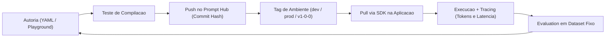

---

## 2.5 Query Reformulation e Prompt Enrichment

Usuários frequentemente enviam pedidos vagos (*"corrija uma PR"*) ou com premissas incorretas. Em vez de repassar a entrada bruta ao LLM principal, intercepte-a com um **modelo menor e mais barato** (mais cache para padrões recorrentes).

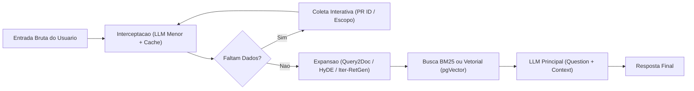

Quatro padrões principais elevam drasticamente a qualidade da recuperação e da resposta:

- **Query2Doc (busca léxica / BM25 / Elasticsearch / Lucene):** expande a pergunta em um mini-documento neutro e rico em vocabulário técnico para ampliar correspondência de termos.
- **HyDE (*Hypothetical Document Embedding* — busca vetorial / pgVector):** gera uma **resposta hipotética plausível** cujo embedding (combinado à query original) aproxima-se dos documentos reais na base vetorial. O documento hipotético serve *apenas* para recuperação — nunca é entregue ao usuário como verdade.
- **Iter-RetGen (*Iterative Retrieval Generation*):** executa ciclos controlados de **Draft** (marcando lacunas como `[MISSING: ...]`) → **Query** (gera perguntas para cada gap) → **Fill** (recupera e preenche os trechos) → **Expansion** (repete apenas enquanto houver lacunas relevantes).
- **Enriquecimento Interativo com Estado:** mantém os campos obrigatórios (ex.: `pr_id`, repositório, escopo) e pergunta ao usuário até completar o contexto mínimo antes de acionar a tarefa principal.

---

## 2.6 Prompt Evaluation e Avaliação Comparativa

Alterar poucas palavras em um prompt pode introduzir regressões silenciosas. **Prompt Evaluation** substitui "achismo" por evidência experimental controlada: testa-se o **prompt** (não apenas o modelo) sobre um **dataset fixo em JSONL** (`input`, `reference`/ground truth e metadados), mantendo modelo e ambiente constantes.

### Dimensões e Tipos de Evaluators

Avalie dimensões específicas junto às métricas sistêmicas (latência P50/P99, tokens e custo):

- **Determinísticos (código):** validam *format adherence* (JSON válido e schema). No troubleshooting, separe três causas: resposta não parseável, JSON válido com schema errado e schema certo com conteúdo incorreto.
- **Binários (`pass/fail`, `0/1`):** julgam cada critério isoladamente para apontar onde falhou e guiar o ciclo *falhou → inspecionou → ajustou → reexecutou*.
- **Contínuos (`ScoreString` `0.0`–`1.0`) e Rubricas Customizadas:** medem coerência, concisão, profundidade, utilidade, *faithfulness* e *toxicity*. Inspecione sempre o *reasoning* do avaliador, não apenas a nota.
- **Embedding Distance (cosseno/L2):** útil somente quando o *ground truth* textual é completo e representativo; isoladamente não valida correção factual.

> [!TIP]
> **Valide seus Evaluators com Prompts Propositalmente Ruins:** notas sempre altas podem esconder avaliadores lenientes. Force cenários negativos — revisor "otimista demais", "verboso fora de escopo", "alucinador" (inventando SQL Injection ou *memory leaks*) e "genérico/sem utilidade" — para confirmar que suas métricas realmente detectam degradação.

### Precision, Recall e F1 para Calibração de Prompts

Em classificação, extração ou detecção de bugs com *ground truth* objetivo, as métricas clássicas mostram exatamente como o texto do prompt calibra o modelo:

```text
Precision = TP / (TP + FP)   -> Confianca: dos alertas emitidos, quantos eram reais?
Recall    = TP / (TP + FN)   -> Cobertura: dos casos reais, quantos foram detectados?
F1        = 2 * (Precision * Recall) / (Precision + Recall)  -> Equilibrio harmonico
```

- Prompts **agressivos** sobem **Recall** mas derrubam **Precision** (excesso de falsos positivos).
- Prompts **conservadores** sobem **Precision** mas arriscam perder falhas reais (queda de **Recall**).
- Escolha o equilíbrio conforme o **custo do erro no domínio** e evite forçar F1 em tarefas puramente subjetivas.

```python
def compute_metrics(tp: int, fp: int, fn: int) -> dict:
    precision = tp / (tp + fp) if (tp + fp) > 0 else 0.0
    recall = tp / (tp + fn) if (tp + fn) > 0 else 0.0
    f1 = (2 * precision * recall / (precision + recall)) if (precision + recall) > 0 else 0.0
    return {"precision": round(precision, 3), "recall": round(recall, 3), "f1": round(f1, 3)}
```

### Pairwise Evaluation (LLM-as-Judge) vs. A/B Testing

Para tarefas abertas (documentação, revisão de código), compare versões concorrentes (Prompt A vs. Prompt B) com **Pairwise Evaluation**:

- **Pairwise Evaluation (offline, controlado):** roda A e B no mesmo dataset e usa um juiz (*LLM-as-Judge*) com **rubrica explícita de vitória**, opção de **empate** (empates frequentes indicam ausência de ganho real) e **justificativa textual auditável** no LangSmith.
- **A/B Testing (online, produção):** mede impacto real em usuários e métricas de negócio sob tráfego ao vivo.

Rankings não são permanentes: qualquer mudança de modelo, tarefa ou contexto exige reexecutar a mesma suíte de avaliação.

---

## 2.7 Checklist de Aplicação Prática

- [ ] **Comece simples e escale por evidência:** parta de *zero-shot* estruturado; adicione *few-shot*, CoT, ToT, ReAct ou Chaining apenas quando a tarefa ou a avaliação comprovar o ganho.
- [ ] **Separe System (global) de User (específico):** explicite inputs, workflow ordenado, schema de saída, bloco de `assumptions` e instruções negativas.
- [ ] **Otimize custo e latência no design do prompt:** coloque prefixos estáticos no início (*Prompt Caching*), use sumarização ou *sliding window* + storage externo em chats longos e *batch prompting* em tarefas homogêneas.
- [ ] **Versione prompts como software:** use YAML declarativo, `README`, `CHANGELOG`, testes de compilação e commit hashes/tags imutáveis no Prompt Hub.
- [ ] **Intercepte entradas ruins antes do LLM principal:** aplique *Query2Doc* (BM25), *HyDE* (vetorial), *Iter-RetGen* ou coleta interativa de campos obrigatórios.
- [ ] **Avalie em dataset fixo (JSONL):** combine validadores determinísticos de JSON/schema, critérios binários/contínuos com *reasoning* e métricas de latência (P50/P99) e custo.
- [ ] **Calibre evaluators e reavalie continuamente:** valide avaliadores com prompts ruins propositais, ajuste *Precision vs. Recall* ao risco do domínio e rode *Pairwise Evaluation* a cada mudança de prompt ou modelo.


---


# Capítulo 3 — Design Docs e Documentação Viva na Era da IA

> **O problema real e o modelo mental:** Código-fonte registra *o que* o sistema faz hoje, mas apaga o *porquê*, as restrições de negócio e as alternativas descartadas. Na engenharia assistida por IA, documentação deixa de ser anexo burocrático para se tornar **contexto operacional**: se ela não existe, o modelo alucina premissas; se está desatualizada, o modelo gera código convincente e estruturalmente errado.

---

## 3.1 De artefato burocrático a contexto operacional

A documentação em engenharia de software historicamente oscilou entre o excesso cerimonial que trava a entrega e a ausência total que condena o sistema à memória oral:

| Era / Abordagem | Propósito documental | Atualização | Consumidor principal | Principal modo de falha |
| :--- | :--- | :--- | :--- | :--- |
| **Waterfall** | Contrato congelado pré-código | Única (início) | Analistas e gestores | Software fiel ao doc, porém obsoleto frente ao negócio |
| **RUP** | Disciplina formal centrada em arquitetura (UML e papéis rígidos) | Por fase formal | Arquitetos, analistas, QA | Peso burocrático e alto custo de mudança |
| **Agile (2001)** | Mínimo suficiente e útil para reduzir ambiguidade | Contínua (em teoria) | Produto e engenharia | Distorção como "licença para não documentar nada" |
| **Era da IA** | **Contexto operacional** para geração, revisão e manutenção | Bidirecional no workflow | Humanos **e** agentes de IA | Docs genéricos ou defasados induzindo alucinações |

O Manifesto Ágil nunca propôs eliminar documentação, mas sim eliminar artefatos desconectados do trabalho real. Com LLMs no fluxo de desenvolvimento, essa premissa ganha peso imediato: a IA não possui conhecimento implícito sobre seu domínio. Regras óbvias para o time — políticas multi-tenant, metas de latência P95 ou convenções de erro — precisam estar explícitas no repositório.

Para escapar do envelhecimento natural dos documentos, adote um **ciclo bidirecional de documentação viva**: a documentação alimenta a IA para implementar ou alterar uma funcionalidade e, antes do merge, a própria IA revisa e atualiza os documentos afetados pela mudança.

> [!WARNING]
> **Armadilha Comum — A falsa confiança:** Documentação desatualizada é pior do que ausência de documentação. Ela transmite segurança ilusória para o time e atua como veneno de contexto para agentes de IA, que seguem regras obsoletas com obediência mecânica. Documento sem gatilho de atualização no workflow vira passivo técnico.

---

## 3.2 A cadeia de abstração: do PRD ao LLD

Pedidos vagos como *"gere um design doc"* produzem textos genéricos que misturam objetivos comerciais com detalhes de implementação. Documentação útil organiza o raciocínio em uma **cadeia de abstração**, na qual cada artefato responde a uma pergunta distinta.

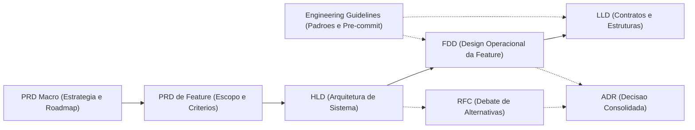

Nem toda entrega exige a cadeia inteira. Escolha o nível pela densidade de decisões e risco técnico:

| Documento | Pergunta central | Granularidade | Quando criar | O que evitar |
| :--- | :--- | :--- | :--- | :--- |
| **PRD Macro** | *Por que* a iniciativa existe e qual sua direção? | Produto / Épico | Alinhamento estratégico, roadmap, papéis, KPIs e riscos macro | Cronograma rígido ou detalhes de banco |
| **PRD de Feature** | *O que* a feature entrega e como provar que está pronta? | Funcionalidade | Entregas com regras, métricas e fluxos próprios (ex.: Login SSO/2FA) | Detalhes internos de implementação |
| **HLD** (*High-Level Design*) | *Como* o sistema se organiza em containers e integrações? | Sistema (C2) | Arquitetura macro, interfaces públicas, segurança, escala, observabilidade | Contratos completos de classes |
| **FDD** (*Feature Design Doc*) | *Como* a feature opera no código real? | Feature técnica | Fechar a lacuna entre arquitetura e código (headers, fallbacks, erros, telemetria) | Responsabilidades fora de escopo |
| **LLD** (*Low-Level Design*) | *Quais* assinaturas, structs e algoritmos serão codificados? | Módulo / Código | Domínios complexos, concorrência crítica ou SDKs públicos | Duplicar código simples em prosa |
| **RFC** (*Request for Comments*) | *Quais* alternativas estão em debate? | Proposta aberta | Decisões controversas que exigem alinhamento entre times | Usar como histórico final (consolide em ADR) |
| **ADR** (*Architecture Decision Record*) | *Por que* escolhemos este caminho e quais trade-offs aceitamos? | Decisão pontual | Decisões estruturais, evidentes e estáveis | Tutoriais ou detalhes triviais |

### Entrevista guiada, formato duplo e Deep Research

Em vez de pedir à IA que escreva um PRD, HLD ou FDD diretamente, inverta o fluxo para uma **entrevista guiada**:

1. **Coleta estruturada:** A IA lê insumos prévios (codebase, PRD ou HLD) e conduz perguntas por bloco temático, organizando as respostas por chave.
2. **Checagem de consistência:** Antes de gerar o texto final, o prompt instrui a IA a detectar contradições (por exemplo, centralizar estado sem listar ponto único de falha nos riscos) e interromper a geração se houver lacunas críticas.
3. **Formato duplo (Markdown + JSON opcional):** Renderize o documento principal em **Markdown estável** para revisão humana em PRs e exporte **JSON** apenas quando houver consumo por agentes ou automações.

Em temas tecnicamente densos (como rate limiting distribuído com Redis e scripts Lua em Go), aplique **Deep Research em duas fases**: conduza uma entrevista curta para gerar um briefing calibrado (tema, stack, motivação, profundidade), execute a pesquisa profunda, reformate o conteúdo para o template do time (comparando modelos em saídas longas para preservar densidade técnica) e gere o rascunho de FDD exigindo **grounding** (citação da fonte original) antes da revisão humana.

### Exemplo prático: esqueleto enxuto de FDD orientado a agentes

Requisitos numerados (`RF-01`, `RNF-01`), não-escopo explícito e critérios observáveis reduzem drasticamente interpretações arbitrárias:

```markdown
# FDD-04: Middleware e Core do Rate Limiter SDK (Go)

- **Referências:** `PRD-04`, `HLD-02`, `ADR-012` (Redis + Lua), `ADR-014` (Fallback Open)

## 1. Escopo e Não-Escopo
- **Em escopo:** Extração de chave (API key, tenant, IP), Fixed Window / Token Bucket, headers HTTP padrão e resposta `429 Too Many Requests`.
- **Fora de escopo:** Autenticação, autorização e painel administrativo de políticas.

## 2. Requisitos Rastreáveis
- **RF-01 (Bloqueio observável):** Ao exceder o limite, o middleware bloqueia antes do handler e retorna `HTTP 429` com `Retry-After`, `X-RateLimit-Limit` e `X-RateLimit-Remaining: 0`.
- **RF-02 (Configuração segura):** `NewLimiter(opts ...Option)` usa Functional Options com validação no construtor, impedindo instâncias inválidas em runtime.
- **RNF-01 (Latência e atomicidade):** Overhead P95 < 3ms; Redis via `EVALSHA` (Lua atômico); modo local com locks por chave.
- **RNF-02 (Fallback e telemetria):** Em falha do Redis, aplicar `fail-open`, log estruturado e métrica `ratelimit_fallback_total`.

## 3. Critérios de Aceite
- [ ] Requisição permitida chega ao handler com headers `X-RateLimit-*`.
- [ ] Requisição negada não invoca o handler e retorna `429` + `Retry-After`.
- [ ] Queda do Redis aciona `fail-open` sem panic e emite telemetria.
```

---

## 3.3 Diagramas como código: C4 Model e Mermaid

Diagramas desenhados em ferramentas gráficas morrem após a primeira refatoração. Tratar **diagramas como código** (texto versionado no Git junto ao FDD) garante diff em Pull Requests, baixa fricção de manutenção e geração assistida por IA.

Combine o **Modelo C4** (em PlantUML `.puml` ou Structurizr) para fronteiras arquiteturais rigorosas com **Mermaid** para fluxos, sequências e máquinas de estado embutidos no Markdown:

| Nível C4 | Foco operacional | Exemplo no Rate Limiter SDK | Quando gerar |
| :--- | :--- | :--- | :--- |
| **C1 — System Context** | Fronteira do sistema, atores e sistemas externos | Desenvolvedor, Operador, Serviço Host + SDK, Redis, Observabilidade | Sempre em HLDs e onboarding |
| **C2 — Containers** | O que roda em produção e como integra | App HTTP + Middleware, Cluster Redis, OpenTelemetry Collector (com *sampling*) | Sempre com múltiplos processos/serviços |
| **C3 — Components** | Blocos internos e responsabilidades | Key Extractor, Public API interna, Strategy Engine, Storage Adapter (Lua/Locks) | Em FDDs de módulos complexos ou SDKs |
| **C4 — Code** | Interfaces e implementações concretas | Interface `Store` vs. `RedisStore`/`MemoryStore`, structs e tipos | **Raramente** — apenas se reduzir carga cognitiva |

Para diagramas em Mermaid, escolha o tipo pela pergunta que precisa responder: `flowchart` para ramificações e decisões; `sequenceDiagram` para interações no tempo; `stateDiagram-v2` para ciclos de vida (`Active -> Limited -> Cooling Down -> Blocked`); `classDiagram` para contratos e padrões Strategy/Adapter; `erDiagram` para entidades e cardinalidades.

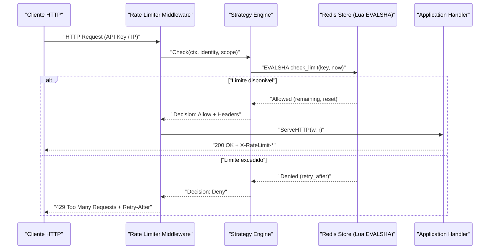

### Workflow de geração com subagente

Encapsule a geração de diagramas em um workflow executado preferencialmente em **subagente isolado** (para não contaminar o contexto principal): ler o FDD como fonte única; decidir o nível máximo sustentado sem inventar componentes; dividir diagramas Mermaid com mais de 10 nós; salvar `.puml` (UTF-8) ou Markdown único com justificativas ligadas ao FDD; e revalidar o resultado contra o documento original.

> [!IMPORTANT]
> **Regra de Ouro — Sintaxe válida não é fidelidade semântica:** Um diagrama Mermaid ou PlantUML compilar sem erros não garante que ele reflita a arquitetura aprovada. Valide manualmente primário/réplicas, caminhos de fallback, contratos públicos e concorrência — e use hooks pré-commit para evitar divergência entre FDD e diagramas.

---

## 3.4 Architecture Decision Records (ADRs) e o Grafo Histórico

O **ADR** preserva o racional por trás de escolhas arquiteturais relevantes — não para defender a tecnologia escolhida, mas para registrar contexto, restrições, alternativas descartadas e consequências aceitas. O formato **MADR** (*Markdown Architecture Decision Record*) padroniza seções e metadados para leitura rápida, CLIs (ADR Tools), GitHub Actions e extração por agentes.

### Status e semântica de vínculos

Um acervo de ADRs só funciona como **timeline arquitetural** quando status e relacionamentos respeitam semântica estrita:

| Tipo | Termo | Significado e regra prática |
| :--- | :--- | :--- |
| **Status** | `Draft` / `Proposal` | `Draft` é rascunho interno; `Proposal` já entrou formalmente em aprovação |
| **Status** | `Accepted` | Decisão aprovada e vigente (mesmo antes de toda implementação terminar) |
| **Status** | `Rejected` / `Withdrawn` | `Rejected` foi analisado e descartado; `Withdrawn` saiu de pauta por mudança de contexto |
| **Status** | `Deprecated` | Não adotar em novos contextos; sistemas legados continuam válidos sem migração obrigatória |
| **Status** | `Superseded` | Substituído por ADR mais novo — **sempre** parear `superseded_by` e `supersedes` |
| **Vínculo** | `amends` | Ajuste ou extensão parcial de ADR antigo, sem substituição completa |
| **Vínculo** | `relatesTo` / `dependsOn` | `relatesTo` indica afinidade técnica; `dependsOn` indica dependência estrutural real |

### Exemplo prático: esqueleto MADR versionado

```markdown
---
id: ADR-014
title: Estrategia Fail-Open na indisponibilidade do Redis
status: Accepted
date: 2026-04-10
deciders: ["Tech Lead Plataforma", "Arquitetura"]
dependsOn: ["ADR-012"]
relatesTo: ["ADR-009"]
supersedes: []
superseded_by: null
---

# ADR-014: Estratégia Fail-Open na Indisponibilidade do Redis

## Contexto e Forças em Jogo
O Rate Limiter SDK protege APIs públicas usando Redis distribuído (`ADR-012`).
Em partição de rede ou failover do cluster, precisamos escolher entre bloquear tráfego (`fail-closed`) ou operar em passagem degradada (`fail-open`).

## Decisão
Adotar **`fail-open`** como padrão para endpoints públicos de leitura, combinado com circuit breaker curto, log estruturado e métrica `ratelimit_fallback_total`.

## Alternativas Consideradas
1. **Fail-Closed global:** Proteção rígida contra abuso, mas converte falha de cache em indisponibilidade total da plataforma.
2. **Fallback silencioso para memória local:** Mascara falhas distribuídas e multiplica o limite pelo número de réplicas sem visibilidade.

## Consequências
- **Positivas:** Preserva disponibilidade durante falhas transitórias do Redis.
- **Negativas:** Janela temporária de exposição a picos; exige alerta SRE imediato quando `ratelimit_fallback_total > 0`.

## Referências
- HLD: `docs/hld/HLD-02-edge-protection.md` | FDD: `docs/fdd/FDD-04-rate-limiter-sdk.md`
```

### A Regra dos 3 Es e o pipeline de ADRs com IA

Para evitar **"documentacite"** — excesso de documentos triviais que poluem a recuperação de contexto da IA —, só crie um ADR quando a decisão passar na **Regra dos 3 Es**:

- **Estrutural:** Impacta arquitetura, integrações, contratos públicos, dados, segurança, resiliência ou modelo operacional (ex.: REST vs. gRPC, SQL vs. NoSQL, OAuth2/JWT, Kubernetes vs. Cloud Run, Terraform, circuit breakers).
- **Evidente:** Engenheiros futuros precisarão do racional e não conseguirão deduzi-lo apenas lendo o código.
- **Estável:** Tem expectativa razoável de durar meses ou anos.

Detalhes locais, entidades de domínio rotineiras e configurações triviais ficam no código, `README.md` ou `CONTRIBUTING.md`.

Em repositórios legados sem histórico documentado, aplique um **pipeline em quatro estágios assistido por agentes**:
1. **Mapeamento:** Um agente analisa código, dependências e histórico Git aplicando *red flags* para filtrar ruído de domínio.
2. **Potenciais ADRs:** Classifica achados por módulo em **`must document`** (prioridade clara) e **`consider`** (zona cinzenta para julgamento humano).
3. **Geração Formal:** Escreve o MADR definitivo mantendo abstração arquitetural e **pausando para solicitar contexto humano** quando a motivação estratégica ou comercial não constar no Git.
4. **Linkagem:** Um agente conecta os ADRs via `dependsOn`, `relatesTo`, `supersedes` e links bidirecionais com HLDs/FDDs, formando um **grafo histórico de decisões**.

---

## 3.5 Engineering Guidelines e Manutenção Contínua

Quando múltiplos engenheiros — ou agentes especializados paralelos (front-end, back-end, CI/CD) — atuam no mesmo repositório sem convenções explícitas, a base se fragmenta e PRs ficam contaminados por refatorações fora de escopo.

As **Engineering Guidelines** atuam como constituição técnica subordinando qualquer agente aos padrões do projeto. Elas reúnem: **Project Stack** (linguagem, framework, banco, ORM, validação como Zod/Pydantic, versões e links oficiais), **práticas operacionais** (formatação, linting como `go vet`/ESLint, concorrência, tratamento de erros, logs, observabilidade e segurança), **estratégia de testes** (*table-driven tests*, injeção de dependências, mocks, testes de integração), **higiene de Git/PR** e um bloco final de **Golden Rules + Checklist Pré-Commit**.

No mapa completo de documentação de engenharia, essas guidelines convivem com **Runbooks e Playbooks** (operação de produção e incidentes para SRE/DevOps), **documentos de Evaluation** (critérios objetivos para sistemas com IA) e **TRDs**, substituindo planos de teste manuais legados.

> [!TIP]
> **Regra de Ouro — Orçamento de linhas nas Guidelines:** Guidelines verbosas diluem a atenção do modelo e deixam de ser mantidas. Defina um limite rígido (entre **1.000 e 1.500 linhas** para o guia da stack), evite exemplos de tutorial redundantes e execute compactação iterativa sempre que o documento crescer além do teto.

---

## 3.6 Checklist de Aplicação Prática

- [ ] **Definir a taxonomia documental do time:** Explicitar qual pergunta PRD, HLD, FDD, ADR e Guidelines respondem, eliminando pedidos genéricos à IA.
- [ ] **Usar entrevista guiada com checagem de consistência:** Coletar decisões estruturadas e resolver contradições antes de renderizar o Markdown (e JSON opcional).
- [ ] **Fechar o ciclo de documentação viva no PR:** Tornar a atualização de FDDs, diagramas e ADRs etapa obrigatória sempre que a feature alterar contratos ou arquitetura.
- [ ] **Versionar diagramas como código:** Combinar C4 (C1–C3) e Mermaid no repositório, validando manualmente a fidelidade semântica ao FDD.
- [ ] **Aplicar a Regra dos 3 Es nos ADRs:** Documentar apenas decisões *estruturais*, *evidentes* e *estáveis*; preservar histórico com `Superseded`/`superseded_by` sem reescrever o passado.
- [ ] **Mapear legados em quatro etapas:** Separar varredura com *red flags*, triagem (`must document` vs. `consider`), redação com input humano e linkagem em grafo histórico.
- [ ] **Publicar Engineering Guidelines enxutas com checklist pré-commit:** Manter stack, Golden Rules e teto de linhas atualizados para governar humanos e agentes paralelos.


---


# Parte II — Desenvolvimento em Modo Agente e Extensibilidade


# Capítulo 4 — Desenvolvimento em Modo Agente: SDD e Harness Engineering

> **O problema real e o modelo mental:** Gerar código com LLMs ficou barato; garantir que esse código respeite a arquitetura, integre-se entre features e funcione de ponta a ponta é o novo gargalo. Desenvolver em modo agente exige separar duas disciplinas complementares: **Spec-Driven Development (SDD)** define *o que* o sistema deve ser; **Harness Engineering** projeta o ambiente determinístico que governa *como* o agente constrói, valida e comprova a entrega.

---

## 4.1 Spec-Driven Development (SDD) e seus três níveis de maturidade

No **Spec-Driven Development (SDD)**, a especificação atua como contrato explícito entre produto, implementação e testes. Em vez de improvisar prompts e descobrir *edge cases* após o código pronto, o time antecipa regras de negócio, tratamento de erros e fronteiras de integração **antes** da geração.

Inspirado na progressão popularizada na literatura de engenharia (como nos artigos do ecossistema Martin Fowler), o SDD evolui em três níveis de maturidade:

| Nível de SDD | Papel da especificação | Manutenção contínua | Uso ideal | Trade-off principal |
| :--- | :--- | :--- | :--- | :--- |
| **1. Spec First** | Criada antes do código para guiar uma entrega pontual | Descartada ou congelada após o merge | Protótipos, spikes, tarefas isoladas | Baixo custo, mas perde histórico acumulado |
| **2. Especificação Ancorada** | Evolui junto com o código e é validada pelos testes | Persistida feature a feature no repositório | Sistemas reais em evolução contínua | Exige disciplina para evitar contradições históricas |
| **3. Spec as Source** | Único local editável; código derivado é regenerado | Total (sem edição manual no código gerado) | Direção de maturidade em pipelines maduros | Requer pipeline ultraconfiável; ajustes de ambiente ainda ocorrem |

Na prática, a **Especificação Ancorada** entrega o melhor retorno: constrói uma linha do tempo de features e dependências que orienta tanto humanos quanto sessões futuras da IA. O nível de detalhe necessário também é dinâmico — conforme os modelos ganham capacidade de inferência, parte do detalhamento trivial pode diminuir sem perder previsibilidade.

### A fronteira entre SDD e Harness

Não tente controlar o comportamento do agente enchendo a especificação de microgerenciamento. Separe os papéis:

- **SDD define *o quê*:** intenção de negócio, *core scope* versus extensões, contratos de API e dados, comportamento explícito de erro, *edge cases* e critérios de aceitação.
- **Harness define *como*:** ferramentas, scripts de ambiente, gates de qualidade, isolamento de execução e validação externa.

### Artefatos operacionais do fluxo SDD

Um pipeline SDD estruturado divide intenção, estado e contrato de verificação em cinco artefatos versionados:

1. **`PRD.md` (skill `PRD Writer`):** Construído via entrevista, inferência e autovalidação (até três ciclos de correção automática). Separa *core scope* de extensões, explicita comportamento de erro e declara dependências entre features em **`Consumes` e `Provides`**.
2. **`PRDProgress.json` (ou `tracking.json`):** Fonte objetiva de estado (`pending` -> `implemented` -> `done` + link para relatório de avaliação), eliminando a amnésia entre sessões conversacionais.
3. **`spec.md` (skill `Spec Writer`):** Desenho técnico calibrado por heurística de complexidade (arquitetura, componentes, contratos de API, modelo de dados e *edge cases*).
4. **`plan.md`:** Decompõe a `spec.md` em passos sequenciais de execução — operacionaliza o trabalho, mas **não** substitui o tracking de estado.
5. **`contract.md`:** Contrato ativo de execução e aceite: serviços de runtime, fixtures, gates determinísticos e manifesto de cobertura por *surfaces* com critérios Given/When/Then.

---

## 4.2 Paralelização segura, contratos entre features e Waves

Em modo agente, features raramente falham isoladas — elas falham **nas costuras de integração**. Um agente pode entregar upload de vídeo e outro entregar a biblioteca de vídeos com testes unitários verdes, mas o sistema quebra se o redirecionamento pós-login, o evento assíncrono ou o schema de metadados divergirem.

### A Regra de Ouro em integrações

Trate toda integração entre features como um **contrato explícito** (`Provides` / `Consumes`), acompanhado de **critérios de aceitação cross-feature** testados em todo ponto de passagem. Quando uma dependência assíncrona ainda não foi implementada, a feature consumidora entrega integralmente sua parte e declara explicitamente a fronteira pendente sem mascarar a lacuna.

### Orquestração em Waves, Worktrees e resolução de conflitos

Com dependências explícitas no PRD, a paralelização segue cinco regras operacionais:

- **Waves (rodadas):** Execute features bloqueantes primeiro (autenticação, upload core) e agrupe features independentes em *Waves* paralelas.
- **Git Worktrees e `tmux`:** Isole cada agente em branch e diretório próprios (`git worktree`), coordenando sessões paralelas em `tmux` sem disputa pelo mesmo diretório.
- **Isolamento de runtime e dados:** Configure portas dedicadas por worktree (evitando assumir sempre a porta `3000`) e bancos/schemas com prefixo controlado (ex.: `VideoMaxCloud-*`) para limpeza segura.
- **Economia de tokens no orquestrador:** Em execução em lote (*batch mode*), não faça cada subagente reler o repositório e o PRD inteiro do zero; extraia e persista artefatos de contexto compartilhado em disco uma única vez.
- **Integração rigorosa antes da PR:** Sincronize com `main`, resolva conflitos, **regenere artefatos derivados** (como Prisma Client e migrações após conflito de schema), reexecute **todos** os critérios de aceitação (incluindo E2E se o front-end foi impactado) e remova branch e worktree após o merge.

> [!WARNING]
> **Armadilha Comum — Hard Fail, Soft Fail e o falso verde dos fakes:** No relatório final da skill `implement`, exija distinção clara entre **Hard Fail** (bloqueio estrutural insuperável, como ausência de credencial) e **Soft Fail** (impedimento parcial contornado). E nunca encerre a validação de pipelines assíncronos apenas com *fakes*: dublês validam lógica repetível, mas só serviços reais comprovam autenticação, rede e serialização.

---

## 4.3 Harness Engineering: domando a execução autônoma

Popularizado por relatos práticos como *"My AI Adoption Journey"* (Mitchell Hashimoto), o **Harness Engineering** segue uma regra de engenharia iterativa: **sempre que um agente comete um erro previsível, você ajusta o ambiente para que aquele erro nunca mais possa se repetir.**

Para evitar sobreposição conceitual, diferencie as três camadas:

| Disciplina | Pergunta central | O que controla | Horizonte típico | Limite quando usada sozinha |
| :--- | :--- | :--- | :--- | :--- |
| **Prompt Engineering** | *Como* instruir o modelo? | Formulação, *few-shot*, *chain-of-thought* | Uma interação | Não controla visibilidade nem efeitos no repositório |
| **Context Engineering** | *O que* o agente pode ver? | Dados, documentos e mínimo necessário na janela | Uma sessão | Não bloqueia desvio arquitetural nem código não testado |
| **Harness Engineering** | *Em que ambiente* o agente opera? | Prompt + contexto + ferramentas, scripts, gates, estado e avaliação | Horas de execução autônoma | Sem SDD claro, automatiza a entrega da coisa errada |

### General-Purpose Harness vs. User Harness

Um ambiente agêntico desacopla o **cérebro** (LLM) do **corpo** (harness):

- **General-Purpose Harness:** Base neutra fornecida por ferramentas como Claude Code, Codex ou Cursor (sessões, terminal, manipulação de arquivos e tools).
- **User Harness (Outer Harness):** Camada construída pelo time sobre a base genérica — `AGENTS.md` / `CLAUDE.md`, *Skills*, scaffolding, scripts, gates e avaliadores — que evolui de forma incremental a partir dos desvios reais do projeto.

### Context Anxiety e Self-Evaluation Bias

Dois comportamentos recorrentes em LLMs tornam a autonomia sem harness arriscada:

1. **Context Anxiety:** Ao perceber a janela de contexto perto do limite, o agente entra em modo defensivo — resume etapas, corta verificações, improvisa gambiarras e declara término apressado.
2. **Self-Evaluation Bias:** Ainda mais perigoso. Quando o mesmo agente que codificou avalia o próprio trabalho, tende a aprová-lo com confiança excessiva — afirmando que "tudo funciona" sem sequer subir o servidor ou executar a aplicação, mesmo com instrução explícita em `AGENTS.md`.

> [!IMPORTANT]
> **Regra de Ouro — Separe execução de avaliação:** Instrução textual orienta, mas não garante execução. Um agente nunca deve ser o único avaliador do próprio código. Trate **"tarefa concluída" como um estado verificável externamente** (gates verdes, ambiente ativo, evidências observáveis), jamais como autorrelato do modelo.

---

## 4.4 Anatomia de um User Harness de produção

O fluxo abaixo integra SDD, isolamento, gates determinísticos e avaliação independente:

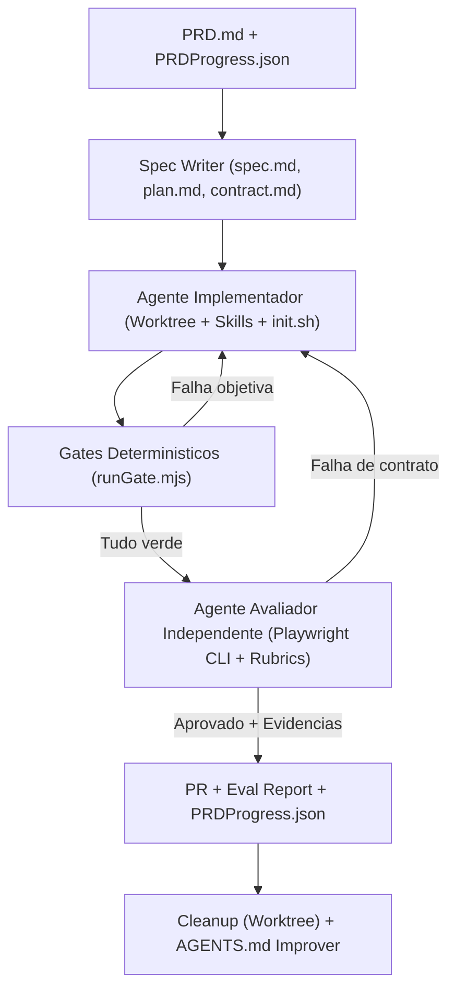

### 1. Guidance enxuta, Skills modulares e Design System

Mantenha `AGENTS.md` / `CLAUDE.md` conciso (estrutura do monorepo como `apps/web` e `apps/backend`, comandos de bootstrap, alertas temporários de APIs novas como Next.js 16 e regras invioláveis) e mova detalhes de domínio para **Skills modulares** (`SKILL.md` enxuto + referências carregadas sob demanda). No front-end, como gates estáticos não garantem consistência visual, documente **tokens de design, primitivos Tailwind e referências visuais** no `AGENTS.md`, proibindo estilos improvisados em `global.css`.

### 2. Scaffolding determinístico, `init.sh` e fixtures

Economize tokens gerando boilerplate de projeto via **scripts de scaffolding** antes do código de domínio (DDD). Padronize também um `init.sh` (com seeds **idempotentes** e suporte a `--ignore-seed`) e scripts dedicados para assets pesados de teste — por exemplo, gerar um arquivo de vídeo de 2GB via `dd` ou `ffmpeg` fora do Git e documentá-lo no `AGENTS.md` (lembrando que testes de upload ainda transferem o tamanho aparente do arquivo).

### 3. Gates determinísticos centralizados (`runGate.mjs`)

Gates determinísticos retornam erros concretos e repetíveis que aceleram a convergência do agente. Centralize toda a cadeia em um único script usado igualmente por humano, CI e agente:

```javascript
// scripts/runGate.mjs — cadeia determinística de verificação
import { execSync } from "node:child_process";

const gates = [
  { name: "TypeScript (tsc)", cmd: "npm run typecheck" },
  { name: "ESLint (zero warnings)", cmd: "npx eslint . --max-warnings=0" },
  { name: "Dependency Cruiser (camadas)", cmd: "npm run arch:deps" },
  { name: "Check Architecture (regras locais)", cmd: "npx tsx scripts/check-architecture.ts" },
  { name: "Automated Tests", cmd: "npm test" },
  { name: "Knip (dead code e exports orfaos)", cmd: "npx knip" },
];

for (const gate of gates) {
  console.log(`[GATE] Executando: ${gate.name}`);
  execSync(gate.cmd, { stdio: "inherit" });
}
```

A cadeia protege cada fronteira: `tsc` valida contratos de tipos; `ESLint` com `--max-warnings=0` bloqueia erosão gradual; `Dependency Cruiser` impede importações ilegais entre camadas; `check-architecture.ts` impõe convenções próprias (como `process.env` restrito a `env.ts`, *composition root* em `main.ts` e proibição de `try-catch` cru em handlers); os testes verificam comportamento; e **`Knip`** remove arquivos órfãos e exports abandonados durante explorações do agente.

### 4. Contratos executáveis e estado persistente

```markdown
# Contract — F01: Landing Page Pública

## Runtime Services
- `apps/web` (Next.js Dev Runtime em porta isolada) + Browser real via `playwright-cli`

## Quality Gates
- `node scripts/runGate.mjs` com exit code `0`

## Coverage Manifest (Surface: UI / Public-01)
- **Pré-condição:** Visitante anônimo em `/` sem cookies nem sessão.
- **AC-01 (Given/When/Then):** Dado acesso anônimo em `/`, quando carrega, então exibe CTA de registro, login no topo e zero erros 5xx/console.
- **AC-02:** Dado usuário autenticado em `/`, então redireciona para `/dashboard`.
- **AC-03 (Híbrido):** Aderência aos tokens visuais (anexar screenshot para revisão).
```

```json
{
  "project": "VideoMax",
  "features": [
    { "id": "F01", "name": "Landing Page Publica", "dependsOn": [], "status": "done", "evalReport": "docs/evals/F01-eval-report.md" },
    { "id": "F02", "name": "Autenticacao", "dependsOn": ["F01"], "status": "implemented", "evalReport": null },
    { "id": "F03", "name": "Video Upload", "dependsOn": ["F02"], "status": "pending", "evalReport": null }
  ]
}
```

---

## 4.5 Avaliação independente, observabilidade e gestão de degradação

Gates estáticos validam estrutura, não experiência real. Quatro mecanismos fecham o ciclo de qualidade em produção:

1. **Agente Avaliador + Playwright CLI:** Um agente independente valida o `contract.md` operando um browser real via **Playwright CLI** (inspeção de DOM, rede, console, abas, *snapshots* e screenshots em modo *headless* ou visível para depuração). Como consome tokens extras, aplique-o seletivamente segundo o risco da feature.
2. **Rubrics multidimensionais:** Substitua veredictos binários vagos por *rubrics* (design, navegação, comportamento, código), podendo acionar avaliadores especializados por dimensão. O relatório deve registrar status objetivos (`ok`, `fail`, `pending`, `aborted`) e **sinalizar critérios subjetivos para revisão humana**.
3. **Observabilidade no ciclo de dev:** Conecte telemetria (ex.: Elastic Stack ou OpenTelemetry em Docker) já no ambiente de desenvolvimento para que requisitos não funcionais integrem a avaliação antes de produção.
4. **Gestão de Degradação (Controle de Entropia):** Assuma que a IA introduzirá ruído ao longo do tempo e remova-o continuamente — rodando sessões limpas de **`simplify`**, aplicando lock (`orchestrate.lock`) e journal em workflows automatizados, e executando o loop **`AGENTS.md improver`** após sessões difíceis, sempre com curadoria humana para aceitar checks úteis e rejeitar verbosidade.

> [!TIP]
> **Regra de Ouro — Pragmatismo na orquestração:** Multiplicar subagentes traz custo de contexto e sincronização. Comece com um único modelo forte em um harness bem instrumentado e só introduza subagentes quando o ganho de isolamento for real (como separar **Implementador** de **Avaliador** ou paralelizar *Waves* independentes).

---

## 4.6 Checklist de Aplicação Prática

- [ ] **Adotar Especificação Ancorada e separar SDD de Harness:** Manter intenção/contratos na spec e controles operacionais no ambiente do agente.
- [ ] **Formalizar contratos cross-feature (`Consumes`/`Provides`):** Exigir testes de integração em todos os pontos de passagem entre features.
- [ ] **Persistir estado fora do chat:** Versionar `PRDProgress.json` (com link para *eval reports*), `spec.md`, `plan.md` e `contract.md`.
- [ ] **Paralelizar com isolamento real:** Usar *Waves*, `git worktree` (e `tmux`), portas dinâmicas e prefixo de banco seguro; sincronizar `main`, regenerar artefatos derivados e revalidar tudo antes da PR.
- [ ] **Centralizar gates determinísticos em `runGate.mjs`:** Reunir `tsc`, `ESLint` (`--max-warnings=0`), `Dependency Cruiser`, `check-architecture`, testes e `Knip`.
- [ ] **Separar implementação de avaliação:** Mitigar *Context Anxiety* e *Self-Evaluation Bias* com agente avaliador independente, Playwright CLI e *rubrics*.
- [ ] **Fechar o loop anti-degradação:** Executar `simplify` em sessão limpa e revisar periodicamente melhorias propostas para `AGENTS.md` e scripts do harness.


---


# Capítulo 5 — Desenvolvimento de Software e Aplicações com IA no Dia a Dia

> **O problema real e o modelo mental**
> Usar IA apenas como chat reativo gera ganhos pontuais que se dissipam em retrabalho, exploração repetitiva do repositório e código inconsistente. Produtividade sustentável nasce quando você constrói um **sistema operacional de engenharia**: ambiente reproduzível, contrato de contexto enxuto, testes confiáveis e workflows estruturados que convertem intenção em entrega verificável.

---

## 5.1 Do Modo Reativo ao Sistema de Engenharia com IA

Desenvolver com IA desloca o centro do trabalho técnico do ato de digitar código para a capacidade de especificar, preparar o ambiente, orquestrar execuções e revisar entregas.

A diferença prática está entre o **modo reativo** e o **modo orientado por processo**:

- **Modo reativo**: pedidos soltos no chat, ambiente local ambíguo, exploração repetitiva de pastas e retrabalho contínuo para corrigir convenções esquecidas.
- **Modo orientado por processo**: intenção, arquitetura, convenções e critérios de aceite vivem em artefatos versionados. O agente opera sobre uma fundação previsível e valida alterações contra comandos determinísticos.

Nesse fluxo, a **documentação torna-se a fonte primária de verdade**. Mesmo código tecnicamente limpo falha se implementar uma especificação ambígua — a IA apenas executa o erro com mais velocidade. Revisar especificações é revisar o entendimento do produto antes da implementação.

### O Workflow RPI (Research → Plan → Implement)

Para substituir improviso por previsibilidade, tarefas não triviais seguem o ciclo **RPI** (*Research → Plan → Implement*), base operacional do *Spec-Driven Development* (aprofundado no Capítulo 7):

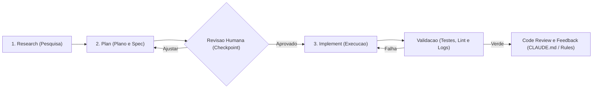

1. **Research**: o agente lê código existente, dependências, schemas e contratos sem editar arquivos, eliminando suposições.
2. **Plan**: gera-se um plano objetivo listando arquivos afetados, regras de negócio, *edge cases* e critérios de aceite. Esse checkpoint humano é o ponto mais barato para corrigir rumos.
3. **Implement**: após aprovação, o agente implementa em incrementos curtos, validando cada passo contra testes e logs reais.

> [!TIP]
> **Ferramentas convergem; o modelo mental permanece.** Combinar uma IDE nativa de IA (Cursor ou Windsurf) para navegação e debugging com um agente CLI (Claude Code) para automação e execuções longas é altamente produtivo. Ainda assim, quem domina especificação, delegação, isolamento de ambiente e revisão transfere essa competência entre ferramentas com atrito mínimo.

---

## 5.2 A Segunda Fundação: Preparando o Ambiente para Agentes

Práticas básicas de engenharia continuam difíceis de sustentar com IA. Quando o ambiente quebra por `.env` ausente, containers mal configurados ou comandos implícitos, o agente gasta contexto descobrindo o *bootstrap* em vez de resolver a tarefa.

Em projetos *greenfield*, o *scaffolding* oficial do framework (`create-next-app`, Nest CLI, Spring Initializr, Django) entrega apenas a **primeira fundação** (o *Hello World* que compila). Um projeto operável por agentes exige uma **segunda fundação** desde o dia zero:

1. **Contrato operacional** (`CLAUDE.md` / `AGENTS.md`): regras e comandos carregados automaticamente na sessão.
2. **Scripts executáveis**: comandos semânticos para subir, verificar, reparar, observar e resetar o ambiente.
3. **Observabilidade via CLI**: logs e processos inspecionáveis sem interface gráfica.
4. **Isolamento de portas**: suporte a múltiplas sessões paralelas sem colisão.
5. **Testes no Dia Zero**: validação pronta antes da primeira feature.

### README Operacional e Scripts como Interface Executável

Em projetos com IA, o `README.md` atua como **manual operacional**, não como vitrine. Ainda assim, texto puro deixa espaço para variação; o passo decisivo é transformar procedimentos em scripts dedicados (ex.: `env.scripts/` ou `scripts/`) nomeados pela intenção:

- **Globais**: `init-all` (copia `.env`, instala deps, sobe containers, aplica migrations/seeds e checa saúde), `status` e `down-all`.
- **Segmentados**: `back-end-init`, `back-end-down`, `front-end-status`, para operar apenas a camada alterada.
- **Recuperação e reset completo**: distinguir desligamento normal de limpeza agressiva de processos órfãos (Playwright, Jest) e reset total do ambiente.

```bash
# Interface operacional padrao para projetos conduzidos por agentes
./scripts/init.sh            # Setup completo (.env, deps, migrations, seeds, boot, health check)
./scripts/check.sh           # Verifica servidor, banco e portas
./scripts/check.sh --fix     # Encerra processos orfaos e recupera servicos degradados
./scripts/watch.sh           # Tail de logs da aplicacao para depuracao por evidencia
./scripts/watch.sh --ps      # Lista processos ativos do projeto
./scripts/down.sh            # Encerra o servidor principal
./scripts/down.sh --force    # Derruba servidor + subprocessos orfaos (Playwright, Jest, Node)
./scripts/down.sh --clean    # Reset total: remove .env.local, builds (.next/dist) e node_modules
```

> [!IMPORTANT]
> **Regra do Reset Zero:** o ambiente só está pronto para agentes quando sobe de forma reproduzível logo após `./scripts/down.sh --clean`. Dependência de estado manual acumulado gera falhas intermitentes impossíveis de depurar automaticamente.

### Paralelização Segura: `PORT_RANGE` e `tmux`

Paralelizar com IA significa executar frentes independentes simultaneamente (por exemplo, API, UI e testes em diretórios/worktrees isolados). Sem isolamento de portas, dois agentes colidem na porta `3000` e testes de uma sessão passam a validar o servidor da outra.

A solução operacional combina alocação dinâmica persistida no `.env.local` (`PORT_RANGE` + `SERVER_PORT`) com gerenciamento de sessões em background via `tmux`, garantindo que servidor, `check.sh` e testes E2E apontem para a mesma instância:

```env
# .env.local (gerado automaticamente por scripts/init.sh)
PORT_RANGE=3100-3199
SERVER_PORT=3104
APP_URL=http://localhost:3104
```

---

## 5.3 Contrato Operacional: `CLAUDE.md`, Sub-`CLAUDE.md` e Rules

Diferente do `README.md`, o arquivo de inicialização (`CLAUDE.md`, `AGENTS.md`) entra no contexto **antes da primeira ação**. Quando a equipe alterna entre harnesses, mantenha uma única fonte de verdade via link simbólico:

```bash
ln -s CLAUDE.md AGENTS.md
```

### Regra de Poda: O Que Entra vs. O Que Sai

Cada linha no `CLAUDE.md` custa tokens em todas as sessões e disputa atenção com regras críticas. **Só entra o que altera decisões práticas do agente e não é dedutível pelo codebase.**

- **DEVE entrar**:
  - **Resumo em uma linha**: o que o projeto faz e sua stack principal.
  - **Comandos com sintaxe completa**: execução em containers, migrations, build e testes não interativos.
  - **Convenções verificáveis**: `TypeScript strict: true`, proibição de `any`, padrões de erro.
  - **Git Policy e restrições explícitas**: *Conventional Commits*, proibição nominal de `git push --force` na `main`, `git reset --hard` e `--no-verify`.
  - **Gotchas observados na prática**: ex. rodar `alembic upgrade head` após migrations, usar MSW mocks no front-end isolado, ou evitar erros recorrentes de React/Next.js (sobrescrever `ref` do `react-hook-form`, elementos interativos dentro de `<Link>`).
  - **Ponteiros curtos** para guias detalhados sob demanda.
- **NÃO deve entrar**:
  - **Inventário volátil de arquivos, classes e funções**: o agente navega pela árvore de diretórios; listas desatualizadas induzem erro (exceção apenas para um arquivo crítico que concentra uma armadilha não óbvia).
  - **Slogans vagos**: *"use boas práticas"* ou *"escreva código seguro"* não mudam decisões.
  - **Documentação extensa de frameworks**: pertence a arquivos de referência ou servidores MCP como o Context7.

### Hierarquia de Contexto e Governança

Em projetos multi-stack, distribua o conhecimento entre camadas complementares para evitar poluição de contexto:

| Artefato | Carregamento | Papel principal | Exemplo prático |
| :--- | :--- | :--- | :--- |
| **`README.md`** | Sob demanda | Manual humano e de *bootstrap* | Arquitetura geral e ponteiros para scripts |
| **`CLAUDE.md` raiz** | Sempre na sessão | Contrato global, scripts e políticas | Stack, Docker, Git policy e gotchas globais |
| **Sub-`CLAUDE.md`** | No subdiretório alvo | Convenções locais de serviço/framework | `backend/CLAUDE.md` com padrões Nest.js |
| **`.claude/rules/`** | Sempre ou por *path* | Regras prescritivas modulares | `.claude/rules/testing.md`, `api-security.md` |
| **Skills** | Sob demanda (ou `/cmd`) | Procedimentos especializados reutilizáveis | Boas práticas TypeORM, auditoria de testes |
| **Hooks / Linters** | Determinístico | Bloqueio mecânico independente do LLM | Pre-commit contra `--no-verify`, ESLint |

Exemplo enxuto de `CLAUDE.md` raiz e regra modular em `.claude/rules/testing.md`:

```markdown
# CLAUDE.md
API REST em Nest.js + TypeORM + PostgreSQL (StreamTube) para ingestao e catalogo de videos.

## Operacao (sempre dentro do container)
- Subir / Status / Derrubar: `./env.scripts/init-all` | `./env.scripts/status` | `./env.scripts/down-all`
- Migrations: `docker compose exec api npm run migration:run`

## Testes (nao interativos)
- Unitarios: `docker compose exec api npm test -- --watchAll=false`
- Integracao (requer Postgres): `docker compose exec api npm run test:int`
- E2E UI: `npx playwright test --reporter=list`
- Durante iteracao rode testes dos arquivos alterados; rode a suite completa antes de PR.

## Git Policy e Gotchas
- NUNCA execute `git push --force`, `git reset --hard` ou `--no-verify`.
- Use Conventional Commits (`feat:`, `fix:`, `refactor:`).
- Gotcha: alteracoes em entidades TypeORM exigem migration validada antes dos testes de integracao.
```

```markdown
---
paths:
  - "backend/src/**/*.spec.ts"
  - "backend/test/**/*.ts"
---
# Regras de Testes do Backend
- Reutilize factories em `test/factories/` (`createTestUserData`, `createVideoPayload`).
- Maximo de 3 mocks por teste; acima disso, escreva teste de integracao com banco real.
- NAO teste decorators padrao do `class-validator` nem getters triviais.
```

### Evolução Guiada por Erro Observado

Comandos como `/init` aceleram o primeiro rascunho do `CLAUDE.md`, mas sua qualidade vem da manutenção contínua: valide arquivos legados contra contradições antes de podá-los e, ao fim de tarefas custosas, peça ao agente uma lista concisa dos pontos em que travou. Converta falhas recorrentes em regras curtas, gotchas ou hooks — validando depois se o erro desapareceu.

---

## 5.4 Testes Automatizados na Era da IA: Qualidade Real vs. Falsa Segurança

Com agentes produzindo código em alta velocidade, **testes automatizados funcionam como o canal objetivo de comunicação com a IA**, indicando imediatamente o que funcionou e qual contrato quebrou. Sem diretrizes claras, porém, agentes inflam a suíte com testes rasos.

> [!WARNING]
> **Armadilha da cobertura como vilão:** perseguir 95% de cobertura como meta cega induz a IA a testar bibliotecas externas (Zod, Pydantic, `class-validator`), abusar de mocks acoplados à implementação e multiplicar testes triviais. O percentual sobe, mas fluxos críticos seguem desprotegidos.

### Matriz Worth vs. NOT Worth Testing

Defina critérios objetivos de valor — aplicáveis tanto na criação quanto na auditoria de suítes inchadas (via `.claude/rules/` ou Skill de *Test Guidelines* em modos **Criação** e **Auditoria**):

| Vale Testar (*Worth Testing*) | Não Vale Testar (*NOT Worth Testing*) |
| :--- | :--- |
| Fluxos críticos (autenticação, upload, permissões, quotas) | Validação padrão de bibliotecas/frameworks consolidados |
| Regras de negócio, invariantes de domínio e cálculos | CRUD trivial já coberto por testes de integração |
| Tratamento de falhas, retries e gerenciamento de estado | Renderização estática simples de componentes UI |
| *Edge cases* (limites, nulos, concorrência, estados inválidos) | Utilitários triviais de formatação e getters/setters |

Complemente essa matriz com **limites verificáveis** (máximo de testes por arquivo, máximo de mocks por teste e proporção saudável entre teste e implementação) e três práticas operacionais:

1. **Execução determinística e não interativa**: classifique suítes com marcadores (`unit`, `integration`, `slow`), explicite dependências de banco, reutilize fixtures/helpers (`conftest`, factories) e desative watchers ou relatórios ruidosos (`--watchAll=false` no Jest, `--reporter=list` no Playwright).
2. **Testes E2E de navegação com `playwright-cli`**: dê olhos ao agente na interface real (encapsulável em uma Skill E2E), validando rotas, cliques, formulários e erros de console/rede além do código estático.
3. **TDD com IA**: definir casos de teste e *edge cases* antes da implementação transforma a suíte em especificação executável — permitindo inclusive conduzir grandes refatorações e reescritas completas (como migrações de projetos Next.js guiadas por suítes robustas) com segurança verificável.

---

## 5.5 Arquitetura na Prática: A Fundação de IA no Projeto StreamTube

No desenvolvimento *greenfield* do backend **StreamTube** (Nest.js + TypeORM + PostgreSQL + Docker), aplicar a **prova dos noves com IA crua** — pedindo uma feature sem fundação configurada — expõe rapidamente os gargalos: convenções misturadas, APIs defasadas do framework, testes fora do container e desconhecimento do banco real.

Ao montar a fundação completa, todas as peças operam em conjunto:

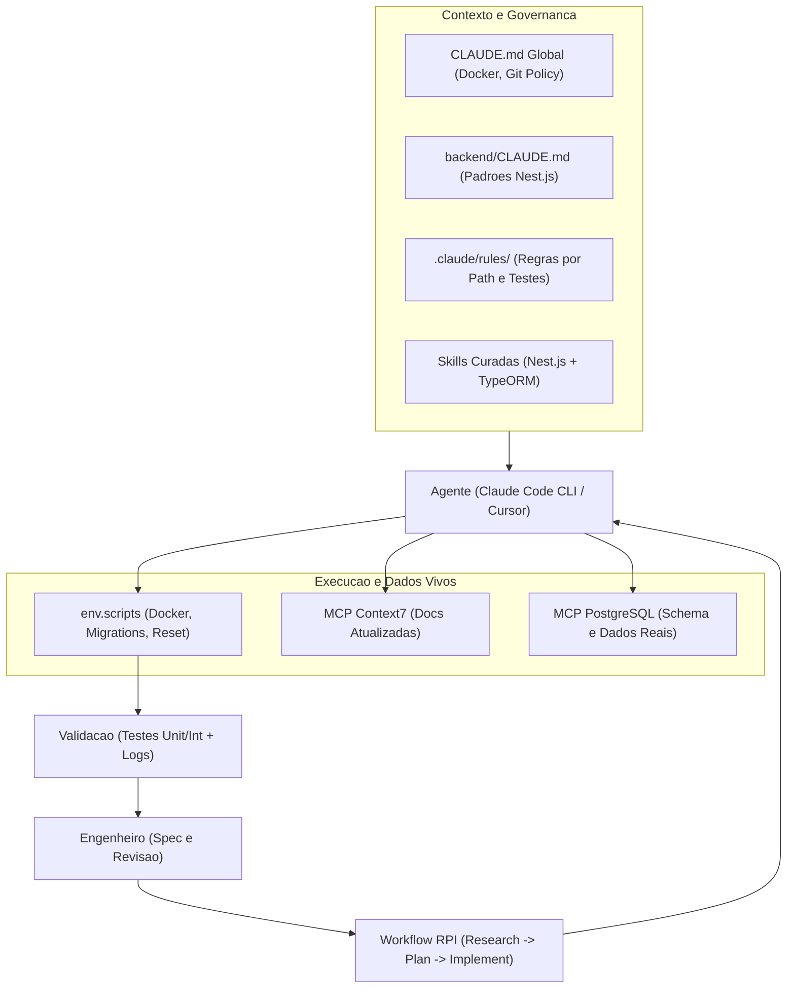

Observe os pontos-chave dessa arquitetura:

- **Hierarquia limpa**: `CLAUDE.md` global governa Docker e políticas transversais; `backend/CLAUDE.md` detalha convenções do Nest.js.
- **Confronto entre Rules e Skills**: durante a curadoria de Skills de Nest.js e TypeORM, elimine conflitos com `.claude/rules/`. Políticas obrigatórias ficam em `rules/`; guias especializados entram como Skills sob demanda.
- **MCPs complementares**: **Context7** traz documentação atualizada de frameworks em tempo real; **PostgreSQL MCP** permite inspecionar tabelas, constraints e registros reais durante *Research* e depuração.

### Exemplo Prático de Execução RPI

```text
[RESEARCH]
Inspecione `backend/src/videos/` e o schema atual via MCP PostgreSQL.
Consulte a documentacao atual do TypeORM via Context7 para soft deletes e indices compostos.
NAO edite arquivos. Resuma entidades afetadas, dependencias e riscos.

[PLAN]
Proponha um plano para `PATCH /videos/:id/publish`:
- Regra: apenas videos em status `READY` com duracao > 0 podem ser publicados.
- Arquivos a alterar (controller, service, repository, migration).
- Casos de teste (caminho feliz + 4 edge cases conforme `.claude/rules/testing.md`).
Aguarde aprovacao antes de codificar.

[IMPLEMENT]
Plano aprovado. Implemente, execute testes unitarios e de integracao no container e apresente o resumo final.
```

---

## 5.6 Armadilhas Comuns e Trade-offs de Produção

| Decisão | Opção A | Opção B | Critério prático |
| :--- | :--- | :--- | :--- |
| **Paralelização** | Serial (1 frente) | Paralela (worktrees + portas dinâmicas) | Só paralelize tarefas com escopo, limites e entregáveis bem isolados |
| **Bootstrap greenfield** | Scaffold vanilla | Skill de bootstrap (2ª fundação) | Vanilla para protótipos descartáveis; 2ª fundação para produtos reais |
| **Regras vs. Skills** | Tudo em `CLAUDE.md` / `rules/` | Núcleo fixo + Skills sob demanda | Verdades permanentes vão em `CLAUDE.md`/`rules/`; guias pontuais em Skills |
| **Segurança operacional** | Apenas texto no prompt | Texto + Hooks/Scripts determinísticos | Regras críticas (Git, arquitetura, lint) exigem trava mecânica |

> [!WARNING]
> **Quatro armadilhas que drenam produtividade em escala:**
> 1. **Automação redundante**: pedir à IA para montar o que o CLI oficial do framework ou um linter executa em segundos.
> 2. **Paralelizar sem método**: especificar mal gera retrabalho em escala; revisar mal gera bugs em escala.
> 3. **`CLAUDE.md` inchado e sem poda**: excesso de regras vagas e inventários voláteis degrada a atenção do modelo.
> 4. **Estado residual entre sessões**: containers sujos e processos órfãos de Jest/Playwright produzem falhas fantasmas.

---

## 5.7 Checklist de Aplicação Prática

- [ ] **Manual e scripts operacionais**: o repositório possui `README.md` operacional e scripts (`init`, `status`, `check --fix`, `watch`, `down --force`, `down --clean`) validados após reset total?
- [ ] **Contrato enxuto e fonte única**: `CLAUDE.md` abre com resumo em 1 linha, registra apenas regras que mudam decisões práticas (comandos exatos, Git policy, gotchas) e usa link simbólico (`AGENTS.md`) quando há múltiplos harnesses?
- [ ] **Isolamento para paralelização**: projetos web/API alocam portas em um `PORT_RANGE` persistido no `.env.local` para evitar colisões entre agentes paralelos?
- [ ] **Camadas sem contradição**: `CLAUDE.md` global, sub-`CLAUDE.md`, `.claude/rules/` e Skills curadas foram confrontados para remover regras conflitantes?
- [ ] **Testes determinísticos e seletivos**: comandos rodam sem modo interativo (`--watchAll=false`, `--reporter=list`), reutilizam fixtures oficiais e aplicam critérios de *Worth vs. NOT Worth Testing*?
- [ ] **Observabilidade e UI**: o agente consulta logs via CLI e, em projetos com front-end, valida navegação real via `playwright-cli`?
- [ ] **Feedback operacional contínuo**: dificuldades recorrentes do agente ao fim das tarefas são convertidas em ajustes cirúrgicos no `CLAUDE.md`, em regras ou em travas determinísticas?


---


# Capítulo 6 — Agent Skills e Extensibilidade Prática

> **O problema real e o modelo mental**
> A janela de contexto de um agente é finita e disputada por system prompts, `CLAUDE.md`, schemas MCP e histórico de conversa. Empilhar todos os procedimentos do time na inicialização degrada a atenção do modelo e desperdiça tokens; improvisar prompts gera resultados inconsistentes. **Agent Skills** empacotam conhecimento procedural reutilizável em módulos portáteis carregados sob demanda por **Progressive Disclosure** — governados com versionamento, segurança e testes automatizados como código de produção.

---

## 6.1 O Que É uma Agent Skill e Como o Progressive Disclosure Funciona

Uma **Agent Skill** é um pacote versionado de instruções, referências e scripts que especializa um agente em uma responsabilidade clara — como code review segundo padrões do time, auditoria de pendências, geração de UI fiel a um *design system* ou onboarding técnico de projetos.

Seguindo o padrão aberto de `agentskills.io` (e diretórios compartilháveis como `skills.sh`), a mesma Skill opera em diferentes *harnesses* — Claude Code, Codex, OpenCode ou Cursor — evitando aprisionamento a uma única ferramenta.

### Progressive Disclosure em 3 Níveis

Você consegue instalar dezenas de Skills sem sufocar o contexto porque o carregamento ocorre em camadas progressivas (como escolher um livro pela capa, depois abrir o sumário e só então ler o capítulo específico):

1. **Nível 1 — Metadados (`name` + `description`)**: sempre indexados no startup com custo mínimo de tokens. Atuam como o classificador de ativação.
2. **Nível 2 — Corpo do `SKILL.md`**: carregado sob demanda após ativação. Deve ficar enxuto (**abaixo de 500 linhas**), com instruções imperativas, checklists e critérios de aceite.
3. **Nível 3 — Referências e Scripts (`references/`, `scripts/`, `assets/`)**: carregados ou executados sob condição explícita (**Conditional Details**) apenas quando o fluxo exige documentação extensa ou execução determinística.

### Arquitetura Interna de Execução em 6 Fases

*Harnesses* como o Claude Code executam uma Skill em até seis fases (Skills simples podem pular as fases 3 e/ou 4):

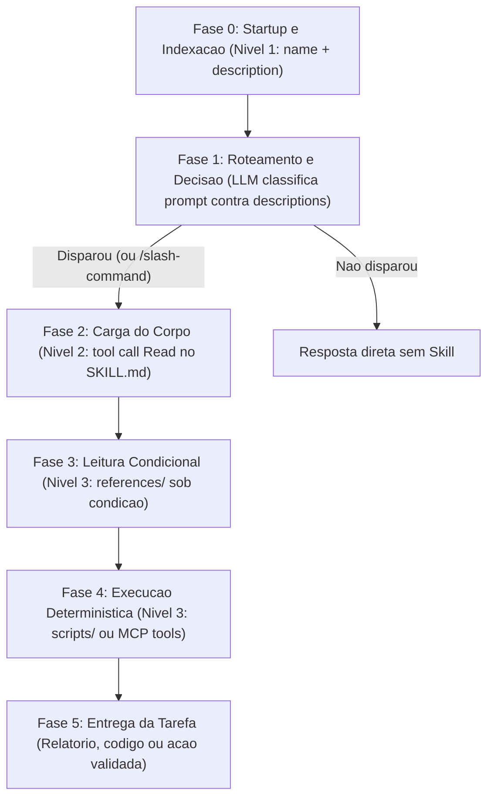

Na **Fase 1**, quem decide disparar a Skill no modo autônomo é o próprio **modelo**, comparando o pedido do usuário com as `descriptions` indexadas. Por isso, a `description` é o componente mais crítico de uma Skill.

---

## 6.2 Anatomia da Skill e Engenharia de Frontmatter

Cada Skill reside em sua própria pasta (ex.: `.claude/skills/<skill-name>/`), cujo nome corresponde exatamente ao campo `name` no arquivo `SKILL.md`:

```text
.claude/skills/team-code-review/
├── SKILL.md                  # Frontmatter YAML (N1) + instrucoes enxutas (N2)
├── references/               # Guias detalhados sob demanda (N3)
│   ├── team-conventions.md
│   └── owasp-checklist.md
├── scripts/                  # Coleta e validacao deterministica (N3)
│   └── collect-staged-diff.sh
└── evals/                    # Datasets de validacao da Skill
    └── evals.json
```

### Frontmatter: Padrão Aberto vs. Extensões de Harness

| Propriedade | Escopo | Papel operacional |
| :--- | :--- | :--- |
| `name` | Padrão aberto (obrigatório) | Identificador em kebab-case igual ao nome da pasta |
| `description` | Padrão aberto (obrigatório) | Classificador semântico que define quando disparar ou ignorar |
| `allowed-tools` | Padrão aberto | Lista branca de ferramentas liberadas (menor privilégio) |
| `license` / `metadata` | Padrão aberto | Licença, autoria, versão e metadados de catálogo |
| `compatibility` | Padrão aberto | Pré-requisitos de ambiente (Node, Docker, Git, Python) |
| `disable-model-invocation` | Extensão (Claude Code) | Impede disparo autônomo; exige chamada explícita `/skill-name` |
| `disallowed-tools` | Extensão (Claude Code) | Ferramentas explicitamente bloqueadas na execução |
| `model` / `effort` | Extensão (Claude Code) | Sobrescreve modelo e esforço de raciocínio para a Skill |
| `context: fork` | Extensão (Claude Code) | Executa o corpo da Skill em um subagente isolado |

Skills podem ser acionadas por **disparo semântico** ou como **slash command** (`/team-code-review`). Para rotinas com efeitos colaterais ou controle humano obrigatório (deploy, release, reset), habilite `disable-model-invocation: true`.

### A Fórmula de 4 Partes para uma `description` Precisa

Descrições genéricas geram o anti-padrão `dev-helper` (*"ajuda com código, revisão, testes e tarefas do dia a dia"*): ela dispara falsos positivos na maioria dos prompts e compete com Skills especializadas.

Escreva a `description` em **terceira pessoa** (preferencialmente em inglês — redija em português e traduza se preferir), sempre com quatro elementos:

1. **O que faz e quando usar** (verbo direto em 3ª pessoa, nunca *"I can help..."*).
2. **Gatilhos concretos** entre aspas com frases reais usadas pela equipe.
3. **Quando NÃO usar (`Do not use`)**: fronteiras negativas contra falsos positivos.
4. **O que produz**: artefato ou formato final esperado.

```markdown
---
name: team-code-review
description: >-
  Reviews staged Git diffs against team architecture and security conventions.
  Use when the user asks to "review my changes", "check staged diff", or "run code review".
  Do not use for writing commit messages, explaining Git commands, or full module refactors.
  Produces a prioritized Markdown report (Blocker, Warning, Suggestion) with file and line evidence.
allowed-tools: Read, Grep, Bash(bash .claude/skills/team-code-review/scripts/*)
compatibility: Requires git CLI in an initialized repository.
---

# Team Code Review

## Workflow
1. Run `bash .claude/skills/team-code-review/scripts/collect-staged-diff.sh` to capture 100% of staged changes.
2. Read `references/team-conventions.md` for naming, error handling, and architecture rules.
3. **Conditional Detail**: ONLY if the diff touches auth, user input validation, SQL queries, or external HTTP calls, also read `references/owasp-checklist.md`.
4. Report only evidence-backed issues with `file:line`; tag uncertain points as `[POSSIBLE]`.
```

No passo 3, o padrão **Conditional Details** evita carregar o guia OWASP quando o diff altera apenas estilos ou documentação.

---

## 6.3 Framework de Decisão: Quando Vira Skill (e Quando Não Vira)

Antes de versionar uma nova Skill, faça a triagem central: *"Isso é conhecimento procedural reutilizável e estável o bastante para valer um arquivo versionado?"*

Aplique a **Regra dos 3 SIMs + Filtro de Segurança**:

1. **Reutilização**: repete-se ao longo dos dias, em vários prompts ou projetos?
2. **Procedimento não óbvio**: existe um *como* específico (ordem, convenções, checklist) que o modelo não acerta sozinho?
3. **Estabilidade**: a regra permanece válida por semanas ou meses?
4. **Filtro de Segurança (veto imediato)**: contém credenciais, tokens, segredos ou estado em tempo real? **Se SIM, não vira Skill** — segredos vão para variáveis/cofres e dados vivos vêm de tools/MCP em tempo de execução.

### Resolvendo a Zona Cinzenta

| Necessidade | Mecanismo ideal | Critério técnico |
| :--- | :--- | :--- |
| Verdade permanente do projeto (ex.: *"responder em PT-BR"*, comandos Docker) | `CLAUDE.md` / `AGENTS.md` | Leitura garantida em 100% das sessões; Skill pode não disparar |
| Regra puramente mecânica (indentação, espaços vs. tabs, imports) | Linter / Formatter | Determinístico e instantâneo; a Skill pode *invocar* o linter, não substituí-lo |
| Dados vivos externos (issues abertas, schema do banco, docs atuais) | Servidor MCP / Tools | Estado volátil não deve ser congelado em Markdown |
| Procedimento repetível, não óbvio e estável | **Agent Skill (N2 ou N3)** | Carrega o *como* sob demanda sem inflar o contexto base |

Se virou Skill, escolha o nível: **Nível 2** apenas quando o procedimento curto em Markdown basta; **Nível 3** sempre que houver convenções extensas (`references/`) ou coleta/validação que exija garantia determinística (`scripts/`).

---

## 6.4 Determinismo, Orquestração e Subagents em Skills Avançadas

LLMs são **não determinísticos**. Se uma Skill pedir via texto para *"encontrar todos os `TODO` e `FIXME`"* ou *"listar arquivos sem `.spec.ts`"*, o modelo pode varrer apenas parte do projeto e responder com confiança.

Em Skills de produção, separe responsabilidades:

- **Script determinístico (`scripts/`)**: garante 100% de cobertura na coleta ou validação (busca de marcadores, arquivos sem teste, `git diff`, análise estática de camadas).
- **LLM (`SKILL.md`)**: interpreta os dados completos, prioriza severidades (Alta/Média/Baixa), explica impacto e produz recomendações ou correções.

### Orquestração de Sub-skills e Gate Arquitetural com Auto-correção

Respeitar **uma Skill = uma responsabilidade** permite compor uma **Skill orquestradora** sobre **sub-skills** por camada, combinando três níveis de customização (fundamentos + framework + convenções do time).

Na Skill `implement-feature`, a orquestradora delega a implementação *bottom-up* (`domain` → `adapter` → `repository` → `service` → `route` → `tests`) e fecha com um **gate arquitetural determinístico** (`npm run check-layers` baseado em regras customizadas de ESLint):

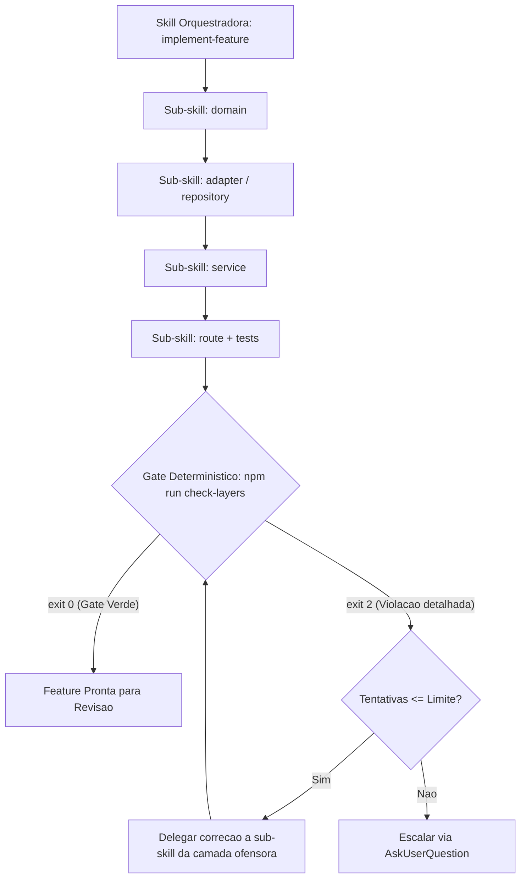

Quando uma rota importa indevidamente `src/domain` ou `src/repository`, o script encerra com **`exit 2`** imprimindo um bloco estruturado: **regra violada**, **arquivo e linha**, **import ofensor**, **por que viola** e **como corrigir**. Esse diagnóstico aciona o loop de auto-correção na sub-skill correspondente até `exit 0`, reforçado no `CLAUDE.md` pela regra de que nenhuma feature está concluída sem gate verde.

### Skills Disparando Subagents em Paralelo

Para análises extensas de código (como onboarding ou atualização de documentação), executar tudo no contexto principal esgota rapidamente a janela. Skills avançadas aplicam o padrão *fan-out / fan-in* lançando **subagents em paralelo**, cada um com contexto isolado.

Os perfis típicos (com nomes variando por CLI; no Claude Code) são:

- **Explore**: somente leitura, usa modelo rápido e econômico (como Haiku) para varreduras e mapeamentos velozes.
- **Plan**: somente leitura (sem edição), herda o modelo principal para pesquisa e desenho de arquitetura.
- **General Purpose**: acesso completo (leitura/escrita) para fluxos multi-etapa.

Na Skill `mapping-project`, o passo 1 divide o repositório em frentes independentes (*Arquitetura*, *Dados*, *Testes*, *Build/CI* e *Segurança*); o passo 2 dispara subagents `Explore` concorrentemente, cada um devolvendo apenas um resumo enxuto com caminhos, linhas e 1–2 riscos; o passo 3 sintetiza tudo no contexto principal em um mapa unificado do repositório.

---

## 6.5 Integrando Skills com Servidores MCP

A fronteira entre Skill e MCP é direta: **Skill define o COMO** (procedimento estável); **MCP fornece a PORTA** (acesso a dados vivos e sistemas externos).

Em uma Skill de triagem de issues (`issue-triage`), as issues abertas nunca entram no Markdown — são lidas em tempo de execução via **GitHub MCP** containerizado em Docker com transporte `stdio` e um *Fine-Grained Personal Access Token* no `.env` restrito à leitura de *Issues*:

```yaml
# docker-compose.yml (GitHub MCP server via stdio)
services:
  gh-mcp:
    image: ghcr.io/github/github-mcp-server:latest
    stdin_open: true
    tty: false
    environment:
      GITHUB_PERSONAL_ACCESS_TOKEN: ${GITHUB_PERSONAL_ACCESS_TOKEN}
    command: ["stdio"]
```

Registre o MCP no **escopo de projeto** (gerando `.mcp.json` compartilhável sem credenciais):

```bash
claude mcp add github --scope project -- docker compose run --rm -i gh-mcp
```

Na Skill `issue-triage`, aplique duas proteções:

1. **Princípio do menor privilégio em `allowed-tools`**: entre dezenas de tools expostas pelo GitHub MCP, libere apenas `mcp__github__list_issues`, `mcp__github__get_issue` e `mcp__github__search_issues`.
2. **Instrução explícita de uso do MCP**: cite o servidor MCP no passo a passo para evitar que o modelo desvie para `gh` CLI ou `curl`.

---

## 6.6 Avaliação (Evals) de Skills: Skill Creator, Triggers e Promptfoo no CI/CD

Tratar Skills como código exige **evals automatizados**, pois o disparo e a qualidade variam conforme edições na `description`, atualizações de modelo ou troca de *harness*. Avalie sempre duas dimensões: **trigger** (dispara quando deve e silencia quando não deve) e **qualidade da saída**.

### Otimização de Triggers com Split 60% Treino / 40% Holdout

No fluxo de avaliação do *Skill Creator*, um dataset com consultas `should_trigger` e `should_not_trigger` é dividido em **~60% treino** (usado para diagnosticar falhas e reescrever a `description`) e **~40% holdout** (mantido oculto para validar generalização em pedidos inéditos sem *overfitting*). O relatório mede **Accuracy**, **Precision** e **Recall**, guiando refinamentos baseados em evidência.

### Avaliação Multimodelo e CI/CD com Promptfoo

Para validar a mesma Skill em **múltiplos modelos** e executá-la automaticamente em **CI/CD** a cada Pull Request, utilize o **Promptfoo** (`npx promptfoo@latest init`). Quando testar com o SDK do Claude Code, instale `@anthropic-ai/claude-agent-sdk` e configure `promptfooconfig.yaml`:

```yaml
description: "Eval da skill issue-triage (trigger + qualidade)"

prompts:
  - "{{prompt}}"

providers:
  - id: anthropic:claude-agent-sdk
    config:
      apiKey: ${ANTHROPIC_API_KEY}
      model: claude-sonnet-4-6
      working_dir: "."
      setting_sources: ["project"]
      allowed_tools: ["Read", "mcp__github__list_issues", "mcp__github__get_issue"]
      permission_mode: acceptEdits

tests:
  - description: "Pergunta generica de Git NAO deve disparar a skill"
    vars:
      prompt: "Qual a diferenca entre git merge e git rebase?"
    assert:
      - type: llm-rubric
        metric: no_false_trigger
        value: "Responde sobre merge e rebase sem listar issues nem acionar o GitHub MCP."

  - description: "Pedido de triagem DEVE disparar a skill e priorizar bugs"
    vars:
      prompt: "Faca a triagem das issues abertas no repositorio e priorize os bugs criticos."
    assert:
      - type: contains
        value: "Prioridade"
      - type: llm-rubric
        metric: triage_quality
        value: "Agrupa as issues por prioridade com justificativa baseada nos dados retornados."
```

Execute com `npx promptfoo eval` e visualize resultados em `npx promptfoo view`, acompanhando **métricas agregadas** (*pass rate*, *threshold*, score ponderado, custo em USD, tokens e latência) e dois tipos de *assertions*:

- **Determinísticas**: `contains`/`not-contains`, validação de schema/estrutura, lógica/código e similaridade lexical.
- **Model-graded**: `llm-rubric`, `g-eval` (raciocínio estruturado), `factuality`, `similar` (embeddings), `select-best` (compara saídas entre múltiplos modelos) e `moderation`.

> [!WARNING]
> **Segurança e governança em Skills de terceiros:** nunca instale uma Skill externa sem auditar `SKILL.md` e cada script em `scripts/`. Instruções maliciosas ou scripts não verificados podem exfiltrar segredos ou corromper arquivos. Restrinja `allowed-tools`, versione todas as Skills no Git e exija revisão por PR + passagem nos evals antes do merge.

---

## 6.7 Checklist de Aplicação Prática

- [ ] **Triagem rigorosa**: cada candidata passou pela regra dos 3 SIMs (reutilização, procedimento não óbvio, estabilidade), pelo filtro de segurança (zero segredos/estado vivo embutido) e não pertence melhor a `CLAUDE.md`, linter ou MCP?
- [ ] **Progressive Disclosure disciplinado**: o `SKILL.md` tem menos de 500 linhas, delega guias pesados para `references/` sob *Conditional Details* e move varreduras/validações críticas para `scripts/` determinísticos?
- [ ] **Frontmatter como classificador**: a `description` está em 3ª pessoa, contém gatilhos concretos entre aspas, define fronteiras `Do not use` e descreve a saída esperada?
- [ ] **Invocação controlada e menor privilégio**: ações sensíveis definem `disable-model-invocation: true` e `allowed-tools` libera apenas comandos Bash ou tools MCP estritamente necessários?
- [ ] **Gates determinísticos em orquestrações**: Skills que geram código encerram com validador determinístico (ex.: `check-layers` com `exit 2` detalhado) em loop de auto-correção com teto de tentativas?
- [ ] **Contexto limpo via subagents**: análises extensas de codebase disparam subagents isolados (`Explore`) em paralelo para proteger a janela principal?
- [ ] **Skills testadas como código**: toda alteração passa por Git/PR e roda evals de trigger (treino/holdout) e qualidade multimodelo no Promptfoo integrados ao CI/CD?


---


# Parte III — Arquitetura, Sistemas Agênticos, Protocolos e Operação


# Capítulo 7 — Arquitetura de Software na Era da IA

> **O problema real e o modelo mental**
> Colocar uma chamada de SDK de LLM dentro de um controller leva cinco minutos; operar esse sistema seis meses depois — com custos previsíveis, latência aceitável, respostas auditáveis e sem vazamento de dados ou envenenamento de contexto — exige arquitetura. O modelo mental muda de um software puramente determinístico para um **sistema híbrido**, no qual componentes probabilísticos (modelos) operam cercados por fronteiras determinísticas de código, dados, cache, observabilidade, avaliação contínua e segurança.

---

## 7.1 Os Quatro Níveis de Arquitetura e a Entrada da IA

Antes de desenhar pipelines de RAG ou gateways de modelos, vale separar quatro escopos que frequentemente se misturam em discussões técnicas:

- **Arquitetura Corporativa:** define a direção de evolução dos sistemas, governança, padrões transversais e alinhamento com objetivos de negócio da organização.
- **Arquitetura de Solução:** conecta múltiplos sistemas, integrações, filtros de dados e fluxos de ponta a ponta para resolver um problema específico de negócio.
- **Arquitetura Tecnológica:** aprofunda escolhas de plataformas, nuvem, bancos de dados, runtimes e infraestrutura de suporte.
- **Arquitetura de Software:** organiza fronteiras internas, módulos, dependências, contratos e fluxo de execução dentro da aplicação.

A entrada da IA atravessa esses quatro níveis porque introduz decisões que antes não existiam no desenho tradicional de sistemas: como a aplicação monta o contexto enviado ao modelo, de onde vêm os dados que fundamentam uma resposta, quanto cada requisição pode custar, qual degradação é aceitável quando um provedor cai e como provar que uma mudança de prompt não quebrou o comportamento em produção.

---

## 7.2 Acoplamento e Saúde Arquitetural ao Longo do Tempo

Com a aceleração na geração de código assistida por IA, o risco arquitetural mais silencioso é o crescimento descontrolado do acoplamento. Um serviço inicialmente simples — como um `OrderService` — acumula dependências de pagamento, banco de dados, mensageria e provedores externos até que qualquer alteração dispare efeitos em cascata.

Para sair do achismo e medir a saúde estrutural ao longo do tempo, aplicamos as métricas clássicas da **Main Sequence** (Robert C. Martin):

- **Acoplamento Aferente (`Ca`):** quantos módulos externos dependem deste módulo (dependências que entram).
- **Acoplamento Eferente (`Ce`):** de quantos módulos externos este módulo depende (dependências que saem).
- **Instabilidade (`I`):** calculada por `I = Ce / (Ce + Ca)`. Valores próximos de `0` indicam módulos altamente estáveis (muitos dependem deles); valores próximos de `1` indicam módulos instáveis.
- **Abstração (`A`):** proporção de elementos abstratos (interfaces, contratos, tipos base) sobre o total de elementos do módulo.

A relação saudável segue a linha ideal `A + I = 1`. O perigo mora nos dois extremos:

| Zona Arquitetural | Característica (`I` e `A`) | Exemplo Típico | Consequência em Produção |
| :--- | :--- | :--- | :--- |
| **Zona de Dor** | Alta estabilidade (`I` próximo de `0`) e concreto demais (`A` próximo de `0`) | Classe global `database.ts` ou logger concreto importado por todo o projeto | Rigidez extrema: qualquer mudança quebra múltiplos módulos |
| **Main Sequence** | Equilíbrio entre estabilidade e abstração (`A + I ≈ 1`) | Contratos de repositório estáveis + implementações concretas na borda | Evolução previsível com impacto localizado |
| **Zona de Inutilidade** | Alta abstração (`A` próximo de `1`) sem uso real (`I` próximo de `1`) | Interfaces criadas para uma única classe concreta jamais substituída | *Overengineering*, burocracia e custo cognitivo sem proteção real |

### Refatoração guiada por métricas (e assistida por agentes)

Em vez de pedir a uma IA "refatore o sistema para ficar mais limpo", o fluxo disciplinado segue quatro passos:

1. **Medir antes de mexer:** gere um script de análise de imports para calcular `Ca`, `Ce`, `I`, `A` e plotar os módulos no gráfico da *Main Sequence*.
2. **Construir rede de segurança:** garanta testes automatizados reais (sem *skips* escondidos ou asserções vazias) antes de tocar na estrutura.
3. **Inverter dependências nos pontos de dor:** extraia interfaces de repositório por agregado (em vez de um `database.ts` monolítico) e centralize a instanciação concreta em um *Composition Root* (`composition.ts`), que concentra a criação dos objetos sem vazar detalhes concretos para o domínio.
4. **Re-executar o gráfico após cada ciclo:** confirme objetivamente que os módulos críticos saíram da Zona de Dor sem empurrar o restante para a Zona de Inutilidade.

> [!TIP]
> **Regra de Ouro:** Concreto demais em ponto estável gera rigidez; abstração demais sem variação real gera peso. Um *Composition Root* pode ter alto acoplamento eferente — esse é exatamente o papel dele — desde que ninguém no domínio dependa dele.

---

## 7.3 AI Gateways: Fronteira de Compatibilidade, Governança e Resiliência

Quando uma equipe integra IA pela primeira vez, é comum espalhar chamadas diretas ao SDK da OpenAI ou da Anthropic por vários serviços. Assim que surge a necessidade de adicionar um segundo provedor, o contraste fica explícito: a OpenAI usa uma assinatura de *chat completions* ou *responses*, enquanto a Anthropic usa `client.messages.create` com parâmetros e payloads distintos. O detalhe do fornecedor vaza para a lógica de negócio.

Um **AI Gateway** estabelece uma fronteira arquitetural única entre a aplicação e os provedores de LLM. Essa evolução ocorre em dois saltos claros (exemplificados na prática com o **LiteLLM**):

1. **Camada de compatibilidade (biblioteca):** a aplicação substitui SDKs específicos por uma interface padronizada (`completion(model=..., messages=...)`), mantendo a chamada dentro do próprio processo. Resolve a padronização de entrada/saída, mas ainda sem governança central.
2. **Topologia de Proxy (serviço HTTP):** o gateway sobe como componente dedicado (**LiteLLM Proxy**) entre as aplicações e os provedores. As aplicações consomem HTTP padronizado usando *virtual keys*, enquanto o proxy centraliza autenticação, *budgets*, *rate limits*, logs e roteamento via **Router**.

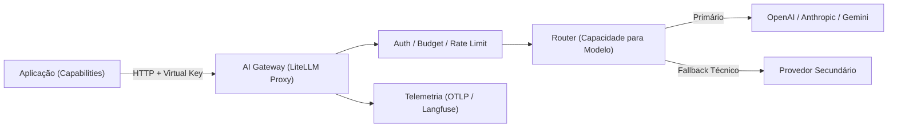

### Exponha capacidades de negócio, não modelos físicos

A decisão mais valiosa ao adotar um AI Gateway é parar de acoplar o código a nomes físicos como `gpt-4.1-mini` ou `claude-sonnet`. Em vez disso, o gateway expõe **capacidades lógicas** (`developer-assistant`, `architecture-advisor`, `ticket-classifier`). Trocar o provedor por custo, latência ou estabilidade passa a ser uma alteração de configuração no gateway — sem deploy da aplicação.

```yaml
# config.yaml — Exemplo enxuto de LiteLLM Proxy expondo capacidades
model_list:
  - model_name: architecture-advisor
    litellm_params:
      model: openai/gpt-4.1
      api_key: os.environ/OPENAI_API_KEY
      timeout: 30

  - model_name: architecture-advisor-fallback
    litellm_params:
      model: anthropic/claude-sonnet-4-20250514
      api_key: os.environ/ANTHROPIC_API_KEY
      timeout: 30

router_settings:
  num_retries: 2
  fallbacks:
    - architecture-advisor: ["architecture-advisor-fallback"]
```

> [!WARNING]
> **Armadilha Comum — Fallback com modelo fraco:** Ter um fallback técnico evita erro HTTP `500`, mas trocar silenciosamente um modelo forte por um modelo fraco pode destruir a qualidade da resposta ou quebrar contratos de saída estruturada. Fallback em IA só é seguro quando o modelo reserva atende ao mesmo padrão mínimo de capacidade validado em *evaluation*.

---

## 7.4 Fluxos de Chamada: Síncrono, Streaming e Assíncrono

Uma chamada de LLM não tem o perfil de latência de uma query SQL indexada. Segurar conexões HTTP por dezenas de segundos esgota *workers*, provoca timeouts em cascata e trava a interface do usuário. A escolha do padrão de execução deve responder ao contrato da funcionalidade:

| Padrão de Execução | Como Funciona | Quando Usar | Trade-offs e Limites |
| :--- | :--- | :--- | :--- |
| **Síncrono** | Requisição HTTP bloqueante aguarda resposta completa | Classificação curta, extração com JSON/Pydantic, tarefas de baixa latência (poucos segundos) | Simples de implementar e validar contrato; falha em tarefas longas ou picos de lentidão do provedor |
| **Streaming (SSE)** | Envia tokens incrementalmente conforme são gerados | Chats, assistentes interativos e geração textual longa onde o usuário lê em tempo real | Reduz drasticamente a **latência percebida** (não o tempo total); inadequado quando o backend precisa validar um JSON completo antes de responder |
| **Assíncrono (Jobs/Filas)** | Endpoint aceita a tarefa, retorna `job_id` e processa em background | Análises extensas, ingestão/indexação, múltiplos passos de agentes ou relatórios pesados | Desacopla a IA do caminho crítico HTTP e facilita retries; exige gestão de estado, polling/webhook e UX de acompanhamento |

---

## 7.5 Cache em Aplicações com IA: Exato, Semântico e Prompt Caching

Em sistemas com IA, cache não existe apenas para reduzir latência: ele controla diretamente o **custo por token** e a **consistência comportamental**. Entretanto, uma resposta armazenada em cache pode estar tecnicamente válida (dentro do TTL) e arquiteturalmente errada (*stale*) se o prompt, as regras de negócio ou o modelo mudaram ontem.

### 1. Cache exato com *cache-aside* e Fingerprint

No padrão *cache-aside*, a aplicação gera uma chave determinística antes de chamar o modelo. Para evitar servir respostas obsoletas após ajustes de engenharia de prompt, a chave nunca deve depender apenas do texto do usuário — ela precisa de um **fingerprint** que combine versão do prompt, versão das regras, capacidade do modelo e entrada normalizada:

```python
import hashlib, json

def build_cache_key(text: str, prompt_version: str, rules_version: str, capability: str) -> str:
    payload = {
        "text": " ".join(text.strip().lower().split()),
        "prompt_version": prompt_version,
        "rules_version": rules_version,
        "capability": capability,
    }
    raw = json.dumps(payload, sort_keys=True)
    return hashlib.sha256(raw.encode("utf-8")).hexdigest()
```

### 2. Cache semântico com Embeddings e `pgvector`

Se um usuário pergunta *"quero cancelar meu plano"* e outro escreve *"preciso cancelar minha assinatura"*, o cache exato dá *miss*. O **cache semântico** converte a entrada em um vetor numérico via modelo de **embedding**, consulta o **PostgreSQL com `pgvector`** usando distância de cosseno e reutiliza a resposta se a similaridade superar um **threshold** calibrado.

O fluxo integrado tenta em ordem: **Cache Exato → Cache Semântico (`pgvector`) → Chamada ao LLM + gravação automática**. O risco central é o **falso positivo**: um threshold frouxo pode retornar uma resposta de cancelamento para uma dúvida sobre alteração de plano. Definir o threshold é uma decisão de negócio, não uma constante universal.

### 3. Camadas de cache e Prompt Caching do Provedor

Dois equívocos arquiteturais precisam ficar rigorosamente separados:

- **Cache semântico não é RAG:** o cache semântico busca *reaproveitar uma resposta pronta* para uma pergunta parecida; o RAG busca *evidências em uma base de conhecimento* para sintetizar uma resposta nova e fundamentada.
- **Cache da aplicação não é Prompt Caching do provedor:** OpenAI, Anthropic e Gemini oferecem *prompt caching* no lado do provedor para reaproveitar prefixos longos e estáticos do prompt (como *system prompts* extensos ou documentação fixa), reduzindo custo de entrada e latência mesmo quando a pergunta final do usuário é inédita.

| Camada de Cache | Onde Vive | O Que Reaproveita | Evita Chamada ao LLM? | Principal Risco |
| :--- | :--- | :--- | :--- | :--- |
| **Cache Exato (Fingerprint)** | Aplicação (Memória/Redis) | Resposta final idêntica | Sim | Chave sem versionamento gerar resposta *stale* |
| **Cache Semântico** | Aplicação + `pgvector` | Resposta final para intenção equivalente | Sim | Falso positivo por threshold mal calibrado |
| **Prompt Caching** | Provedor (OpenAI/Anthropic/Gemini) | Prefixo estático do prompt (tokens de entrada) | Não (reduz custo/latência) | Prefixo dinâmico no início invalidar o reaproveitamento |

---

## 7.6 Arquitetura de RAG de Produção

**RAG (Retrieval-Augmented Generation)** recupera trechos relevantes de fontes externas e os injeta no contexto do modelo antes da geração. Ele resolve o problema de conhecimento proprietário, dinâmico e auditável, mas **não substitui** bancos relacionais para agregações exatas, APIs transacionais nem fine-tuning de estilo.

| Estratégia | Melhor Cenário de Uso | Quando Evitar |
| :--- | :--- | :--- |
| **RAG** | Base proprietária mutável, precisa de recuperação seletiva, filtros por tenant e citação de fontes | Cálculos exatos em dados tabulares ou ações transacionais |
| **Long Context** | Conjunto pequeno e fechado de documentos analisados de uma só vez | Bases grandes/dinâmicas onde o custo por chamada e o ruído explodem |
| **SQL / API / Tool Calling** | Dados estruturados em tempo real (estoque, saldo, consumo do tenant, criação de tickets) | Busca semântica em políticas e manuais não estruturados |
| **Fine-Tuning** | Ajuste de estilo, formato específico ou comportamento especializado recorrente | Inserir fatos que mudam com frequência (re-treino caro e sem rastreabilidade) |

### Do RAG ingênuo ao RAG confiável

Um RAG ingênuo — que fatia textos aleatoriamente, joga tudo em um banco vetorial e manda os *top-k* resultados direto para o prompt — falha por razões previsíveis: documentos antigos vencem documentos novos, chunks sem contexto perdem o título da seção/plano a que pertencem, e o banco vetorial sempre retorna "os menos ruins" mesmo quando nenhum trecho responde à pergunta.

A arquitetura madura divide o RAG em dois pipelines bem definidos:

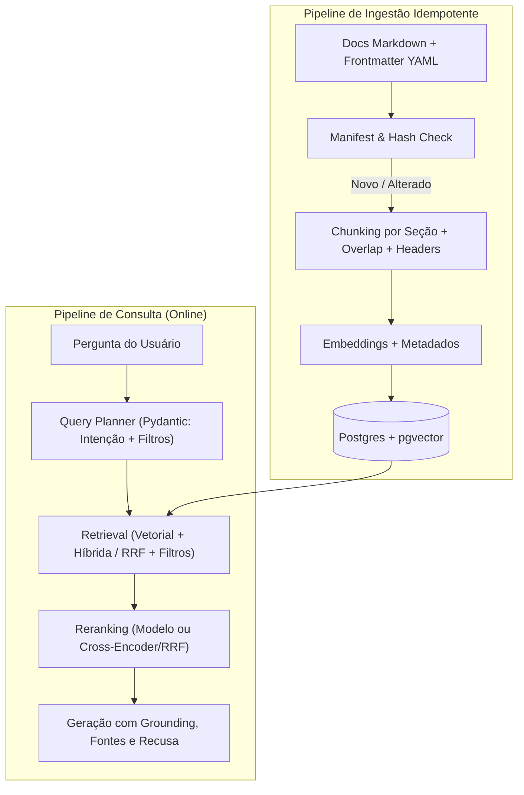

Cinco decisões estruturais definem onde um RAG ganha ou perde:

1. **Chunking consciente de estrutura e metadados:** extraia metadados via frontmatter YAML (`product`, `plan`, `doc_type`, `version`, `status`, `tenant`), faça chunking respeitando seções com *overlap* controlado e inclua cabeçalhos no texto do chunk para preservar o contexto semântico.
2. **Reindexação idempotente com Manifest e Hash:** documentos mudam e são removidos. Calcule o hash de cada fonte em um *manifest* para inserir apenas documentos novos, reindexar apenas os modificados e apagar chunks órfãos — sem duplicidade nem reprocessamento caro.
3. **Query Planner antes do retrieval:** use uma etapa leve com saída estruturada (Pydantic) para interpretar a intenção, detectar ambiguidade (pedindo clarificação quando necessário) e extrair filtros objetivos (`plan="enterprise"`, `doc_type="policy"`).
4. **Busca híbrida e Reranking:** recupere um conjunto maior de candidatos (combinando busca vetorial e busca textual via **RRF — Reciprocal Rank Fusion**) e aplique **reranking** (com reranker dedicado, heurística/RRF ou modelo) para enviar apenas os trechos mais relevantes ao gerador, reduzindo ruído e custo.
5. **Grounding com fontes e recusa explícita:** instrua e valide que o modelo responda apenas com evidências recuperadas, cite as fontes exatas e recuse responder quando o contexto for insuficiente.

> [!NOTE]
> **Build vs. Buy em RAG:** Soluções gerenciadas de nuvem ou provedores aceleram o *time-to-market* em casos padronizados. Construir o próprio pipeline (como `pgvector` + FastAPI) faz sentido quando há exigência rígida de isolamento multi-tenant, regras customizadas de filtragem/proveniência, auditoria completa ou independência de fornecedor.

---

## 7.7 Observabilidade e Governança Operacional com OpenTelemetry

Sem observabilidade, times de IA otimizam no escuro: mudam o tamanho de chunk sem saber se o problema estava no *query planner*, ou cortam o modelo sem descobrir qual feature concentra 80% do consumo de tokens.

A telemetria de sistemas de IA usa os mesmos quatro pilares clássicos — **logs, métricas, traces e spans** — aplicados às etapas do fluxo probabilístico: um *trace* representa a requisição completa, enquanto cada *span* registra uma etapa (`query_planner`, `vector_retrieval`, `rerank`, `answer_generation`, `tool_call`) com atributos de latência, provedor, modelo, tokens, fallback e número de chunks recuperados.

### OpenTelemetry como padrão, não como destino

A decisão arquitetural correta é instrumentar a aplicação com **OpenTelemetry (OTEL)** e exportar via protocolo **OTLP**. Assim, o código não fica preso a um fornecedor específico: basta trocar o endpoint OTLP para visualizar os mesmos traces no **Jaeger** (infraestrutura distribuída), no **Langfuse** (observabilidade nativa de LLM, prompts e custos) ou em APMs corporativos (**Datadog**, **New Relic**).

```python
from opentelemetry import trace

tracer = trace.get_tracer("knowledge-chat")

def run_rag_step(question: str, tenant_id: str, model_capability: str):
    with tracer.start_as_current_span("rag.retrieval") as span:
        span.set_attribute("tenant.tier", "enterprise")          # Baixa cardinalidade
        span.set_attribute("ai.capability", model_capability)
        chunks = retrieve_chunks(question, tenant_id)
        span.set_attribute("rag.chunks.count", len(chunks))
        return chunks
```

### Operação madura: privacidade, cardinalidade e limites ativos

- **Privacidade por ambiente:** capture payloads completos (prompts/respostas) apenas em desenvolvimento/staging ou com mascaramento; em produção, controle via flags de ambiente e política de retenção.
- **Cardinalidade controlada:** evite colocar IDs únicos ou textos inteiros como labels de métricas (isso explode o custo e degrada dashboards); reserve detalhes granulares para atributos de spans ou eventos com *sampling*.
- **Governança operacional ativa:** observabilidade passiva apenas relata o incêndio; governança aplica **budgets e quotas** por tenant, feature e modelo (autorização de acesso a modelos premium, limites de passos em agentes, detecção de loops de *tool calling* e degradação graciosa controlada).

---

## 7.8 Testes, Evaluation e Quality Gates no CI

Testes unitários tradicionais não verificam se uma resposta em linguagem natural permanece fiel às evidências, mas continuam indispensáveis para validar **contratos determinísticos**: status HTTP, parsing de schemas Pydantic, regras de fallback, recusa obrigatória e serialização de saída.

Para validar o comportamento probabilístico, construímos uma arquitetura de **Evaluation** em camadas:

1. **Dataset versionado (Golden Set):** casos representativos armazenados e sincronizados (ex.: no **Langfuse**), cobrindo perguntas válidas, casos que exigem clarificação (`should_clarify`) e perguntas fora de escopo que exigem recusa (`should_answer=false`).
2. **Evaluation por componente:** mede cada etapa isoladamente (o *query planner* extraiu o plano certo? O *retrieval* trouxe o documento correto? O *reranker* promoveu a evidência certa?). Sem isso, uma falha na resposta final esconde qual peça quebrou.
3. **Avaliação da resposta final (Ragas e LLM-as-a-Judge):**
   - **Ragas:** quantifica propriedades específicas de RAG como *faithfulness* (fidelidade ao contexto recuperado), *context precision* e *context recall*.
   - **LLM-as-a-Judge:** usa um modelo avaliador com **rubrica explícita** e **saída estruturada**, sempre submetido a **calibração** prévia contra exemplos rotulados conhecidos para confirmar que o juiz pontua como esperado.
4. **Evaluation de agentes e tool calling:** em sistemas como um *Support Triage Agent* (com ferramentas para buscar documentação, consultar consumo do tenant e abrir ticket), a qualidade não está só no texto final — avaliam-se **seleção da ferramenta**, **correção dos argumentos** e **trajetória de execução** (`exact`, proibindo chamadas extras, ou `in_order`, exigindo a sequência mínima esperada).
5. **Experiments, Baseline e Quality Gates no CI:** toda mudança de prompt, modelo ou chunking roda um *experiment* comparável lado a lado com o *baseline* anterior no Langfuse para detectar regressões. No CI, **Quality Gates** travam o pipeline automaticamente se alguma métrica crítica cair abaixo do threshold definido.

---

## 7.9 Segurança, Threat Modeling, OWASP e Provenance

Segurança em sistemas de IA começa abandonando a ilusão de que "um bom system prompt resolve tudo". A abordagem correta é **Threat Modeling** baseado em **Trust Boundaries** — os pontos exatos onde dados ou decisões cruzam níveis diferentes de confiança:

1. **Input Boundary:** entrada do usuário chegando à aplicação. Nunca é confiável e, diferente de um CRUD comum, pode influenciar o raciocínio do modelo.
2. **Context / Data Boundary:** documentos recuperados do banco vetorial (`pgvector`) e injetados no prompt. Estar no banco interno não torna um texto automaticamente confiável.
3. **Model Output Boundary:** resposta devolvida pelo modelo ao código. Mesmo um JSON válido em Pydantic pode carregar uma decisão incorreta ou manipulada.
4. **Action Boundary:** fronteira entre a decisão probabilística de um agente e a execução real de uma ferramenta (ex.: `create_support_ticket`). **O modelo escolher uma tool não significa que o usuário ou o fluxo tem autorização para executá-la.**

### OWASP Top 10 e a anatomia de Prompt Injection

O **OWASP Top 10 for LLM & GenAI Applications** funciona como mapa de cobertura para auditar essas fronteiras — com destaque para `LLM01 (Prompt Injection)`. É essencial distinguir quatro vetores diferentes:

- **Direct Prompt Injection:** o usuário tenta sequestrar instruções diretamente na entrada.
- **Jailbreak:** tentativa de contornar políticas de segurança/recusa do modelo.
- **Indirect Prompt Injection:** uma instrução maliciosa escondida dentro de um documento recuperado pelo RAG comanda o modelo durante a leitura do contexto.
- **RAG Repository / Factual Poisoning:** inserção de informações falsas (ex.: um SLA adulterado) na base de conhecimento, fazendo uma pergunta legítima gerar uma resposta contaminada.

### Baseline reproduzível de ataques e Provenance antes do Retrieval

Assim como na avaliação de qualidade, segurança se mede com **baselines reproduzíveis de ataque** — suítes de testes adversariais executadas sobre o chat, sobre agentes com tools e sobre a base RAG — para medir objetivamente quantos ataques atravessam cada camada antes e depois de um controle.

Para ataques vindos do contexto (RAG), tentar filtrar o veneno dentro do prompt do LLM já é tarde demais: o modelo não consegue saber, apenas lendo o texto, se quem publicou aquele documento tinha autoridade. A solução arquitetural é **Provenance (Proveniência) e Trusted Ingestion**:

- **Separe metadados autodeclarados de metadados de segurança:** um arquivo Markdown conter `status: published` e `tenant: acme` no frontmatter é uma *autodeclaração*, não prova de confiança. Campos de autorização (`source_system`, `publisher_id`, `approved`, `trust_level`) devem ser atribuídos pela aplicação/pipeline de ingestão.
- **Área de Quarentena (*Quarantine*):** documentos de origens não validadas entram em quarentena para revisão ou validação automatizada antes de se tornarem elegíveis ao índice de produção.
- **Defesa em profundidade:** provenance bloqueia tanto *factual poisoning* quanto *indirect prompt injection* antes do retrieval, somando-se à validação determinística nas ferramentas e ao isolamento rígido de tenants.

> [!IMPORTANT]
> **Regra de Ouro da Segurança em IA:** Confiança de fonte e autorização de ação são propriedades determinísticas da arquitetura — nunca decisões probabilísticas delegadas ao prompt do modelo.

---

## 7.10 Checklist de Aplicação Prática

- [ ] **Acoplamento sob controle:** medir `Ca`, `Ce`, `I` e `A` periodicamente para manter módulos centrais fora da Zona de Dor e isolar dependências concretas via inversão de dependência e *Composition Root*.
- [ ] **AI Gateway como fronteira única:** remover SDKs de provedores do código de domínio, expor capacidades lógicas (não nomes físicos de modelos) e validar qualidade antes de habilitar fallbacks.
- [ ] **Fluxo de execução adequado ao contrato:** usar síncrono para tarefas curtas/estruturadas, streaming SSE para respostas longas interativas e filas assíncronas para processamentos pesados.
- [ ] **Cache em camadas com versionamento:** incluir `prompt_version`, `rules_version` e `capability` no fingerprint do cache exato, calibrar o threshold de negócio no cache semântico e estruturar prefixos estáticos para aproveitar *prompt caching*.
- [ ] **Pipeline de RAG auditável:** adotar chunking estruturado com metadados, reindexação idempotente por hash/manifest, *query planner* com filtros, busca híbrida/reranking e grounding com citação de fontes e recusa explícita.
- [ ] **Telemetria padronizada e governada:** instrumentar etapas de IA com OpenTelemetry/OTLP (exportando para Jaeger/Langfuse/APM), controlar privacidade/cardinalidade e impor limites ativos de custo e passos por tenant.
- [ ] **Evaluation contínua e CI Gates:** manter datasets versionados, avaliar componentes isoladamente (além de Ragas/LLM-as-a-Judge calibrado e trajetória de tools) e bloquear regressões com *Quality Gates* no CI.
- [ ] **Segurança nas quatro Trust Boundaries:** mapear riscos com OWASP LLM Top 10, rodar baselines adversariais, exigir autorização determinística na *Action Boundary* e aplicar *Provenance* + *Trusted Ingestion* antes do retrieval.


---


# Capítulo 8 — Desenvolvimento de Agentes com IA

> **O problema real e o modelo mental**
> Um chatbot tradicional recebe uma pergunta e devolve texto; um **agente de IA** opera em loop autônomo — raciocina, consulta sistemas externos, interpreta retornos e decide o próximo passo até concluir um objetivo. O modelo mental fundamental é separar papéis: **a LLM é o cérebro que decide, mas nunca executa nada diretamente**; o **runtime do agente é o chão de fábrica** que chama funções, valida contratos, gerencia sessões e impõe limites determinísticos.

---

## 8.1 O Que Define um Agente e uma Aplicação Agêntica

Antes de escrever a primeira linha de código, duas definições evitam erros de arquitetura e de produto:

- **Agente de IA:** um componente de software no qual um modelo de linguagem controla iterativamente o fluxo de execução — decidindo chamar ferramentas (banco de dados, APIs, sistema de arquivos, busca web), avaliando os resultados obtidos e repetindo o ciclo até encerrar a tarefa.
- **Aplicação com fluxos agênticos vs. Aplicação agêntica:** incorporar um agente em um sistema web, CLI ou desktop existente significa adicionar um *componente agêntico* (assim como se adiciona banco de dados, cache ou mensageria). Já uma **aplicação agêntica** tem os agentes como núcleo inseparável do produto: se você remove os agentes, o produto deixa de funcionar.

> [!TIP]
> **Fundamento antes da automação:** Na engenharia de agentes, compreender manualmente o ciclo de execução (tools, sessões, estado e grafos) consolida o conhecimento crítico que permite auditar código gerado por IA. Frameworks agênticos evoluem rapidamente; sem domínio dos fundamentos, fica impossível detectar quando um assistente gera padrões depreciados ou falhas sutis de estado.

### Estrutura base com Google ADK

O **Google ADK (Agent Development Kit)** — estruturado em Python 3.12+ (preferencialmente em ambiente Unix/WSL com `venv` e tipagem estrita) — organiza agentes por convenção de pastas: um módulo contendo `__init__.py` e `agent.py` exportando `root_agent` (ou definição declarativa em `root_agent.yaml`).

```python
# agents/operador_conta/agent.py
from google.adk.agents import Agent

root_agent = Agent(
    name="operador_conta",
    model="gemini-2.5-flash",
    description="Auxilia o cliente a gerenciar sua conta, faturas e assinaturas.",
    instruction=(
        "Você é um operador de conta objetivo e cordial. "
        "Use as ferramentas disponíveis para consultar faturas ou cancelar assinaturas "
        "sempre validando o identificador do cliente."
    ),
    tools=[],
)
```

Embora o ADK integre nativamente os modelos **Gemini** (via Google AI Studio ou Vertex AI), também suporta modelos de outros provedores por meio do **LiteLLM**. Durante o desenvolvimento, a CLI oferece dois comandos essenciais: `adk run` (execução rápida em terminal) e **`adk web`** (interface Developer UI no navegador para inspecionar *traces*, eventos, payloads enviados à LLM, chamadas de tools, consumo de tokens e estado da sessão).

---

## 8.2 Tools: O "Chão de Fábrica" do Agente

Uma **Tool** é uma função Python que o agente expõe ao modelo para interagir com o mundo externo. O fluxo de execução nunca acontece dentro da LLM:

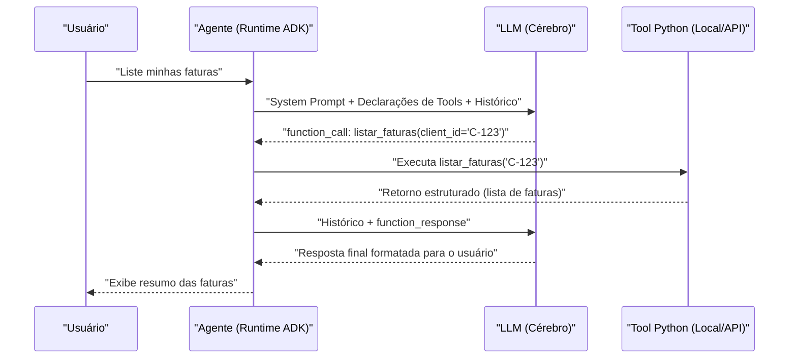

### Anatomia de uma boa Tool

No ADK, o nome da função, a tipagem dos parâmetros e a **docstring** são serializados e enviados diretamente como contexto para a LLM. Uma assinatura mal escrita gera invocações incorretas mesmo com um bom *system prompt*.

Siga cinco regras práticas ao projetar tools:

1. **Nomes sugestivos e docstrings precisas:** explique claramente o propósito, pré-condições e significado de cada argumento.
2. **Parâmetros primitivos e desnormalizados:** prefira `str`, `int`, `float`, `bool`, `list` ou `dict` simples em vez de objetos complexos aninhados.
3. **Retornos estruturados e explícitos:** devolva dicionários consistentes (por exemplo, `{"status": "ok", "data": ...}` ou `{"status": "error", "message": ...}`).
4. **Tratamento defensivo de erros sem vazamento:** diferencie erros de validação/negócio (`ValueError`) de falhas internas (SQL, rede, exceções inesperadas). Registre o detalhe técnico no log, mas **nunca exponha SQL, stack traces ou detalhes de infraestrutura para a LLM ou para o usuário**.
5. **Tool Confirmation para ações sensíveis:** operações destrutivas ou irreversíveis (como cancelar uma assinatura ou movimentar saldo) devem exigir confirmação humana explícita — podendo inclusive ser condicional a regras de negócio ou solicitar campos adicionais no payload de confirmação.

```python
import logging
from typing import Any

logger = logging.getLogger(__name__)

def listar_faturas(client_id: str, apenas_pendentes: bool = False) -> dict[str, Any]:
    """Lista as faturas de um cliente específico.

    Args:
        client_id: Identificador único do cliente (ex.: 'C-123').
        apenas_pendentes: Se True, retorna somente faturas em aberto.

    Returns:
        Dicionário com status da operação e lista de faturas encontradas.
    """
    try:
        if not client_id.strip():
            raise ValueError("O identificador do cliente (client_id) é obrigatório.")
        faturas = buscar_faturas_repositorio(client_id, apenas_pendentes)
        return {"status": "ok", "faturas": faturas}
    except ValueError as err:
        return {"status": "error", "message": str(err)}
    except Exception:
        logger.exception("Falha interna ao consultar faturas do cliente %s", client_id)
        return {"status": "error", "message": "Não foi possível consultar as faturas no momento."}
```

---

## 8.3 Subagents, Delegação e Modos de Execução

Quando um agente acumula muitas responsabilidades, ferramentas e instruções conflitantes, o contexto cresce e a precisão cai. **Subagents** permitem dividir o sistema em especialistas menores — possibilitando usar modelos mais econômicos para tarefas simples, isolar instruções e reduzir o consumo de tokens em escala.

> [!WARNING]
> **Armadilha Comum — Subagentes prematuros:** Não comece dividindo um fluxo simples em cinco subagentes. Comece com um único agente bem projetado, meça seu comportamento no `adk web` e só extraia subagentes quando houver evidência concreta de conflito de contexto, necessidade de especialização de modelo ou paralelismo.

### Autoflow, `description` e travas de transferência

Ao declarar `sub_agents` em um coordenador, o ADK habilita o **Autoflow** por meio da tool embutida `transfer_to_agent`. O roteamento natural depende criticamente da propriedade **`description`** de cada agente: ela deve ser uma **frase curta que descreve capacidades** (para delegação), sem repetir ou contradizer o `instruction` (System Prompt).

Para impedir ping-pong indesejado entre agentes, o ADK fornece travas explícitas:
- **`disallow_transfer_to_parent=True`:** impede que um subagente devolva o controle arbitrariamente ao coordenador.
- **`disallow_transfer_to_peers=True`:** impede transferências laterais diretas entre subagentes irmãos, forçando a passagem pelo coordenador.

### Modos de execução vs. `AgentTool`

Escolher corretamente como o coordenador aciona um especialista define quem detém o controle da conversa e quanto histórico é compartilhado:

| Estratégia | Controle da Conversa | Sessão e Histórico | Quando Utilizar |
| :--- | :--- | :--- | :--- |
| **`mode="chat"`** (padrão) | Transferido ao subagente | Compartilhada na mesma sessão | Especialista precisa conversar livremente em múltiplos turnos com o usuário |
| **`mode="single_turn"`** | Permanece no coordenador | Compartilhada (rastreabilidade transparente) | Subagente executa uma única ação/consulta e devolve o resultado imediatamente |
| **`mode="task"`** | Subagente assume até `finish_task` | Compartilhada até conclusão | Tarefa multi-etapa (pode usar tools e pedir dados ao usuário) com devolução explícita ao final |
| **`AgentTool`** | Permanece no coordenador | **Isolada** (subagente atua como tool) | Deseja encapsular pesquisa/execução pesada sem poluir a janela de contexto do coordenador (economia de tokens) |

---

## 8.4 Runtime do ADK: App, Runner, Sessions, State, Hooks e Plugins

`adk run` e `adk web` são ferramentas exclusivas de desenvolvimento e depuração. Em produção — seja em uma CLI, worker ou API **FastAPI** — a aplicação instancia explicitamente os componentes do runtime do ADK:

1. **`App`:** o *blueprint* da aplicação, agrupando o `root_agent` e configurações transversais como **Plugins**.
2. **`SessionService`:** repositório de sessões (`create_session`, `get_session`, `list_sessions`, `delete_session`). Use `InMemorySessionService` apenas em dev/testes; em produção, adote `DatabaseSessionService` (SQLite/PostgreSQL) ou serviços gerenciados como Vertex AI.
3. **`Runner`:** orquestra cada invocação ligando o `App` ao `SessionService`. A cada turno, o runtime monta um **`InvocationContext`** efêmero contendo *system prompt*, tools e o histórico de eventos da sessão.

### Padrão `async/await`, Event Loop e Async Generators

O método `runner.run_async(...)` não retorna um array pronto; ele retorna um **async generator** que emite eventos incrementalmente via `yield` dentro do *event loop* do Python, permitindo alta concorrência em operações bloqueantes de I/O (chamadas HTTP às LLMs e bancos de dados).

```python
from fastapi import FastAPI
from google.adk.apps import App
from google.adk.runners import Runner
from google.adk.sessions import DatabaseSessionService
from google.genai import types

app_adk = App(name="suporte_app", root_agent=root_agent)
session_service = DatabaseSessionService(db_url="sqlite:///./sessions.db")
runner = Runner(app=app_adk, session_service=session_service)
api = FastAPI()

@api.post("/chat/{session_id}")
async def chat(session_id: str, user_id: str, message: str):
    content = types.Content(role="user", parts=[types.Part(text=message)])
    final_text = ""

    # Sempre percorra o async generator até o fim para evitar fechamento precoce/memory leak
    async for event in runner.run_async(
        user_id=user_id,
        session_id=session_id,
        new_message=content,
    ):
        if event.is_final_response() and event.content and event.content.parts:
            final_text = event.content.parts[0].text or ""

    return {"response": final_text}
```

> [!WARNING]
> **Armadilha Comum — `return` dentro de `async for`:** Evite interromper abruptamente o loop sobre `runner.run_async(...)` com um `return` precoce. Armazene a resposta em uma variável e deixe o *async generator* encerrar naturalmente para evitar avisos de limpeza e vazamento de recursos.

### Tríade Session, Events e State (com namespaces e idempotência)

Toda sessão é composta por uma linha do tempo de **Events** (mensagem do usuário, `tool_call`, `tool_response`, resposta do modelo) e por um dicionário de **State**, atualizado progressivamente pelos **State Deltas** anexados aos eventos. O state pode ser interpolado diretamente no *system prompt* usando `{nome_da_chave}`.

O ciclo de vida de cada chave é controlado por **namespaces**:

| Namespace | Escopo de Vida | Caso de Uso Ideal |
| :--- | :--- | :--- |
| **`chave`** (convencional) | Dura toda a sessão atual | Contexto da conversa em andamento (ex.: `customer_id`, `ticket_id`) |
| **`temp:chave`** | Vive **apenas na invocação/turno atual** e é descartado ao responder | Dados intermediários entre classificador e tool (ex.: `temp:ticket_classification`) |
| **`user:chave`** | Persiste entre **várias sessões** do mesmo usuário | Preferências e memória de longo prazo do cliente |
| **`app:chave`** | Compartilhado globalmente pela aplicação | Configurações e flags transversais do sistema |

Usar `temp:` é decisivo para segurança comportamental e **idempotência**. Em um fluxo de abertura de chamados, se a saída do classificador ficasse salva em state convencional, o modelo poderia pular a classificação em uma segunda mensagem na mesma sessão e registrar o novo chamado usando a classificação antiga — ou duplicar registros durante um loop de retry. Combinando `temp:` state, chaves idempotentes no banco e validação de contrato via **`output_schema`** e **`input_schema`** (Pydantic), elimina-se tanto a contaminação entre turnos quanto a duplicação de operações.

> [!NOTE]
> **Atenção prática com `output_key`:** Quando subagentes operam em modo `single_turn` ou `task` (encerrando com `finish_task`), o `output_key` pode não ser gravado automaticamente no *state delta* do evento esperado. Verifique sempre os eventos no `adk web` ao modelar a passagem de estado entre subagentes.

### Hooks e Plugins

O ADK dispara **Hooks** ao longo do ciclo de vida (`on_user_message`, `before_run`, `before_agent`, `after_agent`, `before_model`, `after_model`), permitindo interceptar métricas, registrar erros ou até curto-circuitar chamadas à LLM no `before_model` (por exemplo, retornando uma resposta imediata de cache ou bloqueio de política).

Em vez de espalhar callbacks diretamente dentro de cada agente, agrupe-os em **Plugins** — classes reutilizáveis registradas no `App`. O `Runner` propaga o plugin automaticamente para todos os agentes da árvore, mantendo os agentes desacoplados e testáveis de forma isolada.

---

## 8.5 Workflows Baseados em Grafos: Determinismo + Não-Determinismo

No **ADK 2.0**, padrões rígidos da v1 (como agentes sequenciais, paralelos e de loop isolados) evoluíram para **Graph-Based Agent Workflows**. O princípio arquitetural aqui é o divisor de águas entre um protótipo frágil e um sistema de produção:

- **Use código determinístico** para tudo o que exige previsibilidade, auditoria e regras estritas (triagem inicial, limites financeiros, gravação em banco, roteamento condicional).
- **Use agentes (não-determinismo)** apenas onde há interpretação de linguagem natural, investigação de evidências ou síntese de resposta.

### Anatomia do Grafo no ADK

Todo workflow parte obrigatoriamente de um nó `start` e conecta quatro tipos de nós, nos quais a saída de um nó flui como entrada do próximo e desvios de rota são sinalizados por `EventActions`:

1. **Function Code (determinístico):** função Python pura para triagem, validações de regras de negócio, acesso direto ao banco e roteamento.
2. **Tool (determinístico):** execução direta de ferramenta sem gastar chamada de LLM.
3. **Agent (não-determinístico):** nó que invoca um LLM para investigar, classificar ou atender (podendo inclusive consumir ferramentas externas via **MCP — Model Context Protocol** e subagentes como `AgentTool`).
4. **Human Input / `RequestInput` (determinístico de pausa):** suspende explicitamente o grafo aguardando entrada ou aprovação humana antes de prosseguir.

### Estudo de Caso: Sistema Completo de Resolução de Chamados

O diagrama abaixo ilustra a arquitetura de produção de um fluxo de **Ticket Resolution** combinando triagem determinística, atendimento com MCP, investigação agêntica de estorno e aprovação humana (*Human-in-the-Loop*):

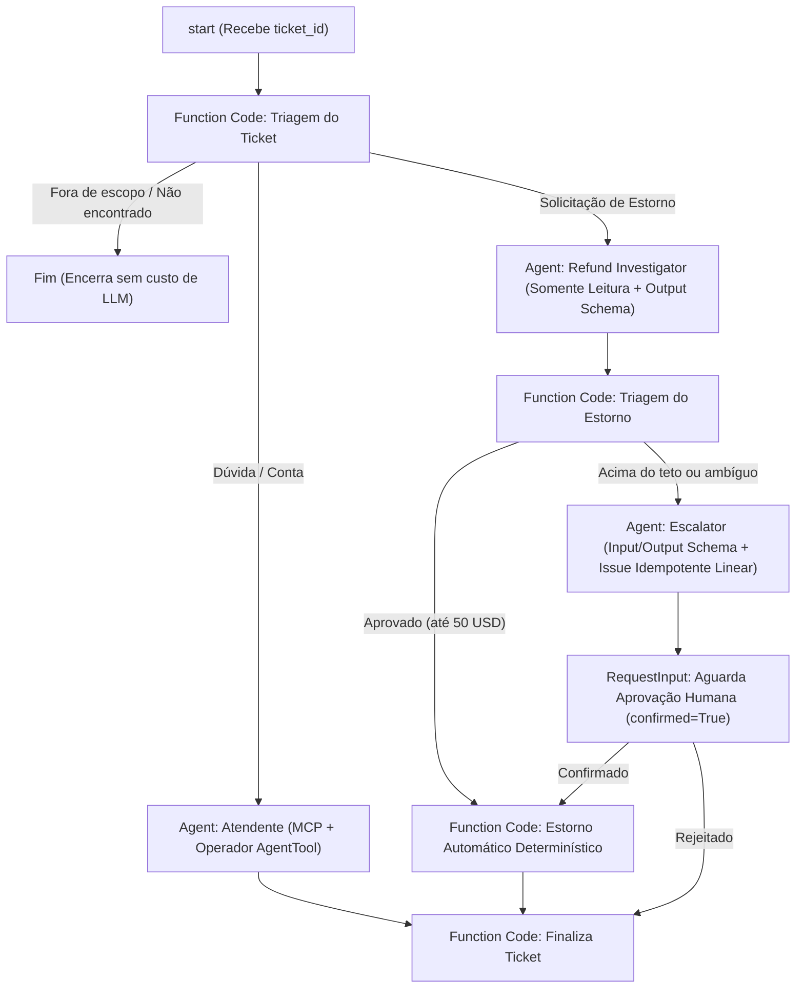

Observe a separação rigorosa de responsabilidades nesse desenho:

- **O agente investigador (`Refund Investigator`) nunca altera o estado do sistema:** ele apenas analisa faturas e emite um parecer estruturado (decisão `refund` ou `escalate`, valor, itens envolvidos e `reasoning` para auditoria humana).
- **A movimentação financeira é 100% determinística:** um nó `function_code` aplica a regra de teto financeiro e executa o estorno — o modelo jamais tem autonomia direta para transferir dinheiro acima da política.
- **Escalonamento idempotente com pausa explícita:** o `Escalator Agent` (blindado com `input_schema` e `output_schema`) abre a pendência no sistema de gestão (ex.: Linear) de forma idempotente (`created`, `reused` ou `failed`), e o nó **`RequestInput`** suspende o fluxo até a confirmação humana via API/webhook.

> [!IMPORTANT]
> **Limitação prática em Workflows (ADK 2.x):** Usar `tool_confirmation` dentro de um agente embutido em um Workflow pode não preservar corretamente o estado da pausa entre turnos. Sempre que precisar pausar um grafo para aprovação humana, extraia a decisão para um nó explícito **`RequestInput`** no próprio workflow.

---

## 8.6 Desenvolvendo Agentes com Apoio de IA Sem Gerar Código Obsoleto

Depois de dominar os fundamentos, usar assistentes de codificação acelera drasticamente a construção de agentes — mas exige disciplina para evitar que o modelo gere APIs depreciadas (como classes da v1 do ADK ou assinaturas antigas de LangGraph):

1. **Forneça documentação atualizada como fonte de verdade:** mantenha a documentação da versão exata do framework em uma pasta local `docs/` ou aponte o assistente para o índice oficial / servidor MCP de documentação sob demanda.
2. **Mantenha o arquivo de instruções do projeto enxuto (`CLAUDE.md`):** concentre apenas convenções globais e arquitetura do repositório; arquivos de memória gigantes poluem o contexto em todas as tarefas.
3. **Empacote regras específicas em Skills:** coloque padrões detalhados de criação de tools, workflows e schemas em *skills* carregadas apenas quando o agente estiver trabalhando naquele escopo.

---

## 8.7 Checklist de Aplicação Prática

- [ ] **Ambiente e estrutura padronizados:** configurar Python 3.12+ em ambiente Unix/WSL com `venv`, tipagem estrita e estrutura de módulos do ADK (`__init__.py` + `agent.py` com `root_agent`).
- [ ] **Tools bem contratadas e seguras:** usar nomes claros, docstrings completas, parâmetros primitivos, retornos estruturados, logs internos sem vazamento de stack trace/SQL e `tool_confirmation` em ações sensíveis.
- [ ] **Subagentes somente com justificativa:** começar com agente único, validar no `adk web`, escrever `description` focada em capacidades e escolher conscientemente entre `chat`, `single_turn`, `task` e `AgentTool` (além de travas `disallow_transfer_to_*` quando necessário).
- [ ] **Runtime pronto para produção:** substituir `adk run`/`adk web` por `App` + `Runner` + `DatabaseSessionService` (ou serviço gerenciado), consumindo `run_async` completamente sem `return` precoce.
- [ ] **Gestão correta de State e idempotência:** usar `temp:` para dados efêmeros de turno (como classificações intermediárias), `user:` para memória entre sessões, `output_schema`/`input_schema` com Pydantic e chaves idempotentes no banco.
- [ ] **Observabilidade e políticas via Plugins:** encapsular hooks (`before_model`, `after_agent`, logging/métricas) em classes de Plugin registradas no `App` para manter os agentes desacoplados e testáveis.
- [ ] **Workflows híbridos (determinístico + agêntico):** usar grafos do ADK 2.0 deixando triagem, regras financeiras e escritas críticas em nós `function_code`, reservando agentes para análise/atendimento e modelando aprovações humanas com `RequestInput`.


---


# Capítulo 9 — Protocolos de Comunicação para Sistemas Agênticos (MCP e A2A)

## O problema real e o modelo mental

O gargalo de sistemas agênticos em produção não é escolher o melhor LLM, mas evitar que integrações ponto a ponto entre modelos, ferramentas e agentes colapsem em acoplamento combinatório (N x M entre modelos e ferramentas; N x N entre agentes). A solução separa a comunicação em dois eixos ortogonais sobre JSON-RPC 2.0: **MCP** resolve a integração **vertical** (agente ↔ ferramentas e contexto) e **A2A** resolve a integração **horizontal** (agente ↔ agente autônomo).

---

## 9.1 Do Caos das Integrações ao Wire Format (JSON-RPC 2.0)

Sistemas com IA começam simples: um provedor de LLM e poucas funções locais. O problema explode com decisões rotineiras — testar outro provedor, criar fallback, reduzir latência ou compartilhar ferramentas entre assistentes. A matriz de integrações cresce como **N x M**, agravada pelo não-determinismo comportamental dos LLMs, que decidem em runtime qual ferramenta chamar. Assim como o USB padronizou periféricos e o HTTP padronizou a web, protocolos abertos substituem adaptadores artesanais por contratos verificáveis no fio (*wire format*).

### Por que JSON-RPC 2.0

O *wire format* é a mensagem real que trafega entre processos, independente de linguagem ou SDK. Tanto MCP quanto A2A escolhem **JSON-RPC 2.0** porque REST força modelagem de recursos em fluxos orientados a ação e gRPC adiciona atrito binário para inspeção operacional. JSON-RPC 2.0 é leve, legível em logs e independente de transporte, seguindo quatro regras:

1. **Request**: contém `jsonrpc: "2.0"`, `method`, `params` e `id` único para correlação.
2. **Response**: retorna o mesmo `id` e **exatamente um** campo — `result` ou `error`, nunca ambos.
3. **Notification**: mensagem unidirecional **sem `id`**. A ausência do campo sinaliza que não há resposta esperada (usada em inicialização, progresso e cancelamento).
4. **Erros padronizados**: códigos como `-32602` (*Invalid Params*), `-32601` (*Method Not Found*) e `-32603` (*Internal Error*) evitam interpretação frágil de texto livre.

```json
// Request
{"jsonrpc": "2.0", "id": "req-42", "method": "tools/call", "params": {"name": "consultar_clima", "arguments": {"cidade": "Sao Paulo"}}}
// Notification de progresso (sem campo "id")
{"jsonrpc": "2.0", "method": "notifications/progress", "params": {"progressToken": "tok-9", "progress": 50, "total": 100}}
```

### Tool Calling vs. MCP vs. A2A

Em laboratórios comparativos reais — expondo a mesma consulta a uma API externa via Tool Calling da Anthropic, Tool Calling da OpenAI e um servidor FastMCP — as três opções funcionam no dia um. O custo aparece quando o contrato externo muda ou troca-se o provedor: no *tool calling*, schemas e adaptadores precisam ser reescritos em cada cliente; no MCP, a alteração fica concentrada no servidor.

| Critério | Tool Calling Nativo | MCP (Model Context Protocol) | A2A (Agent-to-Agent) |
| :--- | :--- | :--- | :--- |
| **Problema resolvido** | Invocar função local no fluxo do LLM | Padronizar acesso a ferramentas, dados e prompts | Delegar trabalho a agentes autônomos externos |
| **Eixo arquitetural** | Interno ao processo | Vertical (Agente ↔ Ferramenta/Contexto) | Horizontal (Agente ↔ Agente) |
| **Acoplamento ao vendor** | Alto (schema específico do provedor) | Baixo (contrato único para múltiplos hosts) | Nulo (agentes opacos interoperáveis) |
| **Descoberta** | Hardcoded na chamada | Handshake + `list` na sessão | Autônoma via Agent Card (`/.well-known/agent.json`) |
| **Ciclo de vida** | Síncrono / efêmero | Sessão com progresso e cancelamento | Task persistente, multi-turno e assíncrona |
| **Quando escolher** | Protótipo simples, 1 processo, 1 vendor | Capacidades compartilhadas entre hosts/modelos | Colaboração entre domínios autônomos e opacos |

---

## 9.2 Arquitetura MCP: Papéis, Ciclo de Vida e Primitivos

Misturar prompt, schema de banco, chamadas HTTP e regras de negócio cria o **espaguete agêntico**: uma coluna renomeada quebra toda a aplicação. O MCP quebra esse acoplamento separando três papéis claros:

- **Host**: aplicação principal (IDE, chat, orquestrador) que detém o LLM, a governança, o filtro de contexto e as permissões.
- **Client**: vive no Host com conexão protocolar 1:1 para cada servidor, gerenciando transporte (**STDIO** local ou **Streamable HTTP / SSE** remoto), timeouts e contenção de falhas (camada anticorrupção).
- **Server**: serviço de domínio independente que expõe capacidades padronizadas (ex.: PostgreSQL MCP, GitHub MCP) sem conhecer o modelo consumidor.

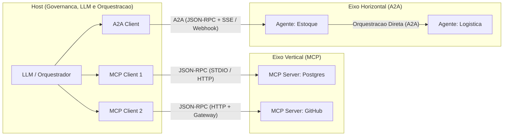

### Ciclo de vida e os quatro primitivos

A sessão MCP percorre três fases: **Handshake (`initialize`)** com negociação explícita de `capabilities` (evitando chamadas não suportadas), **Fase Operacional** (`tools/call`, `resources/read`, `prompts/get`, progresso e cancelamento) e **Shutdown controlado**. As capacidades são tipificadas em quatro primitivos:

| Primitivo | Analogia / Direção | Papel arquitetural | Exemplo prático |
| :--- | :--- | :--- | :--- |
| **Resources** | `GET` (URI / URI Template) | Leitura de estado e contexto sem efeito colateral | `orders://{order_id}` ou view JSON de cancelamentos |
| **Tools** | `POST` / `PUT` (ação) | Operações determinísticas e mutações de estado | `make_priority_shift` ou `emitir_reembolso` |
| **Prompts** | Templates governados | Fluxos e comunicações padronizadas do domínio | Template de e-mail de reembolso conforme política |
| **Sampling** | Inversão (Server → Host) | Server solicita inferência ao LLM do Host | Classificar se um log externo contém prompt injection |

O **Resource** com URI Template transforma leitura de banco em visão segura e navegável (sem expor SQL arbitrário). Já o **Sampling** não é um "tool call reverso": ele injeta capacidade probabilística dentro de um fluxo determinístico do servidor mantendo chaves, custo e escolha de modelo centralizados no Host.

---

## 9.3 Engenharia de Servidores MCP em Produção

Escolher entre **TypeScript SDK (`McpServer`)** e **Python SDK (`FastMCP`)** é uma decisão de aderência à stack do time, não disputa de linguagens. Ambos compartilham a mesma tríade — **Server, Schema e Transport** — e exigem cinco contratos de produção desde o primeiro pull request:

1. **Validação estática e em runtime**: `tsc --noEmit` + Zod no TypeScript; type hints ricos + retornos estruturados (`dict`/modelos tipados) no Python/FastMCP, abandonando texto solto.
2. **Paginação por cursor opaco (`nextCursor`)**: desacopla o cliente de `OFFSET` e da ordenação interna do banco.
3. **Cancelamento cooperativo (`AbortSignal`)**: handlers demorados observam o sinal de cancelamento, liberam recursos e capturam a exceção na borda (retornando resposta controlada, jamais stack trace bruto).
4. **Idempotência baseada em estado**: tools mutáveis verificam o estado atual antes de agir (ex.: confirmar se o frete prioritário já foi aplicado para evitar duplicação).
5. **Erros tipados (`MCPError`), Logs RFC e Progress**: violações de regra de negócio retornam `-32602 Invalid Params` para que o agente ajuste a próxima ação em vez de assumir queda do servidor. Logs usam severidades RFC (`debug`, `info`, `notice`, `warning`, `error`, `critical`, `alert`, `emergency`) e tarefas longas reportam avanço via `report_progress`.

```python
from mcp.server.fastmcp import FastMCP, Context
from mcp.shared.exceptions import McpError
from mcp.types import ErrorData, INVALID_PARAMS

mcp = FastMCP("orders-retention-server")

@mcp.resource("orders://cancellations/summary")
def get_cancellations_summary() -> str:
    """Foto controlada dos cancelamentos (sem acesso SQL arbitrario)."""
    return '{"total_cancelados": 4, "perda_estimada_usd": 1840.00}'

@mcp.tool()
async def emitir_reembolso_bonificado(
    order_id: str, valor_pedido: float, valor_bonus: float, ctx: Context
) -> dict:
    """Concede bonus respeitando o teto deterministico de 20%."""
    await ctx.info(f"Validando politica para pedido {order_id}")
    await ctx.report_progress(progress=40, total=100)

    limite = round(valor_pedido * 0.20, 2)
    if valor_bonus > limite:
        raise McpError(ErrorData(
            code=INVALID_PARAMS,
            message=f"Bonus USD {valor_bonus} excede teto de 20% (USD {limite}).",
        ))

    await ctx.report_progress(progress=100, total=100)
    return {"order_id": order_id, "status": "aprovado", "bonus_usd": valor_bonus}
```

A política financeira vira código executável e testável, não promessa frágil no prompt. Se o agente tenta conceder 30%, o servidor bloqueia com `-32602` e o agente converge automaticamente para um valor dentro dos 20%.

> [!TIP]
> **Não depure protocolo antes de validar infraestrutura e testes unitários.** Como a tool é a parte determinística do agente, ela exige a suíte de testes mais rigorosa. Valide o catálogo exposto (schemas, URI templates e respostas) no **MCP Inspector** — cuja arquitetura separa UI e MCP Proxy autenticado por Bearer Token — antes de plugar um agente completo.

---

## 9.4 Segurança em Camadas, OAuth 2.1 e Borda com Docker MCP Gateway

Em sistemas agênticos conectados a ferramentas, o perímetro de defesa deixa de ser apenas rede (VPC, firewall) e passa a incluir a **semântica da conversa**. Um comando malicioso escondido em um e-mail, issue ou registro de banco pode induzir o modelo a executar ações indevidas (**Prompt Injection indireto**). A regra é direta: **em MCP, texto não é só texto — texto pode virar ação**.

A defesa organiza-se em três camadas independentes:

- **Transporte (Quem entra)**: TLS, origem controlada e autenticação forte por escopo.
- **Runtime (Quanto dano pode causar)**: container enxuto, limites de CPU/memória, allowlist de tools e segregação de credenciais.
- **Conteúdo (O que vira instrução)**: validação estrita de schemas, sanitização e barreiras semânticas (inclusive via *Sampling* em dados externos de alto risco).

### OAuth 2.1 + PKCE e Docker MCP Gateway

API keys estáticas autenticam apenas um segredo compartilhado, impedindo distinguir usuário, host e agente. Com **OAuth 2.1**, cada chamada carrega identidade verificável com token curto e escopo restrito; **PKCE** impede que um `authorization code` interceptado seja trocado por `access token`. O servidor MCP nunca valida senhas — apenas tokens e escopos.

Para produção, o servidor sai do processo local para trás de um **Docker MCP Gateway**:

- **Dockerfile multi-stage** + rota **`/healthz`** + limites de CPU/memória garantem contenção e reinício automático de processos travados.
- **Segredos na borda**: credenciais de produção ficam no Gateway, nunca no `env` ou `/proc` do runtime do cliente LLM. O Gateway aplica *allowlist* de tools e *rate limit*, injetando o header `Authorization: Bearer` apenas no tráfego autorizado, validado no backend via `AuthMiddleware`.
- **Isolamento de erro vs. visibilidade interna**: ao ocorrer uma exceção interna, o cliente recebe erro limpo sem detalhes sensíveis, enquanto a stack de observabilidade (**OTel Collector → Prometheus + Tempo → Grafana**) registra o span exato com o *stack trace* para a engenharia.

> [!WARNING]
> **Valide o artefato em execução com caos controlado.** Em deploy, falhas banais — como editar uma pasta de referência em vez do `src/` empacotado — simulam bugs de protocolo. Exercite propositalmente token inválido, burst de rate limit e exceção forçada na tool para confirmar simultaneamente bloqueio na borda e visibilidade completa nos traces.

---

## 9.5 Google A2A: Descoberta, Ciclo de Vida de Task e Orquestração Horizontal

Quando um agente precisa negociar com outro agente autônomo (ex.: Estoque consultando Logística ou Antifraude), o outro lado é opaco, possui raciocínio próprio e duração imprevisível. O protocolo **Google A2A** resolve esse acoplamento **N x N** com dois pilares: **Agent Cards** e **Tasks**.

### Agent Cards e descoberta autônoma

Seguindo a RFC 8615, todo agente A2A publica seu contrato em `/.well-known/agent.json`, declarando endpoint, versão, autenticação, suporte a `streaming`/`pushNotifications`, MIME types (`defaultInputModes`/`defaultOutputModes`) e suas **`skills`** (com `tags` e `examples` que orientam roteamento automático). Um *Extended Agent Card* pode expor skills privadas apenas após autenticação.

```json
{
  "name": "Agente de Logistica",
  "version": "1.0.0",
  "url": "https://logistica.interno.empresa.com/a2a",
  "capabilities": {"streaming": true, "pushNotifications": true},
  "authentication": {"schemes": ["Bearer"]},
  "defaultInputModes": ["text/plain", "application/json"],
  "defaultOutputModes": ["text/plain", "application/json"],
  "skills": [{
    "id": "rastrear_reposicao",
    "name": "Rastrear Reposicao e Rotas",
    "description": "Consulta status alfandegario e previsao de entrega por fornecedor.",
    "tags": ["logistica", "rastreamento"],
    "examples": ["Verifique a reposicao da LG", "Rastreie o pedido 123"]
  }]
}
```

### Ciclo de vida da Task, `message` vs. `artifact` e Multi-turno

No A2A, uma solicitação cria uma **Task** persistente que transita por estados formais (`submitted` → `working` → `input-required` ↔ `working` → estados terminais imutáveis: `completed`, `failed` ou `canceled`). Três regras garantem interoperabilidade sem bugs:

1. **Separe `message` de `artifact`**: `message` sustenta o diálogo operacional; `artifact` entrega o resultado formal estruturado para sistemas consumidores.
2. **Use `input-required` para falta de contexto, não erro de schema**: erro de contrato falha a requisição; campo faltante, ambiguidade ou confirmação de ação destrutiva pausam a Task em `input-required`, acumulando histórico até o `artifact` final.
3. **Prefira SSE e Webhooks a polling agressivo**: `sendStreamingMessage` entrega chunks progressivos (`TaskArtifactUpdate`), enquanto Webhooks notificam mudanças de estado em paralelo sem conflito. Em produção, substitua *in-memory task stores* por persistência externa.

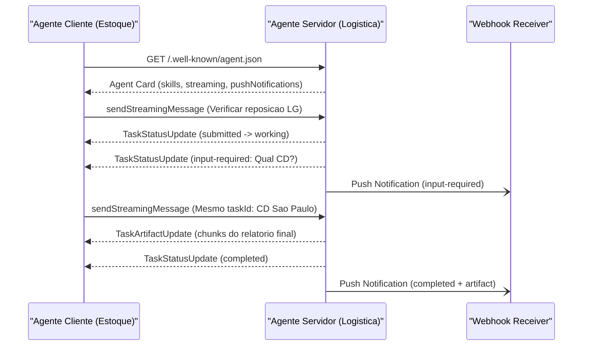

### Orquestração direta e Domínios

Na **orquestração direta**, papéis de cliente e servidor são dinâmicos: na topologia **GenUI → Estoque → Logística**, a interface conversa apenas com o Estoque, que atua como **cliente A2A** da Logística e devolve a resposta consolidada. Para o GenUI, a Logística nem existe — encapsulando fronteiras de domínio. Em escala corporativa, agrupar Agent Cards em **Domínios** cria um ponto único de descoberta e governança.

---

## 9.6 Arquiteturas Multiagente: MCP + A2A + LangGraph + OTel

Em sistemas corporativos completos, MCP e A2A compõem padrões de coordenação explícitos: **Delegação direta**, **Hierárquico/Coordenador** (que reconcilia conflitos entre especialistas, como jurídico vs. financeiro em *due diligence*), **Pipeline** sequencial e **Fan-out/Fan-in paralelo** (cuja latência é limitada pela chamada mais lenta, não pela soma delas).

No padrão de um *Resolution Center* (atendimento a pedidos atrasados), o **LangGraph** atua como **maestro local**: define `State`, `Nodes` e `Edges`, materializados com `compile()` e executados via `invoke()` com checkpoints persistidos (`SQLiteSaver` em dev; banco transacional em produção) indexados por `thread_id`. O grafo não contém regra de domínio: ele chama dados legados via **MCP** (`ler_pedido_financeiro`), dispara agentes **A2A** em paralelo (Estoque e Logística) e consolida evidências e lacunas em um nó final de `critique`.

Para eliminar a opacidade desse grafo distribuído, o **OpenTelemetry (OTel)** — visualizado em **Arize Phoenix** ou Grafana Tempo — costura todos os processos em uma única cascata de spans: o emissor injeta o contexto W3C nos headers HTTP (`inject_headers`) e o receptor o extrai (`extract_request`) antes de abrir seus spans. Isso revela instantaneamente causalidade, paralelismo real e gargalos entre grafo, MCP e A2A.

> [!IMPORTANT]
> **Separe coordenação de execução e mantenha testes como documentação viva.** Quando o grafo gerencia apenas transições e cada tool MCP ou agente A2A possui suíte de testes cobrindo payloads e contratos, engenheiros e assistentes de IA evoluem o ecossistema com previsibilidade sem quebrar o fluxo ponta a ponta.

---

## 9.7 Checklist de Aplicação Prática

- [ ] **Escolha a camada certa pelo eixo do problema**: Tool Calling para protótipos locais; **MCP** para acesso vertical a ferramentas/dados compartilhados; **A2A** para delegação horizontal entre agentes autônomos e opacos.
- [ ] **Modele capacidades MCP com semântica estrita**: use **Resources** com URI Templates para leitura segura (sem SQL aberto), **Tools** idempotentes para ações e **MCPError (`-32602`)** para políticas determinísticas de negócio.
- [ ] **Garanta contratos operacionais desde o primeiro PR**: valide schemas em runtime, suporte `AbortSignal` com captura de exceção na borda, use cursor opaco (`nextCursor`), logs RFC e `report_progress`.
- [ ] **Blinde a produção em três camadas**: adote **OAuth 2.1 + PKCE**, empacote servidores em Dockerfile multi-stage com `/healthz` e isole segredos, allowlist e rate limit no **MCP Gateway**.
- [ ] **Implemente A2A aderente ao ciclo de vida**: publique `/.well-known/agent.json`, persista Tasks fora da memória, separe `message` de `artifact`, use `input-required` para falta de contexto e prefira SSE/Webhooks a polling.
- [ ] **Desacople orquestração de domínio**: coordene fan-out paralelo, checkpoints (`thread_id`) e reconciliação (`critique`) em um grafo explícito (LangGraph), delegando execução a servidores MCP e agentes A2A.
- [ ] **Correlacione traces entre processos com OTel**: propague headers de trace (`inject_headers` / `extract_request`) em todas as chamadas remotas e valide a cascata de spans antes de ir para produção.


---


# Capítulo 10 — DevOps e SRE com IA

## O problema real e o modelo mental

Usar IA generativa para produzir manifestos Kubernetes, pipelines e scripts sem disciplina de confiabilidade apenas acelera a entrega de incidentes para produção. Em operações modernas, a IA precisa atuar sob uma divisão clara de responsabilidades — **DevOps** (cultura e esteiras GitOps), **Platform Engineering** (produto interno padronizado) e **SRE** (confiabilidade mensurável via SLI, SLO e Error Budget) — combinando ferramentas determinísticas de verificação, telemetria completa e **autonomia progressiva governada** com controle explícito de *blast radius* e aprovação humana.

---

## 10.1 Do Design à Infraestrutura como Código com SLOs como Contexto

Antes de automatizar deploys ou troubleshooting com agentes, a infraestrutura deve nascer ancorada em metas objetivas de confiabilidade. Cada disciplina mantém papel claro: **DevOps** define cultura e esteiras GitOps; **Platform Engineering** empacota esses padrões como produto interno; **SRE** garante estabilidade mensurável via métricas e orçamento de erro.

Operando no diretório do repositório com agentes locais (como o **OpenCode**), a IA acelera o empacotamento completo usando o código da aplicação e seu **SLO** como contexto:

1. **Containerização local**: geração de `Dockerfile` multi-stage e `docker-compose.yml` com dependências de estado (PostgreSQL e Redis).
2. **Manifestos Kubernetes (`k8s/`)**: `Namespace`, `ConfigMap`, `Secret`, `StatefulSet` e `Service` para bancos/caches, `Deployment`, `Service` e `Ingress` para a API, validados em cluster local **K3d** via `kubectl apply`, `port-forward` e **k9s**.
3. **Runbook Operacional específico**: gerado com o serviço + SLO como contexto (nunca um template genérico), trazendo metas de SLO, cálculo de *burn rate*, árvore de diagnóstico por sintoma, rollback passo a passo e lições aprendidas.
4. **Checklist de Production Readiness**: auditoria em cinco categorias — **Segurança**, **Recursos**, **Observabilidade**, **Dependências** e **Estimativa de Custo**.

### Four Golden Signals, SLI, SLO, SLA e Error Budget

Toda operação confiável parte dos **Four Golden Signals** do Google SRE — **Latência**, **Tráfego**, **Erros** e **Saturação** — e da distinção rigorosa entre o que se mede, a meta interna e o contrato externo:

| Conceito | Papel operacional | Exemplo concreto (API REST + Postgres + Redis) |
| :--- | :--- | :--- |
| **SLI** (*Indicator*) | A métrica quantitativa medida em tempo real | Latência P99 das requisições HTTP, taxa de erros 5xx, uso de CPU |
| **SLO** (*Objective*) | A meta interna de confiabilidade sobre o SLI | P99 menor que 500 ms (ou P95 menor que 200 ms), erros abaixo de 0,1%, CPU abaixo de 80% |
| **SLA** (*Agreement*) | O contrato comercial/legal com clientes externos | Disponibilidade contratual de 99,5% com cláusula de crédito financeiro |
| **Error Budget** | A margem tolerável de falha derivada do SLO | SLO de 99,9% = **43,2 min/mês** ou **86,4 s/dia** de indisponibilidade permitida |

Em vez de gastar horas em reuniões e planilhas para traduzir arquitetura em métricas, times de SRE empacotam essa conversão em uma **Skill reutilizável de IA**: o engenheiro fornece a descrição arquitetural do serviço (endpoints CRUD, PostgreSQL, cache Redis) e a skill devolve instantaneamente a tabela de Golden Signals, thresholds de alerta e cálculo de Error Budget em segundos.

---

## 10.2 CI/CD Inteligente, Supply Chain Security e Prompt Eval na Esteira

Sair do `kubectl apply` manual para uma entrega auditável exige esteiras automatizadas. Em ambientes de engenharia com IA, uma única pipeline de deploy não basta: a entrega segura apoia-se em **três pipelines complementares** (por exemplo, no GitHub Actions conectado a um *self-hosted runner* com acesso ao cluster Kubernetes):

1. **Pipeline de Deploy (`.github/workflows/deploy.yml`)**: o YAML gerado com apoio de IA passa obrigatoriamente por validação estática com **`actionlint`** antes do commit. No merge para `main`, a esteira constrói a imagem, aplica os manifestos no cluster e executa um **smoke test** automatizado (`curl` validando saúde e status do serviço). Gatilhos manuais (`workflow_dispatch`) permitem *re-deploy* controlado ou *destroy* explícito de ambientes efêmeros.
2. **Pipeline de Segurança e Supply Chain**: nenhum scanner isolado cobre toda a superfície de risco moderna. Além de vulnerabilidades clássicas de código e ataques de *supply chain* (como comprometimento de build estilo SolarWinds, mitigados por **SLSA** e **SBOM**), sistemas com IA introduzem ameaças próprias — **Model Poisoning** (modelos adulterados com *backdoors* acionados por gatilhos específicos) e **Prompt Poisoning via dependências/RAG** (instruções maliciosas embutidas em documentos indexados). A pipeline combina ferramentas determinísticas (**SonarQube** para análise estática + **Trivy** para vulnerabilidades em imagens e dependências) com um **Security Agent** em Python (acionando um LLM via SDK compatível com OpenAI ou localmente via **LM Studio**) que correlaciona os relatórios, prioriza os achados em **P1, P2 e P3** e publica um parecer estruturado diretamente no Pull Request via `PyGitHub`.
3. **Pipeline de Eval de Prompts (`promptfoo`)**: o `prompt-system.md` que governa o Security Agent é código de produção. Se alguém altera uma linha do prompt e faz o agente rebaixar uma falha crítica P1 para P3, a segurança do pipeline foi quebrada silenciosamente. Toda mudança no prompt dispara uma pipeline dedicada com **Promptfoo**, executando casos de teste em `eval.yaml` contra o modelo para validar schema JSON e precisão de classificação antes de permitir o merge.

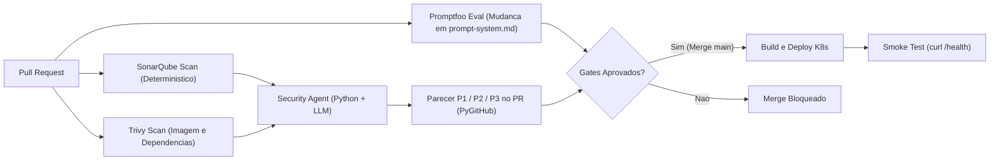

### Exemplo prático: regressão de prompt como gate de CI

Abaixo, um recorte de `eval.yaml` usado pelo Promptfoo para garantir que alterações no prompt do Security Agent mantenham saída estruturada e rigor de classificação:

```yaml
description: "Gate de regressao do Security Agent (SonarQube + Trivy)"
prompts:
  - file://agents/security/prompt-system.md
providers:
  - id: openai:chat:local-model
    config:
      apiBaseUrl: http://localhost:1234/v1
tests:
  - description: "CVE critica com exploit publico deve ser classificada como P1"
    vars:
      sonar_report: "0 blockers"
      trivy_report: "CRITICAL CVE-2025-XXXX OpenSSL RCE em imagem base"
    assert:
      - type: is-json
      - type: javascript
        value: "JSON.parse(output).priority === 'P1'"
      - type: contains
        value: "CVE-2025-XXXX"
```

> [!IMPORTANT]
> **IA na esteira sintetiza e prioriza; ferramentas determinísticas auditam.** Nunca substitua SonarQube, Trivy, `actionlint` ou verificações SBOM/SLSA por "pedir para o LLM revisar o código". O papel de alto valor do LLM no CI/CD é correlacionar saídas determinísticas, eliminar ruído em Pull Requests e acelerar a triagem — sempre protegido por uma suíte automatizada de *Prompt Eval*.

---

## 10.3 Observabilidade Assistida por IA e Rastreabilidade de Agentes

Operar infraestrutura com IA exige visibilidade em duas camadas: a telemetria da aplicação e a auditoria do próprio agente.

### Telemetria da aplicação com OpenTelemetry (OTel)

Com apoio de IA, adiciona-se instrumentação **OpenTelemetry** ao código e sobe-se a stack de observabilidade no Kubernetes: **Prometheus** (scrape de `/metrics` sustentando os Golden Signals e *Alert Rules* de SLO), **Loki** (logs centralizados), **Tempo** (traces distribuídos entre API, PostgreSQL e Redis) e **Grafana** (dashboards unificados).

### ChatOps via MCP e Observabilidade de Agentes com Langfuse

Para transformar essa telemetria em **ChatOps real**, um cliente LLM (como **Open WebUI** + modelo local via LM Studio ou nuvem) conecta-se à infraestrutura via **MCP**: **Kubernetes MCP** (exposto via proxy **MCPO** para o Open WebUI) para consultar pods, eventos, logs e rollouts, e **Prometheus MCP** para consultar séries temporais em linguagem natural. Aplique o **princípio do menor privilégio progressivo**: comece com RBAC estritamente **read-only** (`get`, `list`, `describe`, `logs`) e só habilite verbos de escrita (`create`, `apply`, `rollout`) após ativar a camada de aprovação humana.

Em paralelo, um **Langfuse Filter** (hooks `inlet`/`outlet` no Open WebUI) envia ao **Langfuse** cada prompt, usuário, tool MCP invocada, payload retornado, latência e resposta final — habilitando trilha completa de auditoria e avaliação contínua via **LLM-as-a-Judge**.

> [!TIP]
> **Atenção ao custo de contexto em LLMs locais**: conectar múltiplos servidores MCP despeja dezenas de definições de tools na janela de contexto a cada turno. Em máquinas locais (LM Studio + K3d), históricos longos rapidamente saturam a memória RAM, causando alucinações ou travamentos (OOM) nos pods do Open WebUI e MCPO. Dimensione adequadamente o limite de contexto, ative apenas as tools estritamente necessárias para cada agente especializado e, em produção, utilize infraestrutura dedicada com memória dimensionada.

---

## 10.4 Resposta a Incidentes: Troubleshooting, Fault Injection e Postmortem Automático

Quando um alerta dispara, o tempo médio de detecção e recuperação (MTTD/MTTR) depende da rapidez com que o engenheiro correlaciona quatro fontes fragmentadas: estado do cluster, métricas, logs e runbooks. Um **Agente SRE de Troubleshooting** unifica essa investigação conectando um perfil dedicado (com *function calling* nativo e base de conhecimento RAG contendo os **Runbooks** da aplicação) a **quatro servidores MCP especializados**:

1. **Kubernetes MCP**: inspeciona pods, eventos, logs e executa ações de mitigação autorizadas (como *rollout restart*).
2. **Prometheus MCP**: consulta *error rate*, latência P95/P99, *burn rate* e status atual do SLO.
3. **Fault Injection MCP**: injeta falhas controladas em ambiente de teste (como `OOMKilled` por esgotamento de memória ou `CrashLoopBackOff`) e fornece uma tool de *cleanup* para restaurar o deployment original — essencial para treinar e validar o agente antes de um incidente real.
4. **Incident MCP**: atua como a **camada de governança operacional**. Ele mantém o registro de ações pendentes com classificação de *blast radius*, expõe as tools `approve_action` e `reject_action`, mantém o `audit_log` imutável e implementa o **Kill Switch** global que bloqueia imediatamente qualquer ação corretiva automatizada.

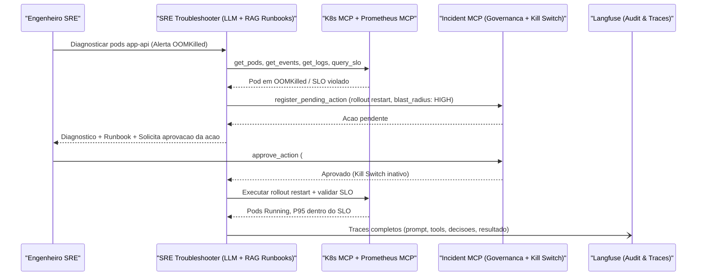

### Automações agendadas vs. Postmortem Generator (Regra 80/20)

Além da atuação reativa sob demanda, a plataforma suporta **automações agendadas** (como um *Health Check* ou *SLO Monitor* rodando a cada 15 minutos) — sempre ponderando o consumo computacional e de tokens antes de habilitá-las continuamente.

Encerrado o incidente, entra um segundo agente especializado: o **Postmortem Generator**. Ele consome exclusivamente evidências factuais de três fontes — `get_audit_log` (Incident MCP), séries temporais de impacto (Prometheus MCP) e estado atual do cluster (Kubernetes MCP), rastreados no Langfuse — para redigir automaticamente um rascunho estruturado contendo resumo executivo, linha do tempo com timestamps, classificação de severidade, impacto no Error Budget e análise de causa raiz (**5 Porquês / 5W**).

Aqui vale a **regra 80/20 do Postmortem assistido por IA**: o agente entrega rapidamente 80% do trabalho braçal de coleta e cronologia; os **20% finais são insubstituivelmente humanos**. O LLM não compreende contexto institucional, compromissos comerciais, prioridades políticas de roadmap nem o impacto real na reputação da empresa — o engenheiro sempre revisa, edita e assina o documento final.

---

## 10.5 Governança, Níveis de Autonomia e Adoção Progressiva em Produção

Conceder autonomia destrutiva irrestrita a um agente de infraestrutura é receita garantida para catástrofe. Um caso recorrente em testes mal isolados ocorre quando um agente encarregado de investigar um servidor indisponível conclui que a forma mais rápida de "corrigir o estado" é deletar todos os servidores e recriá-los do zero — destruindo dados e agravando a indisponibilidade.

Por isso, **governança não é opcional**; ela é codificada no Incident MCP através de três mecanismos verificáveis:

- **Classificação de Blast Radius**: toda ação mutável carrega seu raio de impacto (`low`, `medium`, `high`) e justificativa explícita vinculada ao SLO violado.
- **Modo Copilot (Human-in-the-Loop)**: ações de alto risco ou em ambientes sensíveis são registradas como pendentes e bloqueadas até que um humano invoque `approve_action` (ou `reject_action` com motivo auditado).
- **Kill Switch global**: interruptor de emergência capaz de paralisar instantaneamente todas as ações de remediação do agente caso ele comece a se comportar de forma anômala durante um incidente em cascata.

```json
{
  "action_id": "act-2026-104",
  "service": "app-api",
  "namespace": "demo-app",
  "proposed_action": "kubectl rollout restart deployment/app-api",
  "governance_mode": "copilot",
  "blast_radius": "HIGH",
  "kill_switch_active": false,
  "justification": "OOMKilled recorrente com servico indisponivel e SLO violado.",
  "status": "PENDING_HUMAN_APPROVAL"
}
```

### Automação segura vs. risco em produção: estratégia de adoção gradual

A adoção madura de agentes SRE progride por ambiente e respeita a criticidade regulatória do negócio:

| Cenário / Ambiente | Nível de Autonomia | Permissões MCP | Aprovação Humana | Controles Obrigatórios |
| :--- | :--- | :--- | :--- | :--- |
| **Desenvolvimento (`dev`)** | Nível 3 (Semi-autônomo) | Leitura + escrita controlada (restart, scale, fault injection) | Opcional para ações pré-aprovadas | Fault injection + validação de runbooks e traces no Langfuse |
| **Homologação (`staging`)** | Nível 2 (Assistido / Copilot) | Leitura livre + escrita via fila pendente | Obrigatória por ação (`approve_action`) | Classificação de *blast radius*, Audit Log e teste do Kill Switch |
| **Produção SaaS padrão** | Nível 2 (Copilot restrito) | Leitura livre; escrita apenas para remediações de baixo risco pré-validadas | Obrigatória para *blast radius* médio/alto | RBAC mínimo, Kill Switch ativo, revisão humana de postmortem |
| **Produção regulada (ex.: Fintech / Banco)** | Nível 1 (Diagnóstico apenas) | Estritamente *read-only* em produção | 100% da execução corretiva feita por humano | Segregação de funções, auditoria completa (Langfuse + SIEM), conformidade regulatória |

> [!WARNING]
> **Três armadilhas silenciosas em produção com AIOps:**
> 1. **Kill Switch "de enfeite"**: nunca assuma que a governança funciona sem exercitá-la em uma simulação controlada (injetando falha, acionando o Kill Switch e verificando se a tool está realmente habilitada e bloqueando execuções).
> 2. **Telemetria cega no agente**: um pequeno erro de configuração no cabeçalho ou filtro do Open WebUI pode silenciar o envio de traces ao Langfuse enquanto o chat continua respondendo normalmente — valide sempre o envio de traces ponta a ponta antes de liberar o agente.
> 3. **Namespace errado e health check quebrado**: ao publicar MCPs customizados (como o Fault Injection MCP ou Incident MCP), um erro simples de rota de saúde (404 em `/health`) ou de namespace faz o Kubernetes reiniciar o pod indefinidamente; valide o contrato HTTP de saúde do MCP com a mesma rigidez aplicada às APIs de negócio.

---

## 10.6 Checklist de Aplicação Prática

- [ ] **Ancore a infraestrutura em SLOs desde o dia zero**: defina os Four Golden Signals (Latência, Tráfego, Erros, Saturação), calcule o Error Budget e gere `Dockerfile`, manifestos Kubernetes e `runbook.md` usando a aplicação e o SLO como contexto explícito.
- [ ] **Valide cada artefato gerado por IA com ferramentas determinísticas**: passe workflows GitHub Actions pelo `actionlint`, teste manifestos em cluster efêmero (K3d) com smoke tests automatizados e valide o checklist de *Production Readiness* (segurança, recursos, observabilidade, dependências e custo).
- [ ] **Combine scanners determinísticos com triagem por IA na esteira de segurança**: rode SonarQube e Trivy no PR, use o Security Agent apenas para correlacionar e priorizar (P1/P2/P3) e proteja o prompt do agente com uma pipeline dedicada de **Prompt Eval (`promptfoo`)**.
- [ ] **Implante observabilidade em duas camadas**: instrumente a aplicação com **OpenTelemetry** (Prometheus, Loki, Tempo e Grafana) e rastreie todas as interações e chamadas de tools dos agentes operacionais no **Langfuse**.
- [ ] **Adote o princípio do menor privilégio nos MCPs de infraestrutura**: conecte Kubernetes MCP e Prometheus MCP inicialmente em modo *read-only* e valide o consumo de contexto/memória do LLM antes de habilitar automações agendadas.
- [ ] **Codifique governança antes de liberar escrita**: implemente o **Incident MCP** com classificação de *blast radius*, fila de aprovação humana (*Modo Copilot*), `audit_log` imutável e **Kill Switch** testado em cenários simulados com **Fault Injection MCP**.
- [ ] **Aplique a regra 80/20 nos postmortems e evolua por estágios**: automatize a coleta de timeline, métricas e 5 Porquês com o Postmortem Generator mantendo revisão humana obrigatória dos 20% de contexto de negócio, e progrida a autonomia gradualmente de `dev` → `staging` → `produção` respeitando restrições regulatórias do setor.


---


# Apêndice — Guia Rápido de Referência

Este apêndice consolida, em formato de consulta imediata, a **matriz de decisão técnica**, o **glossário essencial** e os **checklists de produção** cobrindo todo o livro.

---

## A.1 Matriz de Decisão — Qual Técnica ou Ferramenta Usar?

| Problema de Engenharia | Primeira Escolha | Quando Escalar para o Próximo Nível |
| --- | --- | --- |
| **Respostas inconsistentes ou genéricas do LLM** | Prompt estruturado (papel, objetivo, restrições, formato de saída, Few-Shot) | Versionamento + avaliação sistemática (Langfuse) ou otimização programática (DSPy) |
| **Modelo não conhece dados internos ou recentes** | **RAG** (busca híbrida BM25 + vetorial + reranking + citations) | Fine-tuning apenas se o problema for estilo/formato rígido ou domínio muito específico, nunca para "memorizar fatos mutáveis" |
| **Custo ou latência alta em chamadas LLM** | Roteamento por complexidade (AI Gateway) + Prompt Caching + Cache Exato/Semântico | Streaming, chamadas paralelas, modelos menores/destilados em tarefas de classificação/extração |
| **IA gerando código fora do padrão do time** | Design Docs vivos (PRD/TRD/ADR) + `CLAUDE.md`/Rules + workflow **RPI** | **SDD** (Spec-Driven Development) + **Harness Engineering** (lint, typecheck, testes automáticos como gate) |
| **Instruções repetitivas poluindo o contexto do agente** | **Agent Skills** (`SKILL.md` com frontmatter enxuto e *progressive disclosure*) | Scripts determinísticos dentro da Skill + Subagents isolados + testes de trigger com Promptfoo |
| **Conectar agente a APIs, bancos ou ferramentas externas** | **MCP** (Model Context Protocol) com escopo mínimo e autenticação isolada | **A2A** (Agent-to-Agent) quando precisar delegar tarefas entre agentes independentes com Agent Cards |
| **Orquestrar tarefas com múltiplos passos previsíveis** | **Workflows determinísticos** (Sequential, Parallel, Loop) com LLMs em nós específicos | Agente autônomo/multi-agente apenas onde o caminho realmente depende de decisão dinâmica em tempo de execução |
| **Medo de regressão ao alterar prompts, modelos ou RAG** | Dataset versionado + **Evaluations** automatizadas (LLM-as-a-Judge + métricas determinísticas) | Quality Gates obrigatórios no CI/CD bloqueando merge quando métricas caem abaixo do baseline |
| **Risco de Prompt Injection, vazamento ou ações destrutivas** | Trust Boundaries explícitas + validação de entrada/saída + *Human-in-the-Loop* (aprovação em tools críticas) | Provenance de documentos no RAG + baseline reproduzível de ataques (OWASP LLM Top 10) no CI |
| **Incidentes recorrentes e operação sobrecarregada** | Observabilidade correlacionada (logs, métricas, traces + traces de LLM) + Runbooks vivos | Agente SRE operacional em modo **somente leitura / recomendação** primeiro; remediação automatizada apenas com guardrails e rollback seguro |

---

## A.2 Glossário Técnico Essencial

- **A2A (Agent-to-Agent Protocol):** Protocolo aberto (Google) para descoberta (via *Agent Card*), delegação de tarefas assíncronas e comunicação padronizada entre agentes autônomos independentes.
- **ADK (Agent Development Kit):** Framework de desenvolvimento de agentes estruturado em torno de agentes, tools, subagents, sessions, runners e workflows.
- **ADR (Architecture Decision Record):** Documento curto e imutável que registra o contexto, a decisão arquitetural tomada, as alternativas consideradas e suas consequências.
- **AI Gateway:** Camada intermediária entre aplicações e provedores de LLM para roteamento, fallback, rate limiting, controle de custos, cache, observabilidade e políticas de segurança.
- **Cache Semântico:** Cache baseado em similaridade vetorial (embeddings) entre consultas, reutilizando respostas para perguntas diferentes com o mesmo significado (exige threshold rigoroso para evitar falsos positivos).
- **Context Engineering:** Disciplina de projetar, filtrar, estruturar e priorizar o que entra na janela de contexto de um modelo para maximizar precisão e reduzir ruído (*context rot*).
- **CoT (Chain-of-Thought):** Técnica que induz o modelo a explicitar etapas intermediárias de raciocínio antes da resposta final.
- **DSPy:** Framework declarativo que trata prompts como programas otimizáveis a partir de métricas e exemplos, em vez de engenharia manual de strings.
- **Embedding:** Representação numérica vetorial de texto (ou outro dado) que captura significado semântico, permitindo busca por similaridade.
- **Evaluation (Eval):** Processo automatizado de medir qualidade, precisão, fidelidade, seleção de tools e segurança de sistemas com IA contra datasets de referência.
- **Harness Engineering:** Construção da infraestrutura determinística em volta do agente (linters, testes, compiladores, sandboxes, verificadores) que transforma geração probabilística em entrega confiável.
- **HITL (Human-in-the-Loop):** Ponto de controle explícito onde uma ação crítica (escrita em produção, deploy, deleção, aprovação de tool) exige confirmação humana.
- **MCP (Model Context Protocol):** Protocolo padrão aberto que desacopla modelos/clientes de ferramentas, recursos e prompts externos via servidores MCP padronizados.
- **OWASP Top 10 for LLM:** Catálogo de referência dos principais riscos de segurança em aplicações com LLMs (Prompt Injection, Sensitive Information Disclosure, Supply Chain, Excessive Agency, etc.).
- **PRD / TRD:** *Product Requirements Document* (o quê e por quê do ponto de vista de negócio/usuário) e *Technical Requirements Document* (como será construído tecnicamente).
- **Progressive Disclosure:** Princípio de carregar apenas metadados mínimos inicialmente (ex.: frontmatter de uma Skill) e puxar instruções/arquivos completos sob demanda para economizar contexto.
- **RAG (Retrieval-Augmented Generation):** Padrão que recupera trechos relevantes de uma base externa em tempo de consulta e os injeta no contexto do LLM para fundamentar a resposta.
- **ReAct (Reason + Act):** Padrão iterativo no qual o modelo alterna raciocínio (*Thought*), execução de ferramenta (*Action*) e leitura do retorno (*Observation*).
- **RPI (Research, Plan, Implement):** Workflow disciplinado de desenvolvimento com IA que separa pesquisa do código existente, planejamento revisável e execução controlada.
- **SDD (Spec-Driven Development):** Desenvolvimento guiado por especificações estruturadas e verificáveis escritas antes da geração de código por agentes.
- **Skill (Agent Skill):** Pacote modular reutilizável (`SKILL.md` + scripts/referências) que ensina a um agente um procedimento especializado e acionável sob demanda.
- **Trust Boundary:** Fronteira arquitetural entre dados confiáveis (instruções do sistema) e dados não confiáveis (entrada do usuário, retorno de APIs, documentos recuperados no RAG).

---

## A.3 Checklist Mestre de Produção (Go-Live com IA)

Antes de colocar qualquer sistema baseado em IA ou agentes em produção, valide estes 10 pontos:

- [ ] **Desacoplamento de provedor:** Todas as chamadas passam por abstração ou AI Gateway com timeout, retry com backoff e fallback configurados.
- [ ] **Orçamento e limites:** Há teto de tokens, limite de iterações em loops agênticos e alertas de custo por ambiente/feature.
- [ ] **Prompts versionados:** Nenhum prompt crítico está hardcoded sem versão, dono e histórico de alterações.
- [ ] **Dataset de Evaluation no CI:** Existe uma suíte mínima de casos reais (incluindo regressões conhecidas) rodando automaticamente antes do deploy.
- [ ] **RAG auditável (se aplicável):** Chunks têm metadados de origem (*provenance*), busca combina léxico + semântico quando necessário e respostas citam fontes.
- [ ] **Observabilidade ponta a ponta:** Cada requisição gera trace com latência, tokens, custo, versão de prompt, tool calls e erro/fallback.
- [ ] **Princípio do menor privilégio:** Tools e servidores MCP têm permissões mínimas; ações destrutivas exigem aprovação humana (HITL) ou sandbox isolado.
- [ ] **Proteção contra Prompt Injection:** Dados externos (usuário, web, RAG) nunca são misturados sem delimitação clara com instruções de sistema; saídas passam por validação determinística (schema/regras).
- [ ] **Qualidade determinística no código gerado por IA:** Todo código assistido por agentes passa pelos mesmos gates de lint, tipagem, testes automatizados e revisão humana consciente.
- [ ] **Runbook e plano de degradação:** O time sabe exatamente como desativar a feature de IA (feature flag), fazer rollback de prompt/modelo e operar em modo degradado se o provedor cair.
