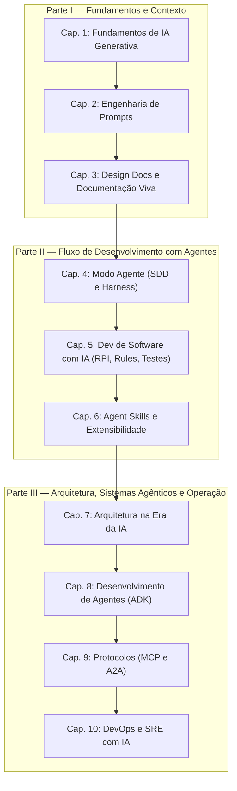

# Engenharia de Software na Era da IA
### Guia Prático do Fundamento à Produção

> **Baseado no conteúdo integral do MBA em Engenharia de Software com IA (FullCycle — 10 módulos técnicos, 767 aulas).**
> Escrito para engenheiros de software, tech leads e arquitetos que querem dominar o ciclo completo — sem enrolação, sem hype e com foco em decisões técnicas que sustentam produção.

---

## Prefácio — Como Ler Este Livro

A mudança real trazida pela Inteligência Artificial à engenharia de software não é "digitar código mais rápido". É o deslocamento do gargalo: **gerar código ficou barato; especificar, arquitetar, validar, observar e operar com segurança virou o diferencial.**

Quem trata IA como um chat para gerar trechos soltos acumula dívida técnica em velocidade recorde. Quem trata IA como **componente arquitetural e motor de um workflow determinístico** multiplica qualidade, confiabilidade e throughput.

Este livro destila toda a trilha técnica do MBA em 10 capítulos progressivos, desenhados para funcionar tanto como **leitura sequencial** quanto como **manual de consulta rápida no dia a dia**.

### Mapa da Obra — Como os 10 Capítulos se Conectam

### Três trilhas rápidas conforme seu objetivo imediato

| Seu foco agora | Leia primeiro | Depois avance para |
| --- | --- | --- |
| **Aumentar produtividade e qualidade no código hoje** | Cap. 2 → Cap. 3 → Cap. 4 → Cap. 5 → Cap. 6 | Cap. 7 (Testes e Eval) |
| **Colocar aplicações com LLM/RAG em produção com segurança** | Cap. 1 → Cap. 2 → Cap. 7 | Cap. 10 (Observabilidade e SRE) |
| **Construir sistemas agênticos e multi-agente integrados** | Cap. 7 → Cap. 8 → Cap. 9 | Cap. 6 e Cap. 10 |

Cada capítulo segue a mesma estrutura didática: **modelo mental → mecânica técnica → padrões e exemplos concretos → trade-offs e armadilhas → checklist acionável**.

