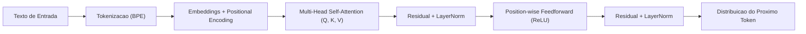
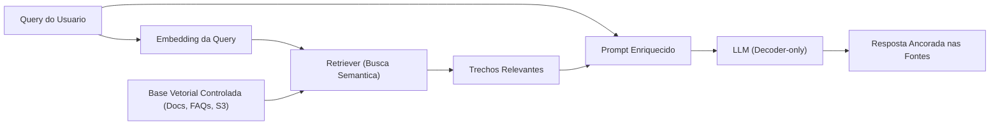

# Capítulo 1 — Fundamentos de IA Generativa

**O problema real e o modelo mental:** a maioria das falhas em projetos de IA em produção nasce de tratar Modelos de Linguagem (LLMs) como oráculos determinísticos. Um LLM é um motor probabilístico de predição de tokens baseado na arquitetura Transformer: ele não consulta fatos verificados nem executa lógica formal nativa — ele amostra continuações estatisticamente coerentes a partir de vetores e contexto. Dominar esse mecanismo permite decidir arquitetura, custo, latência e mitigação de risco com critério técnico, acima do hype.

---

## 1.1 IA Tradicional vs. IA Generativa e a Evolução até os Transformers

A mudança entre IA tradicional e IA Generativa (Gen AI) altera diretamente o contrato de engenharia de software:

- **IA Tradicional (preditiva/supervisionada):** aprende um mapeamento de entradas conhecidas para saídas delimitadas (fraude/não fraude, preço, categoria). Funciona como um aluno em prova de múltipla escolha.
- **IA Generativa:** aprende **distribuições de probabilidade** sobre grandes volumes de dados para gerar saídas inéditas — texto, código, imagem, áudio e vídeo.

Essa capacidade resultou da superação progressiva de dois gargalos históricos: **representação semântica** e **dependência de longo prazo em sequências**.

| Era / Arquitetura | Mecanismo Central | Ganho Principal | Limitação Estrutural |
| :--- | :--- | :--- | :--- |
| **Baseada em Regras (anos 1960)** | Lógica `se... então` e árvores de decisão manuais | Previsibilidade total em domínios fechados | Frágil fora do previsto; não escala por exigir codificação manual |
| **N-gramas (ex.: Bigramas)** | Probabilidade da próxima palavra condicionada às `N-1` anteriores | Captura colocações locais ("bom dia", "gato preto") | Coerência local sem coerência global; entra em loops e perde o tópico |
| **Cadeias de Markov / HMMs** | Estados ocultos + probabilidades de transição/emissão (POS tagging, DNA) | Modela sequências curtas com estrutura latente | Depende só do estado anterior; rotulagem cara; falha em texto longo |
| **Feedforward + Embeddings** | Vetores densos (ex.: GloVe) em fluxo unidirecional | Captura similaridade semântica em espaço contínuo | Janela fixa; perde conexões entre parágrafos distantes |
| **RNNs, LSTM e GRU** | Estado recorrente token a token com portas de memória | Processa sequências variáveis e mitiga esquecimento imediato | Execução sequencial impede paralelização; sofre com *vanishing/exploding gradient* |
| **Transformers (2017+)** | *Self-attention* global + *positional encoding* em paralelo | Relaciona todos os tokens simultaneamente em GPUs/TPUs | Custo computacional e de memória cresce com o contexto |

> [!IMPORTANT]
> **Regra de Ouro:** coerência local não implica coerência global nem compreensão real. Um modelo pode gerar frases impecáveis enquanto viola uma restrição definida três parágrafos antes.

No domínio visual, a geração evoluiu por trilhas complementares aos LLMs:
- **GANs (*Generative Adversarial Networks*):** colocam um **gerador** e um **discriminador** em competição para elevar o realismo visual, com o trade-off de treinamento sensível.
- **VAEs (*Variational Autoencoders*):** usam *encoder-decoder* probabilístico sobre um **espaço latente** controlável, permitindo direcionar atributos específicos da saída (como expressão ou estilo).

---

## 1.2 Por Dentro dos LLMs e da Arquitetura Transformer

Quatro engrenagens sustentam qualquer aplicação com LLMs em produção: **tokenização**, **embeddings**, **atenção** e **arquitetura do bloco Transformer**.

### Tokens e Tokenização (BPE)

LLMs operam sobre **tokens** — unidade real de processamento, limite de contexto e cobrança. O algoritmo mais comum é o **BPE (*Byte Pair Encoding*)**, que define agrupamentos frequentes de caracteres durante o treinamento.

Regras práticas para engenharia:
1. Tokens são fixos do treinamento, não criados dinamicamente a cada requisição.
2. **Palavras ≠ Tokens:** código e palavras em português tendem a quebrar em mais subtokens do que o inglês, elevando custo e consumo de janela.
3. Inspecione prompts no *OpenAI Tokenizer* antes de estimar orçamento ou depurar limites.

### Embeddings e Similaridade Semântica

Cada token vira um **embedding** (vetor numérico denso). O modelo executa operações matriciais sobre esses vetores: termos de contextos semelhantes ficam próximos no espaço vetorial, permitindo medir afinidade semântica via **similaridade de cosseno** mesmo sem palavras idênticas.

```python
from sentence_transformers import SentenceTransformer, util

model = SentenceTransformer("sentence-transformers/all-MiniLM-L6-v2")
frases = [
    "Falha de autenticacao no endpoint de pagamento",
    "Erro 401 ao validar token na API de checkout",
    "Receita de pao de queijo mineiro",
]
emb = model.encode(frases, convert_to_tensor=True)

print("A vs B:", round(util.cos_sim(emb[0], emb[1]).item(), 3))  # Alta similaridade
print("A vs C:", round(util.cos_sim(emb[0], emb[2]).item(), 3))  # Baixa similaridade
```

### Anatomia do Bloco Transformer

Como o Transformer processa tokens em paralelo, ele soma **Positional Encoding** aos embeddings para preservar a ordem da sequência antes de entrar nos blocos internos.



- **Self-Attention (Q, K, V):** cada token projeta vetores **Query** (o que busca), **Key** (o que oferece) e **Value** (o conteúdo). A interação `Q x K` define o peso que cada token atribui aos demais ao recompor seu significado a partir de `V`.
- **Multi-Head Attention:** executa múltiplas *heads* em paralelo; de forma emergente no treinamento, cada *head* se especializa em relações distintas (concordância gramatical, referência pronominal, tempo, semântica) e suas saídas são concatenadas.
- **Position-wise Feedforward Layers:** enquanto a atenção **mistura contexto entre tokens**, o bloco *feedforward* (`max(0, xW1 + b1)W2 + b2`) refina **cada posição individualmente**, reorganizando o contexto recebido antes da próxima camada.
- **Conexões Residuais e LayerNorm:** preservam o sinal original, estabilizam ativações numéricas e garantem fluxo saudável de gradientes em redes profundas.

### As Três Famílias Arquiteturais

| Arquitetura | Atenção | Pré-treinamento | Referências | Melhor Caso de Uso |
| :--- | :--- | :--- | :--- | :--- |
| **Encoder-only** | Bidirecional (esquerda e direita) | MLM (*Masked Language Modeling*) | BERT, RoBERTa, DistilBERT, ALBERT | Embeddings, busca semântica, classificação, NER, análise de sentimento |
| **Decoder-only** | Unidirecional com **máscara causal** | CLM (*Causal Language Modeling*) | GPT, LLaMA, Mistral, Phi, Claude | Geração textual, chatbots, código, raciocínio aberto |
| **Encoder-Decoder** | Encoder bidirecional + Decoder causal | *Seq2Seq* | T5, BART | Tradução, sumarização controlada, reescrita |

Entre variantes *encoder-only*, **RoBERTa** prioriza qualidade, **DistilBERT** reduz latência/tamanho por destilação e **ALBERT** compartilha parâmetros para economizar memória.

---

## 1.3 Treinamento, Alinhamento e Otimização em Escala

O ciclo de vida de um LLM passa por três estágios principais:

1. **Pré-treinamento (auto-supervisionado):** aprende padrões linguísticos sem rótulos humanos. No **CLM**, prevê o próximo token usando **Cross-Entropy Loss** + *backpropagation*; no **MLM**, reconstrói tokens mascarados usando contexto bidirecional.
2. **Fine-Tuning Supervisionado (SFT):** adapta o modelo pré-treinado com exemplos rotulados de alta curadoria. Em empresas, o objetivo não é apenas "saber mais fatos", mas **internalizar vocabulário, tom, formato e restrições** — incluindo exemplos de respostas proibidas. Pode ser completo (caro) ou parcial.
3. **Alinhamento (Instruction Tuning e RLHF):** o *Instruction Tuning* melhora a obediência generalista a comandos; o **RLHF (*Reinforcement Learning from Human Feedback*)** combina SFT, modelo de recompensa humano e otimização (ex.: PPO) para gerar respostas úteis, seguras e capazes de admitir limites — com o custo e o viés da avaliação humana.

### Técnicas de Otimização de Grandes Modelos

| Técnica | Gargalo Atacado | Mecanismo | Trade-off |
| :--- | :--- | :--- | :--- |
| **LoRA / PEFT** | Custo de GPU no *fine-tuning* | Congela pesos base e treina matrizes adaptadoras de baixo rank | Menor capacidade de mudança radical de domínio que SFT completo |
| **Quantização (FP32 → FP16 → INT8/INT4)** | Memória (VRAM) e custo de inferência | Reduz precisão numérica dos pesos | Possível perda leve de precisão em tarefas sensíveis (INT4) |
| **MoE (*Mixture of Experts*)** | Custo por inferência em modelos gigantes | Roteador ativa apenas parte dos especialistas por token (ex.: *Switch Transformer*) | Exige memória total alta para hospedar todos os especialistas |
| **P-Tuning / Prefix Tuning** | Adaptação leve sem alterar pesos | Treina vetores contínuos de contexto injetados na entrada | Menor expressividade que alterar pesos em tarefas complexas |

> [!TIP]
> **Esgote opções mais baratas antes de treinar:** na maioria dos cenários práticos, refinar prompts ou adotar RAG entrega mais valor com uma fração do custo e da manutenção de um *fine-tuning*.

---

## 1.4 Controle de Geração: Temperatura, Top-K, Top-P e Max Tokens

A cada token gerado, o modelo produz uma distribuição de probabilidades sobre o vocabulário. Os parâmetros de decodificação controlam essa amostragem:

- **Temperatura (`0.0` a `1.0`+):** ajusta a concentração da distribuição. Valores baixos (`0.0`–`0.2`) favorecem os tokens mais prováveis — como um especialista indo direto à referência exata na biblioteca. Valores altos (`0.7`–`1.0`) elevam diversidade e criatividade, aumentando também o risco de deriva e alucinação.
- **Top-K:** limita a escolha aos `K` tokens mais prováveis (quantidade fixa).
- **Top-P (*Nucleus Sampling*):** seleciona o menor conjunto de tokens cuja probabilidade acumulada atinge `P` (quantidade dinâmica conforme a certeza do modelo).
- **Max Tokens:** teto rígido de tokens gerados na resposta.

| Perfil de Tarefa | Temperatura | Top-P | Objetivo |
| :--- | :--- | :--- | :--- |
| **Extração / JSON / SQL / Classificação** | `0.0` – `0.2` | `0.1` – `0.3` | Previsibilidade máxima e estabilidade de schema |
| **Explicação técnica / Suporte / Resumo** | `0.2` – `0.4` | `0.7` – `0.9` | Clareza, naturalidade controlada e fidelidade |
| **Brainstorming / Copywriting** | `0.7` – `0.9` | `0.9` – `0.95` | Diversidade lexical e exploração criativa |

```python
generation_config = {
    "model": "gpt-4o-mini",
    "temperature": 0.1,   # Precisao para respostas tecnicas
    "top_p": 0.9,         # Filtra cauda de tokens improsaveis
    "max_tokens": 512,    # Evita truncamento operacional
}
```

> [!WARNING]
> **Armadilha de Depuração:** respostas cortadas no meio em Playgrounds ou APIs quase sempre decorrem de `max_tokens` baixo ou falha do *provider*, não de incapacidade do modelo. Em testes comparativos, isole uma variável por vez em mensagens novas — nunca mude `temperature` e `top_p` simultaneamente.

---

## 1.5 Limitações Estruturais de Produção e Estratégias de Mitigação

Antes de colocar LLMs em fluxos críticos, quatro limitações estruturais exigem mitigação arquitetural:

1. **Alucinação e Factualidade:** ocorre por lacunas de treino, prompts especulativos e ajuste para soar convincente em vez de admitir dúvida. Em áreas jurídica, médica ou financeira, plausibilidade não substitui verificabilidade documental. Mitigue restringindo fontes/datas, usando *few-shot*, exigindo recusa quando faltar evidência e mantendo revisão humana.
2. **Janela de Contexto e Diluição de Atenção:** caber na janela não garante foco. Enviar um PDF de 200 páginas inteiro pedindo uma cláusula da página 13 gera respostas vagas. Mitigue com **chunking**, recuperação seletiva e resumos hierárquicos (ciente da perda de detalhes finos).
3. **Raciocínio Simbólico e Erro Acumulado:** a geração autoregressiva acumula erros em matemática e deduções multi-etapas (como problemas de equações). *Chain of Thought* ajuda a organizar passos, mas **não garante prova formal** — delegue cálculos e validações críticas a código ou ferramentas externas.
4. **Conhecimento Estático vs. Tempo Real (RAG):** pesos do modelo congelam no treinamento e retreinar diariamente é inviável. O padrão **RAG (*Retrieval-Augmented Generation*)** separa o que o modelo guarda nos pesos do contexto fornecido em tempo de execução.



O fluxo RAG em cinco etapas — **Query → Embedding → Retriever (em fontes corporativas controladas) → Enriquecimento de Contexto → Geração** — reduz ruído e impede que o modelo dependa de memória desatualizada sem precisar alterar seus pesos.

---

## 1.6 Quick Wins de Engenharia: Contexto Estruturado no Fluxo de Trabalho

Os fundamentos de contexto trazem ganhos imediatos no dia a dia de engenharia assistida por IA (IDEs e CLIs como Gemini CLI):

- **Separe entrada, regras e estado do projeto:**
  - `README.md`: visão de entrada e execução.
  - **Rules / Guidelines (`CLAUDE.md`, `GEMINI.md`):** stack autorizada, convenções de código, testes e **onde/por que** usar cada dependência (ex.: "Redis apenas para cache, nunca como fila").
  - **Estado (`state.md`):** bugs conhecidos, limitações e pendências. Mantenha preferências pessoais em arquivos locais (`state.local.md` no `.gitignore`) para não poluir o repositório do time.
- **Documentação viva e MCP:** organize guias de versões atuais por dependência (`docs-libs`) para evitar APIs obsoletas e conecte agentes via **MCP (*Model Context Protocol*)** a fontes reais como Jira, Confluence e documentação oficial.
- **Planeje com PRP (*Product Requirement Prompt*):** transforme requisitos (PRD/ADR) em um plano estruturado com árvore atual vs. futura, *library quirks*, *anti-patterns* e sequência de validação. Execute tarefa por tarefa (`execute prp`) com testes passando, revisão arquivo por arquivo e commits incrementais.
- **Reancore em sessões longas:** regras iniciais perdem peso conforme o chat cresce; faça checkpoints e reforce restrições críticas periodicamente.

---

## 1.7 Checklist de Aplicação Prática

- [ ] **Valide se o caso exige Gen AI:** confirme se geração aberta agrega valor real ou se busca, regras ou ML clássico entregam menor custo e risco.
- [ ] **Alinhe arquitetura à tarefa:** *encoder-only* para embeddings/busca/classificação, *decoder-only* para geração e *encoder-decoder* para tradução/sumarização.
- [ ] **Dimensione tudo em tokens, não em palavras:** teste prompts reais em um tokenizador (especialmente em português) antes de projetar orçamento e janela.
- [ ] **Calibre decodificação por objetivo:** use temperatura baixa (`0.0`–`0.2`) em automações e extrações; isole parâmetros nos testes e verifique `max_tokens`.
- [ ] **Separe geração textual de fatos e cálculos:** delegue matemática/lógica formal a código externo e use RAG sobre bases confiáveis para dados recentes.
- [ ] **Esgote prompt e contexto antes de treinar:** recorra a SFT/LoRA apenas quando precisar internalizar comportamento, tom ou vocabulário que não estabiliza via contexto.
- [ ] **Governe o contexto do repositório:** separe rules compartilhadas de estado local (`.gitignore`), planeje features com PRP e mantenha testes e revisão humana obrigatórios.
