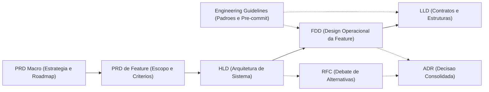
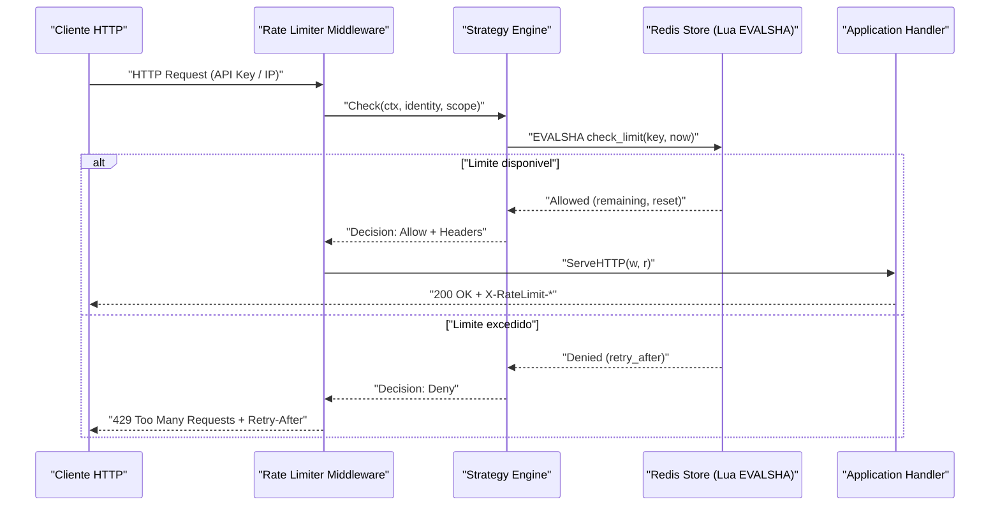

# Capítulo 3 — Design Docs e Documentação Viva na Era da IA

> **O problema real e o modelo mental:** Código-fonte registra *o que* o sistema faz hoje, mas apaga o *porquê*, as restrições de negócio e as alternativas descartadas. Na engenharia assistida por IA, documentação deixa de ser anexo burocrático para se tornar **contexto operacional**: se ela não existe, o modelo alucina premissas; se está desatualizada, o modelo gera código convincente e estruturalmente errado.

---

## 3.1 De artefato burocrático a contexto operacional

A documentação em engenharia de software historicamente oscilou entre o excesso cerimonial que trava a entrega e a ausência total que condena o sistema à memória oral:

| Era / Abordagem | Propósito documental | Atualização | Consumidor principal | Principal modo de falha |
| :--- | :--- | :--- | :--- | :--- |
| **Waterfall** | Contrato congelado pré-código | Única (início) | Analistas e gestores | Software fiel ao doc, porém obsoleto frente ao negócio |
| **RUP** | Disciplina formal centrada em arquitetura (UML e papéis rígidos) | Por fase formal | Arquitetos, analistas, QA | Peso burocrático e alto custo de mudança |
| **Agile (2001)** | Mínimo suficiente e útil para reduzir ambiguidade | Contínua (em teoria) | Produto e engenharia | Distorção como "licença para não documentar nada" |
| **Era da IA** | **Contexto operacional** para geração, revisão e manutenção | Bidirecional no workflow | Humanos **e** agentes de IA | Docs genéricos ou defasados induzindo alucinações |

O Manifesto Ágil nunca propôs eliminar documentação, mas sim eliminar artefatos desconectados do trabalho real. Com LLMs no fluxo de desenvolvimento, essa premissa ganha peso imediato: a IA não possui conhecimento implícito sobre seu domínio. Regras óbvias para o time — políticas multi-tenant, metas de latência P95 ou convenções de erro — precisam estar explícitas no repositório.

Para escapar do envelhecimento natural dos documentos, adote um **ciclo bidirecional de documentação viva**: a documentação alimenta a IA para implementar ou alterar uma funcionalidade e, antes do merge, a própria IA revisa e atualiza os documentos afetados pela mudança.

> [!WARNING]
> **Armadilha Comum — A falsa confiança:** Documentação desatualizada é pior do que ausência de documentação. Ela transmite segurança ilusória para o time e atua como veneno de contexto para agentes de IA, que seguem regras obsoletas com obediência mecânica. Documento sem gatilho de atualização no workflow vira passivo técnico.

---

## 3.2 A cadeia de abstração: do PRD ao LLD

Pedidos vagos como *"gere um design doc"* produzem textos genéricos que misturam objetivos comerciais com detalhes de implementação. Documentação útil organiza o raciocínio em uma **cadeia de abstração**, na qual cada artefato responde a uma pergunta distinta.



Nem toda entrega exige a cadeia inteira. Escolha o nível pela densidade de decisões e risco técnico:

| Documento | Pergunta central | Granularidade | Quando criar | O que evitar |
| :--- | :--- | :--- | :--- | :--- |
| **PRD Macro** | *Por que* a iniciativa existe e qual sua direção? | Produto / Épico | Alinhamento estratégico, roadmap, papéis, KPIs e riscos macro | Cronograma rígido ou detalhes de banco |
| **PRD de Feature** | *O que* a feature entrega e como provar que está pronta? | Funcionalidade | Entregas com regras, métricas e fluxos próprios (ex.: Login SSO/2FA) | Detalhes internos de implementação |
| **HLD** (*High-Level Design*) | *Como* o sistema se organiza em containers e integrações? | Sistema (C2) | Arquitetura macro, interfaces públicas, segurança, escala, observabilidade | Contratos completos de classes |
| **FDD** (*Feature Design Doc*) | *Como* a feature opera no código real? | Feature técnica | Fechar a lacuna entre arquitetura e código (headers, fallbacks, erros, telemetria) | Responsabilidades fora de escopo |
| **LLD** (*Low-Level Design*) | *Quais* assinaturas, structs e algoritmos serão codificados? | Módulo / Código | Domínios complexos, concorrência crítica ou SDKs públicos | Duplicar código simples em prosa |
| **RFC** (*Request for Comments*) | *Quais* alternativas estão em debate? | Proposta aberta | Decisões controversas que exigem alinhamento entre times | Usar como histórico final (consolide em ADR) |
| **ADR** (*Architecture Decision Record*) | *Por que* escolhemos este caminho e quais trade-offs aceitamos? | Decisão pontual | Decisões estruturais, evidentes e estáveis | Tutoriais ou detalhes triviais |

### Entrevista guiada, formato duplo e Deep Research

Em vez de pedir à IA que escreva um PRD, HLD ou FDD diretamente, inverta o fluxo para uma **entrevista guiada**:

1. **Coleta estruturada:** A IA lê insumos prévios (codebase, PRD ou HLD) e conduz perguntas por bloco temático, organizando as respostas por chave.
2. **Checagem de consistência:** Antes de gerar o texto final, o prompt instrui a IA a detectar contradições (por exemplo, centralizar estado sem listar ponto único de falha nos riscos) e interromper a geração se houver lacunas críticas.
3. **Formato duplo (Markdown + JSON opcional):** Renderize o documento principal em **Markdown estável** para revisão humana em PRs e exporte **JSON** apenas quando houver consumo por agentes ou automações.

Em temas tecnicamente densos (como rate limiting distribuído com Redis e scripts Lua em Go), aplique **Deep Research em duas fases**: conduza uma entrevista curta para gerar um briefing calibrado (tema, stack, motivação, profundidade), execute a pesquisa profunda, reformate o conteúdo para o template do time (comparando modelos em saídas longas para preservar densidade técnica) e gere o rascunho de FDD exigindo **grounding** (citação da fonte original) antes da revisão humana.

### Exemplo prático: esqueleto enxuto de FDD orientado a agentes

Requisitos numerados (`RF-01`, `RNF-01`), não-escopo explícito e critérios observáveis reduzem drasticamente interpretações arbitrárias:

```markdown
# FDD-04: Middleware e Core do Rate Limiter SDK (Go)

- **Referências:** `PRD-04`, `HLD-02`, `ADR-012` (Redis + Lua), `ADR-014` (Fallback Open)

## 1. Escopo e Não-Escopo
- **Em escopo:** Extração de chave (API key, tenant, IP), Fixed Window / Token Bucket, headers HTTP padrão e resposta `429 Too Many Requests`.
- **Fora de escopo:** Autenticação, autorização e painel administrativo de políticas.

## 2. Requisitos Rastreáveis
- **RF-01 (Bloqueio observável):** Ao exceder o limite, o middleware bloqueia antes do handler e retorna `HTTP 429` com `Retry-After`, `X-RateLimit-Limit` e `X-RateLimit-Remaining: 0`.
- **RF-02 (Configuração segura):** `NewLimiter(opts ...Option)` usa Functional Options com validação no construtor, impedindo instâncias inválidas em runtime.
- **RNF-01 (Latência e atomicidade):** Overhead P95 < 3ms; Redis via `EVALSHA` (Lua atômico); modo local com locks por chave.
- **RNF-02 (Fallback e telemetria):** Em falha do Redis, aplicar `fail-open`, log estruturado e métrica `ratelimit_fallback_total`.

## 3. Critérios de Aceite
- [ ] Requisição permitida chega ao handler com headers `X-RateLimit-*`.
- [ ] Requisição negada não invoca o handler e retorna `429` + `Retry-After`.
- [ ] Queda do Redis aciona `fail-open` sem panic e emite telemetria.
```

---

## 3.3 Diagramas como código: C4 Model e Mermaid

Diagramas desenhados em ferramentas gráficas morrem após a primeira refatoração. Tratar **diagramas como código** (texto versionado no Git junto ao FDD) garante diff em Pull Requests, baixa fricção de manutenção e geração assistida por IA.

Combine o **Modelo C4** (em PlantUML `.puml` ou Structurizr) para fronteiras arquiteturais rigorosas com **Mermaid** para fluxos, sequências e máquinas de estado embutidos no Markdown:

| Nível C4 | Foco operacional | Exemplo no Rate Limiter SDK | Quando gerar |
| :--- | :--- | :--- | :--- |
| **C1 — System Context** | Fronteira do sistema, atores e sistemas externos | Desenvolvedor, Operador, Serviço Host + SDK, Redis, Observabilidade | Sempre em HLDs e onboarding |
| **C2 — Containers** | O que roda em produção e como integra | App HTTP + Middleware, Cluster Redis, OpenTelemetry Collector (com *sampling*) | Sempre com múltiplos processos/serviços |
| **C3 — Components** | Blocos internos e responsabilidades | Key Extractor, Public API interna, Strategy Engine, Storage Adapter (Lua/Locks) | Em FDDs de módulos complexos ou SDKs |
| **C4 — Code** | Interfaces e implementações concretas | Interface `Store` vs. `RedisStore`/`MemoryStore`, structs e tipos | **Raramente** — apenas se reduzir carga cognitiva |

Para diagramas em Mermaid, escolha o tipo pela pergunta que precisa responder: `flowchart` para ramificações e decisões; `sequenceDiagram` para interações no tempo; `stateDiagram-v2` para ciclos de vida (`Active -> Limited -> Cooling Down -> Blocked`); `classDiagram` para contratos e padrões Strategy/Adapter; `erDiagram` para entidades e cardinalidades.



### Workflow de geração com subagente

Encapsule a geração de diagramas em um workflow executado preferencialmente em **subagente isolado** (para não contaminar o contexto principal): ler o FDD como fonte única; decidir o nível máximo sustentado sem inventar componentes; dividir diagramas Mermaid com mais de 10 nós; salvar `.puml` (UTF-8) ou Markdown único com justificativas ligadas ao FDD; e revalidar o resultado contra o documento original.

> [!IMPORTANT]
> **Regra de Ouro — Sintaxe válida não é fidelidade semântica:** Um diagrama Mermaid ou PlantUML compilar sem erros não garante que ele reflita a arquitetura aprovada. Valide manualmente primário/réplicas, caminhos de fallback, contratos públicos e concorrência — e use hooks pré-commit para evitar divergência entre FDD e diagramas.

---

## 3.4 Architecture Decision Records (ADRs) e o Grafo Histórico

O **ADR** preserva o racional por trás de escolhas arquiteturais relevantes — não para defender a tecnologia escolhida, mas para registrar contexto, restrições, alternativas descartadas e consequências aceitas. O formato **MADR** (*Markdown Architecture Decision Record*) padroniza seções e metadados para leitura rápida, CLIs (ADR Tools), GitHub Actions e extração por agentes.

### Status e semântica de vínculos

Um acervo de ADRs só funciona como **timeline arquitetural** quando status e relacionamentos respeitam semântica estrita:

| Tipo | Termo | Significado e regra prática |
| :--- | :--- | :--- |
| **Status** | `Draft` / `Proposal` | `Draft` é rascunho interno; `Proposal` já entrou formalmente em aprovação |
| **Status** | `Accepted` | Decisão aprovada e vigente (mesmo antes de toda implementação terminar) |
| **Status** | `Rejected` / `Withdrawn` | `Rejected` foi analisado e descartado; `Withdrawn` saiu de pauta por mudança de contexto |
| **Status** | `Deprecated` | Não adotar em novos contextos; sistemas legados continuam válidos sem migração obrigatória |
| **Status** | `Superseded` | Substituído por ADR mais novo — **sempre** parear `superseded_by` e `supersedes` |
| **Vínculo** | `amends` | Ajuste ou extensão parcial de ADR antigo, sem substituição completa |
| **Vínculo** | `relatesTo` / `dependsOn` | `relatesTo` indica afinidade técnica; `dependsOn` indica dependência estrutural real |

### Exemplo prático: esqueleto MADR versionado

```markdown
---
id: ADR-014
title: Estrategia Fail-Open na indisponibilidade do Redis
status: Accepted
date: 2026-04-10
deciders: ["Tech Lead Plataforma", "Arquitetura"]
dependsOn: ["ADR-012"]
relatesTo: ["ADR-009"]
supersedes: []
superseded_by: null
---

# ADR-014: Estratégia Fail-Open na Indisponibilidade do Redis

## Contexto e Forças em Jogo
O Rate Limiter SDK protege APIs públicas usando Redis distribuído (`ADR-012`).
Em partição de rede ou failover do cluster, precisamos escolher entre bloquear tráfego (`fail-closed`) ou operar em passagem degradada (`fail-open`).

## Decisão
Adotar **`fail-open`** como padrão para endpoints públicos de leitura, combinado com circuit breaker curto, log estruturado e métrica `ratelimit_fallback_total`.

## Alternativas Consideradas
1. **Fail-Closed global:** Proteção rígida contra abuso, mas converte falha de cache em indisponibilidade total da plataforma.
2. **Fallback silencioso para memória local:** Mascara falhas distribuídas e multiplica o limite pelo número de réplicas sem visibilidade.

## Consequências
- **Positivas:** Preserva disponibilidade durante falhas transitórias do Redis.
- **Negativas:** Janela temporária de exposição a picos; exige alerta SRE imediato quando `ratelimit_fallback_total > 0`.

## Referências
- HLD: `docs/hld/HLD-02-edge-protection.md` | FDD: `docs/fdd/FDD-04-rate-limiter-sdk.md`
```

### A Regra dos 3 Es e o pipeline de ADRs com IA

Para evitar **"documentacite"** — excesso de documentos triviais que poluem a recuperação de contexto da IA —, só crie um ADR quando a decisão passar na **Regra dos 3 Es**:

- **Estrutural:** Impacta arquitetura, integrações, contratos públicos, dados, segurança, resiliência ou modelo operacional (ex.: REST vs. gRPC, SQL vs. NoSQL, OAuth2/JWT, Kubernetes vs. Cloud Run, Terraform, circuit breakers).
- **Evidente:** Engenheiros futuros precisarão do racional e não conseguirão deduzi-lo apenas lendo o código.
- **Estável:** Tem expectativa razoável de durar meses ou anos.

Detalhes locais, entidades de domínio rotineiras e configurações triviais ficam no código, `README.md` ou `CONTRIBUTING.md`.

Em repositórios legados sem histórico documentado, aplique um **pipeline em quatro estágios assistido por agentes**:
1. **Mapeamento:** Um agente analisa código, dependências e histórico Git aplicando *red flags* para filtrar ruído de domínio.
2. **Potenciais ADRs:** Classifica achados por módulo em **`must document`** (prioridade clara) e **`consider`** (zona cinzenta para julgamento humano).
3. **Geração Formal:** Escreve o MADR definitivo mantendo abstração arquitetural e **pausando para solicitar contexto humano** quando a motivação estratégica ou comercial não constar no Git.
4. **Linkagem:** Um agente conecta os ADRs via `dependsOn`, `relatesTo`, `supersedes` e links bidirecionais com HLDs/FDDs, formando um **grafo histórico de decisões**.

---

## 3.5 Engineering Guidelines e Manutenção Contínua

Quando múltiplos engenheiros — ou agentes especializados paralelos (front-end, back-end, CI/CD) — atuam no mesmo repositório sem convenções explícitas, a base se fragmenta e PRs ficam contaminados por refatorações fora de escopo.

As **Engineering Guidelines** atuam como constituição técnica subordinando qualquer agente aos padrões do projeto. Elas reúnem: **Project Stack** (linguagem, framework, banco, ORM, validação como Zod/Pydantic, versões e links oficiais), **práticas operacionais** (formatação, linting como `go vet`/ESLint, concorrência, tratamento de erros, logs, observabilidade e segurança), **estratégia de testes** (*table-driven tests*, injeção de dependências, mocks, testes de integração), **higiene de Git/PR** e um bloco final de **Golden Rules + Checklist Pré-Commit**.

No mapa completo de documentação de engenharia, essas guidelines convivem com **Runbooks e Playbooks** (operação de produção e incidentes para SRE/DevOps), **documentos de Evaluation** (critérios objetivos para sistemas com IA) e **TRDs**, substituindo planos de teste manuais legados.

> [!TIP]
> **Regra de Ouro — Orçamento de linhas nas Guidelines:** Guidelines verbosas diluem a atenção do modelo e deixam de ser mantidas. Defina um limite rígido (entre **1.000 e 1.500 linhas** para o guia da stack), evite exemplos de tutorial redundantes e execute compactação iterativa sempre que o documento crescer além do teto.

---

## 3.6 Checklist de Aplicação Prática

- [ ] **Definir a taxonomia documental do time:** Explicitar qual pergunta PRD, HLD, FDD, ADR e Guidelines respondem, eliminando pedidos genéricos à IA.
- [ ] **Usar entrevista guiada com checagem de consistência:** Coletar decisões estruturadas e resolver contradições antes de renderizar o Markdown (e JSON opcional).
- [ ] **Fechar o ciclo de documentação viva no PR:** Tornar a atualização de FDDs, diagramas e ADRs etapa obrigatória sempre que a feature alterar contratos ou arquitetura.
- [ ] **Versionar diagramas como código:** Combinar C4 (C1–C3) e Mermaid no repositório, validando manualmente a fidelidade semântica ao FDD.
- [ ] **Aplicar a Regra dos 3 Es nos ADRs:** Documentar apenas decisões *estruturais*, *evidentes* e *estáveis*; preservar histórico com `Superseded`/`superseded_by` sem reescrever o passado.
- [ ] **Mapear legados em quatro etapas:** Separar varredura com *red flags*, triagem (`must document` vs. `consider`), redação com input humano e linkagem em grafo histórico.
- [ ] **Publicar Engineering Guidelines enxutas com checklist pré-commit:** Manter stack, Golden Rules e teto de linhas atualizados para governar humanos e agentes paralelos.
