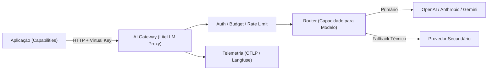
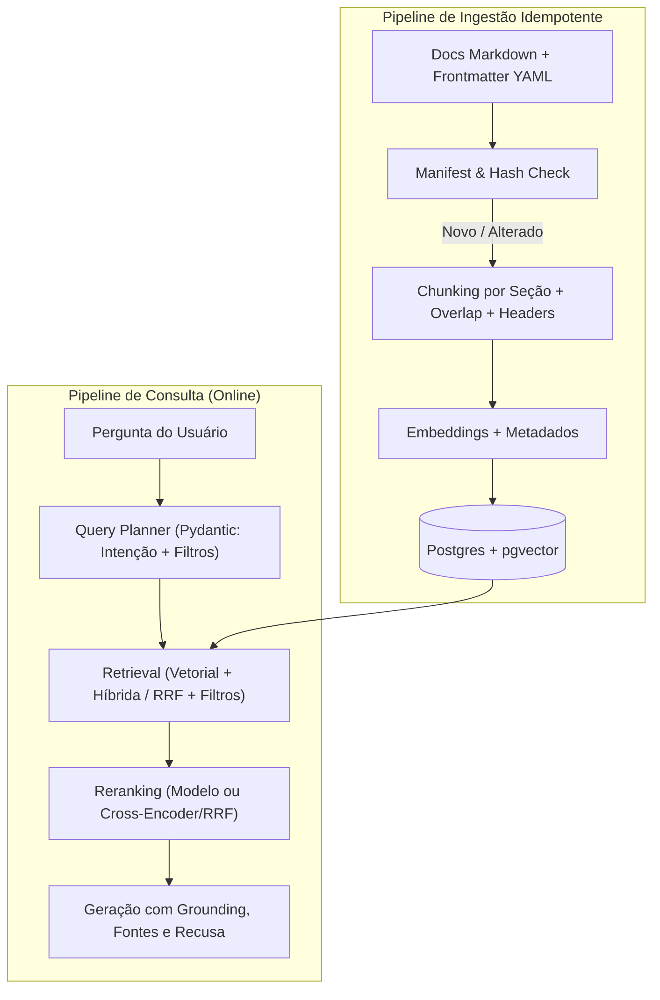

# Capítulo 7 — Arquitetura de Software na Era da IA

> **O problema real e o modelo mental**
> Colocar uma chamada de SDK de LLM dentro de um controller leva cinco minutos; operar esse sistema seis meses depois — com custos previsíveis, latência aceitável, respostas auditáveis e sem vazamento de dados ou envenenamento de contexto — exige arquitetura. O modelo mental muda de um software puramente determinístico para um **sistema híbrido**, no qual componentes probabilísticos (modelos) operam cercados por fronteiras determinísticas de código, dados, cache, observabilidade, avaliação contínua e segurança.

---

## 7.1 Os Quatro Níveis de Arquitetura e a Entrada da IA

Antes de desenhar pipelines de RAG ou gateways de modelos, vale separar quatro escopos que frequentemente se misturam em discussões técnicas:

- **Arquitetura Corporativa:** define a direção de evolução dos sistemas, governança, padrões transversais e alinhamento com objetivos de negócio da organização.
- **Arquitetura de Solução:** conecta múltiplos sistemas, integrações, filtros de dados e fluxos de ponta a ponta para resolver um problema específico de negócio.
- **Arquitetura Tecnológica:** aprofunda escolhas de plataformas, nuvem, bancos de dados, runtimes e infraestrutura de suporte.
- **Arquitetura de Software:** organiza fronteiras internas, módulos, dependências, contratos e fluxo de execução dentro da aplicação.

A entrada da IA atravessa esses quatro níveis porque introduz decisões que antes não existiam no desenho tradicional de sistemas: como a aplicação monta o contexto enviado ao modelo, de onde vêm os dados que fundamentam uma resposta, quanto cada requisição pode custar, qual degradação é aceitável quando um provedor cai e como provar que uma mudança de prompt não quebrou o comportamento em produção.

---

## 7.2 Acoplamento e Saúde Arquitetural ao Longo do Tempo

Com a aceleração na geração de código assistida por IA, o risco arquitetural mais silencioso é o crescimento descontrolado do acoplamento. Um serviço inicialmente simples — como um `OrderService` — acumula dependências de pagamento, banco de dados, mensageria e provedores externos até que qualquer alteração dispare efeitos em cascata.

Para sair do achismo e medir a saúde estrutural ao longo do tempo, aplicamos as métricas clássicas da **Main Sequence** (Robert C. Martin):

- **Acoplamento Aferente (`Ca`):** quantos módulos externos dependem deste módulo (dependências que entram).
- **Acoplamento Eferente (`Ce`):** de quantos módulos externos este módulo depende (dependências que saem).
- **Instabilidade (`I`):** calculada por `I = Ce / (Ce + Ca)`. Valores próximos de `0` indicam módulos altamente estáveis (muitos dependem deles); valores próximos de `1` indicam módulos instáveis.
- **Abstração (`A`):** proporção de elementos abstratos (interfaces, contratos, tipos base) sobre o total de elementos do módulo.

A relação saudável segue a linha ideal `A + I = 1`. O perigo mora nos dois extremos:

| Zona Arquitetural | Característica (`I` e `A`) | Exemplo Típico | Consequência em Produção |
| :--- | :--- | :--- | :--- |
| **Zona de Dor** | Alta estabilidade (`I` próximo de `0`) e concreto demais (`A` próximo de `0`) | Classe global `database.ts` ou logger concreto importado por todo o projeto | Rigidez extrema: qualquer mudança quebra múltiplos módulos |
| **Main Sequence** | Equilíbrio entre estabilidade e abstração (`A + I ≈ 1`) | Contratos de repositório estáveis + implementações concretas na borda | Evolução previsível com impacto localizado |
| **Zona de Inutilidade** | Alta abstração (`A` próximo de `1`) sem uso real (`I` próximo de `1`) | Interfaces criadas para uma única classe concreta jamais substituída | *Overengineering*, burocracia e custo cognitivo sem proteção real |

### Refatoração guiada por métricas (e assistida por agentes)

Em vez de pedir a uma IA "refatore o sistema para ficar mais limpo", o fluxo disciplinado segue quatro passos:

1. **Medir antes de mexer:** gere um script de análise de imports para calcular `Ca`, `Ce`, `I`, `A` e plotar os módulos no gráfico da *Main Sequence*.
2. **Construir rede de segurança:** garanta testes automatizados reais (sem *skips* escondidos ou asserções vazias) antes de tocar na estrutura.
3. **Inverter dependências nos pontos de dor:** extraia interfaces de repositório por agregado (em vez de um `database.ts` monolítico) e centralize a instanciação concreta em um *Composition Root* (`composition.ts`), que concentra a criação dos objetos sem vazar detalhes concretos para o domínio.
4. **Re-executar o gráfico após cada ciclo:** confirme objetivamente que os módulos críticos saíram da Zona de Dor sem empurrar o restante para a Zona de Inutilidade.

> [!TIP]
> **Regra de Ouro:** Concreto demais em ponto estável gera rigidez; abstração demais sem variação real gera peso. Um *Composition Root* pode ter alto acoplamento eferente — esse é exatamente o papel dele — desde que ninguém no domínio dependa dele.

---

## 7.3 AI Gateways: Fronteira de Compatibilidade, Governança e Resiliência

Quando uma equipe integra IA pela primeira vez, é comum espalhar chamadas diretas ao SDK da OpenAI ou da Anthropic por vários serviços. Assim que surge a necessidade de adicionar um segundo provedor, o contraste fica explícito: a OpenAI usa uma assinatura de *chat completions* ou *responses*, enquanto a Anthropic usa `client.messages.create` com parâmetros e payloads distintos. O detalhe do fornecedor vaza para a lógica de negócio.

Um **AI Gateway** estabelece uma fronteira arquitetural única entre a aplicação e os provedores de LLM. Essa evolução ocorre em dois saltos claros (exemplificados na prática com o **LiteLLM**):

1. **Camada de compatibilidade (biblioteca):** a aplicação substitui SDKs específicos por uma interface padronizada (`completion(model=..., messages=...)`), mantendo a chamada dentro do próprio processo. Resolve a padronização de entrada/saída, mas ainda sem governança central.
2. **Topologia de Proxy (serviço HTTP):** o gateway sobe como componente dedicado (**LiteLLM Proxy**) entre as aplicações e os provedores. As aplicações consomem HTTP padronizado usando *virtual keys*, enquanto o proxy centraliza autenticação, *budgets*, *rate limits*, logs e roteamento via **Router**.



### Exponha capacidades de negócio, não modelos físicos

A decisão mais valiosa ao adotar um AI Gateway é parar de acoplar o código a nomes físicos como `gpt-4.1-mini` ou `claude-sonnet`. Em vez disso, o gateway expõe **capacidades lógicas** (`developer-assistant`, `architecture-advisor`, `ticket-classifier`). Trocar o provedor por custo, latência ou estabilidade passa a ser uma alteração de configuração no gateway — sem deploy da aplicação.

```yaml
# config.yaml — Exemplo enxuto de LiteLLM Proxy expondo capacidades
model_list:
  - model_name: architecture-advisor
    litellm_params:
      model: openai/gpt-4.1
      api_key: os.environ/OPENAI_API_KEY
      timeout: 30

  - model_name: architecture-advisor-fallback
    litellm_params:
      model: anthropic/claude-sonnet-4-20250514
      api_key: os.environ/ANTHROPIC_API_KEY
      timeout: 30

router_settings:
  num_retries: 2
  fallbacks:
    - architecture-advisor: ["architecture-advisor-fallback"]
```

> [!WARNING]
> **Armadilha Comum — Fallback com modelo fraco:** Ter um fallback técnico evita erro HTTP `500`, mas trocar silenciosamente um modelo forte por um modelo fraco pode destruir a qualidade da resposta ou quebrar contratos de saída estruturada. Fallback em IA só é seguro quando o modelo reserva atende ao mesmo padrão mínimo de capacidade validado em *evaluation*.

---

## 7.4 Fluxos de Chamada: Síncrono, Streaming e Assíncrono

Uma chamada de LLM não tem o perfil de latência de uma query SQL indexada. Segurar conexões HTTP por dezenas de segundos esgota *workers*, provoca timeouts em cascata e trava a interface do usuário. A escolha do padrão de execução deve responder ao contrato da funcionalidade:

| Padrão de Execução | Como Funciona | Quando Usar | Trade-offs e Limites |
| :--- | :--- | :--- | :--- |
| **Síncrono** | Requisição HTTP bloqueante aguarda resposta completa | Classificação curta, extração com JSON/Pydantic, tarefas de baixa latência (poucos segundos) | Simples de implementar e validar contrato; falha em tarefas longas ou picos de lentidão do provedor |
| **Streaming (SSE)** | Envia tokens incrementalmente conforme são gerados | Chats, assistentes interativos e geração textual longa onde o usuário lê em tempo real | Reduz drasticamente a **latência percebida** (não o tempo total); inadequado quando o backend precisa validar um JSON completo antes de responder |
| **Assíncrono (Jobs/Filas)** | Endpoint aceita a tarefa, retorna `job_id` e processa em background | Análises extensas, ingestão/indexação, múltiplos passos de agentes ou relatórios pesados | Desacopla a IA do caminho crítico HTTP e facilita retries; exige gestão de estado, polling/webhook e UX de acompanhamento |

---

## 7.5 Cache em Aplicações com IA: Exato, Semântico e Prompt Caching

Em sistemas com IA, cache não existe apenas para reduzir latência: ele controla diretamente o **custo por token** e a **consistência comportamental**. Entretanto, uma resposta armazenada em cache pode estar tecnicamente válida (dentro do TTL) e arquiteturalmente errada (*stale*) se o prompt, as regras de negócio ou o modelo mudaram ontem.

### 1. Cache exato com *cache-aside* e Fingerprint

No padrão *cache-aside*, a aplicação gera uma chave determinística antes de chamar o modelo. Para evitar servir respostas obsoletas após ajustes de engenharia de prompt, a chave nunca deve depender apenas do texto do usuário — ela precisa de um **fingerprint** que combine versão do prompt, versão das regras, capacidade do modelo e entrada normalizada:

```python
import hashlib, json

def build_cache_key(text: str, prompt_version: str, rules_version: str, capability: str) -> str:
    payload = {
        "text": " ".join(text.strip().lower().split()),
        "prompt_version": prompt_version,
        "rules_version": rules_version,
        "capability": capability,
    }
    raw = json.dumps(payload, sort_keys=True)
    return hashlib.sha256(raw.encode("utf-8")).hexdigest()
```

### 2. Cache semântico com Embeddings e `pgvector`

Se um usuário pergunta *"quero cancelar meu plano"* e outro escreve *"preciso cancelar minha assinatura"*, o cache exato dá *miss*. O **cache semântico** converte a entrada em um vetor numérico via modelo de **embedding**, consulta o **PostgreSQL com `pgvector`** usando distância de cosseno e reutiliza a resposta se a similaridade superar um **threshold** calibrado.

O fluxo integrado tenta em ordem: **Cache Exato → Cache Semântico (`pgvector`) → Chamada ao LLM + gravação automática**. O risco central é o **falso positivo**: um threshold frouxo pode retornar uma resposta de cancelamento para uma dúvida sobre alteração de plano. Definir o threshold é uma decisão de negócio, não uma constante universal.

### 3. Camadas de cache e Prompt Caching do Provedor

Dois equívocos arquiteturais precisam ficar rigorosamente separados:

- **Cache semântico não é RAG:** o cache semântico busca *reaproveitar uma resposta pronta* para uma pergunta parecida; o RAG busca *evidências em uma base de conhecimento* para sintetizar uma resposta nova e fundamentada.
- **Cache da aplicação não é Prompt Caching do provedor:** OpenAI, Anthropic e Gemini oferecem *prompt caching* no lado do provedor para reaproveitar prefixos longos e estáticos do prompt (como *system prompts* extensos ou documentação fixa), reduzindo custo de entrada e latência mesmo quando a pergunta final do usuário é inédita.

| Camada de Cache | Onde Vive | O Que Reaproveita | Evita Chamada ao LLM? | Principal Risco |
| :--- | :--- | :--- | :--- | :--- |
| **Cache Exato (Fingerprint)** | Aplicação (Memória/Redis) | Resposta final idêntica | Sim | Chave sem versionamento gerar resposta *stale* |
| **Cache Semântico** | Aplicação + `pgvector` | Resposta final para intenção equivalente | Sim | Falso positivo por threshold mal calibrado |
| **Prompt Caching** | Provedor (OpenAI/Anthropic/Gemini) | Prefixo estático do prompt (tokens de entrada) | Não (reduz custo/latência) | Prefixo dinâmico no início invalidar o reaproveitamento |

---

## 7.6 Arquitetura de RAG de Produção

**RAG (Retrieval-Augmented Generation)** recupera trechos relevantes de fontes externas e os injeta no contexto do modelo antes da geração. Ele resolve o problema de conhecimento proprietário, dinâmico e auditável, mas **não substitui** bancos relacionais para agregações exatas, APIs transacionais nem fine-tuning de estilo.

| Estratégia | Melhor Cenário de Uso | Quando Evitar |
| :--- | :--- | :--- |
| **RAG** | Base proprietária mutável, precisa de recuperação seletiva, filtros por tenant e citação de fontes | Cálculos exatos em dados tabulares ou ações transacionais |
| **Long Context** | Conjunto pequeno e fechado de documentos analisados de uma só vez | Bases grandes/dinâmicas onde o custo por chamada e o ruído explodem |
| **SQL / API / Tool Calling** | Dados estruturados em tempo real (estoque, saldo, consumo do tenant, criação de tickets) | Busca semântica em políticas e manuais não estruturados |
| **Fine-Tuning** | Ajuste de estilo, formato específico ou comportamento especializado recorrente | Inserir fatos que mudam com frequência (re-treino caro e sem rastreabilidade) |

### Do RAG ingênuo ao RAG confiável

Um RAG ingênuo — que fatia textos aleatoriamente, joga tudo em um banco vetorial e manda os *top-k* resultados direto para o prompt — falha por razões previsíveis: documentos antigos vencem documentos novos, chunks sem contexto perdem o título da seção/plano a que pertencem, e o banco vetorial sempre retorna "os menos ruins" mesmo quando nenhum trecho responde à pergunta.

A arquitetura madura divide o RAG em dois pipelines bem definidos:



Cinco decisões estruturais definem onde um RAG ganha ou perde:

1. **Chunking consciente de estrutura e metadados:** extraia metadados via frontmatter YAML (`product`, `plan`, `doc_type`, `version`, `status`, `tenant`), faça chunking respeitando seções com *overlap* controlado e inclua cabeçalhos no texto do chunk para preservar o contexto semântico.
2. **Reindexação idempotente com Manifest e Hash:** documentos mudam e são removidos. Calcule o hash de cada fonte em um *manifest* para inserir apenas documentos novos, reindexar apenas os modificados e apagar chunks órfãos — sem duplicidade nem reprocessamento caro.
3. **Query Planner antes do retrieval:** use uma etapa leve com saída estruturada (Pydantic) para interpretar a intenção, detectar ambiguidade (pedindo clarificação quando necessário) e extrair filtros objetivos (`plan="enterprise"`, `doc_type="policy"`).
4. **Busca híbrida e Reranking:** recupere um conjunto maior de candidatos (combinando busca vetorial e busca textual via **RRF — Reciprocal Rank Fusion**) e aplique **reranking** (com reranker dedicado, heurística/RRF ou modelo) para enviar apenas os trechos mais relevantes ao gerador, reduzindo ruído e custo.
5. **Grounding com fontes e recusa explícita:** instrua e valide que o modelo responda apenas com evidências recuperadas, cite as fontes exatas e recuse responder quando o contexto for insuficiente.

> [!NOTE]
> **Build vs. Buy em RAG:** Soluções gerenciadas de nuvem ou provedores aceleram o *time-to-market* em casos padronizados. Construir o próprio pipeline (como `pgvector` + FastAPI) faz sentido quando há exigência rígida de isolamento multi-tenant, regras customizadas de filtragem/proveniência, auditoria completa ou independência de fornecedor.

---

## 7.7 Observabilidade e Governança Operacional com OpenTelemetry

Sem observabilidade, times de IA otimizam no escuro: mudam o tamanho de chunk sem saber se o problema estava no *query planner*, ou cortam o modelo sem descobrir qual feature concentra 80% do consumo de tokens.

A telemetria de sistemas de IA usa os mesmos quatro pilares clássicos — **logs, métricas, traces e spans** — aplicados às etapas do fluxo probabilístico: um *trace* representa a requisição completa, enquanto cada *span* registra uma etapa (`query_planner`, `vector_retrieval`, `rerank`, `answer_generation`, `tool_call`) com atributos de latência, provedor, modelo, tokens, fallback e número de chunks recuperados.

### OpenTelemetry como padrão, não como destino

A decisão arquitetural correta é instrumentar a aplicação com **OpenTelemetry (OTEL)** e exportar via protocolo **OTLP**. Assim, o código não fica preso a um fornecedor específico: basta trocar o endpoint OTLP para visualizar os mesmos traces no **Jaeger** (infraestrutura distribuída), no **Langfuse** (observabilidade nativa de LLM, prompts e custos) ou em APMs corporativos (**Datadog**, **New Relic**).

```python
from opentelemetry import trace

tracer = trace.get_tracer("knowledge-chat")

def run_rag_step(question: str, tenant_id: str, model_capability: str):
    with tracer.start_as_current_span("rag.retrieval") as span:
        span.set_attribute("tenant.tier", "enterprise")          # Baixa cardinalidade
        span.set_attribute("ai.capability", model_capability)
        chunks = retrieve_chunks(question, tenant_id)
        span.set_attribute("rag.chunks.count", len(chunks))
        return chunks
```

### Operação madura: privacidade, cardinalidade e limites ativos

- **Privacidade por ambiente:** capture payloads completos (prompts/respostas) apenas em desenvolvimento/staging ou com mascaramento; em produção, controle via flags de ambiente e política de retenção.
- **Cardinalidade controlada:** evite colocar IDs únicos ou textos inteiros como labels de métricas (isso explode o custo e degrada dashboards); reserve detalhes granulares para atributos de spans ou eventos com *sampling*.
- **Governança operacional ativa:** observabilidade passiva apenas relata o incêndio; governança aplica **budgets e quotas** por tenant, feature e modelo (autorização de acesso a modelos premium, limites de passos em agentes, detecção de loops de *tool calling* e degradação graciosa controlada).

---

## 7.8 Testes, Evaluation e Quality Gates no CI

Testes unitários tradicionais não verificam se uma resposta em linguagem natural permanece fiel às evidências, mas continuam indispensáveis para validar **contratos determinísticos**: status HTTP, parsing de schemas Pydantic, regras de fallback, recusa obrigatória e serialização de saída.

Para validar o comportamento probabilístico, construímos uma arquitetura de **Evaluation** em camadas:

1. **Dataset versionado (Golden Set):** casos representativos armazenados e sincronizados (ex.: no **Langfuse**), cobrindo perguntas válidas, casos que exigem clarificação (`should_clarify`) e perguntas fora de escopo que exigem recusa (`should_answer=false`).
2. **Evaluation por componente:** mede cada etapa isoladamente (o *query planner* extraiu o plano certo? O *retrieval* trouxe o documento correto? O *reranker* promoveu a evidência certa?). Sem isso, uma falha na resposta final esconde qual peça quebrou.
3. **Avaliação da resposta final (Ragas e LLM-as-a-Judge):**
   - **Ragas:** quantifica propriedades específicas de RAG como *faithfulness* (fidelidade ao contexto recuperado), *context precision* e *context recall*.
   - **LLM-as-a-Judge:** usa um modelo avaliador com **rubrica explícita** e **saída estruturada**, sempre submetido a **calibração** prévia contra exemplos rotulados conhecidos para confirmar que o juiz pontua como esperado.
4. **Evaluation de agentes e tool calling:** em sistemas como um *Support Triage Agent* (com ferramentas para buscar documentação, consultar consumo do tenant e abrir ticket), a qualidade não está só no texto final — avaliam-se **seleção da ferramenta**, **correção dos argumentos** e **trajetória de execução** (`exact`, proibindo chamadas extras, ou `in_order`, exigindo a sequência mínima esperada).
5. **Experiments, Baseline e Quality Gates no CI:** toda mudança de prompt, modelo ou chunking roda um *experiment* comparável lado a lado com o *baseline* anterior no Langfuse para detectar regressões. No CI, **Quality Gates** travam o pipeline automaticamente se alguma métrica crítica cair abaixo do threshold definido.

---

## 7.9 Segurança, Threat Modeling, OWASP e Provenance

Segurança em sistemas de IA começa abandonando a ilusão de que "um bom system prompt resolve tudo". A abordagem correta é **Threat Modeling** baseado em **Trust Boundaries** — os pontos exatos onde dados ou decisões cruzam níveis diferentes de confiança:

1. **Input Boundary:** entrada do usuário chegando à aplicação. Nunca é confiável e, diferente de um CRUD comum, pode influenciar o raciocínio do modelo.
2. **Context / Data Boundary:** documentos recuperados do banco vetorial (`pgvector`) e injetados no prompt. Estar no banco interno não torna um texto automaticamente confiável.
3. **Model Output Boundary:** resposta devolvida pelo modelo ao código. Mesmo um JSON válido em Pydantic pode carregar uma decisão incorreta ou manipulada.
4. **Action Boundary:** fronteira entre a decisão probabilística de um agente e a execução real de uma ferramenta (ex.: `create_support_ticket`). **O modelo escolher uma tool não significa que o usuário ou o fluxo tem autorização para executá-la.**

### OWASP Top 10 e a anatomia de Prompt Injection

O **OWASP Top 10 for LLM & GenAI Applications** funciona como mapa de cobertura para auditar essas fronteiras — com destaque para `LLM01 (Prompt Injection)`. É essencial distinguir quatro vetores diferentes:

- **Direct Prompt Injection:** o usuário tenta sequestrar instruções diretamente na entrada.
- **Jailbreak:** tentativa de contornar políticas de segurança/recusa do modelo.
- **Indirect Prompt Injection:** uma instrução maliciosa escondida dentro de um documento recuperado pelo RAG comanda o modelo durante a leitura do contexto.
- **RAG Repository / Factual Poisoning:** inserção de informações falsas (ex.: um SLA adulterado) na base de conhecimento, fazendo uma pergunta legítima gerar uma resposta contaminada.

### Baseline reproduzível de ataques e Provenance antes do Retrieval

Assim como na avaliação de qualidade, segurança se mede com **baselines reproduzíveis de ataque** — suítes de testes adversariais executadas sobre o chat, sobre agentes com tools e sobre a base RAG — para medir objetivamente quantos ataques atravessam cada camada antes e depois de um controle.

Para ataques vindos do contexto (RAG), tentar filtrar o veneno dentro do prompt do LLM já é tarde demais: o modelo não consegue saber, apenas lendo o texto, se quem publicou aquele documento tinha autoridade. A solução arquitetural é **Provenance (Proveniência) e Trusted Ingestion**:

- **Separe metadados autodeclarados de metadados de segurança:** um arquivo Markdown conter `status: published` e `tenant: acme` no frontmatter é uma *autodeclaração*, não prova de confiança. Campos de autorização (`source_system`, `publisher_id`, `approved`, `trust_level`) devem ser atribuídos pela aplicação/pipeline de ingestão.
- **Área de Quarentena (*Quarantine*):** documentos de origens não validadas entram em quarentena para revisão ou validação automatizada antes de se tornarem elegíveis ao índice de produção.
- **Defesa em profundidade:** provenance bloqueia tanto *factual poisoning* quanto *indirect prompt injection* antes do retrieval, somando-se à validação determinística nas ferramentas e ao isolamento rígido de tenants.

> [!IMPORTANT]
> **Regra de Ouro da Segurança em IA:** Confiança de fonte e autorização de ação são propriedades determinísticas da arquitetura — nunca decisões probabilísticas delegadas ao prompt do modelo.

---

## 7.10 Checklist de Aplicação Prática

- [ ] **Acoplamento sob controle:** medir `Ca`, `Ce`, `I` e `A` periodicamente para manter módulos centrais fora da Zona de Dor e isolar dependências concretas via inversão de dependência e *Composition Root*.
- [ ] **AI Gateway como fronteira única:** remover SDKs de provedores do código de domínio, expor capacidades lógicas (não nomes físicos de modelos) e validar qualidade antes de habilitar fallbacks.
- [ ] **Fluxo de execução adequado ao contrato:** usar síncrono para tarefas curtas/estruturadas, streaming SSE para respostas longas interativas e filas assíncronas para processamentos pesados.
- [ ] **Cache em camadas com versionamento:** incluir `prompt_version`, `rules_version` e `capability` no fingerprint do cache exato, calibrar o threshold de negócio no cache semântico e estruturar prefixos estáticos para aproveitar *prompt caching*.
- [ ] **Pipeline de RAG auditável:** adotar chunking estruturado com metadados, reindexação idempotente por hash/manifest, *query planner* com filtros, busca híbrida/reranking e grounding com citação de fontes e recusa explícita.
- [ ] **Telemetria padronizada e governada:** instrumentar etapas de IA com OpenTelemetry/OTLP (exportando para Jaeger/Langfuse/APM), controlar privacidade/cardinalidade e impor limites ativos de custo e passos por tenant.
- [ ] **Evaluation contínua e CI Gates:** manter datasets versionados, avaliar componentes isoladamente (além de Ragas/LLM-as-a-Judge calibrado e trajetória de tools) e bloquear regressões com *Quality Gates* no CI.
- [ ] **Segurança nas quatro Trust Boundaries:** mapear riscos com OWASP LLM Top 10, rodar baselines adversariais, exigir autorização determinística na *Action Boundary* e aplicar *Provenance* + *Trusted Ingestion* antes do retrieval.
