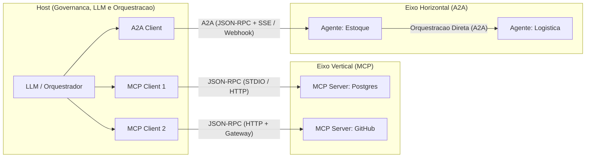
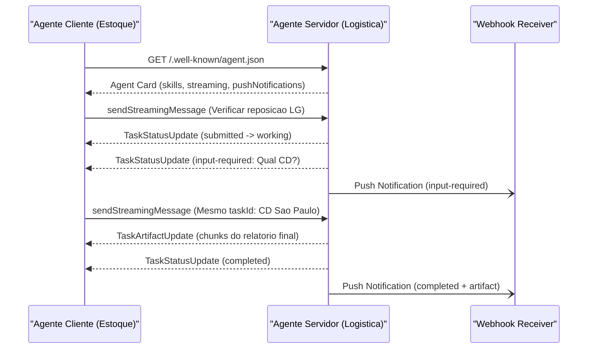

# Capítulo 9 — Protocolos de Comunicação para Sistemas Agênticos (MCP e A2A)

## O problema real e o modelo mental

O gargalo de sistemas agênticos em produção não é escolher o melhor LLM, mas evitar que integrações ponto a ponto entre modelos, ferramentas e agentes colapsem em acoplamento combinatório (N x M entre modelos e ferramentas; N x N entre agentes). A solução separa a comunicação em dois eixos ortogonais sobre JSON-RPC 2.0: **MCP** resolve a integração **vertical** (agente ↔ ferramentas e contexto) e **A2A** resolve a integração **horizontal** (agente ↔ agente autônomo).

---

## 9.1 Do Caos das Integrações ao Wire Format (JSON-RPC 2.0)

Sistemas com IA começam simples: um provedor de LLM e poucas funções locais. O problema explode com decisões rotineiras — testar outro provedor, criar fallback, reduzir latência ou compartilhar ferramentas entre assistentes. A matriz de integrações cresce como **N x M**, agravada pelo não-determinismo comportamental dos LLMs, que decidem em runtime qual ferramenta chamar. Assim como o USB padronizou periféricos e o HTTP padronizou a web, protocolos abertos substituem adaptadores artesanais por contratos verificáveis no fio (*wire format*).

### Por que JSON-RPC 2.0

O *wire format* é a mensagem real que trafega entre processos, independente de linguagem ou SDK. Tanto MCP quanto A2A escolhem **JSON-RPC 2.0** porque REST força modelagem de recursos em fluxos orientados a ação e gRPC adiciona atrito binário para inspeção operacional. JSON-RPC 2.0 é leve, legível em logs e independente de transporte, seguindo quatro regras:

1. **Request**: contém `jsonrpc: "2.0"`, `method`, `params` e `id` único para correlação.
2. **Response**: retorna o mesmo `id` e **exatamente um** campo — `result` ou `error`, nunca ambos.
3. **Notification**: mensagem unidirecional **sem `id`**. A ausência do campo sinaliza que não há resposta esperada (usada em inicialização, progresso e cancelamento).
4. **Erros padronizados**: códigos como `-32602` (*Invalid Params*), `-32601` (*Method Not Found*) e `-32603` (*Internal Error*) evitam interpretação frágil de texto livre.

```json
// Request
{"jsonrpc": "2.0", "id": "req-42", "method": "tools/call", "params": {"name": "consultar_clima", "arguments": {"cidade": "Sao Paulo"}}}
// Notification de progresso (sem campo "id")
{"jsonrpc": "2.0", "method": "notifications/progress", "params": {"progressToken": "tok-9", "progress": 50, "total": 100}}
```

### Tool Calling vs. MCP vs. A2A

Em laboratórios comparativos reais — expondo a mesma consulta a uma API externa via Tool Calling da Anthropic, Tool Calling da OpenAI e um servidor FastMCP — as três opções funcionam no dia um. O custo aparece quando o contrato externo muda ou troca-se o provedor: no *tool calling*, schemas e adaptadores precisam ser reescritos em cada cliente; no MCP, a alteração fica concentrada no servidor.

| Critério | Tool Calling Nativo | MCP (Model Context Protocol) | A2A (Agent-to-Agent) |
| :--- | :--- | :--- | :--- |
| **Problema resolvido** | Invocar função local no fluxo do LLM | Padronizar acesso a ferramentas, dados e prompts | Delegar trabalho a agentes autônomos externos |
| **Eixo arquitetural** | Interno ao processo | Vertical (Agente ↔ Ferramenta/Contexto) | Horizontal (Agente ↔ Agente) |
| **Acoplamento ao vendor** | Alto (schema específico do provedor) | Baixo (contrato único para múltiplos hosts) | Nulo (agentes opacos interoperáveis) |
| **Descoberta** | Hardcoded na chamada | Handshake + `list` na sessão | Autônoma via Agent Card (`/.well-known/agent.json`) |
| **Ciclo de vida** | Síncrono / efêmero | Sessão com progresso e cancelamento | Task persistente, multi-turno e assíncrona |
| **Quando escolher** | Protótipo simples, 1 processo, 1 vendor | Capacidades compartilhadas entre hosts/modelos | Colaboração entre domínios autônomos e opacos |

---

## 9.2 Arquitetura MCP: Papéis, Ciclo de Vida e Primitivos

Misturar prompt, schema de banco, chamadas HTTP e regras de negócio cria o **espaguete agêntico**: uma coluna renomeada quebra toda a aplicação. O MCP quebra esse acoplamento separando três papéis claros:

- **Host**: aplicação principal (IDE, chat, orquestrador) que detém o LLM, a governança, o filtro de contexto e as permissões.
- **Client**: vive no Host com conexão protocolar 1:1 para cada servidor, gerenciando transporte (**STDIO** local ou **Streamable HTTP / SSE** remoto), timeouts e contenção de falhas (camada anticorrupção).
- **Server**: serviço de domínio independente que expõe capacidades padronizadas (ex.: PostgreSQL MCP, GitHub MCP) sem conhecer o modelo consumidor.



### Ciclo de vida e os quatro primitivos

A sessão MCP percorre três fases: **Handshake (`initialize`)** com negociação explícita de `capabilities` (evitando chamadas não suportadas), **Fase Operacional** (`tools/call`, `resources/read`, `prompts/get`, progresso e cancelamento) e **Shutdown controlado**. As capacidades são tipificadas em quatro primitivos:

| Primitivo | Analogia / Direção | Papel arquitetural | Exemplo prático |
| :--- | :--- | :--- | :--- |
| **Resources** | `GET` (URI / URI Template) | Leitura de estado e contexto sem efeito colateral | `orders://{order_id}` ou view JSON de cancelamentos |
| **Tools** | `POST` / `PUT` (ação) | Operações determinísticas e mutações de estado | `make_priority_shift` ou `emitir_reembolso` |
| **Prompts** | Templates governados | Fluxos e comunicações padronizadas do domínio | Template de e-mail de reembolso conforme política |
| **Sampling** | Inversão (Server → Host) | Server solicita inferência ao LLM do Host | Classificar se um log externo contém prompt injection |

O **Resource** com URI Template transforma leitura de banco em visão segura e navegável (sem expor SQL arbitrário). Já o **Sampling** não é um "tool call reverso": ele injeta capacidade probabilística dentro de um fluxo determinístico do servidor mantendo chaves, custo e escolha de modelo centralizados no Host.

---

## 9.3 Engenharia de Servidores MCP em Produção

Escolher entre **TypeScript SDK (`McpServer`)** e **Python SDK (`FastMCP`)** é uma decisão de aderência à stack do time, não disputa de linguagens. Ambos compartilham a mesma tríade — **Server, Schema e Transport** — e exigem cinco contratos de produção desde o primeiro pull request:

1. **Validação estática e em runtime**: `tsc --noEmit` + Zod no TypeScript; type hints ricos + retornos estruturados (`dict`/modelos tipados) no Python/FastMCP, abandonando texto solto.
2. **Paginação por cursor opaco (`nextCursor`)**: desacopla o cliente de `OFFSET` e da ordenação interna do banco.
3. **Cancelamento cooperativo (`AbortSignal`)**: handlers demorados observam o sinal de cancelamento, liberam recursos e capturam a exceção na borda (retornando resposta controlada, jamais stack trace bruto).
4. **Idempotência baseada em estado**: tools mutáveis verificam o estado atual antes de agir (ex.: confirmar se o frete prioritário já foi aplicado para evitar duplicação).
5. **Erros tipados (`MCPError`), Logs RFC e Progress**: violações de regra de negócio retornam `-32602 Invalid Params` para que o agente ajuste a próxima ação em vez de assumir queda do servidor. Logs usam severidades RFC (`debug`, `info`, `notice`, `warning`, `error`, `critical`, `alert`, `emergency`) e tarefas longas reportam avanço via `report_progress`.

```python
from mcp.server.fastmcp import FastMCP, Context
from mcp.shared.exceptions import McpError
from mcp.types import ErrorData, INVALID_PARAMS

mcp = FastMCP("orders-retention-server")

@mcp.resource("orders://cancellations/summary")
def get_cancellations_summary() -> str:
    """Foto controlada dos cancelamentos (sem acesso SQL arbitrario)."""
    return '{"total_cancelados": 4, "perda_estimada_usd": 1840.00}'

@mcp.tool()
async def emitir_reembolso_bonificado(
    order_id: str, valor_pedido: float, valor_bonus: float, ctx: Context
) -> dict:
    """Concede bonus respeitando o teto deterministico de 20%."""
    await ctx.info(f"Validando politica para pedido {order_id}")
    await ctx.report_progress(progress=40, total=100)

    limite = round(valor_pedido * 0.20, 2)
    if valor_bonus > limite:
        raise McpError(ErrorData(
            code=INVALID_PARAMS,
            message=f"Bonus USD {valor_bonus} excede teto de 20% (USD {limite}).",
        ))

    await ctx.report_progress(progress=100, total=100)
    return {"order_id": order_id, "status": "aprovado", "bonus_usd": valor_bonus}
```

A política financeira vira código executável e testável, não promessa frágil no prompt. Se o agente tenta conceder 30%, o servidor bloqueia com `-32602` e o agente converge automaticamente para um valor dentro dos 20%.

> [!TIP]
> **Não depure protocolo antes de validar infraestrutura e testes unitários.** Como a tool é a parte determinística do agente, ela exige a suíte de testes mais rigorosa. Valide o catálogo exposto (schemas, URI templates e respostas) no **MCP Inspector** — cuja arquitetura separa UI e MCP Proxy autenticado por Bearer Token — antes de plugar um agente completo.

---

## 9.4 Segurança em Camadas, OAuth 2.1 e Borda com Docker MCP Gateway

Em sistemas agênticos conectados a ferramentas, o perímetro de defesa deixa de ser apenas rede (VPC, firewall) e passa a incluir a **semântica da conversa**. Um comando malicioso escondido em um e-mail, issue ou registro de banco pode induzir o modelo a executar ações indevidas (**Prompt Injection indireto**). A regra é direta: **em MCP, texto não é só texto — texto pode virar ação**.

A defesa organiza-se em três camadas independentes:

- **Transporte (Quem entra)**: TLS, origem controlada e autenticação forte por escopo.
- **Runtime (Quanto dano pode causar)**: container enxuto, limites de CPU/memória, allowlist de tools e segregação de credenciais.
- **Conteúdo (O que vira instrução)**: validação estrita de schemas, sanitização e barreiras semânticas (inclusive via *Sampling* em dados externos de alto risco).

### OAuth 2.1 + PKCE e Docker MCP Gateway

API keys estáticas autenticam apenas um segredo compartilhado, impedindo distinguir usuário, host e agente. Com **OAuth 2.1**, cada chamada carrega identidade verificável com token curto e escopo restrito; **PKCE** impede que um `authorization code` interceptado seja trocado por `access token`. O servidor MCP nunca valida senhas — apenas tokens e escopos.

Para produção, o servidor sai do processo local para trás de um **Docker MCP Gateway**:

- **Dockerfile multi-stage** + rota **`/healthz`** + limites de CPU/memória garantem contenção e reinício automático de processos travados.
- **Segredos na borda**: credenciais de produção ficam no Gateway, nunca no `env` ou `/proc` do runtime do cliente LLM. O Gateway aplica *allowlist* de tools e *rate limit*, injetando o header `Authorization: Bearer` apenas no tráfego autorizado, validado no backend via `AuthMiddleware`.
- **Isolamento de erro vs. visibilidade interna**: ao ocorrer uma exceção interna, o cliente recebe erro limpo sem detalhes sensíveis, enquanto a stack de observabilidade (**OTel Collector → Prometheus + Tempo → Grafana**) registra o span exato com o *stack trace* para a engenharia.

> [!WARNING]
> **Valide o artefato em execução com caos controlado.** Em deploy, falhas banais — como editar uma pasta de referência em vez do `src/` empacotado — simulam bugs de protocolo. Exercite propositalmente token inválido, burst de rate limit e exceção forçada na tool para confirmar simultaneamente bloqueio na borda e visibilidade completa nos traces.

---

## 9.5 Google A2A: Descoberta, Ciclo de Vida de Task e Orquestração Horizontal

Quando um agente precisa negociar com outro agente autônomo (ex.: Estoque consultando Logística ou Antifraude), o outro lado é opaco, possui raciocínio próprio e duração imprevisível. O protocolo **Google A2A** resolve esse acoplamento **N x N** com dois pilares: **Agent Cards** e **Tasks**.

### Agent Cards e descoberta autônoma

Seguindo a RFC 8615, todo agente A2A publica seu contrato em `/.well-known/agent.json`, declarando endpoint, versão, autenticação, suporte a `streaming`/`pushNotifications`, MIME types (`defaultInputModes`/`defaultOutputModes`) e suas **`skills`** (com `tags` e `examples` que orientam roteamento automático). Um *Extended Agent Card* pode expor skills privadas apenas após autenticação.

```json
{
  "name": "Agente de Logistica",
  "version": "1.0.0",
  "url": "https://logistica.interno.empresa.com/a2a",
  "capabilities": {"streaming": true, "pushNotifications": true},
  "authentication": {"schemes": ["Bearer"]},
  "defaultInputModes": ["text/plain", "application/json"],
  "defaultOutputModes": ["text/plain", "application/json"],
  "skills": [{
    "id": "rastrear_reposicao",
    "name": "Rastrear Reposicao e Rotas",
    "description": "Consulta status alfandegario e previsao de entrega por fornecedor.",
    "tags": ["logistica", "rastreamento"],
    "examples": ["Verifique a reposicao da LG", "Rastreie o pedido 123"]
  }]
}
```

### Ciclo de vida da Task, `message` vs. `artifact` e Multi-turno

No A2A, uma solicitação cria uma **Task** persistente que transita por estados formais (`submitted` → `working` → `input-required` ↔ `working` → estados terminais imutáveis: `completed`, `failed` ou `canceled`). Três regras garantem interoperabilidade sem bugs:

1. **Separe `message` de `artifact`**: `message` sustenta o diálogo operacional; `artifact` entrega o resultado formal estruturado para sistemas consumidores.
2. **Use `input-required` para falta de contexto, não erro de schema**: erro de contrato falha a requisição; campo faltante, ambiguidade ou confirmação de ação destrutiva pausam a Task em `input-required`, acumulando histórico até o `artifact` final.
3. **Prefira SSE e Webhooks a polling agressivo**: `sendStreamingMessage` entrega chunks progressivos (`TaskArtifactUpdate`), enquanto Webhooks notificam mudanças de estado em paralelo sem conflito. Em produção, substitua *in-memory task stores* por persistência externa.



### Orquestração direta e Domínios

Na **orquestração direta**, papéis de cliente e servidor são dinâmicos: na topologia **GenUI → Estoque → Logística**, a interface conversa apenas com o Estoque, que atua como **cliente A2A** da Logística e devolve a resposta consolidada. Para o GenUI, a Logística nem existe — encapsulando fronteiras de domínio. Em escala corporativa, agrupar Agent Cards em **Domínios** cria um ponto único de descoberta e governança.

---

## 9.6 Arquiteturas Multiagente: MCP + A2A + LangGraph + OTel

Em sistemas corporativos completos, MCP e A2A compõem padrões de coordenação explícitos: **Delegação direta**, **Hierárquico/Coordenador** (que reconcilia conflitos entre especialistas, como jurídico vs. financeiro em *due diligence*), **Pipeline** sequencial e **Fan-out/Fan-in paralelo** (cuja latência é limitada pela chamada mais lenta, não pela soma delas).

No padrão de um *Resolution Center* (atendimento a pedidos atrasados), o **LangGraph** atua como **maestro local**: define `State`, `Nodes` e `Edges`, materializados com `compile()` e executados via `invoke()` com checkpoints persistidos (`SQLiteSaver` em dev; banco transacional em produção) indexados por `thread_id`. O grafo não contém regra de domínio: ele chama dados legados via **MCP** (`ler_pedido_financeiro`), dispara agentes **A2A** em paralelo (Estoque e Logística) e consolida evidências e lacunas em um nó final de `critique`.

Para eliminar a opacidade desse grafo distribuído, o **OpenTelemetry (OTel)** — visualizado em **Arize Phoenix** ou Grafana Tempo — costura todos os processos em uma única cascata de spans: o emissor injeta o contexto W3C nos headers HTTP (`inject_headers`) e o receptor o extrai (`extract_request`) antes de abrir seus spans. Isso revela instantaneamente causalidade, paralelismo real e gargalos entre grafo, MCP e A2A.

> [!IMPORTANT]
> **Separe coordenação de execução e mantenha testes como documentação viva.** Quando o grafo gerencia apenas transições e cada tool MCP ou agente A2A possui suíte de testes cobrindo payloads e contratos, engenheiros e assistentes de IA evoluem o ecossistema com previsibilidade sem quebrar o fluxo ponta a ponta.

---

## 9.7 Checklist de Aplicação Prática

- [ ] **Escolha a camada certa pelo eixo do problema**: Tool Calling para protótipos locais; **MCP** para acesso vertical a ferramentas/dados compartilhados; **A2A** para delegação horizontal entre agentes autônomos e opacos.
- [ ] **Modele capacidades MCP com semântica estrita**: use **Resources** com URI Templates para leitura segura (sem SQL aberto), **Tools** idempotentes para ações e **MCPError (`-32602`)** para políticas determinísticas de negócio.
- [ ] **Garanta contratos operacionais desde o primeiro PR**: valide schemas em runtime, suporte `AbortSignal` com captura de exceção na borda, use cursor opaco (`nextCursor`), logs RFC e `report_progress`.
- [ ] **Blinde a produção em três camadas**: adote **OAuth 2.1 + PKCE**, empacote servidores em Dockerfile multi-stage com `/healthz` e isole segredos, allowlist e rate limit no **MCP Gateway**.
- [ ] **Implemente A2A aderente ao ciclo de vida**: publique `/.well-known/agent.json`, persista Tasks fora da memória, separe `message` de `artifact`, use `input-required` para falta de contexto e prefira SSE/Webhooks a polling.
- [ ] **Desacople orquestração de domínio**: coordene fan-out paralelo, checkpoints (`thread_id`) e reconciliação (`critique`) em um grafo explícito (LangGraph), delegando execução a servidores MCP e agentes A2A.
- [ ] **Correlacione traces entre processos com OTel**: propague headers de trace (`inject_headers` / `extract_request`) em todas as chamadas remotas e valide a cascata de spans antes de ir para produção.
