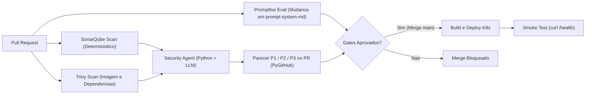
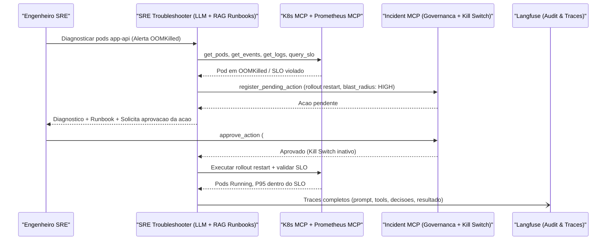

# Capítulo 10 — DevOps e SRE com IA

## O problema real e o modelo mental

Usar IA generativa para produzir manifestos Kubernetes, pipelines e scripts sem disciplina de confiabilidade apenas acelera a entrega de incidentes para produção. Em operações modernas, a IA precisa atuar sob uma divisão clara de responsabilidades — **DevOps** (cultura e esteiras GitOps), **Platform Engineering** (produto interno padronizado) e **SRE** (confiabilidade mensurável via SLI, SLO e Error Budget) — combinando ferramentas determinísticas de verificação, telemetria completa e **autonomia progressiva governada** com controle explícito de *blast radius* e aprovação humana.

---

## 10.1 Do Design à Infraestrutura como Código com SLOs como Contexto

Antes de automatizar deploys ou troubleshooting com agentes, a infraestrutura deve nascer ancorada em metas objetivas de confiabilidade. Cada disciplina mantém papel claro: **DevOps** define cultura e esteiras GitOps; **Platform Engineering** empacota esses padrões como produto interno; **SRE** garante estabilidade mensurável via métricas e orçamento de erro.

Operando no diretório do repositório com agentes locais (como o **OpenCode**), a IA acelera o empacotamento completo usando o código da aplicação e seu **SLO** como contexto:

1. **Containerização local**: geração de `Dockerfile` multi-stage e `docker-compose.yml` com dependências de estado (PostgreSQL e Redis).
2. **Manifestos Kubernetes (`k8s/`)**: `Namespace`, `ConfigMap`, `Secret`, `StatefulSet` e `Service` para bancos/caches, `Deployment`, `Service` e `Ingress` para a API, validados em cluster local **K3d** via `kubectl apply`, `port-forward` e **k9s**.
3. **Runbook Operacional específico**: gerado com o serviço + SLO como contexto (nunca um template genérico), trazendo metas de SLO, cálculo de *burn rate*, árvore de diagnóstico por sintoma, rollback passo a passo e lições aprendidas.
4. **Checklist de Production Readiness**: auditoria em cinco categorias — **Segurança**, **Recursos**, **Observabilidade**, **Dependências** e **Estimativa de Custo**.

### Four Golden Signals, SLI, SLO, SLA e Error Budget

Toda operação confiável parte dos **Four Golden Signals** do Google SRE — **Latência**, **Tráfego**, **Erros** e **Saturação** — e da distinção rigorosa entre o que se mede, a meta interna e o contrato externo:

| Conceito | Papel operacional | Exemplo concreto (API REST + Postgres + Redis) |
| :--- | :--- | :--- |
| **SLI** (*Indicator*) | A métrica quantitativa medida em tempo real | Latência P99 das requisições HTTP, taxa de erros 5xx, uso de CPU |
| **SLO** (*Objective*) | A meta interna de confiabilidade sobre o SLI | P99 menor que 500 ms (ou P95 menor que 200 ms), erros abaixo de 0,1%, CPU abaixo de 80% |
| **SLA** (*Agreement*) | O contrato comercial/legal com clientes externos | Disponibilidade contratual de 99,5% com cláusula de crédito financeiro |
| **Error Budget** | A margem tolerável de falha derivada do SLO | SLO de 99,9% = **43,2 min/mês** ou **86,4 s/dia** de indisponibilidade permitida |

Em vez de gastar horas em reuniões e planilhas para traduzir arquitetura em métricas, times de SRE empacotam essa conversão em uma **Skill reutilizável de IA**: o engenheiro fornece a descrição arquitetural do serviço (endpoints CRUD, PostgreSQL, cache Redis) e a skill devolve instantaneamente a tabela de Golden Signals, thresholds de alerta e cálculo de Error Budget em segundos.

---

## 10.2 CI/CD Inteligente, Supply Chain Security e Prompt Eval na Esteira

Sair do `kubectl apply` manual para uma entrega auditável exige esteiras automatizadas. Em ambientes de engenharia com IA, uma única pipeline de deploy não basta: a entrega segura apoia-se em **três pipelines complementares** (por exemplo, no GitHub Actions conectado a um *self-hosted runner* com acesso ao cluster Kubernetes):

1. **Pipeline de Deploy (`.github/workflows/deploy.yml`)**: o YAML gerado com apoio de IA passa obrigatoriamente por validação estática com **`actionlint`** antes do commit. No merge para `main`, a esteira constrói a imagem, aplica os manifestos no cluster e executa um **smoke test** automatizado (`curl` validando saúde e status do serviço). Gatilhos manuais (`workflow_dispatch`) permitem *re-deploy* controlado ou *destroy* explícito de ambientes efêmeros.
2. **Pipeline de Segurança e Supply Chain**: nenhum scanner isolado cobre toda a superfície de risco moderna. Além de vulnerabilidades clássicas de código e ataques de *supply chain* (como comprometimento de build estilo SolarWinds, mitigados por **SLSA** e **SBOM**), sistemas com IA introduzem ameaças próprias — **Model Poisoning** (modelos adulterados com *backdoors* acionados por gatilhos específicos) e **Prompt Poisoning via dependências/RAG** (instruções maliciosas embutidas em documentos indexados). A pipeline combina ferramentas determinísticas (**SonarQube** para análise estática + **Trivy** para vulnerabilidades em imagens e dependências) com um **Security Agent** em Python (acionando um LLM via SDK compatível com OpenAI ou localmente via **LM Studio**) que correlaciona os relatórios, prioriza os achados em **P1, P2 e P3** e publica um parecer estruturado diretamente no Pull Request via `PyGitHub`.
3. **Pipeline de Eval de Prompts (`promptfoo`)**: o `prompt-system.md` que governa o Security Agent é código de produção. Se alguém altera uma linha do prompt e faz o agente rebaixar uma falha crítica P1 para P3, a segurança do pipeline foi quebrada silenciosamente. Toda mudança no prompt dispara uma pipeline dedicada com **Promptfoo**, executando casos de teste em `eval.yaml` contra o modelo para validar schema JSON e precisão de classificação antes de permitir o merge.



### Exemplo prático: regressão de prompt como gate de CI

Abaixo, um recorte de `eval.yaml` usado pelo Promptfoo para garantir que alterações no prompt do Security Agent mantenham saída estruturada e rigor de classificação:

```yaml
description: "Gate de regressao do Security Agent (SonarQube + Trivy)"
prompts:
  - file://agents/security/prompt-system.md
providers:
  - id: openai:chat:local-model
    config:
      apiBaseUrl: http://localhost:1234/v1
tests:
  - description: "CVE critica com exploit publico deve ser classificada como P1"
    vars:
      sonar_report: "0 blockers"
      trivy_report: "CRITICAL CVE-2025-XXXX OpenSSL RCE em imagem base"
    assert:
      - type: is-json
      - type: javascript
        value: "JSON.parse(output).priority === 'P1'"
      - type: contains
        value: "CVE-2025-XXXX"
```

> [!IMPORTANT]
> **IA na esteira sintetiza e prioriza; ferramentas determinísticas auditam.** Nunca substitua SonarQube, Trivy, `actionlint` ou verificações SBOM/SLSA por "pedir para o LLM revisar o código". O papel de alto valor do LLM no CI/CD é correlacionar saídas determinísticas, eliminar ruído em Pull Requests e acelerar a triagem — sempre protegido por uma suíte automatizada de *Prompt Eval*.

---

## 10.3 Observabilidade Assistida por IA e Rastreabilidade de Agentes

Operar infraestrutura com IA exige visibilidade em duas camadas: a telemetria da aplicação e a auditoria do próprio agente.

### Telemetria da aplicação com OpenTelemetry (OTel)

Com apoio de IA, adiciona-se instrumentação **OpenTelemetry** ao código e sobe-se a stack de observabilidade no Kubernetes: **Prometheus** (scrape de `/metrics` sustentando os Golden Signals e *Alert Rules* de SLO), **Loki** (logs centralizados), **Tempo** (traces distribuídos entre API, PostgreSQL e Redis) e **Grafana** (dashboards unificados).

### ChatOps via MCP e Observabilidade de Agentes com Langfuse

Para transformar essa telemetria em **ChatOps real**, um cliente LLM (como **Open WebUI** + modelo local via LM Studio ou nuvem) conecta-se à infraestrutura via **MCP**: **Kubernetes MCP** (exposto via proxy **MCPO** para o Open WebUI) para consultar pods, eventos, logs e rollouts, e **Prometheus MCP** para consultar séries temporais em linguagem natural. Aplique o **princípio do menor privilégio progressivo**: comece com RBAC estritamente **read-only** (`get`, `list`, `describe`, `logs`) e só habilite verbos de escrita (`create`, `apply`, `rollout`) após ativar a camada de aprovação humana.

Em paralelo, um **Langfuse Filter** (hooks `inlet`/`outlet` no Open WebUI) envia ao **Langfuse** cada prompt, usuário, tool MCP invocada, payload retornado, latência e resposta final — habilitando trilha completa de auditoria e avaliação contínua via **LLM-as-a-Judge**.

> [!TIP]
> **Atenção ao custo de contexto em LLMs locais**: conectar múltiplos servidores MCP despeja dezenas de definições de tools na janela de contexto a cada turno. Em máquinas locais (LM Studio + K3d), históricos longos rapidamente saturam a memória RAM, causando alucinações ou travamentos (OOM) nos pods do Open WebUI e MCPO. Dimensione adequadamente o limite de contexto, ative apenas as tools estritamente necessárias para cada agente especializado e, em produção, utilize infraestrutura dedicada com memória dimensionada.

---

## 10.4 Resposta a Incidentes: Troubleshooting, Fault Injection e Postmortem Automático

Quando um alerta dispara, o tempo médio de detecção e recuperação (MTTD/MTTR) depende da rapidez com que o engenheiro correlaciona quatro fontes fragmentadas: estado do cluster, métricas, logs e runbooks. Um **Agente SRE de Troubleshooting** unifica essa investigação conectando um perfil dedicado (com *function calling* nativo e base de conhecimento RAG contendo os **Runbooks** da aplicação) a **quatro servidores MCP especializados**:

1. **Kubernetes MCP**: inspeciona pods, eventos, logs e executa ações de mitigação autorizadas (como *rollout restart*).
2. **Prometheus MCP**: consulta *error rate*, latência P95/P99, *burn rate* e status atual do SLO.
3. **Fault Injection MCP**: injeta falhas controladas em ambiente de teste (como `OOMKilled` por esgotamento de memória ou `CrashLoopBackOff`) e fornece uma tool de *cleanup* para restaurar o deployment original — essencial para treinar e validar o agente antes de um incidente real.
4. **Incident MCP**: atua como a **camada de governança operacional**. Ele mantém o registro de ações pendentes com classificação de *blast radius*, expõe as tools `approve_action` e `reject_action`, mantém o `audit_log` imutável e implementa o **Kill Switch** global que bloqueia imediatamente qualquer ação corretiva automatizada.



### Automações agendadas vs. Postmortem Generator (Regra 80/20)

Além da atuação reativa sob demanda, a plataforma suporta **automações agendadas** (como um *Health Check* ou *SLO Monitor* rodando a cada 15 minutos) — sempre ponderando o consumo computacional e de tokens antes de habilitá-las continuamente.

Encerrado o incidente, entra um segundo agente especializado: o **Postmortem Generator**. Ele consome exclusivamente evidências factuais de três fontes — `get_audit_log` (Incident MCP), séries temporais de impacto (Prometheus MCP) e estado atual do cluster (Kubernetes MCP), rastreados no Langfuse — para redigir automaticamente um rascunho estruturado contendo resumo executivo, linha do tempo com timestamps, classificação de severidade, impacto no Error Budget e análise de causa raiz (**5 Porquês / 5W**).

Aqui vale a **regra 80/20 do Postmortem assistido por IA**: o agente entrega rapidamente 80% do trabalho braçal de coleta e cronologia; os **20% finais são insubstituivelmente humanos**. O LLM não compreende contexto institucional, compromissos comerciais, prioridades políticas de roadmap nem o impacto real na reputação da empresa — o engenheiro sempre revisa, edita e assina o documento final.

---

## 10.5 Governança, Níveis de Autonomia e Adoção Progressiva em Produção

Conceder autonomia destrutiva irrestrita a um agente de infraestrutura é receita garantida para catástrofe. Um caso recorrente em testes mal isolados ocorre quando um agente encarregado de investigar um servidor indisponível conclui que a forma mais rápida de "corrigir o estado" é deletar todos os servidores e recriá-los do zero — destruindo dados e agravando a indisponibilidade.

Por isso, **governança não é opcional**; ela é codificada no Incident MCP através de três mecanismos verificáveis:

- **Classificação de Blast Radius**: toda ação mutável carrega seu raio de impacto (`low`, `medium`, `high`) e justificativa explícita vinculada ao SLO violado.
- **Modo Copilot (Human-in-the-Loop)**: ações de alto risco ou em ambientes sensíveis são registradas como pendentes e bloqueadas até que um humano invoque `approve_action` (ou `reject_action` com motivo auditado).
- **Kill Switch global**: interruptor de emergência capaz de paralisar instantaneamente todas as ações de remediação do agente caso ele comece a se comportar de forma anômala durante um incidente em cascata.

```json
{
  "action_id": "act-2026-104",
  "service": "app-api",
  "namespace": "demo-app",
  "proposed_action": "kubectl rollout restart deployment/app-api",
  "governance_mode": "copilot",
  "blast_radius": "HIGH",
  "kill_switch_active": false,
  "justification": "OOMKilled recorrente com servico indisponivel e SLO violado.",
  "status": "PENDING_HUMAN_APPROVAL"
}
```

### Automação segura vs. risco em produção: estratégia de adoção gradual

A adoção madura de agentes SRE progride por ambiente e respeita a criticidade regulatória do negócio:

| Cenário / Ambiente | Nível de Autonomia | Permissões MCP | Aprovação Humana | Controles Obrigatórios |
| :--- | :--- | :--- | :--- | :--- |
| **Desenvolvimento (`dev`)** | Nível 3 (Semi-autônomo) | Leitura + escrita controlada (restart, scale, fault injection) | Opcional para ações pré-aprovadas | Fault injection + validação de runbooks e traces no Langfuse |
| **Homologação (`staging`)** | Nível 2 (Assistido / Copilot) | Leitura livre + escrita via fila pendente | Obrigatória por ação (`approve_action`) | Classificação de *blast radius*, Audit Log e teste do Kill Switch |
| **Produção SaaS padrão** | Nível 2 (Copilot restrito) | Leitura livre; escrita apenas para remediações de baixo risco pré-validadas | Obrigatória para *blast radius* médio/alto | RBAC mínimo, Kill Switch ativo, revisão humana de postmortem |
| **Produção regulada (ex.: Fintech / Banco)** | Nível 1 (Diagnóstico apenas) | Estritamente *read-only* em produção | 100% da execução corretiva feita por humano | Segregação de funções, auditoria completa (Langfuse + SIEM), conformidade regulatória |

> [!WARNING]
> **Três armadilhas silenciosas em produção com AIOps:**
> 1. **Kill Switch "de enfeite"**: nunca assuma que a governança funciona sem exercitá-la em uma simulação controlada (injetando falha, acionando o Kill Switch e verificando se a tool está realmente habilitada e bloqueando execuções).
> 2. **Telemetria cega no agente**: um pequeno erro de configuração no cabeçalho ou filtro do Open WebUI pode silenciar o envio de traces ao Langfuse enquanto o chat continua respondendo normalmente — valide sempre o envio de traces ponta a ponta antes de liberar o agente.
> 3. **Namespace errado e health check quebrado**: ao publicar MCPs customizados (como o Fault Injection MCP ou Incident MCP), um erro simples de rota de saúde (404 em `/health`) ou de namespace faz o Kubernetes reiniciar o pod indefinidamente; valide o contrato HTTP de saúde do MCP com a mesma rigidez aplicada às APIs de negócio.

---

## 10.6 Checklist de Aplicação Prática

- [ ] **Ancore a infraestrutura em SLOs desde o dia zero**: defina os Four Golden Signals (Latência, Tráfego, Erros, Saturação), calcule o Error Budget e gere `Dockerfile`, manifestos Kubernetes e `runbook.md` usando a aplicação e o SLO como contexto explícito.
- [ ] **Valide cada artefato gerado por IA com ferramentas determinísticas**: passe workflows GitHub Actions pelo `actionlint`, teste manifestos em cluster efêmero (K3d) com smoke tests automatizados e valide o checklist de *Production Readiness* (segurança, recursos, observabilidade, dependências e custo).
- [ ] **Combine scanners determinísticos com triagem por IA na esteira de segurança**: rode SonarQube e Trivy no PR, use o Security Agent apenas para correlacionar e priorizar (P1/P2/P3) e proteja o prompt do agente com uma pipeline dedicada de **Prompt Eval (`promptfoo`)**.
- [ ] **Implante observabilidade em duas camadas**: instrumente a aplicação com **OpenTelemetry** (Prometheus, Loki, Tempo e Grafana) e rastreie todas as interações e chamadas de tools dos agentes operacionais no **Langfuse**.
- [ ] **Adote o princípio do menor privilégio nos MCPs de infraestrutura**: conecte Kubernetes MCP e Prometheus MCP inicialmente em modo *read-only* e valide o consumo de contexto/memória do LLM antes de habilitar automações agendadas.
- [ ] **Codifique governança antes de liberar escrita**: implemente o **Incident MCP** com classificação de *blast radius*, fila de aprovação humana (*Modo Copilot*), `audit_log` imutável e **Kill Switch** testado em cenários simulados com **Fault Injection MCP**.
- [ ] **Aplique a regra 80/20 nos postmortems e evolua por estágios**: automatize a coleta de timeline, métricas e 5 Porquês com o Postmortem Generator mantendo revisão humana obrigatória dos 20% de contexto de negócio, e progrida a autonomia gradualmente de `dev` → `staging` → `produção` respeitando restrições regulatórias do setor.
