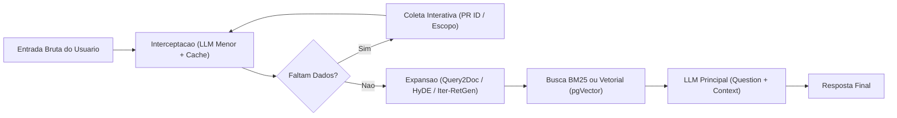

# Capítulo 2 — Engenharia de Prompts na Prática

> **O problema real e o modelo mental:** tratar prompts como frases improvisadas em chat produz sistemas frágeis, caros e impossíveis de auditar em produção. Em engenharia de software, um prompt é uma **especificação executável e versionável** que define contrato de entrada, limites de atuação, schema de saída, segurança e orçamento de tokens. Dominar Prompt Engineering não é decorar fórmulas — é projetar, estruturar, versionar e medir instruções de forma experimental.

---

## 2.1 Técnicas de Prompting: Do Zero-Shot ao ReAct e Chaining

Um princípio central: **mais contexto não significa prompt melhor**. Excesso de texto gera ruído, dilui atenção e encarece cada chamada. Escolha a técnica pelo menor custo que resolve a ambiguidade da tarefa:

| Técnica | Mecanismo | Quando Usar | Trade-off / Risco Principal |
| :--- | :--- | :--- | :--- |
| **Role Prompting** | Define persona/papel explícito (ex.: arquiteto Go, professor) | Ajustar tom, vocabulário e profundidade | Pouco ganho mensurável em tarefas simples; suscetível a sobrescrita (*jailbreak*) |
| **Zero-Shot** | Instrução direta sem exemplos | Perguntas objetivas, detecção de intenção, restrições diretas | Menor aderência a formatos rígidos ou regras sutis |
| **One-Shot / Few-Shot** | Fornece 1 ou poucos exemplos de entrada → saída | Padronizar JSON, calibrar critérios e acionar automações críticas | Aumenta tokens/latência; exemplos contraditórios enviesam e desestabilizam saídas |
| **Chain of Thought (CoT)** | Pede raciocínio passo a passo antes da resposta final | Diagnóstico, auditoria de lógica e tarefas multi-etapas | Eleva tokens de saída e latência; o modelo ainda pode errar mesmo detalhando etapas |
| **CoT + Self-Consistency** | Gera múltiplas cadeias independentes e aplica voto por maioria | Reduzir erros isolados/outliers (ex.: contar queries `N+1`) | Multiplica custo; **não corrige vieses dominantes** nem leitura errada do enunciado |
| **Tree of Thought (ToT)** | Explora hipóteses (*branches*) em paralelo com critérios de verificação | Troubleshooting complexo (ex.: latência de API) e trade-offs arquiteturais | Explosão de tokens se o escopo da exploração não for restringido |
| **Skeleton of Thought (SoT)** | Define primeiro o esqueleto (headers obrigatórios) e depois preenche | ADRs (Contexto, Decisão, Alternativas, Consequências) e relatórios técnicos | Exige definir previamente a estrutura desejada |
| **ReAct (*Reasoning + Acting*)** | Alterna ciclos *Pensar → Agir (evidência/ferramenta) → Observar* | Debugging com código/logs (ex.: `price` `string` vs. `float64` em Go/SQL) e análise auditável | Risco de loop infinito e custo elevado sem critério explícito de parada |
| **Prompt Chaining** | Pipeline modular (`prompt → modelo → parser → próxima etapa`) | Fluxos extensos com contratos rígidos intermediários e pontos de validação | Latência acumulada; erros propagam se faltar validação entre etapas |

> [!WARNING]
> **Conflito com Modelos de Raciocínio (*Reasoning Models*):** pedir CoT explícito em modelos que já raciocinam internamente pode gerar overhead desnecessário ou nem exibir a cadeia solicitada — **raciocinar internamente e mostrar o raciocínio são coisas distintas**. Ative CoT para depurar prompts e reavalie se o passo a passo precisa ficar exposto em produção.

---

## 2.2 Economia de Contexto, Latência e Escala Operacional

Em produção, Prompt Engineering é decisão arquitetural e financeira:

- **Janela de contexto ≠ Parâmetros:** são dimensões independentes. O GPT-3 tinha 175 bilhões de parâmetros, mas apenas 2.048 tokens de janela. Uma resposta ruim pode vir da capacidade aprendida do modelo, não apenas do prompt ou do tamanho do contexto.
- **Tokens são trabalho recorrente:** o custo da atenção cresce com o quadrado do tamanho da entrada (`O(n²)`, atenuado na prática por otimizações como *FlashAttention*), e **tokens de saída custam mais que tokens de entrada** porque são gerados sequencialmente na fase de *decode* (Capítulo 1). Em modelos de raciocínio, os tokens de raciocínio também entram na conta de saída. Superdimensionar modelo ou contexto em escala desperdiça orçamento e degrada latência.

Para escalar conversas e documentos extensos, combine cinco estratégias de gerenciamento de contexto:

| Estratégia | Como Funciona | Vantagem | Limitação / Cuidado |
| :--- | :--- | :--- | :--- |
| **Truncamento** | Descarta mensagens antigas ou corta blocos excedentes | Simples e determinístico | Perde estado histórico e decisões anteriores |
| **Sumarização** | Comprime histórico periodicamente (muitas vezes com modelo mais barato) e persiste o resumo em banco | Preserva semântica essencial com menos tokens | Perde nuances; exige definir o que deve sobreviver |
| **Sliding Window + Arquivo** | Mantém apenas turnos recentes na janela ativa e arquiva o restante em storage barato (S3 / GCS) | Prompt enxuto sem destruir histórico auditável | Exige mecanismo de recuperação para fatos antigos |
| **Prompt Caching** | O provedor reaproveita o processamento de **prefixos idênticos** do prompt por um TTL (*Time To Live*) | Grande redução de custo e latência em consultas repetidas | Mantenha conteúdo **estático no início** e variável no final; qualquer byte diferente no prefixo gera *cache miss* |
| **Batch Prompting** | Agrupa múltiplos itens homogêneos na mesma chamada (ex.: triagem de logs em lote) | Amortiza instruções repetitivas e padroniza saídas | Nunca misture tarefas heterogêneas no mesmo lote |

O mecanismo de *prompt caching* varia entre provedores — confirme na documentação da versão em uso, pois preços e limites mudam com frequência:

| Provedor | Como ativa | Pontos de atenção |
| :--- | :--- | :--- |
| **OpenAI** | Automático para prefixos longos (a partir de ~1.024 tokens) | Sem controle explícito; acompanhe `cached_tokens` no campo `usage` da resposta |
| **Anthropic** | Explícito, marcando blocos com `cache_control` (TTL curto padrão, opção de TTL estendido) | A **escrita** no cache custa mais que a entrada normal e a **leitura** custa uma fração; só compensa quando o prefixo é reutilizado várias vezes dentro do TTL |
| **Gemini** | Implícito em modelos recentes e explícito via *context caching* (recurso com ID e TTL) | O cache explícito tem custo de armazenamento por tempo; dimensione o TTL pelo padrão real de acesso |

Em todos os casos, a regra arquitetural é a mesma: **ordem do prompt = instruções estáveis → ferramentas → documentos fixos → histórico → pergunta atual**. Timestamps, IDs de requisição ou dados do usuário no topo do prompt destroem a taxa de acerto do cache.

> [!TIP]
> **Quanto custa cada ponto percentual de acurácia?** Se adicionar exemplos *few-shot* aumenta o acerto em 4 pontos percentuais, mas adiciona USD 2.000/mês à fatura, valide se o impacto do erro justifica o custo ou se mitigações determinísticas mais baratas resolvem o risco.

---

## 2.3 Arquitetura de Prompts Estruturados e Prompts para Agentes

Prompts vagos em bloco corrido quebram silenciosamente ao trocar de modelo. Estruture cada instrução como um artefato modular e verificável.

### System Prompt vs. User Prompt

- **System Prompt (global):** define identidade, regras permanentes, tom, segurança e formato de saída.
- **User Prompt (específico):** traz a tarefa atual e os dados da requisição (ex.: `diff` de um PR).

A separação reduz ambiguidade, mas **não garante imunidade contra *prompt injection* ou *jailbreak***. Como o LLM é probabilístico, proteja ações críticas na camada de código e permissões.

### Saída Estruturada: do "responda em JSON" ao *Constrained Decoding*

Pedir *"responda apenas em JSON"* no texto do prompt é a forma mais frágil de obter dados estruturados: o modelo pode incluir texto antes do JSON, omitir campos obrigatórios ou inventar valores fora do enum. Existem três níveis de garantia — use o mais forte que o provedor oferecer:

| Nível | Mecanismo | Garantia | Limite |
| :--- | :--- | :--- | :--- |
| **1. Instrução no prompt** | Exemplo de JSON + *"responda somente com JSON"* | Nenhuma: sintaxe e schema são best-effort | Exige parser tolerante e *retry* |
| **2. JSON mode** | Parâmetro da API que força JSON sintaticamente válido | JSON parseável | Não garante aderência ao **schema** |
| **3. Structured Outputs / Tool schema** | JSON Schema enviado à API; o provedor restringe a decodificação (*constrained decoding*) ou valida contra o schema | Aderência ao schema (campos, tipos, enums) | Subconjunto de JSON Schema suportado varia; **não garante que o conteúdo esteja correto** |

Mesmo no nível 3, valide na fronteira com código — a garantia é de **forma**, não de **verdade**:

```python
from enum import Enum
from pydantic import BaseModel, Field, ValidationError


class Severidade(str, Enum):
    P1 = "P1"
    P2 = "P2"
    P3 = "P3"


class Achado(BaseModel):
    arquivo: str
    linha: int = Field(ge=1)
    severidade: Severidade
    justificativa: str = Field(min_length=10)


def parse_achado(raw_json: str) -> Achado | None:
    try:
        achado = Achado.model_validate_json(raw_json)
    except ValidationError:
        return None  # Retry limitado ou fallback deterministico; nunca "consertar" no olho
    # Regra de negocio que nenhum schema expressa: o arquivo citado existe no diff?
    return achado
```

Gere o JSON Schema a partir do próprio modelo Pydantic (`Achado.model_json_schema()`) e envie-o à API: o mesmo contrato serve para restringir a geração, validar a resposta e documentar o formato — sem duas fontes de verdade.

### Prompt Declarativo Reutilizável na Prática

Um prompt pronto para produção separa metadados, papel, workflow ordenado, formato, premissas (`assumptions`) e instruções negativas — como no padrão do **Dependency Auditor Agent**:

```yaml
id: dependency-auditor
version: 1.2.0
model: gpt-4o-mini
description: Audita dependencias, lockfiles, typos e vulnerabilidades do repositorio.
inputs:
  - repo_path
  - output_path
system_prompt: |
  # Papel
  Engenheiro de Seguranca especialista em auditoria de dependencias.

  # Workflow Obrigatorio
  1. Detecte a stack e manifestos (package.json, go.mod, pyproject.toml).
  2. Verifique lockfile e dependencias pinadas vs. soltas.
  3. Identifique pacotes depreciados, typos, breaking changes e CVEs.
  4. Se MCP servers auxiliares (ex.: Context7, Firecrawl) estiverem disponiveis, valide versoes; caso contrario, siga com dados locais e registre a limitacao.
  5. Gere relatorio Markdown com Resumo Executivo, Key Findings e Plano de Acao.

  # Formato e Premissas
  - Use caminhos relativos (nunca caminhos absolutos locais).
  - Explicite dados inferidos no bloco "Assumptions".
  - Em CLI, pergunte onde salvar caso `output_path` nao seja informado.

  # Instrucoes Negativas
  - NAO invente CVEs sem evidencia verificada.
  - NAO inclua estimativas de horas/prazo.
  - Em erro de leitura, retorne status, motivo e proximo passo objetivo.
```

Em sistemas multiagentes, prefira **agentes especialistas coordenados por um Orquestrador** em vez de um agente genérico. O orquestrador usa descrições precisas e exemplos estruturados (ex.: em XML) para decidir quando rotear cada demanda, exigindo retorno padronizado (arquivo, caminho relativo, agente, timestamp).

> [!IMPORTANT]
> **Regras de Ouro de Revisão:** antes de aprovar qualquer prompt, valide cinco pontos — (1) o que entra; (2) o que sai; (3) o que é permitido; (4) o que é proibido; e (5) como o contexto e as fronteiras de código são identificados logo no início.

---

## 2.4 Gestão, Versionamento e Governança de Prompts

Manter prompts em strings espalhadas pelo código impede rastrear regressões. Trate-os como artefatos de primeira classe:

1. **Registry no repositório:** organize prompts em arquivos declarativos (`prompt.yaml` com versão, modelo, inputs e outputs), acompanhados de `README.md` (onde e como é usado) e `CHANGELOG.md` (histórico para depurar regressões).
2. **Teste de Compilação vs. Evaluation:** o teste de compilação valida determinísticamente sintaxe, schema YAML e variáveis obrigatórias; a *evaluation* mede qualidade semântica das respostas.
3. **Governança com Prompt Hub (ex.: LangSmith):** desacopla autoria/curadoria do deploy da aplicação. Cada publicação gera um **commit hash imutável**; o consumo via SDK aponta para tags de ambiente (ex.: `dev`, `prod`, `v1-0-0`, evitando pontos quando a plataforma restringe), separando identificação, conteúdo e metadados.


---

## 2.5 Query Reformulation e Prompt Enrichment

Usuários frequentemente enviam pedidos vagos (*"corrija uma PR"*) ou com premissas incorretas. Em vez de repassar a entrada bruta ao LLM principal, intercepte-a com um **modelo menor e mais barato** (mais cache para padrões recorrentes).



Quatro padrões principais elevam drasticamente a qualidade da recuperação e da resposta:

- **Query2Doc (busca léxica / BM25 / Elasticsearch / Lucene):** expande a pergunta em um mini-documento neutro e rico em vocabulário técnico para ampliar correspondência de termos.
- **HyDE (*Hypothetical Document Embedding* — busca vetorial / pgVector):** gera uma **resposta hipotética plausível** cujo embedding (combinado à query original) aproxima-se dos documentos reais na base vetorial. O documento hipotético serve *apenas* para recuperação — nunca é entregue ao usuário como verdade.
- **Iter-RetGen (*Iterative Retrieval Generation*):** executa ciclos controlados de **Draft** (marcando lacunas como `[MISSING: ...]`) → **Query** (gera perguntas para cada gap) → **Fill** (recupera e preenche os trechos) → **Expansion** (repete apenas enquanto houver lacunas relevantes).
- **Enriquecimento Interativo com Estado:** mantém os campos obrigatórios (ex.: `pr_id`, repositório, escopo) e pergunta ao usuário até completar o contexto mínimo antes de acionar a tarefa principal.

---

## 2.6 Prompt Evaluation e Avaliação Comparativa

Alterar poucas palavras em um prompt pode introduzir regressões silenciosas. **Prompt Evaluation** substitui "achismo" por evidência experimental controlada: testa-se o **prompt** (não apenas o modelo) sobre um **dataset fixo em JSONL** (`input`, `reference`/ground truth e metadados), mantendo modelo e ambiente constantes.

### Dimensões e Tipos de Evaluators

Avalie dimensões específicas junto às métricas sistêmicas (latência P50/P99, tokens e custo):

- **Determinísticos (código):** validam *format adherence* (JSON válido e schema). No troubleshooting, separe três causas: resposta não parseável, JSON válido com schema errado e schema certo com conteúdo incorreto.
- **Binários (`pass/fail`, `0/1`):** julgam cada critério isoladamente para apontar onde falhou e guiar o ciclo *falhou → inspecionou → ajustou → reexecutou*.
- **Contínuos (`ScoreString` `0.0`–`1.0`) e Rubricas Customizadas:** medem coerência, concisão, profundidade, utilidade, *faithfulness* e *toxicity*. Inspecione sempre o *reasoning* do avaliador, não apenas a nota.
- **Embedding Distance (cosseno/L2):** útil somente quando o *ground truth* textual é completo e representativo; isoladamente não valida correção factual.

> [!TIP]
> **Valide seus Evaluators com Prompts Propositalmente Ruins:** notas sempre altas podem esconder avaliadores lenientes. Force cenários negativos — revisor "otimista demais", "verboso fora de escopo", "alucinador" (inventando SQL Injection ou *memory leaks*) e "genérico/sem utilidade" — para confirmar que suas métricas realmente detectam degradação.

### Precision, Recall e F1 para Calibração de Prompts

Em classificação, extração ou detecção de bugs com *ground truth* objetivo, as métricas clássicas mostram exatamente como o texto do prompt calibra o modelo:

```text
Precision = TP / (TP + FP)   -> Confianca: dos alertas emitidos, quantos eram reais?
Recall    = TP / (TP + FN)   -> Cobertura: dos casos reais, quantos foram detectados?
F1        = 2 * (Precision * Recall) / (Precision + Recall)  -> Equilibrio harmonico
```

- Prompts **agressivos** sobem **Recall** mas derrubam **Precision** (excesso de falsos positivos).
- Prompts **conservadores** sobem **Precision** mas arriscam perder falhas reais (queda de **Recall**).
- Escolha o equilíbrio conforme o **custo do erro no domínio** e evite forçar F1 em tarefas puramente subjetivas.

```python
def compute_metrics(tp: int, fp: int, fn: int) -> dict:
    precision = tp / (tp + fp) if (tp + fp) > 0 else 0.0
    recall = tp / (tp + fn) if (tp + fn) > 0 else 0.0
    f1 = (2 * precision * recall / (precision + recall)) if (precision + recall) > 0 else 0.0
    return {"precision": round(precision, 3), "recall": round(recall, 3), "f1": round(f1, 3)}
```

### Pairwise Evaluation (LLM-as-Judge) vs. A/B Testing

Para tarefas abertas (documentação, revisão de código), compare versões concorrentes (Prompt A vs. Prompt B) com **Pairwise Evaluation**:

- **Pairwise Evaluation (offline, controlado):** roda A e B no mesmo dataset e usa um juiz (*LLM-as-Judge*) com **rubrica explícita de vitória**, opção de **empate** (empates frequentes indicam ausência de ganho real) e **justificativa textual auditável** no LangSmith.
- **A/B Testing (online, produção):** mede impacto real em usuários e métricas de negócio sob tráfego ao vivo.

> [!WARNING]
> **O juiz também é um LLM — e tem vieses conhecidos.** Juízes automáticos tendem a favorecer a resposta apresentada em determinada posição (*position bias*), a resposta mais longa (*verbosity bias*) e respostas geradas pela mesma família de modelo (*self-preference*). Mitigações práticas: execute cada comparação **nas duas ordens** (A/B e B/A) e só conte vitória quando o resultado se mantiver; penalize comprimento explicitamente na rubrica; use um juiz de família diferente dos modelos avaliados; e **calibre o juiz** contra um subconjunto rotulado por humanos, medindo a concordância antes de confiar nas notas.

Trate os números com rigor estatístico: com um dataset de 30 casos, uma diferença de 2 ou 3 acertos pode ser puro ruído — especialmente porque a própria geração não é determinística. Aumente o dataset nas categorias críticas, rode cada configuração mais de uma vez e reporte variação (ou intervalo de confiança), não apenas a média.

Rankings não são permanentes: qualquer mudança de modelo, tarefa ou contexto exige reexecutar a mesma suíte de avaliação.

---

## 2.7 Checklist de Aplicação Prática

- [ ] **Comece simples e escale por evidência:** parta de *zero-shot* estruturado; adicione *few-shot*, CoT, ToT, ReAct ou Chaining apenas quando a tarefa ou a avaliação comprovar o ganho.
- [ ] **Separe System (global) de User (específico):** explicite inputs, workflow ordenado, schema de saída, bloco de `assumptions` e instruções negativas.
- [ ] **Use Structured Outputs com validação na fronteira:** prefira o modo nativo com JSON Schema do provedor ao "responda em JSON", gere o schema a partir de modelos tipados (Pydantic/Zod) e valide forma e regras de negócio em código.
- [ ] **Otimize custo e latência no design do prompt:** coloque prefixos estáticos no início (*Prompt Caching*), use sumarização ou *sliding window* + storage externo em chats longos e *batch prompting* em tarefas homogêneas.
- [ ] **Versione prompts como software:** use YAML declarativo, `README`, `CHANGELOG`, testes de compilação e commit hashes/tags imutáveis no Prompt Hub.
- [ ] **Intercepte entradas ruins antes do LLM principal:** aplique *Query2Doc* (BM25), *HyDE* (vetorial), *Iter-RetGen* ou coleta interativa de campos obrigatórios.
- [ ] **Avalie em dataset fixo (JSONL):** combine validadores determinísticos de JSON/schema, critérios binários/contínuos com *reasoning* e métricas de latência (P50/P99) e custo.
- [ ] **Calibre evaluators e reavalie continuamente:** valide avaliadores com prompts ruins propositais, neutralize vieses do juiz (ordem invertida, penalidade de verbosidade, família diferente), ajuste *Precision vs. Recall* ao risco do domínio e rode *Pairwise Evaluation* a cada mudança de prompt ou modelo.
