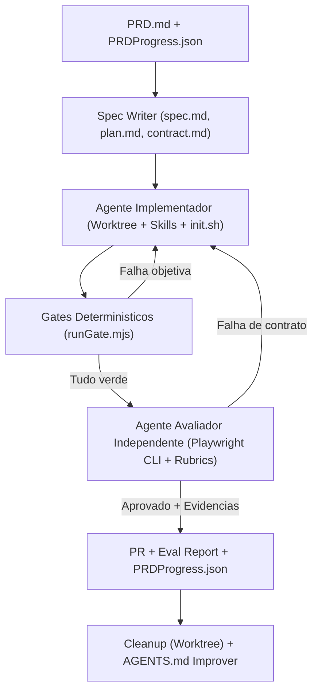

# Capítulo 4 — Desenvolvimento em Modo Agente: SDD e Harness Engineering

> **O problema real e o modelo mental:** Gerar código com LLMs ficou barato; garantir que esse código respeite a arquitetura, integre-se entre features e funcione de ponta a ponta é o novo gargalo. Desenvolver em modo agente exige separar duas disciplinas complementares: **Spec-Driven Development (SDD)** define *o que* o sistema deve ser; **Harness Engineering** projeta o ambiente determinístico que governa *como* o agente constrói, valida e comprova a entrega.

---

## 4.1 Spec-Driven Development (SDD) e seus três níveis de maturidade

No **Spec-Driven Development (SDD)**, a especificação atua como contrato explícito entre produto, implementação e testes. Em vez de improvisar prompts e descobrir *edge cases* após o código pronto, o time antecipa regras de negócio, tratamento de erros e fronteiras de integração **antes** da geração.

A taxonomia mais citada — descrita por Birgitta Böckeler no site de Martin Fowler ao analisar ferramentas como **GitHub Spec Kit**, **Kiro** e **Tessl** — organiza o SDD em três níveis de maturidade (*spec-first*, *spec-anchored* e *spec-as-source*):

| Nível de SDD | Papel da especificação | Manutenção contínua | Uso ideal | Trade-off principal |
| :--- | :--- | :--- | :--- | :--- |
| **1. Spec First** | Criada antes do código para guiar uma entrega pontual | Descartada ou congelada após o merge | Protótipos, spikes, tarefas isoladas | Baixo custo, mas perde histórico acumulado |
| **2. Especificação Ancorada** | Evolui junto com o código e é validada pelos testes | Persistida feature a feature no repositório | Sistemas reais em evolução contínua | Exige disciplina para evitar contradições históricas |
| **3. Spec as Source** | Único local editável; código derivado é regenerado | Total (sem edição manual no código gerado) | Direção de maturidade em pipelines maduros | Requer pipeline ultraconfiável; ajustes de ambiente ainda ocorrem |

Na prática, a **Especificação Ancorada** (*spec-anchored*) entrega o melhor retorno: constrói uma linha do tempo de features e dependências que orienta tanto humanos quanto sessões futuras da IA. O nível de detalhe necessário também é dinâmico — conforme os modelos ganham capacidade de inferência, parte do detalhamento trivial pode diminuir sem perder previsibilidade.

### A fronteira entre SDD e Harness

Não tente controlar o comportamento do agente enchendo a especificação de microgerenciamento. Separe os papéis:

- **SDD define *o quê*:** intenção de negócio, *core scope* versus extensões, contratos de API e dados, comportamento explícito de erro, *edge cases* e critérios de aceitação.
- **Harness define *como*:** ferramentas, scripts de ambiente, gates de qualidade, isolamento de execução e validação externa.

### Artefatos operacionais do fluxo SDD

Um pipeline SDD estruturado divide intenção, estado e contrato de verificação em cinco artefatos versionados:

1. **`PRD.md` (skill `PRD Writer`):** Construído via entrevista, inferência e autovalidação (até três ciclos de correção automática). Separa *core scope* de extensões, explicita comportamento de erro e declara dependências entre features em **`Consumes` e `Provides`**.
2. **`PRDProgress.json` (ou `tracking.json`):** Fonte objetiva de estado (`pending` -> `implemented` -> `done` + link para relatório de avaliação), eliminando a amnésia entre sessões conversacionais.
3. **`spec.md` (skill `Spec Writer`):** Desenho técnico calibrado por heurística de complexidade (arquitetura, componentes, contratos de API, modelo de dados e *edge cases*).
4. **`plan.md`:** Decompõe a `spec.md` em passos sequenciais de execução — operacionaliza o trabalho, mas **não** substitui o tracking de estado.
5. **`contract.md`:** Contrato ativo de execução e aceite: serviços de runtime, fixtures, gates determinísticos e manifesto de cobertura por *surfaces* com critérios Given/When/Then.

---

## 4.2 Paralelização segura, contratos entre features e Waves

Em modo agente, features raramente falham isoladas — elas falham **nas costuras de integração**. Um agente pode entregar upload de vídeo e outro entregar a biblioteca de vídeos com testes unitários verdes, mas o sistema quebra se o redirecionamento pós-login, o evento assíncrono ou o schema de metadados divergirem.

### A Regra de Ouro em integrações

Trate toda integração entre features como um **contrato explícito** (`Provides` / `Consumes`), acompanhado de **critérios de aceitação cross-feature** testados em todo ponto de passagem. Quando uma dependência assíncrona ainda não foi implementada, a feature consumidora entrega integralmente sua parte e declara explicitamente a fronteira pendente sem mascarar a lacuna.

### Orquestração em Waves, Worktrees e resolução de conflitos

Com dependências explícitas no PRD, a paralelização segue cinco regras operacionais:

- **Waves (rodadas):** Execute features bloqueantes primeiro (autenticação, upload core) e agrupe features independentes em *Waves* paralelas.
- **Git Worktrees e `tmux`:** Isole cada agente em branch e diretório próprios (`git worktree`), coordenando sessões paralelas em `tmux` sem disputa pelo mesmo diretório.
- **Isolamento de runtime e dados:** Configure portas dedicadas por worktree (evitando assumir sempre a porta `3000`) e bancos/schemas com prefixo controlado (ex.: `VideoMaxCloud-*`) para limpeza segura.
- **Economia de tokens no orquestrador:** Em execução em lote (*batch mode*), não faça cada subagente reler o repositório e o PRD inteiro do zero; extraia e persista artefatos de contexto compartilhado em disco uma única vez.
- **Integração rigorosa antes da PR:** Sincronize com `main`, resolva conflitos, **regenere artefatos derivados** (como Prisma Client e migrações após conflito de schema), reexecute **todos** os critérios de aceitação (incluindo E2E se o front-end foi impactado) e remova branch e worktree após o merge.

> [!WARNING]
> **Armadilha Comum — Hard Fail, Soft Fail e o falso verde dos fakes:** No relatório final da skill `implement`, exija distinção clara entre **Hard Fail** (bloqueio estrutural insuperável, como ausência de credencial) e **Soft Fail** (impedimento parcial contornado). E nunca encerre a validação de pipelines assíncronos apenas com *fakes*: dublês validam lógica repetível, mas só serviços reais comprovam autenticação, rede e serialização.

---

## 4.3 Harness Engineering: domando a execução autônoma

Popularizado por relatos práticos como *"My AI Adoption Journey"* (Mitchell Hashimoto), o **Harness Engineering** segue uma regra de engenharia iterativa: **sempre que um agente comete um erro previsível, você ajusta o ambiente para que aquele erro nunca mais possa se repetir.**

Para evitar sobreposição conceitual, diferencie as três camadas:

| Disciplina | Pergunta central | O que controla | Horizonte típico | Limite quando usada sozinha |
| :--- | :--- | :--- | :--- | :--- |
| **Prompt Engineering** | *Como* instruir o modelo? | Formulação, *few-shot*, *chain-of-thought* | Uma interação | Não controla visibilidade nem efeitos no repositório |
| **Context Engineering** | *O que* o agente pode ver? | Dados, documentos e mínimo necessário na janela | Uma sessão | Não bloqueia desvio arquitetural nem código não testado |
| **Harness Engineering** | *Em que ambiente* o agente opera? | Prompt + contexto + ferramentas, scripts, gates, estado e avaliação | Horas de execução autônoma | Sem SDD claro, automatiza a entrega da coisa errada |

### General-Purpose Harness vs. User Harness

Um ambiente agêntico desacopla o **cérebro** (LLM) do **corpo** (harness):

- **General-Purpose Harness:** Base neutra fornecida por ferramentas como Claude Code, Codex ou Cursor (sessões, terminal, manipulação de arquivos e tools).
- **User Harness (Outer Harness):** Camada construída pelo time sobre a base genérica — `AGENTS.md` / `CLAUDE.md`, *Skills*, scaffolding, scripts, gates e avaliadores — que evolui de forma incremental a partir dos desvios reais do projeto.

### Context Anxiety e Self-Evaluation Bias

Dois comportamentos recorrentes em LLMs tornam a autonomia sem harness arriscada:

1. **Context Anxiety:** Ao perceber a janela de contexto perto do limite, o agente entra em modo defensivo — resume etapas, corta verificações, improvisa gambiarras e declara término apressado. Mitigue com tarefas menores por sessão, estado persistido em arquivo (`PRDProgress.json`, `plan.md`) para permitir **reinício limpo de contexto** em vez de compactações sucessivas, e gates que impeçam declarar conclusão sem evidência.
2. **Self-Evaluation Bias:** Ainda mais perigoso. Quando o mesmo agente que codificou avalia o próprio trabalho, tende a aprová-lo com confiança excessiva — afirmando que "tudo funciona" sem sequer subir o servidor ou executar a aplicação, mesmo com instrução explícita em `AGENTS.md`.

> [!IMPORTANT]
> **Regra de Ouro — Separe execução de avaliação:** Instrução textual orienta, mas não garante execução. Um agente nunca deve ser o único avaliador do próprio código. Trate **"tarefa concluída" como um estado verificável externamente** (gates verdes, ambiente ativo, evidências observáveis), jamais como autorrelato do modelo.

---

## 4.4 Anatomia de um User Harness de produção

O fluxo abaixo integra SDD, isolamento, gates determinísticos e avaliação independente:



### 1. Guidance enxuta, Skills modulares e Design System

Mantenha `AGENTS.md` / `CLAUDE.md` conciso (estrutura do monorepo como `apps/web` e `apps/backend`, comandos de bootstrap, alertas temporários de APIs novas como Next.js 16 e regras invioláveis) e mova detalhes de domínio para **Skills modulares** (`SKILL.md` enxuto + referências carregadas sob demanda). No front-end, como gates estáticos não garantem consistência visual, documente **tokens de design, primitivos Tailwind e referências visuais** no `AGENTS.md`, proibindo estilos improvisados em `global.css`.

### 2. Scaffolding determinístico, `init.sh` e fixtures

Economize tokens gerando boilerplate de projeto via **scripts de scaffolding** antes do código de domínio (DDD). Padronize também um `init.sh` (com seeds **idempotentes** e suporte a `--ignore-seed`) e scripts dedicados para assets pesados de teste — por exemplo, gerar um arquivo de vídeo de 2GB via `dd` ou `ffmpeg` fora do Git e documentá-lo no `AGENTS.md` (lembrando que testes de upload ainda transferem o tamanho aparente do arquivo).

### 3. Gates determinísticos centralizados (`runGate.mjs`)

Gates determinísticos retornam erros concretos e repetíveis que aceleram a convergência do agente. Centralize toda a cadeia em um único script usado igualmente por humano, CI e agente:

```javascript
// scripts/runGate.mjs — cadeia determinística de verificação (fail-fast)
import { spawnSync } from "node:child_process";

const gates = [
  { name: "TypeScript (tsc)", cmd: "npm run typecheck" },
  { name: "ESLint (zero warnings)", cmd: "npx eslint . --max-warnings=0" },
  { name: "Dependency Cruiser (camadas)", cmd: "npm run arch:deps" },
  { name: "Check Architecture (regras locais)", cmd: "npx tsx scripts/check-architecture.ts" },
  { name: "Automated Tests", cmd: "npm test -- --watchAll=false" },
  { name: "Knip (dead code e exports orfaos)", cmd: "npx knip" },
];

for (const [i, gate] of gates.entries()) {
  const started = Date.now();
  console.log(`[GATE ${i + 1}/${gates.length}] ${gate.name}`);
  const result = spawnSync(gate.cmd, { stdio: "inherit", shell: true });
  const secs = ((Date.now() - started) / 1000).toFixed(1);
  if (result.status !== 0) {
    // Mensagem curta e estavel: e o que o agente le para decidir a proxima acao
    console.error(`[GATE FAIL] ${gate.name} (exit ${result.status ?? "signal"}, ${secs}s). Corrija este gate antes de prosseguir.`);
    process.exit(1);
  }
  console.log(`[GATE OK] ${gate.name} (${secs}s)`);
}
console.log("[GATE] Todos os gates passaram.");
```

Dois detalhes fazem diferença para agentes: o script **para no primeiro gate vermelho** com um código de saída diferente de zero (o agente não precisa interpretar logs longos para saber que falhou) e imprime uma **linha final estável** (`[GATE FAIL] <nome>`), fácil de localizar e de usar como critério objetivo de conclusão.

A cadeia protege cada fronteira: `tsc` valida contratos de tipos; `ESLint` com `--max-warnings=0` bloqueia erosão gradual; `Dependency Cruiser` impede importações ilegais entre camadas; `check-architecture.ts` impõe convenções próprias (como `process.env` restrito a `env.ts`, *composition root* em `main.ts` e proibição de `try-catch` cru em handlers); os testes verificam comportamento; e **`Knip`** remove arquivos órfãos e exports abandonados durante explorações do agente.

### 4. Contratos executáveis e estado persistente

```markdown
# Contract — F01: Landing Page Pública

## Runtime Services
- `apps/web` (Next.js Dev Runtime em porta isolada) + Browser real via `playwright-cli`

## Quality Gates
- `node scripts/runGate.mjs` com exit code `0`

## Coverage Manifest (Surface: UI / Public-01)
- **Pré-condição:** Visitante anônimo em `/` sem cookies nem sessão.
- **AC-01 (Given/When/Then):** Dado acesso anônimo em `/`, quando carrega, então exibe CTA de registro, login no topo e zero erros 5xx/console.
- **AC-02:** Dado usuário autenticado em `/`, então redireciona para `/dashboard`.
- **AC-03 (Híbrido):** Aderência aos tokens visuais (anexar screenshot para revisão).
```

```json
{
  "project": "VideoMax",
  "features": [
    { "id": "F01", "name": "Landing Page Publica", "dependsOn": [], "status": "done", "evalReport": "docs/evals/F01-eval-report.md" },
    { "id": "F02", "name": "Autenticacao", "dependsOn": ["F01"], "status": "implemented", "evalReport": null },
    { "id": "F03", "name": "Video Upload", "dependsOn": ["F02"], "status": "pending", "evalReport": null }
  ]
}
```

---

## 4.5 Avaliação independente, observabilidade e gestão de degradação

Gates estáticos validam estrutura, não experiência real. Quatro mecanismos fecham o ciclo de qualidade em produção:

1. **Agente Avaliador + Playwright CLI:** Um agente independente valida o `contract.md` operando um browser real via **Playwright CLI** (inspeção de DOM, rede, console, abas, *snapshots* e screenshots em modo *headless* ou visível para depuração). Como consome tokens extras, aplique-o seletivamente segundo o risco da feature.
2. **Rubrics multidimensionais:** Substitua veredictos binários vagos por *rubrics* (design, navegação, comportamento, código), podendo acionar avaliadores especializados por dimensão. O relatório deve registrar status objetivos (`ok`, `fail`, `pending`, `aborted`) e **sinalizar critérios subjetivos para revisão humana**.
3. **Observabilidade no ciclo de dev:** Conecte telemetria (ex.: Elastic Stack ou OpenTelemetry em Docker) já no ambiente de desenvolvimento para que requisitos não funcionais integrem a avaliação antes de produção.
4. **Gestão de Degradação (Controle de Entropia):** Assuma que a IA introduzirá ruído ao longo do tempo e remova-o continuamente — rodando sessões limpas de **`simplify`**, aplicando lock (`orchestrate.lock`) e journal em workflows automatizados, e executando o loop **`AGENTS.md improver`** após sessões difíceis, sempre com curadoria humana para aceitar checks úteis e rejeitar verbosidade.

> [!TIP]
> **Regra de Ouro — Pragmatismo na orquestração:** Multiplicar subagentes traz custo de contexto e sincronização. Comece com um único modelo forte em um harness bem instrumentado e só introduza subagentes quando o ganho de isolamento for real (como separar **Implementador** de **Avaliador** ou paralelizar *Waves* independentes).

---

## 4.6 Checklist de Aplicação Prática

- [ ] **Adotar Especificação Ancorada e separar SDD de Harness:** Manter intenção/contratos na spec e controles operacionais no ambiente do agente.
- [ ] **Formalizar contratos cross-feature (`Consumes`/`Provides`):** Exigir testes de integração em todos os pontos de passagem entre features.
- [ ] **Persistir estado fora do chat:** Versionar `PRDProgress.json` (com link para *eval reports*), `spec.md`, `plan.md` e `contract.md`.
- [ ] **Paralelizar com isolamento real:** Usar *Waves*, `git worktree` (e `tmux`), portas dinâmicas e prefixo de banco seguro; sincronizar `main`, regenerar artefatos derivados e revalidar tudo antes da PR.
- [ ] **Centralizar gates determinísticos em `runGate.mjs`:** Reunir `tsc`, `ESLint` (`--max-warnings=0`), `Dependency Cruiser`, `check-architecture`, testes e `Knip`.
- [ ] **Separar implementação de avaliação:** Mitigar *Context Anxiety* e *Self-Evaluation Bias* com agente avaliador independente, Playwright CLI e *rubrics*.
- [ ] **Fechar o loop anti-degradação:** Executar `simplify` em sessão limpa e revisar periodicamente melhorias propostas para `AGENTS.md` e scripts do harness.
