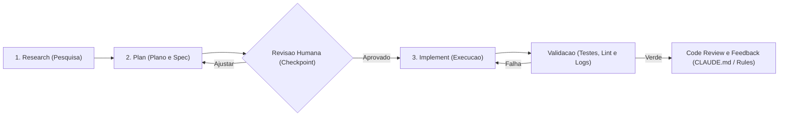
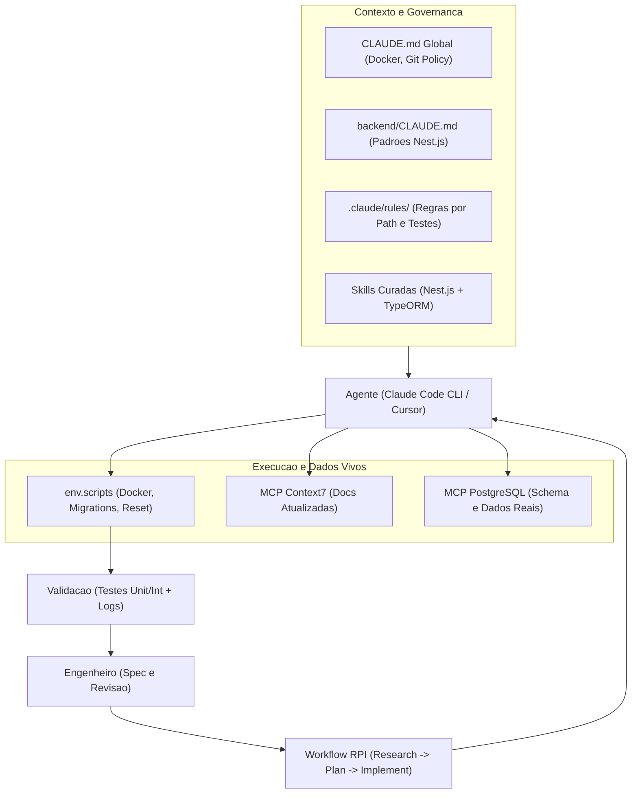

# Capítulo 5 — Desenvolvimento de Software e Aplicações com IA no Dia a Dia

> **O problema real e o modelo mental:** Usar IA apenas como chat reativo gera ganhos pontuais que se dissipam em retrabalho, exploração repetitiva do repositório e código inconsistente. Produtividade sustentável nasce quando você constrói um **sistema operacional de engenharia**: ambiente reproduzível, contrato de contexto enxuto, testes confiáveis e workflows estruturados que convertem intenção em entrega verificável.

---

## 5.1 Do Modo Reativo ao Sistema de Engenharia com IA

Desenvolver com IA desloca o centro do trabalho técnico do ato de digitar código para a capacidade de especificar, preparar o ambiente, orquestrar execuções e revisar entregas.

A diferença prática está entre o **modo reativo** e o **modo orientado por processo**:

- **Modo reativo**: pedidos soltos no chat, ambiente local ambíguo, exploração repetitiva de pastas e retrabalho contínuo para corrigir convenções esquecidas.
- **Modo orientado por processo**: intenção, arquitetura, convenções e critérios de aceite vivem em artefatos versionados. O agente opera sobre uma fundação previsível e valida alterações contra comandos determinísticos.

Nesse fluxo, a **documentação torna-se a fonte primária de verdade**. Mesmo código tecnicamente limpo falha se implementar uma especificação ambígua — a IA apenas executa o erro com mais velocidade. Revisar especificações é revisar o entendimento do produto antes da implementação.

### O Workflow RPI (Research → Plan → Implement)

Para substituir improviso por previsibilidade, tarefas não triviais seguem o ciclo **RPI** (*Research → Plan → Implement*), base operacional do *Spec-Driven Development* (aprofundado no Capítulo 4):



1. **Research**: o agente lê código existente, dependências, schemas e contratos sem editar arquivos, eliminando suposições.
2. **Plan**: gera-se um plano objetivo listando arquivos afetados, regras de negócio, *edge cases* e critérios de aceite. Esse checkpoint humano é o ponto mais barato para corrigir rumos.
3. **Implement**: após aprovação, o agente implementa em incrementos curtos, validando cada passo contra testes e logs reais.

> [!TIP]
> **Ferramentas convergem; o modelo mental permanece.** Combinar uma IDE nativa de IA (Cursor ou Windsurf) para navegação e debugging com um agente CLI (Claude Code) para automação e execuções longas é altamente produtivo. Ainda assim, quem domina especificação, delegação, isolamento de ambiente e revisão transfere essa competência entre ferramentas com atrito mínimo.

---

## 5.2 A Segunda Fundação: Preparando o Ambiente para Agentes

Práticas básicas de engenharia continuam difíceis de sustentar com IA. Quando o ambiente quebra por `.env` ausente, containers mal configurados ou comandos implícitos, o agente gasta contexto descobrindo o *bootstrap* em vez de resolver a tarefa.

Em projetos *greenfield*, o *scaffolding* oficial do framework (`create-next-app`, Nest CLI, Spring Initializr, Django) entrega apenas a **primeira fundação** (o *Hello World* que compila). Um projeto operável por agentes exige uma **segunda fundação** desde o dia zero:

1. **Contrato operacional** (`CLAUDE.md` / `AGENTS.md`): regras e comandos carregados automaticamente na sessão.
2. **Scripts executáveis**: comandos semânticos para subir, verificar, reparar, observar e resetar o ambiente.
3. **Observabilidade via CLI**: logs e processos inspecionáveis sem interface gráfica.
4. **Isolamento de portas**: suporte a múltiplas sessões paralelas sem colisão.
5. **Testes no Dia Zero**: validação pronta antes da primeira feature.

### README Operacional e Scripts como Interface Executável

Em projetos com IA, o `README.md` atua como **manual operacional**, não como vitrine. Ainda assim, texto puro deixa espaço para variação; o passo decisivo é transformar procedimentos em scripts dedicados (ex.: `env.scripts/` ou `scripts/`) nomeados pela intenção:

- **Globais**: `init-all` (copia `.env`, instala deps, sobe containers, aplica migrations/seeds e checa saúde), `status` e `down-all`.
- **Segmentados**: `back-end-init`, `back-end-down`, `front-end-status`, para operar apenas a camada alterada.
- **Recuperação e reset completo**: distinguir desligamento normal de limpeza agressiva de processos órfãos (Playwright, Jest) e reset total do ambiente.

```bash
# Interface operacional padrao para projetos conduzidos por agentes
./scripts/init.sh            # Setup completo (.env, deps, migrations, seeds, boot, health check)
./scripts/check.sh           # Verifica servidor, banco e portas
./scripts/check.sh --fix     # Encerra processos orfaos e recupera servicos degradados
./scripts/watch.sh           # Tail de logs da aplicacao para depuracao por evidencia
./scripts/watch.sh --ps      # Lista processos ativos do projeto
./scripts/down.sh            # Encerra o servidor principal
./scripts/down.sh --force    # Derruba servidor + subprocessos orfaos (Playwright, Jest, Node)
./scripts/down.sh --clean    # Reset total: remove .env.local, builds (.next/dist) e node_modules
```

> [!IMPORTANT]
> **Regra do Reset Zero:** o ambiente só está pronto para agentes quando sobe de forma reproduzível logo após `./scripts/down.sh --clean`. Dependência de estado manual acumulado gera falhas intermitentes impossíveis de depurar automaticamente.

### Paralelização Segura: `PORT_RANGE` e `tmux`

Paralelizar com IA significa executar frentes independentes simultaneamente (por exemplo, API, UI e testes em diretórios/worktrees isolados). Sem isolamento de portas, dois agentes colidem na porta `3000` e testes de uma sessão passam a validar o servidor da outra.

A solução operacional combina alocação dinâmica persistida no `.env.local` (`PORT_RANGE` + `SERVER_PORT`) com gerenciamento de sessões em background via `tmux`, garantindo que servidor, `check.sh` e testes E2E apontem para a mesma instância:

```env
# .env.local (gerado automaticamente por scripts/init.sh)
PORT_RANGE=3100-3199
SERVER_PORT=3104
APP_URL=http://localhost:3104
```

---

## 5.3 Contrato Operacional: `CLAUDE.md`, Sub-`CLAUDE.md` e Rules

Diferente do `README.md`, o arquivo de inicialização (`CLAUDE.md`, `AGENTS.md`) entra no contexto **antes da primeira ação**. Quando a equipe alterna entre harnesses, mantenha uma única fonte de verdade via link simbólico:

```bash
ln -s CLAUDE.md AGENTS.md
```

No Windows, links simbólicos exigem o *Developer Mode* ou privilégios elevados e o Git precisa de `core.symlinks=true` — caso contrário, o "link" vira um arquivo de texto com o caminho. Uma alternativa portátil é manter o conteúdo em `AGENTS.md` (lido por vários harnesses) e deixar o `CLAUDE.md` com uma única linha de importação, recurso suportado pelo Claude Code:

```markdown
@AGENTS.md
```

### Regra de Poda: O Que Entra vs. O Que Sai

Cada linha no `CLAUDE.md` custa tokens em todas as sessões e disputa atenção com regras críticas. **Só entra o que altera decisões práticas do agente e não é dedutível pelo codebase.**

- **DEVE entrar**:
  - **Resumo em uma linha**: o que o projeto faz e sua stack principal.
  - **Comandos com sintaxe completa**: execução em containers, migrations, build e testes não interativos.
  - **Convenções verificáveis**: `TypeScript strict: true`, proibição de `any`, padrões de erro.
  - **Git Policy e restrições explícitas**: *Conventional Commits*, proibição nominal de `git push --force` na `main`, `git reset --hard` e `--no-verify`.
  - **Gotchas observados na prática**: ex. rodar `alembic upgrade head` após migrations, usar MSW mocks no front-end isolado, ou evitar erros recorrentes de React/Next.js (sobrescrever `ref` do `react-hook-form`, elementos interativos dentro de `<Link>`).
  - **Ponteiros curtos** para guias detalhados sob demanda.
- **NÃO deve entrar**:
  - **Inventário volátil de arquivos, classes e funções**: o agente navega pela árvore de diretórios; listas desatualizadas induzem erro (exceção apenas para um arquivo crítico que concentra uma armadilha não óbvia).
  - **Slogans vagos**: *"use boas práticas"* ou *"escreva código seguro"* não mudam decisões.
  - **Documentação extensa de frameworks**: pertence a arquivos de referência ou servidores MCP como o Context7.

### Hierarquia de Contexto e Governança

Em projetos multi-stack, distribua o conhecimento entre camadas complementares para evitar poluição de contexto:

| Artefato | Carregamento | Papel principal | Exemplo prático |
| :--- | :--- | :--- | :--- |
| **`README.md`** | Sob demanda | Manual humano e de *bootstrap* | Arquitetura geral e ponteiros para scripts |
| **`CLAUDE.md` raiz** | Sempre na sessão | Contrato global, scripts e políticas | Stack, Docker, Git policy e gotchas globais |
| **Sub-`CLAUDE.md`** | No subdiretório alvo | Convenções locais de serviço/framework | `backend/CLAUDE.md` com padrões Nest.js |
| **`.claude/rules/`** | Sempre ou por *path* | Regras prescritivas modulares | `.claude/rules/testing.md`, `api-security.md` |
| **Skills** | Sob demanda (ou `/cmd`) | Procedimentos especializados reutilizáveis | Boas práticas TypeORM, auditoria de testes |
| **Hooks / Linters** | Determinístico | Bloqueio mecânico independente do LLM | Pre-commit contra `--no-verify`, ESLint |

Exemplo enxuto de `CLAUDE.md` raiz e regra modular em `.claude/rules/testing.md`:

```markdown
# CLAUDE.md
API REST em Nest.js + TypeORM + PostgreSQL (StreamTube) para ingestao e catalogo de videos.

## Operacao (sempre dentro do container)
- Subir / Status / Derrubar: `./env.scripts/init-all` | `./env.scripts/status` | `./env.scripts/down-all`
- Migrations: `docker compose exec api npm run migration:run`

## Testes (nao interativos)
- Unitarios: `docker compose exec api npm test -- --watchAll=false`
- Integracao (requer Postgres): `docker compose exec api npm run test:int`
- E2E UI: `npx playwright test --reporter=list`
- Durante iteracao rode testes dos arquivos alterados; rode a suite completa antes de PR.

## Git Policy e Gotchas
- NUNCA execute `git push --force`, `git reset --hard` ou `--no-verify`.
- Use Conventional Commits (`feat:`, `fix:`, `refactor:`).
- Gotcha: alteracoes em entidades TypeORM exigem migration validada antes dos testes de integracao.
```

```markdown
---
paths:
  - "backend/src/**/*.spec.ts"
  - "backend/test/**/*.ts"
---
# Regras de Testes do Backend
- Reutilize factories em `test/factories/` (`createTestUserData`, `createVideoPayload`).
- Maximo de 3 mocks por teste; acima disso, escreva teste de integracao com banco real.
- NAO teste decorators padrao do `class-validator` nem getters triviais.
```

### Travas Determinísticas: Permissões e Hooks

Instruções em Markdown **orientam**; permissões e hooks **impedem**. Para regras que não podem falhar (Git destrutivo, acesso a segredos, comandos de produção), configure travas no próprio harness. No Claude Code, isso vive em `.claude/settings.json` (versionado com o time):

```json
{
  "permissions": {
    "deny": ["Bash(git push --force:*)", "Bash(git reset --hard:*)", "Read(./.env)"]
  },
  "hooks": {
    "PreToolUse": [
      {
        "matcher": "Bash",
        "hooks": [{ "type": "command", "command": ".claude/hooks/block-dangerous-git.sh" }]
      }
    ]
  }
}
```

```bash
#!/usr/bin/env bash
# .claude/hooks/block-dangerous-git.sh - recebe o evento PreToolUse em JSON via stdin
cmd=$(jq -r '.tool_input.command // ""')
if printf '%s' "$cmd" | grep -Eq 'git .*push .*(--force|-f( |$))|git .*reset --hard|--no-verify'; then
  echo "Bloqueado pela politica do repositorio: $cmd" >&2
  exit 2  # exit 2 bloqueia a chamada e devolve a mensagem ao agente
fi
exit 0
```

Regras de permissão por prefixo são fáceis de contornar com variações de sintaxe (`git -C . push -f`), por isso o hook com expressão regular complementa o `deny`. E nenhuma das duas substitui a **última linha de defesa no servidor**: *branch protection* na `main`, revisão obrigatória e proibição de *force push* no repositório remoto valem para humanos e agentes, independentemente da ferramenta usada.

### Evolução Guiada por Erro Observado

Comandos como `/init` aceleram o primeiro rascunho do `CLAUDE.md`, mas sua qualidade vem da manutenção contínua: valide arquivos legados contra contradições antes de podá-los e, ao fim de tarefas custosas, peça ao agente uma lista concisa dos pontos em que travou. Converta falhas recorrentes em regras curtas, gotchas ou hooks — validando depois se o erro desapareceu.

---

## 5.4 Testes Automatizados na Era da IA: Qualidade Real vs. Falsa Segurança

Com agentes produzindo código em alta velocidade, **testes automatizados funcionam como o canal objetivo de comunicação com a IA**, indicando imediatamente o que funcionou e qual contrato quebrou. Sem diretrizes claras, porém, agentes inflam a suíte com testes rasos.

> [!WARNING]
> **Armadilha da cobertura como vilão:** perseguir 95% de cobertura como meta cega induz a IA a testar bibliotecas externas (Zod, Pydantic, `class-validator`), abusar de mocks acoplados à implementação e multiplicar testes triviais. O percentual sobe, mas fluxos críticos seguem desprotegidos.

### Matriz Worth vs. NOT Worth Testing

Defina critérios objetivos de valor — aplicáveis tanto na criação quanto na auditoria de suítes inchadas (via `.claude/rules/` ou Skill de *Test Guidelines* em modos **Criação** e **Auditoria**):

| Vale Testar (*Worth Testing*) | Não Vale Testar (*NOT Worth Testing*) |
| :--- | :--- |
| Fluxos críticos (autenticação, upload, permissões, quotas) | Validação padrão de bibliotecas/frameworks consolidados |
| Regras de negócio, invariantes de domínio e cálculos | CRUD trivial já coberto por testes de integração |
| Tratamento de falhas, retries e gerenciamento de estado | Renderização estática simples de componentes UI |
| *Edge cases* (limites, nulos, concorrência, estados inválidos) | Utilitários triviais de formatação e getters/setters |

Complemente essa matriz com **limites verificáveis** (máximo de testes por arquivo, máximo de mocks por teste e proporção saudável entre teste e implementação) e três práticas operacionais:

1. **Execução determinística e não interativa**: classifique suítes com marcadores (`unit`, `integration`, `slow`), explicite dependências de banco, reutilize fixtures/helpers (`conftest`, factories) e desative watchers ou relatórios ruidosos (`--watchAll=false` no Jest, `--reporter=list` no Playwright).
2. **Testes E2E de navegação com `playwright-cli`**: dê olhos ao agente na interface real (encapsulável em uma Skill E2E), validando rotas, cliques, formulários e erros de console/rede além do código estático.
3. **TDD com IA**: definir casos de teste e *edge cases* antes da implementação transforma a suíte em especificação executável — permitindo inclusive conduzir grandes refatorações e reescritas completas (como migrações de projetos Next.js guiadas por suítes robustas) com segurança verificável.

---

## 5.5 Arquitetura na Prática: A Fundação de IA no Projeto StreamTube

No desenvolvimento *greenfield* do backend **StreamTube** (Nest.js + TypeORM + PostgreSQL + Docker), aplicar a **prova dos noves com IA crua** — pedindo uma feature sem fundação configurada — expõe rapidamente os gargalos: convenções misturadas, APIs defasadas do framework, testes fora do container e desconhecimento do banco real.

Ao montar a fundação completa, todas as peças operam em conjunto:



Observe os pontos-chave dessa arquitetura:

- **Hierarquia limpa**: `CLAUDE.md` global governa Docker e políticas transversais; `backend/CLAUDE.md` detalha convenções do Nest.js.
- **Confronto entre Rules e Skills**: durante a curadoria de Skills de Nest.js e TypeORM, elimine conflitos com `.claude/rules/`. Políticas obrigatórias ficam em `rules/`; guias especializados entram como Skills sob demanda.
- **MCPs complementares**: **Context7** traz documentação atualizada de frameworks em tempo real; **PostgreSQL MCP** permite inspecionar tabelas, constraints e registros reais durante *Research* e depuração.

### Exemplo Prático de Execução RPI

```text
[RESEARCH]
Inspecione `backend/src/videos/` e o schema atual via MCP PostgreSQL.
Consulte a documentacao atual do TypeORM via Context7 para soft deletes e indices compostos.
NAO edite arquivos. Resuma entidades afetadas, dependencias e riscos.

[PLAN]
Proponha um plano para `PATCH /videos/:id/publish`:
- Regra: apenas videos em status `READY` com duracao > 0 podem ser publicados.
- Arquivos a alterar (controller, service, repository, migration).
- Casos de teste (caminho feliz + 4 edge cases conforme `.claude/rules/testing.md`).
Aguarde aprovacao antes de codificar.

[IMPLEMENT]
Plano aprovado. Implemente, execute testes unitarios e de integracao no container e apresente o resumo final.
```

---

## 5.6 Armadilhas Comuns e Trade-offs de Produção

| Decisão | Opção A | Opção B | Critério prático |
| :--- | :--- | :--- | :--- |
| **Paralelização** | Serial (1 frente) | Paralela (worktrees + portas dinâmicas) | Só paralelize tarefas com escopo, limites e entregáveis bem isolados |
| **Bootstrap greenfield** | Scaffold vanilla | Skill de bootstrap (2ª fundação) | Vanilla para protótipos descartáveis; 2ª fundação para produtos reais |
| **Regras vs. Skills** | Tudo em `CLAUDE.md` / `rules/` | Núcleo fixo + Skills sob demanda | Verdades permanentes vão em `CLAUDE.md`/`rules/`; guias pontuais em Skills |
| **Segurança operacional** | Apenas texto no prompt | Texto + Permissões/Hooks + proteção no servidor | Regras críticas (Git, segredos, arquitetura, lint) exigem trava mecânica, com a última barreira fora da máquina do agente |

> [!WARNING]
> **Quatro armadilhas que drenam produtividade em escala:**
> 1. **Automação redundante**: pedir à IA para montar o que o CLI oficial do framework ou um linter executa em segundos.
> 2. **Paralelizar sem método**: especificar mal gera retrabalho em escala; revisar mal gera bugs em escala.
> 3. **`CLAUDE.md` inchado e sem poda**: excesso de regras vagas e inventários voláteis degrada a atenção do modelo.
> 4. **Estado residual entre sessões**: containers sujos e processos órfãos de Jest/Playwright produzem falhas fantasmas.

---

## 5.7 Checklist de Aplicação Prática

- [ ] **Manual e scripts operacionais**: o repositório possui `README.md` operacional e scripts (`init`, `status`, `check --fix`, `watch`, `down --force`, `down --clean`) validados após reset total?
- [ ] **Contrato enxuto e fonte única**: `CLAUDE.md` abre com resumo em 1 linha, registra apenas regras que mudam decisões práticas (comandos exatos, Git policy, gotchas) e usa link simbólico (`AGENTS.md`) quando há múltiplos harnesses?
- [ ] **Isolamento para paralelização**: projetos web/API alocam portas em um `PORT_RANGE` persistido no `.env.local` para evitar colisões entre agentes paralelos?
- [ ] **Camadas sem contradição**: `CLAUDE.md` global, sub-`CLAUDE.md`, `.claude/rules/` e Skills curadas foram confrontados para remover regras conflitantes?
- [ ] **Testes determinísticos e seletivos**: comandos rodam sem modo interativo (`--watchAll=false`, `--reporter=list`), reutilizam fixtures oficiais e aplicam critérios de *Worth vs. NOT Worth Testing*?
- [ ] **Observabilidade e UI**: o agente consulta logs via CLI e, em projetos com front-end, valida navegação real via `playwright-cli`?
- [ ] **Travas além do texto**: comandos destrutivos estão bloqueados por permissões e hooks do harness e, em última instância, por *branch protection* no repositório remoto?
- [ ] **Feedback operacional contínuo**: dificuldades recorrentes do agente ao fim das tarefas são convertidas em ajustes cirúrgicos no `CLAUDE.md`, em regras ou em travas determinísticas?
