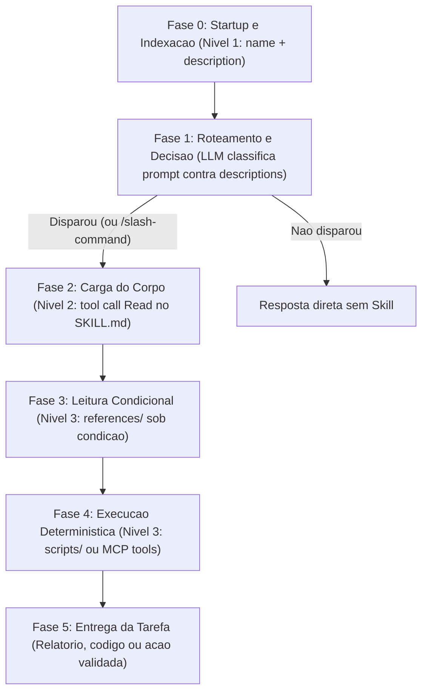
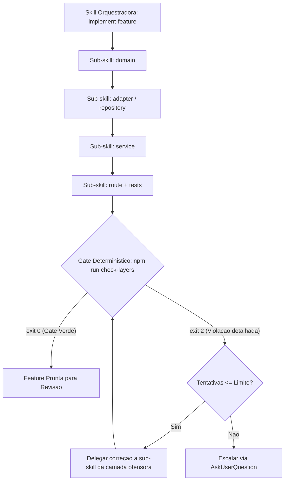

# Capítulo 6 — Agent Skills e Extensibilidade Prática

> **O problema real e o modelo mental:** A janela de contexto de um agente é finita e disputada por system prompts, `CLAUDE.md`, schemas MCP e histórico de conversa. Empilhar todos os procedimentos do time na inicialização degrada a atenção do modelo e desperdiça tokens; improvisar prompts gera resultados inconsistentes. **Agent Skills** empacotam conhecimento procedural reutilizável em módulos portáteis carregados sob demanda por **Progressive Disclosure** — governados com versionamento, segurança e testes automatizados como código de produção.

---

## 6.1 O Que É uma Agent Skill e Como o Progressive Disclosure Funciona

Uma **Agent Skill** é um pacote versionado de instruções, referências e scripts que especializa um agente em uma responsabilidade clara — como code review segundo padrões do time, auditoria de pendências, geração de UI fiel a um *design system* ou onboarding técnico de projetos.

Seguindo o padrão aberto de `agentskills.io` (e diretórios compartilháveis como `skills.sh`), a mesma Skill opera em diferentes *harnesses* — Claude Code, Codex, OpenCode ou Cursor — evitando aprisionamento a uma única ferramenta.

### Progressive Disclosure em 3 Níveis

Você consegue instalar dezenas de Skills sem sufocar o contexto porque o carregamento ocorre em camadas progressivas (como escolher um livro pela capa, depois abrir o sumário e só então ler o capítulo específico):

1. **Nível 1 — Metadados (`name` + `description`)**: sempre indexados no startup com custo mínimo de tokens. Atuam como o classificador de ativação.
2. **Nível 2 — Corpo do `SKILL.md`**: carregado sob demanda após ativação. Deve ficar enxuto (**abaixo de 500 linhas**), com instruções imperativas, checklists e critérios de aceite.
3. **Nível 3 — Referências e Scripts (`references/`, `scripts/`, `assets/`)**: carregados ou executados sob condição explícita (**Conditional Details**) apenas quando o fluxo exige documentação extensa ou execução determinística.

### Arquitetura Interna de Execução em 6 Fases

*Harnesses* como o Claude Code executam uma Skill em até seis fases (Skills simples podem pular as fases 3 e/ou 4):



Na **Fase 1**, quem decide disparar a Skill no modo autônomo é o próprio **modelo**, comparando o pedido do usuário com as `descriptions` indexadas. Por isso, a `description` é o componente mais crítico de uma Skill.

---

## 6.2 Anatomia da Skill e Engenharia de Frontmatter

Cada Skill reside em sua própria pasta (ex.: `.claude/skills/<skill-name>/`), cujo nome corresponde exatamente ao campo `name` no arquivo `SKILL.md`:

```text
.claude/skills/team-code-review/
├── SKILL.md                  # Frontmatter YAML (N1) + instrucoes enxutas (N2)
├── references/               # Guias detalhados sob demanda (N3)
│   ├── team-conventions.md
│   └── owasp-checklist.md
├── scripts/                  # Coleta e validacao deterministica (N3)
│   └── collect-staged-diff.sh
└── evals/                    # Datasets de validacao da Skill
    └── evals.json
```

### Frontmatter: Padrão Aberto vs. Extensões de Harness

| Propriedade | Escopo | Papel operacional |
| :--- | :--- | :--- |
| `name` | Padrão aberto (obrigatório) | Identificador em kebab-case igual ao nome da pasta |
| `description` | Padrão aberto (obrigatório) | Classificador semântico que define quando disparar ou ignorar |
| `allowed-tools` | Padrão aberto (experimental) | Ferramentas **pré-aprovadas** enquanto a Skill está ativa (dispensam confirmação). A semântica varia por harness: em geral **concede** permissão, não bloqueia as demais |
| `license` / `metadata` | Padrão aberto | Licença, autoria, versão e metadados de catálogo |
| `compatibility` | Padrão aberto | Pré-requisitos de ambiente (Node, Docker, Git, Python) |
| `disable-model-invocation` | Extensão (Claude Code) | Impede disparo autônomo; exige chamada explícita `/skill-name` |
| `disallowed-tools` | Extensão (Claude Code) | Ferramentas explicitamente bloqueadas durante a execução da Skill |
| `model` / `effort` | Extensão (Claude Code) | Sobrescreve modelo e esforço de raciocínio para a Skill |
| `context: fork` | Extensão (Claude Code) | Executa o corpo da Skill em um subagente isolado |

Skills podem ser acionadas por **disparo semântico** ou como **slash command** (`/team-code-review`). Para rotinas com efeitos colaterais ou controle humano obrigatório (deploy, release, reset), habilite `disable-model-invocation: true`.

### A Fórmula de 4 Partes para uma `description` Precisa

Descrições genéricas geram o anti-padrão `dev-helper` (*"ajuda com código, revisão, testes e tarefas do dia a dia"*): ela dispara falsos positivos na maioria dos prompts e compete com Skills especializadas.

Escreva a `description` em **terceira pessoa** (preferencialmente em inglês — redija em português e traduza se preferir), sempre com quatro elementos:

1. **O que faz e quando usar** (verbo direto em 3ª pessoa, nunca *"I can help..."*).
2. **Gatilhos concretos** entre aspas com frases reais usadas pela equipe.
3. **Quando NÃO usar (`Do not use`)**: fronteiras negativas contra falsos positivos.
4. **O que produz**: artefato ou formato final esperado.

```markdown
---
name: team-code-review
description: >-
  Reviews staged Git diffs against team architecture and security conventions.
  Use when the user asks to "review my changes", "check staged diff", or "run code review".
  Do not use for writing commit messages, explaining Git commands, or full module refactors.
  Produces a prioritized Markdown report (Blocker, Warning, Suggestion) with file and line evidence.
allowed-tools: Read, Grep, Bash(bash .claude/skills/team-code-review/scripts/*)
compatibility: Requires git CLI in an initialized repository.
---

# Team Code Review

## Workflow
1. Run `bash .claude/skills/team-code-review/scripts/collect-staged-diff.sh` to capture 100% of staged changes.
2. Read `references/team-conventions.md` for naming, error handling, and architecture rules.
3. **Conditional Detail**: ONLY if the diff touches auth, user input validation, SQL queries, or external HTTP calls, also read `references/owasp-checklist.md`.
4. Report only evidence-backed issues with `file:line`; tag uncertain points as `[POSSIBLE]`.
```

No passo 3, o padrão **Conditional Details** evita carregar o guia OWASP quando o diff altera apenas estilos ou documentação.

---

## 6.3 Framework de Decisão: Quando Vira Skill (e Quando Não Vira)

Antes de versionar uma nova Skill, faça a triagem central: *"Isso é conhecimento procedural reutilizável e estável o bastante para valer um arquivo versionado?"*

Aplique a **Regra dos 3 SIMs + Filtro de Segurança**:

1. **Reutilização**: repete-se ao longo dos dias, em vários prompts ou projetos?
2. **Procedimento não óbvio**: existe um *como* específico (ordem, convenções, checklist) que o modelo não acerta sozinho?
3. **Estabilidade**: a regra permanece válida por semanas ou meses?
4. **Filtro de Segurança (veto imediato)**: contém credenciais, tokens, segredos ou estado em tempo real? **Se SIM, não vira Skill** — segredos vão para variáveis/cofres e dados vivos vêm de tools/MCP em tempo de execução.

### Resolvendo a Zona Cinzenta

| Necessidade | Mecanismo ideal | Critério técnico |
| :--- | :--- | :--- |
| Verdade permanente do projeto (ex.: *"responder em PT-BR"*, comandos Docker) | `CLAUDE.md` / `AGENTS.md` | Leitura garantida em 100% das sessões; Skill pode não disparar |
| Regra puramente mecânica (indentação, espaços vs. tabs, imports) | Linter / Formatter | Determinístico e instantâneo; a Skill pode *invocar* o linter, não substituí-lo |
| Dados vivos externos (issues abertas, schema do banco, docs atuais) | Servidor MCP / Tools | Estado volátil não deve ser congelado em Markdown |
| Procedimento repetível, não óbvio e estável | **Agent Skill (N2 ou N3)** | Carrega o *como* sob demanda sem inflar o contexto base |

Se virou Skill, escolha o nível: **Nível 2** apenas quando o procedimento curto em Markdown basta; **Nível 3** sempre que houver convenções extensas (`references/`) ou coleta/validação que exija garantia determinística (`scripts/`).

---

## 6.4 Determinismo, Orquestração e Subagents em Skills Avançadas

LLMs são **não determinísticos**. Se uma Skill pedir via texto para *"encontrar todos os `TODO` e `FIXME`"* ou *"listar arquivos sem `.spec.ts`"*, o modelo pode varrer apenas parte do projeto e responder com confiança.

Em Skills de produção, separe responsabilidades:

- **Script determinístico (`scripts/`)**: garante 100% de cobertura na coleta ou validação (busca de marcadores, arquivos sem teste, `git diff`, análise estática de camadas).
- **LLM (`SKILL.md`)**: interpreta os dados completos, prioriza severidades (Alta/Média/Baixa), explica impacto e produz recomendações ou correções.

### Orquestração de Sub-skills e Gate Arquitetural com Auto-correção

Respeitar **uma Skill = uma responsabilidade** permite compor uma **Skill orquestradora** sobre **sub-skills** por camada, combinando três níveis de customização (fundamentos + framework + convenções do time).

Na Skill `implement-feature`, a orquestradora delega a implementação *bottom-up* (`domain` → `adapter` → `repository` → `service` → `route` → `tests`) e fecha com um **gate arquitetural determinístico** (`npm run check-layers` baseado em regras customizadas de ESLint):



Quando uma rota importa indevidamente `src/domain` ou `src/repository`, o script encerra com **`exit 2`** imprimindo um bloco estruturado: **regra violada**, **arquivo e linha**, **import ofensor**, **por que viola** e **como corrigir**. Esse diagnóstico aciona o loop de auto-correção na sub-skill correspondente até `exit 0`, reforçado no `CLAUDE.md` pela regra de que nenhuma feature está concluída sem gate verde.

### Skills Disparando Subagents em Paralelo

Para análises extensas de código (como onboarding ou atualização de documentação), executar tudo no contexto principal esgota rapidamente a janela. Skills avançadas aplicam o padrão *fan-out / fan-in* lançando **subagents em paralelo**, cada um com contexto isolado.

Os perfis típicos (com nomes variando por CLI; no Claude Code) são:

- **Explore**: somente leitura, usa modelo rápido e econômico (como Haiku) para varreduras e mapeamentos velozes.
- **Plan**: somente leitura (sem edição), herda o modelo principal para pesquisa e desenho de arquitetura.
- **General Purpose**: acesso completo (leitura/escrita) para fluxos multi-etapa.

Na Skill `mapping-project`, o passo 1 divide o repositório em frentes independentes (*Arquitetura*, *Dados*, *Testes*, *Build/CI* e *Segurança*); o passo 2 dispara subagents `Explore` concorrentemente, cada um devolvendo apenas um resumo enxuto com caminhos, linhas e 1–2 riscos; o passo 3 sintetiza tudo no contexto principal em um mapa unificado do repositório.

---

## 6.5 Integrando Skills com Servidores MCP

A fronteira entre Skill e MCP é direta: **Skill define o COMO** (procedimento estável); **MCP fornece a PORTA** (acesso a dados vivos e sistemas externos).

Em uma Skill de triagem de issues (`issue-triage`), as issues abertas nunca entram no Markdown — são lidas em tempo de execução via **GitHub MCP** containerizado em Docker com transporte `stdio` e um *Fine-Grained Personal Access Token* no `.env` restrito à leitura de *Issues*:

```yaml
# docker-compose.yml (GitHub MCP server via stdio)
services:
  gh-mcp:
    image: ghcr.io/github/github-mcp-server:latest
    stdin_open: true
    tty: false
    environment:
      GITHUB_PERSONAL_ACCESS_TOKEN: ${GITHUB_PERSONAL_ACCESS_TOKEN}
    command: ["stdio"]
```

Em produção, troque `:latest` por uma **versão fixa ou digest** (`@sha256:...`): uma atualização silenciosa da imagem pode mudar o catálogo de tools expostas ao agente sem passar por revisão.

Registre o MCP no **escopo de projeto** (gerando `.mcp.json` compartilhável sem credenciais):

```bash
claude mcp add github --scope project -- docker compose run --rm -i gh-mcp
```

Na Skill `issue-triage`, aplique duas proteções:

1. **Princípio do menor privilégio**: entre dezenas de tools expostas pelo GitHub MCP, pré-aprove em `allowed-tools` apenas `mcp__github__list_issues`, `mcp__github__get_issue` e `mcp__github__search_issues`. Como `allowed-tools` concede permissão em vez de restringir, a barreira real está em duas outras camadas: o **token com escopo mínimo** (somente leitura de *Issues*) e as regras `deny` do harness para tools de escrita do servidor (como criação de issues ou merge de PRs).
2. **Instrução explícita de uso do MCP**: cite o servidor MCP no passo a passo para evitar que o modelo desvie para `gh` CLI ou `curl`.

---

## 6.6 Avaliação (Evals) de Skills: Skill Creator, Triggers e Promptfoo no CI/CD

Tratar Skills como código exige **evals automatizados**, pois o disparo e a qualidade variam conforme edições na `description`, atualizações de modelo ou troca de *harness*. Avalie sempre duas dimensões: **trigger** (dispara quando deve e silencia quando não deve) e **qualidade da saída**.

### Otimização de Triggers com Split 60% Treino / 40% Holdout

No fluxo de avaliação do *Skill Creator*, um dataset com consultas `should_trigger` e `should_not_trigger` é dividido em **~60% treino** (usado para diagnosticar falhas e reescrever a `description`) e **~40% holdout** (mantido oculto para validar generalização em pedidos inéditos sem *overfitting*). O relatório mede **Accuracy**, **Precision** e **Recall**, guiando refinamentos baseados em evidência.

### Avaliação Multimodelo e CI/CD com Promptfoo

Para validar a mesma Skill em **múltiplos modelos** e executá-la automaticamente em **CI/CD** a cada Pull Request, utilize o **Promptfoo** (`npx promptfoo@latest init`). Quando testar com o SDK do Claude Code, instale `@anthropic-ai/claude-agent-sdk` e configure `promptfooconfig.yaml`:

```yaml
description: "Eval da skill issue-triage (trigger + qualidade)"

prompts:
  - "{{prompt}}"

providers:
  - id: anthropic:claude-agent-sdk
    config:
      apiKey: ${ANTHROPIC_API_KEY}
      model: claude-sonnet-4-6
      working_dir: "."
      setting_sources: ["project"]
      allowed_tools: ["Read", "mcp__github__list_issues", "mcp__github__get_issue"]
      permission_mode: acceptEdits

tests:
  - description: "Pergunta generica de Git NAO deve disparar a skill"
    vars:
      prompt: "Qual a diferenca entre git merge e git rebase?"
    assert:
      - type: llm-rubric
        metric: no_false_trigger
        value: "Responde sobre merge e rebase sem listar issues nem acionar o GitHub MCP."

  - description: "Pedido de triagem DEVE disparar a skill e priorizar bugs"
    vars:
      prompt: "Faca a triagem das issues abertas no repositorio e priorize os bugs criticos."
    assert:
      - type: contains
        value: "Prioridade"
      - type: llm-rubric
        metric: triage_quality
        value: "Agrupa as issues por prioridade com justificativa baseada nos dados retornados."
```

Rode evals que executam ferramentas (como `permission_mode: acceptEdits`) apenas em ambiente descartável — container ou cópia do repositório —, nunca sobre o diretório de trabalho real. Execute com `npx promptfoo eval` e visualize resultados em `npx promptfoo view`, acompanhando **métricas agregadas** (*pass rate*, *threshold*, score ponderado, custo em USD, tokens e latência) e dois tipos de *assertions*:

- **Determinísticas**: `contains`/`not-contains`, validação de schema/estrutura, lógica/código e similaridade lexical.
- **Model-graded**: `llm-rubric`, `g-eval` (raciocínio estruturado), `factuality`, `similar` (embeddings), `select-best` (compara saídas entre múltiplos modelos) e `moderation`.

> [!WARNING]
> **Segurança e governança em Skills de terceiros:** uma Skill é, na prática, **instrução e código executados com as permissões do agente** — equivale a instalar uma dependência com acesso ao seu terminal. Nunca instale uma Skill externa sem auditar `SKILL.md`, cada arquivo em `references/` (instruções maliciosas podem estar escondidas em texto aparentemente inofensivo) e cada script em `scripts/`. Fixe a versão auditada (commit hash), mantenha `allowed-tools` mínimo, versione todas as Skills no Git e exija revisão por PR + passagem nos evals antes do merge.

---

## 6.7 Checklist de Aplicação Prática

- [ ] **Triagem rigorosa**: cada candidata passou pela regra dos 3 SIMs (reutilização, procedimento não óbvio, estabilidade), pelo filtro de segurança (zero segredos/estado vivo embutido) e não pertence melhor a `CLAUDE.md`, linter ou MCP?
- [ ] **Progressive Disclosure disciplinado**: o `SKILL.md` tem menos de 500 linhas, delega guias pesados para `references/` sob *Conditional Details* e move varreduras/validações críticas para `scripts/` determinísticos?
- [ ] **Frontmatter como classificador**: a `description` está em 3ª pessoa, contém gatilhos concretos entre aspas, define fronteiras `Do not use` e descreve a saída esperada?
- [ ] **Invocação controlada e menor privilégio**: ações sensíveis definem `disable-model-invocation: true`, `allowed-tools` pré-aprova apenas o estritamente necessário e o bloqueio real vem de tokens com escopo mínimo e regras `deny` do harness?
- [ ] **Gates determinísticos em orquestrações**: Skills que geram código encerram com validador determinístico (ex.: `check-layers` com `exit 2` detalhado) em loop de auto-correção com teto de tentativas?
- [ ] **Contexto limpo via subagents**: análises extensas de codebase disparam subagents isolados (`Explore`) em paralelo para proteger a janela principal?
- [ ] **Skills testadas como código**: toda alteração passa por Git/PR e roda evals de trigger (treino/holdout) e qualidade multimodelo no Promptfoo integrados ao CI/CD?
