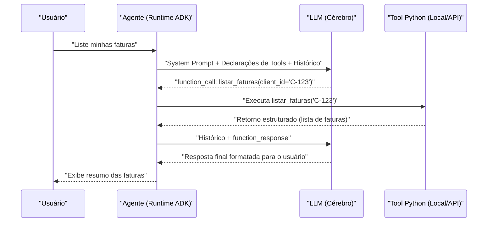
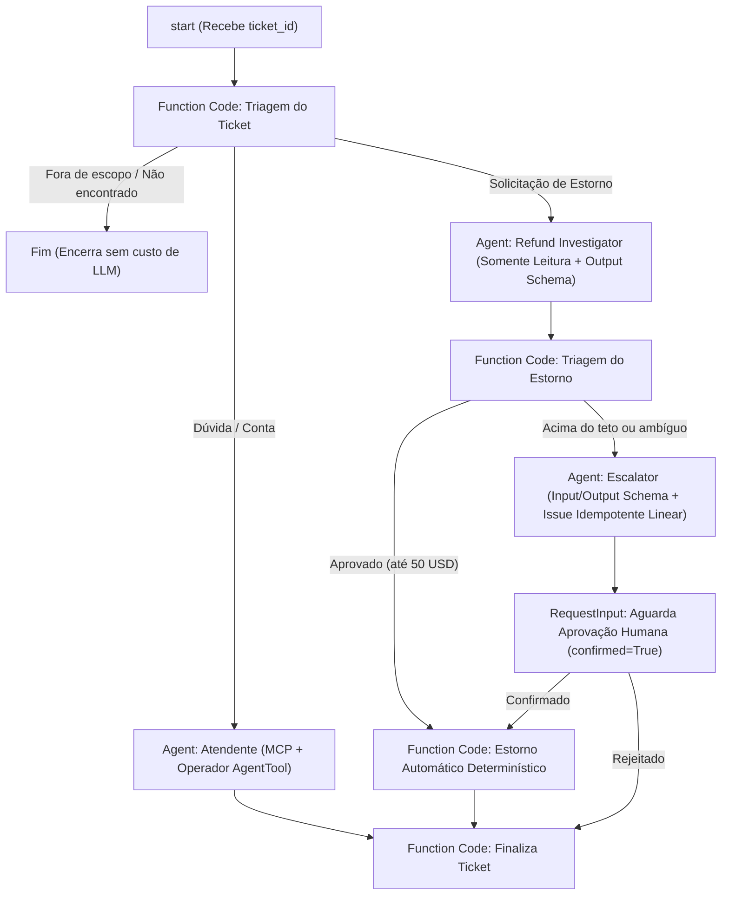

# Capítulo 8 — Desenvolvimento de Agentes com IA

> **O problema real e o modelo mental:** Um chatbot tradicional recebe uma pergunta e devolve texto; um **agente de IA** opera em loop autônomo — raciocina, consulta sistemas externos, interpreta retornos e decide o próximo passo até concluir um objetivo. O modelo mental fundamental é separar papéis: **a LLM é o cérebro que decide, mas nunca executa nada diretamente**; o **runtime do agente é o chão de fábrica** que chama funções, valida contratos, gerencia sessões e impõe limites determinísticos.

---

## 8.1 O Que Define um Agente e uma Aplicação Agêntica

Antes de escrever a primeira linha de código, duas definições evitam erros de arquitetura e de produto:

- **Agente de IA:** um componente de software no qual um modelo de linguagem controla iterativamente o fluxo de execução — decidindo chamar ferramentas (banco de dados, APIs, sistema de arquivos, busca web), avaliando os resultados obtidos e repetindo o ciclo até encerrar a tarefa.
- **Aplicação com fluxos agênticos vs. Aplicação agêntica:** incorporar um agente em um sistema web, CLI ou desktop existente significa adicionar um *componente agêntico* (assim como se adiciona banco de dados, cache ou mensageria). Já uma **aplicação agêntica** tem os agentes como núcleo inseparável do produto: se você remove os agentes, o produto deixa de funcionar.

> [!TIP]
> **Fundamento antes da automação:** Na engenharia de agentes, compreender manualmente o ciclo de execução (tools, sessões, estado e grafos) consolida o conhecimento crítico que permite auditar código gerado por IA. Frameworks agênticos evoluem rapidamente; sem domínio dos fundamentos, fica impossível detectar quando um assistente gera padrões depreciados ou falhas sutis de estado.

### Estrutura base com Google ADK

O **Google ADK (Agent Development Kit)** — estruturado em Python 3.12+ (preferencialmente em ambiente Unix/WSL com `venv` e tipagem estrita) — organiza agentes por convenção de pastas: um módulo contendo `__init__.py` e `agent.py` exportando `root_agent` (ou definição declarativa em `root_agent.yaml`).

```python
# agents/operador_conta/agent.py
from google.adk.agents import Agent

root_agent = Agent(
    name="operador_conta",
    model="gemini-2.5-flash",
    description="Auxilia o cliente a gerenciar sua conta, faturas e assinaturas.",
    instruction=(
        "Você é um operador de conta objetivo e cordial. "
        "Use as ferramentas disponíveis para consultar faturas ou cancelar assinaturas "
        "sempre validando o identificador do cliente."
    ),
    tools=[],
)
```

Embora o ADK integre nativamente os modelos **Gemini** (via Google AI Studio ou Vertex AI), também suporta modelos de outros provedores por meio do **LiteLLM**. Durante o desenvolvimento, a CLI oferece dois comandos essenciais: `adk run` (execução rápida em terminal) e **`adk web`** (interface Developer UI no navegador para inspecionar *traces*, eventos, payloads enviados à LLM, chamadas de tools, consumo de tokens e estado da sessão).

---

## 8.2 Tools: O "Chão de Fábrica" do Agente

Uma **Tool** é uma função Python que o agente expõe ao modelo para interagir com o mundo externo. O fluxo de execução nunca acontece dentro da LLM:



### Anatomia de uma boa Tool

No ADK, o nome da função, a tipagem dos parâmetros e a **docstring** são serializados e enviados diretamente como contexto para a LLM. Uma assinatura mal escrita gera invocações incorretas mesmo com um bom *system prompt*.

Siga cinco regras práticas ao projetar tools:

1. **Nomes sugestivos e docstrings precisas:** explique claramente o propósito, pré-condições e significado de cada argumento.
2. **Parâmetros primitivos e desnormalizados:** prefira `str`, `int`, `float`, `bool`, `list` ou `dict` simples em vez de objetos complexos aninhados.
3. **Retornos estruturados e explícitos:** devolva dicionários consistentes (por exemplo, `{"status": "ok", "data": ...}` ou `{"status": "error", "message": ...}`).
4. **Tratamento defensivo de erros sem vazamento:** diferencie erros de validação/negócio (`ValueError`) de falhas internas (SQL, rede, exceções inesperadas). Registre o detalhe técnico no log, mas **nunca exponha SQL, stack traces ou detalhes de infraestrutura para a LLM ou para o usuário**.
5. **Tool Confirmation para ações sensíveis:** operações destrutivas ou irreversíveis (como cancelar uma assinatura ou movimentar saldo) devem exigir confirmação humana explícita — podendo inclusive ser condicional a regras de negócio ou solicitar campos adicionais no payload de confirmação.

```python
import logging
from typing import Any

logger = logging.getLogger(__name__)

def listar_faturas(client_id: str, apenas_pendentes: bool = False) -> dict[str, Any]:
    """Lista as faturas de um cliente específico.

    Args:
        client_id: Identificador único do cliente (ex.: 'C-123').
        apenas_pendentes: Se True, retorna somente faturas em aberto.

    Returns:
        Dicionário com status da operação e lista de faturas encontradas.
    """
    try:
        if not client_id.strip():
            raise ValueError("O identificador do cliente (client_id) é obrigatório.")
        faturas = buscar_faturas_repositorio(client_id, apenas_pendentes)
        return {"status": "ok", "faturas": faturas}
    except ValueError as err:
        return {"status": "error", "message": str(err)}
    except Exception:
        logger.exception("Falha interna ao consultar faturas do cliente %s", client_id)
        return {"status": "error", "message": "Não foi possível consultar as faturas no momento."}
```

---

## 8.3 Subagents, Delegação e Modos de Execução

Quando um agente acumula muitas responsabilidades, ferramentas e instruções conflitantes, o contexto cresce e a precisão cai. **Subagents** permitem dividir o sistema em especialistas menores — possibilitando usar modelos mais econômicos para tarefas simples, isolar instruções e reduzir o consumo de tokens em escala.

> [!WARNING]
> **Armadilha Comum — Subagentes prematuros:** Não comece dividindo um fluxo simples em cinco subagentes. Comece com um único agente bem projetado, meça seu comportamento no `adk web` e só extraia subagentes quando houver evidência concreta de conflito de contexto, necessidade de especialização de modelo ou paralelismo.

### Autoflow, `description` e travas de transferência

Ao declarar `sub_agents` em um coordenador, o ADK habilita o **Autoflow** por meio da tool embutida `transfer_to_agent`. O roteamento natural depende criticamente da propriedade **`description`** de cada agente: ela deve ser uma **frase curta que descreve capacidades** (para delegação), sem repetir ou contradizer o `instruction` (System Prompt).

Para impedir ping-pong indesejado entre agentes, o ADK fornece travas explícitas:
- **`disallow_transfer_to_parent=True`:** impede que um subagente devolva o controle arbitrariamente ao coordenador.
- **`disallow_transfer_to_peers=True`:** impede transferências laterais diretas entre subagentes irmãos, forçando a passagem pelo coordenador.

### Modos de execução vs. `AgentTool`

Escolher corretamente como o coordenador aciona um especialista define quem detém o controle da conversa e quanto histórico é compartilhado:

| Estratégia | Controle da Conversa | Sessão e Histórico | Quando Utilizar |
| :--- | :--- | :--- | :--- |
| **`mode="chat"`** (padrão) | Transferido ao subagente | Compartilhada na mesma sessão | Especialista precisa conversar livremente em múltiplos turnos com o usuário |
| **`mode="single_turn"`** | Permanece no coordenador | Compartilhada (rastreabilidade transparente) | Subagente executa uma única ação/consulta e devolve o resultado imediatamente |
| **`mode="task"`** | Subagente assume até `finish_task` | Compartilhada até conclusão | Tarefa multi-etapa (pode usar tools e pedir dados ao usuário) com devolução explícita ao final |
| **`AgentTool`** | Permanece no coordenador | **Isolada** (subagente atua como tool) | Deseja encapsular pesquisa/execução pesada sem poluir a janela de contexto do coordenador (economia de tokens) |

---

## 8.4 Runtime do ADK: App, Runner, Sessions, State, Hooks e Plugins

`adk run` e `adk web` são ferramentas exclusivas de desenvolvimento e depuração. Em produção — seja em uma CLI, worker ou API **FastAPI** — a aplicação instancia explicitamente os componentes do runtime do ADK:

1. **`App`:** o *blueprint* da aplicação, agrupando o `root_agent` e configurações transversais como **Plugins**.
2. **`SessionService`:** repositório de sessões (`create_session`, `get_session`, `list_sessions`, `delete_session`). Use `InMemorySessionService` apenas em dev/testes; em produção, adote `DatabaseSessionService` (SQLite/PostgreSQL) ou serviços gerenciados como Vertex AI.
3. **`Runner`:** orquestra cada invocação ligando o `App` ao `SessionService`. A cada turno, o runtime monta um **`InvocationContext`** efêmero contendo *system prompt*, tools e o histórico de eventos da sessão.

### Padrão `async/await`, Event Loop e Async Generators

O método `runner.run_async(...)` não retorna um array pronto; ele retorna um **async generator** que emite eventos incrementalmente via `yield` dentro do *event loop* do Python, permitindo alta concorrência em operações bloqueantes de I/O (chamadas HTTP às LLMs e bancos de dados).

```python
from fastapi import Depends, FastAPI
from pydantic import BaseModel, Field
from google.adk.agents.run_config import RunConfig
from google.adk.apps import App
from google.adk.runners import Runner
from google.adk.sessions import DatabaseSessionService
from google.genai import types

APP_NAME = "suporte_app"
app_adk = App(name=APP_NAME, root_agent=root_agent)
session_service = DatabaseSessionService(db_url="sqlite:///./sessions.db")  # Em producao: PostgreSQL
runner = Runner(app=app_adk, session_service=session_service)
api = FastAPI()


class ChatRequest(BaseModel):
    message: str = Field(min_length=1, max_length=4000)


def current_user_id() -> str:
    """Extrai o usuario do token ja validado (JWT/OAuth). Nunca aceite user_id como parametro livre."""
    raise NotImplementedError


@api.post("/chat/{session_id}")
async def chat(session_id: str, body: ChatRequest, user_id: str = Depends(current_user_id)):
    # A busca e escopada pelo user_id autenticado: um usuario nao acessa a sessao de outro
    session = await session_service.get_session(app_name=APP_NAME, user_id=user_id, session_id=session_id)
    if session is None:
        session = await session_service.create_session(app_name=APP_NAME, user_id=user_id, session_id=session_id)

    content = types.Content(role="user", parts=[types.Part(text=body.message)])
    final_text = ""

    # Sempre percorra o async generator ate o fim para evitar fechamento precoce/vazamento de recursos
    async for event in runner.run_async(
        user_id=user_id,
        session_id=session.id,
        new_message=content,
        run_config=RunConfig(max_llm_calls=20),  # Teto deterministico contra loops de tool calling
    ):
        if event.is_final_response() and event.content and event.content.parts:
            final_text = event.content.parts[0].text or ""

    return {"response": final_text}
```

Três decisões nesse endpoint são de segurança e operação, não de estilo: o `user_id` vem do **token autenticado** (aceitá-lo como parâmetro permitiria ler a sessão de outra pessoa apenas trocando o valor — um IDOR clássico); a sessão é **buscada ou criada** explicitamente, porque o `Runner` não cria sessões inexistentes; e o `RunConfig` impõe um **teto de chamadas ao modelo** por invocação, transformando um loop agêntico descontrolado em erro previsível em vez de fatura inesperada. Assinaturas exatas variam entre versões do ADK — confira a documentação da versão fixada no projeto.

> [!WARNING]
> **Armadilha Comum — `return` dentro de `async for`:** Evite interromper abruptamente o loop sobre `runner.run_async(...)` com um `return` precoce. Armazene a resposta em uma variável e deixe o *async generator* encerrar naturalmente para evitar avisos de limpeza e vazamento de recursos.

### Tríade Session, Events e State (com namespaces e idempotência)

Toda sessão é composta por uma linha do tempo de **Events** (mensagem do usuário, `tool_call`, `tool_response`, resposta do modelo) e por um dicionário de **State**, atualizado progressivamente pelos **State Deltas** anexados aos eventos. O state pode ser interpolado diretamente no *system prompt* usando `{nome_da_chave}`.

O ciclo de vida de cada chave é controlado por **namespaces**:

| Namespace | Escopo de Vida | Caso de Uso Ideal |
| :--- | :--- | :--- |
| **`chave`** (convencional) | Dura toda a sessão atual | Contexto da conversa em andamento (ex.: `customer_id`, `ticket_id`) |
| **`temp:chave`** | Vive **apenas na invocação/turno atual** e é descartado ao responder | Dados intermediários entre classificador e tool (ex.: `temp:ticket_classification`) |
| **`user:chave`** | Persiste entre **várias sessões** do mesmo usuário | Preferências e memória de longo prazo do cliente |
| **`app:chave`** | Compartilhado globalmente pela aplicação | Configurações e flags transversais do sistema |

Usar `temp:` é decisivo para segurança comportamental e **idempotência**. Em um fluxo de abertura de chamados, se a saída do classificador ficasse salva em state convencional, o modelo poderia pular a classificação em uma segunda mensagem na mesma sessão e registrar o novo chamado usando a classificação antiga — ou duplicar registros durante um loop de retry. Combinando `temp:` state, chaves idempotentes no banco e validação de contrato via **`output_schema`** e **`input_schema`** (Pydantic), elimina-se tanto a contaminação entre turnos quanto a duplicação de operações.

> [!NOTE]
> **Atenção prática com `output_key`:** Quando subagentes operam em modo `single_turn` ou `task` (encerrando com `finish_task`), o `output_key` pode não ser gravado automaticamente no *state delta* do evento esperado. Verifique sempre os eventos no `adk web` ao modelar a passagem de estado entre subagentes.

### Hooks e Plugins

O ADK dispara **Hooks** ao longo do ciclo de vida (`on_user_message`, `before_run`, `before_agent`, `after_agent`, `before_model`, `after_model`), permitindo interceptar métricas, registrar erros ou até curto-circuitar chamadas à LLM no `before_model` (por exemplo, retornando uma resposta imediata de cache ou bloqueio de política).

Em vez de espalhar callbacks diretamente dentro de cada agente, agrupe-os em **Plugins** — classes reutilizáveis registradas no `App`. O `Runner` propaga o plugin automaticamente para todos os agentes da árvore, mantendo os agentes desacoplados e testáveis de forma isolada.

---

## 8.5 Workflows Baseados em Grafos: Determinismo + Não-Determinismo

No **ADK 2.0** (APIs de workflow ainda em evolução rápida — fixe a versão e valide cada exemplo contra a documentação instalada), padrões rígidos da v1 (como agentes sequenciais, paralelos e de loop isolados) evoluíram para **Graph-Based Agent Workflows**. O princípio arquitetural aqui é o divisor de águas entre um protótipo frágil e um sistema de produção:

- **Use código determinístico** para tudo o que exige previsibilidade, auditoria e regras estritas (triagem inicial, limites financeiros, gravação em banco, roteamento condicional).
- **Use agentes (não-determinismo)** apenas onde há interpretação de linguagem natural, investigação de evidências ou síntese de resposta.

### Anatomia do Grafo no ADK

Todo workflow parte obrigatoriamente de um nó `start` e conecta quatro tipos de nós, nos quais a saída de um nó flui como entrada do próximo e desvios de rota são sinalizados por `EventActions`:

1. **Function Code (determinístico):** função Python pura para triagem, validações de regras de negócio, acesso direto ao banco e roteamento.
2. **Tool (determinístico):** execução direta de ferramenta sem gastar chamada de LLM.
3. **Agent (não-determinístico):** nó que invoca um LLM para investigar, classificar ou atender (podendo inclusive consumir ferramentas externas via **MCP — Model Context Protocol** e subagentes como `AgentTool`).
4. **Human Input / `RequestInput` (determinístico de pausa):** suspende explicitamente o grafo aguardando entrada ou aprovação humana antes de prosseguir.

### Estudo de Caso: Sistema Completo de Resolução de Chamados

O diagrama abaixo ilustra a arquitetura de produção de um fluxo de **Ticket Resolution** combinando triagem determinística, atendimento com MCP, investigação agêntica de estorno e aprovação humana (*Human-in-the-Loop*):



Observe a separação rigorosa de responsabilidades nesse desenho:

- **O agente investigador (`Refund Investigator`) nunca altera o estado do sistema:** ele apenas analisa faturas e emite um parecer estruturado (decisão `refund` ou `escalate`, valor, itens envolvidos e `reasoning` para auditoria humana).
- **A movimentação financeira é 100% determinística:** um nó `function_code` aplica a regra de teto financeiro e executa o estorno — o modelo jamais tem autonomia direta para transferir dinheiro acima da política.
- **Escalonamento idempotente com pausa explícita:** o `Escalator Agent` (blindado com `input_schema` e `output_schema`) abre a pendência no sistema de gestão (ex.: Linear) de forma idempotente (`created`, `reused` ou `failed`), e o nó **`RequestInput`** suspende o fluxo até a confirmação humana via API/webhook.

> [!IMPORTANT]
> **Limitação prática em Workflows (ADK 2.x):** Usar `tool_confirmation` dentro de um agente embutido em um Workflow pode não preservar corretamente o estado da pausa entre turnos. Sempre que precisar pausar um grafo para aprovação humana, extraia a decisão para um nó explícito **`RequestInput`** no próprio workflow.

---

## 8.6 Desenvolvendo Agentes com Apoio de IA Sem Gerar Código Obsoleto

Depois de dominar os fundamentos, usar assistentes de codificação acelera drasticamente a construção de agentes — mas exige disciplina para evitar que o modelo gere APIs depreciadas (como classes da v1 do ADK ou assinaturas antigas de LangGraph):

1. **Forneça documentação atualizada como fonte de verdade:** fixe a versão do framework no `pyproject.toml`/lockfile, registre-a no `CLAUDE.md` ("usamos `google-adk==X.Y`; não use APIs da v1") e mantenha a documentação dessa versão exata em uma pasta local `docs/` ou aponte o assistente para o índice oficial (ex.: `llms.txt`) / servidor MCP de documentação sob demanda.
2. **Mantenha o arquivo de instruções do projeto enxuto (`CLAUDE.md`):** concentre apenas convenções globais e arquitetura do repositório; arquivos de memória gigantes poluem o contexto em todas as tarefas.
3. **Empacote regras específicas em Skills:** coloque padrões detalhados de criação de tools, workflows e schemas em *skills* carregadas apenas quando o agente estiver trabalhando naquele escopo.
4. **Deixe o interpretador ser o juiz:** exija que todo código gerado seja importado e exercitado por testes contra a versão instalada (`pytest` + um teste de fumaça que instancia `App` e `Runner`). APIs inventadas ou depreciadas falham em segundos no teste — e passariam despercebidas numa revisão apenas visual.

---

## 8.7 Checklist de Aplicação Prática

- [ ] **Ambiente e estrutura padronizados:** configurar Python 3.12+ em ambiente Unix/WSL com `venv`, tipagem estrita e estrutura de módulos do ADK (`__init__.py` + `agent.py` com `root_agent`).
- [ ] **Tools bem contratadas e seguras:** usar nomes claros, docstrings completas, parâmetros primitivos, retornos estruturados, logs internos sem vazamento de stack trace/SQL e `tool_confirmation` em ações sensíveis.
- [ ] **Subagentes somente com justificativa:** começar com agente único, validar no `adk web`, escrever `description` focada em capacidades e escolher conscientemente entre `chat`, `single_turn`, `task` e `AgentTool` (além de travas `disallow_transfer_to_*` quando necessário).
- [ ] **Runtime pronto para produção:** substituir `adk run`/`adk web` por `App` + `Runner` + `DatabaseSessionService` (ou serviço gerenciado), obter o `user_id` do token autenticado, buscar ou criar a sessão explicitamente, limitar chamadas ao modelo por invocação (`max_llm_calls`) e consumir `run_async` completamente sem `return` precoce.
- [ ] **Gestão correta de State e idempotência:** usar `temp:` para dados efêmeros de turno (como classificações intermediárias), `user:` para memória entre sessões, `output_schema`/`input_schema` com Pydantic e chaves idempotentes no banco.
- [ ] **Observabilidade e políticas via Plugins:** encapsular hooks (`before_model`, `after_agent`, logging/métricas) em classes de Plugin registradas no `App` para manter os agentes desacoplados e testáveis.
- [ ] **Workflows híbridos (determinístico + agêntico):** usar grafos do ADK 2.0 deixando triagem, regras financeiras e escritas críticas em nós `function_code`, reservando agentes para análise/atendimento e modelando aprovações humanas com `RequestInput`.
